# BioTube-Insertion-VLA-IsaacLab

### 지름 30 mm 튜브를 31 mm 구멍에 꽂을 수 있을까? — 바이오 실험 튜브 정밀 삽입을 위한 Sim-to-Real VLA (Franka FR3 · FAIRINO FR5, Isaac Sim / Isaac Lab)

[English](README_EN.md) · [목차](#목차) · 수식 정리: [docs/math_ko.md](docs/math_ko.md) · 공식 정리본: [BioRoboticsIsaacSim / sim_isaac](https://github.com/SungjinDavidLee/BioRoboticsIsaacSim/tree/main/sim_isaac)

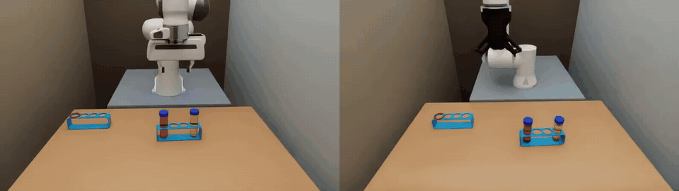

같은 장면(1103-27)을 두 로봇이 각자의 실험대 카메라로 수행한 짝 시연입니다. 1배속 영상(3인칭 · 손목): [demo_pair_scene27.mp4](figures/demo_pair_scene27.mp4)

> **최근 소식**
> - 2026-11-20 · 진행 기록 (11-10 \~ 11-19): [보고서 5 — 본 벤치와 중단](docs/report05_main_bench_stop/README.md) · [보고서 6 — 개선 실험](docs/report06_improve_1112_1113/README.md) · [보고서 7 — sim-to-real 전환과 1,000 판 데이터](docs/report07_sim2real_1000/README.md) · [보고서 8 — FR5 가까운 튜브 버릇 · DAgger · FR3 높게 닫음](docs/report08_dagger_1114_1116/README.md) · [보고서 9 — FR5 영상 형식 · DAgger 다시 · 실물과 같은 수식 · 약점](docs/report09_final_1116_1119/README.md)
> - 2026-11-16 · [보고서 4 — 시뮬 벤치 결과: FR3 · FR5 VLA 단독 · DAgger · 수식 마무리](docs/report04_sim_bench/README.md) ([FR5](docs/report04_sim_bench/fr5/README.md) · [FR3](docs/report04_sim_bench/fr3/README.md))
> - 2026-11-10 · [보고서 3 — 실물 설정으로 다시 모은 짝 시연: 수학 모델의 확률 · 정확성, 실물 형식 변환, 실물 데이터와 비교](docs/report03_realmatched_data/README.md)
> - 2026-11-06 · [보고서 2 — 시연 100개로 학습한 GR00T: 벤치마크 결과, 수집 설정 실수와 고칠 방향](docs/report02_vla100_bench/README.md) · 개발 기록 [docs/12](docs/12-자동수집기.md) 갱신
> - 2026-11-04 · GR00T N1.7 미세조정 (FR3 · FR5 시연 100개씩) · 처음 보는 50 장면 벤치마크
> - 2026-11-03 · [실물 환경 → 디지털 트윈](docs/real_to_twin/README.md) 문서 추가 · FR3 시연 100개 수집 끝
> - 2026-11-02 · FR3 · FR5 짝 시연 100개 자동 수집 시작
> - 2026-11-02 · GR00T N1.7 설치 완료
> - 2026-11-02 · 확인용 영상 · 움직임 튐 점검 도구 추가

---

## 목차

1. **개요 · 과제 · 전체 흐름** — [1장](#1-개요) · [2장](#2-과제) · [3장](#3-전체-흐름-갱신)
2. **[실물 환경 → 디지털 트윈](docs/real_to_twin/README.md)** — 실측에서 모양으로, 실물 화면 영역(세그먼트) 따기, 카메라 맞추기, 색 세그먼트로 실물과 비교 · 요약은 [4장](#4-디지털-트윈-isaac-sim) · [로봇별 차이](#로봇별-차이)
3. **도메인 랜덤화 (Isaac Lab)** — [5장](#5-도메인-랜덤화-isaac-lab)
4. **자동 시연 수집기 (BioTube-AutoDemo-IsaacLab)** — [6장](#6-biotube-autodemo-isaaclab--자동-시연-수집기) · 자세한 개발 문서 [docs/12-자동수집기.md](docs/12-자동수집기.md)
5. **수식** — 요약 [7장](#7-수식-요약) · 전체 [docs/math_ko.md](docs/math_ko.md) ([디지털 트윈](docs/math_ko.md#4-수식과-적용--디지털-트윈) · [도메인 랜덤화](docs/math_ko.md#5-수식과-적용--도메인-랜덤화) · [자동 시연](docs/math_ko.md#6-수식과-적용--자동-시연-생성과-판정))
6. **데이터 품질 도구 · 데이터셋** — [8장](#8-데이터-품질-도구) · [9장](#9-데이터셋-현황-갱신)
7. **GR00T · 결과 · 로드맵** — [10장](#10-vla--gr00t-n17) · [11장](#11-결과-갱신) · [12장](#12-로드맵) · 보고서 [2](docs/report02_vla100_bench/README.md) · [3](docs/report03_realmatched_data/README.md) · **[4 — 시뮬 벤치 결과](docs/report04_sim_bench/README.md)** · 진행 기록 [5](docs/report05_main_bench_stop/README.md) · [6](docs/report06_improve_1112_1113/README.md) · [7](docs/report07_sim2real_1000/README.md) · [8](docs/report08_dagger_1114_1116/README.md) · [9](docs/report09_final_1116_1119/README.md)
8. **실행 방법 · 폴더** — [13장](#13-실행-방법) · [14장](#14-폴더-구성과-환경)
9. **🍪 여기까지 온 과정** — [맨 아래](#과제는-세-번-바뀌었다)

공식 정리본 (연구실 레포): [BioRoboticsIsaacSim / sim_isaac](https://github.com/SungjinDavidLee/BioRoboticsIsaacSim/tree/main/sim_isaac)

## 1. 개요

바이오 실험실에서 원심분리 튜브를 Rack에 꽂는 일은 틈이 1 mm뿐인 정밀 조작입니다. 이 레포는 이 조작을 VLA(Vision-Language-Action) 모델로 해내기 위한 시뮬레이션 쪽 전체 흐름을 담습니다.

1. 실물 실험대(FR3 · FR5)를 실측해 Isaac Sim에 **디지털 트윈**을 만들고
2. Isaac Lab에서 장면을 **무작위로 바꿔 가며**
3. 경로 계획으로 **시연을 스스로 만들고 판정해 저장**하는 수집기(**BioTube-AutoDemo-IsaacLab**)로 두 로봇의 짝 데이터를 모은 뒤
4. 그 데이터로 **GR00T N1.7을 후학습**해 실물로 옮기는 것이 목표입니다.

## 2. 과제

| 항목 | 내용 |
|---|---|
| 지시문 | `put the red tube in the red slot` |
| 장면 | 원래 Rack (양 끝 구멍에 빨간 물 · 노란 물 튜브) + 빈 Rack (구멍 하나에 빨간 링) |
| 성공 | 튜브 축이 구멍 턱 높이(Rack 바닥에서 51 mm)에서 구멍 가운데로부터 **2 mm 안**을 지나고, 바닥까지 들어가고, 기울기 **12° 안**. 노란 튜브와 링은 제자리 |
| 어려운 점 | 튜브 30 mm · 구멍 31 mm → 틈 1 mm. 바닥이 반구(반지름 15 mm)라 조금만 어긋나도 기울어 턱에 걸림 |
| 매 장면 바뀌는 것 | 두 Rack의 자리 · 방향, 빨강 · 노랑 좌우, 빨간 링 구멍(4개 중 하나), 조명 밝기 · 색 |

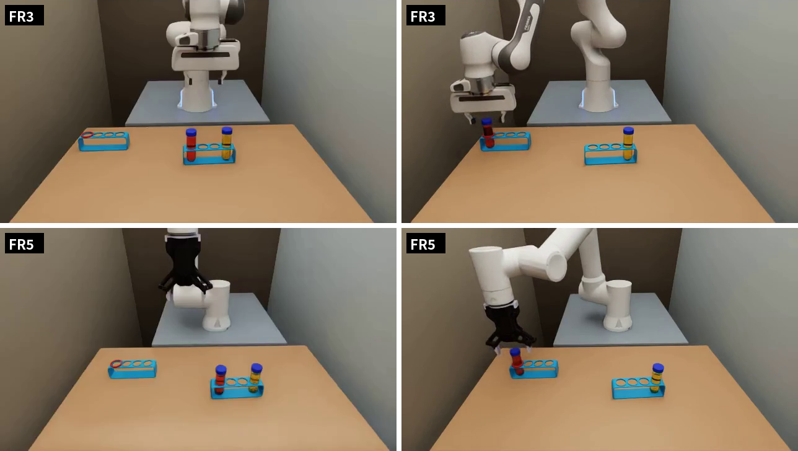

## 3. 전체 흐름 (갱신)

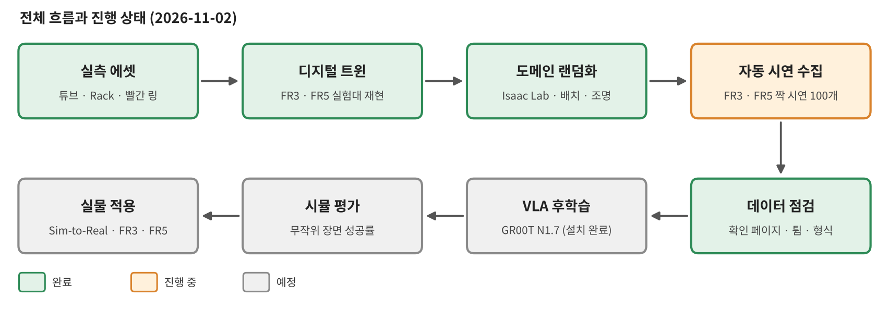

그림은 11-06 기준입니다. 그 뒤로 실물 형식 변환 ([보고서 3](docs/report03_realmatched_data/README.md)) → 실물 맞춤 시뮬 · 로봇마다 1,000 판 ([보고서 7](docs/report07_sim2real_1000/README.md)) → VLA + 수식 · DAgger ([보고서 4](docs/report04_sim_bench/README.md) · [8](docs/report08_dagger_1114_1116/README.md) · [9](docs/report09_final_1116_1119/README.md)) 까지 왔고, 지금 상태는 [12장 로드맵](#12-로드맵) 에 있습니다.

## 4. 디지털 트윈 (Isaac Sim)

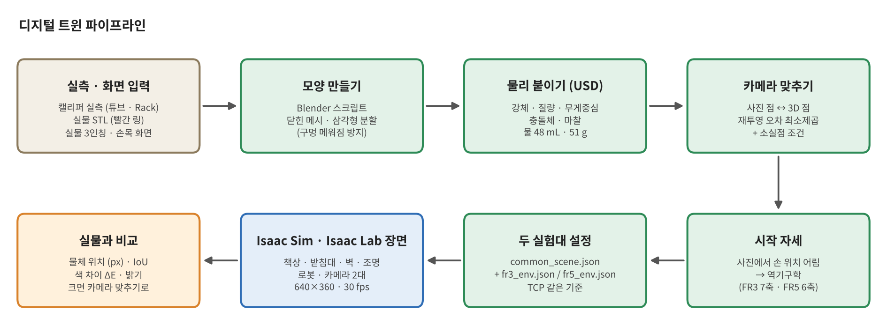

- **실측 에셋:** 튜브(길이 108 mm, 몸통 30 mm, 뚜껑 33×13 mm, 반구 바닥 R 15 mm)와 4구 Rack(165×40×51 mm, 구멍 간격 37 mm)을 캘리퍼로 재서 Blender 스크립트로 만들고, 물리(강체 · 질량 · 충돌 · 마찰)를 붙인 USD로 바꿈. 빨간 링은 실물 STL(안 34 · 밖 41 · 높이 5 mm)
- **색 물 튜브:** 반투명 몸통 + 물 48 mL. 물 높이 · 무게 · 무게중심을 부피 식으로 계산 (51 g)
- **카메라 맞추기:** 실물 화면의 점과 같은 점의 3D 위치로 재투영 오차를 최소제곱으로 풀어 3인칭 · 손목 카메라의 자리 · 각도를 정함 (3인칭 오차 2\~4 px)
- **시작 자세:** 화면에서 어림한 손 위치를 역기구학으로 풀어 관절값을 정함
- **두 실험대:** FR3 · FR5 실험대를 따로 재현하고, 두 로봇의 TCP를 같은 정의(고무 패드 접촉면 − 7.12 mm)로 맞춤
- **실물 비교:** 물체 위치(px) · 겹침(IoU) · 색 차이(ΔE) · 밝기를 숫자로 잼

### 로봇별 차이

장면 · 파이프라인 · 판정은 두 로봇이 같고, 아래만 다릅니다.

| 항목 | FR3 | FR5 |
|---|---|---|
| 로봇 · 그리퍼 | Franka Research 3 · Franka Hand (평행, 한쪽 40 mm) | FAIRINO FR5 · DH-Robotics AG-95 (한쪽 47.5 mm) |
| 팔 관절 | 7 | 6 |
| TCP (손끝 기준점) | 플랜지 + 97.0 mm | 플랜지 + 171.2 mm (둘 다 패드 접촉면 − 7.12 mm) |
| 계획 한계 | 관절 0.8 rad/s (7번 0.15 rad/s) | 관절 15 °/s · 120 °/s², 플랜지 + 167.6 mm 점 ≥ 책상 위 45 mm |
| 3인칭 카메라 | 받침 기준 (1.26, −0.02, 0.47) m, 숙임 −21.4°, 화각 69.7° | (0.96, −0.09, 0.50) m, 숙임 −31.7°, 화각 87° |
| 시작 자세 | [2.8, −16.0, 0, −150.9, 0, 134.9, 47.8]° | [−4.0, −70.2, −110.2, −89.6, 90.0, −1.5]° |
| 시뮬 보조 | 없음 (물리로만 쥠) | 쥔 동안 손끝 기준 튜브 자세 유지 (놓으면 물리로) |
| 상태 · 동작 길이 | 17 (손끝 9 + 그리퍼 1 + 관절 7) | 16 (손끝 9 + 그리퍼 1 + 관절 6) |

위 카메라 · 시작 자세는 처음 설정 (11-02) 값입니다. **11-13 부터는 실물 맞춤 시뮬**을 씁니다 — FR3 는 로봇 PC 자료로 3인칭 카메라 (1.060, −0.028, 0.527) m · 숙임 −30.6° · 화각 88.7° (실물 모형과 평균 0.52 px), 시작 자세 = 실물 home, 받침 23.5 mm 낮춤. FR5 는 실물 팀이 바꾼 값 11 개 (받침 높이 · 시작 자세 · 3인칭 카메라 높이 · 그리퍼 값 표 등) ([보고서 7](docs/report07_sim2real_1000/README.md) 2 · 4 절). 학습할 때 상태 · 동작은 로봇마다 실물 형식으로 바꿉니다 ([6-4](#6-4-데이터-형식)).

## 5. 도메인 랜덤화 (Isaac Lab)

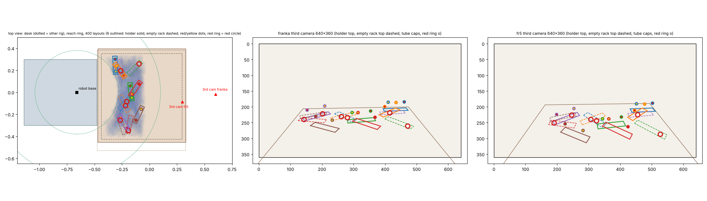

- **바꾸는 것:** 두 Rack의 자리 · 방향, 빨강 · 노랑 좌우, 빨간 링 구멍, 조명 밝기(×0.6\~1.4) · 색(5000\~8500 K)
- **조건 (모두 만족할 때까지 다시 뽑음):** 책상 안 · 두 Rack 사이 간격 · **두 로봇 받침에서 0.38\~0.76 m · ±70° 안** · **두 로봇의 3인칭 화면 안** · 로봇 몸이 가리지 않음. 계획 단계에서 두 로봇 모두 역기구학으로 다시 확인
- **균형:** 좌우 조합 · 링 구멍이 고르게 나오도록 묶음 단위로 섞음
- **짝:** 같은 시드면 두 로봇이 같은 배치 · 조명을 받음

## 6. BioTube-AutoDemo-IsaacLab — 자동 시연 수집기

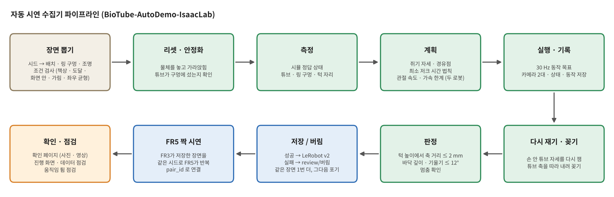

### 6-1. 한 시연의 단계

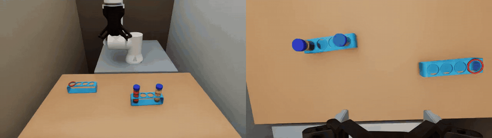

| 단계 | 하는 일 |
|---|---|
| 튜브로 가기 | 시작 자세에서 빨간 튜브 뚜껑 위로. 손목은 손가락이 원래 Rack 줄을 따라 벌어지게 돌림 |
| 쥐기 전 멈춤 · 쥐기 | 그리퍼를 0.5 초에 걸쳐 닫음. 막혀 멈추면 「쥠」 |
| 쥔 채 기다림 · 옮기기 | 들어 올려 곡선으로 옮기며, 손목을 빈 Rack 줄 방향으로 돌림 |
| 구멍 위에서 멈춤 · 구멍 맞추기 | 손 안 튜브 자세를 **다시 재고**, 튜브 바닥을 구멍 축 위로 |
| 꽂기 | **튜브 축을 따라** 내려감 |
| 놓기 · 위로 빠지기 | 놓고 멈춘 뒤 위로 빠짐 |

경로 방식(최소 저크 · 둥글린 꺾은선 · 수직 축 회전 · 관절 속도 검사)은 실물 FR3 자동 시연 코드(`gello_auto.py`)에서 옮겼고, FR5는 실물 안전 필터와 같은 한계(관절 15 °/s · 120 °/s², 플랜지 + 167.6 mm 점이 책상 위 45 mm 이상)를 씁니다.
시연마다 높이 · 호 · 머무는 시간 · 속도(0.85\~1.15배)를 조금씩 바꿔 다양성을 줍니다.

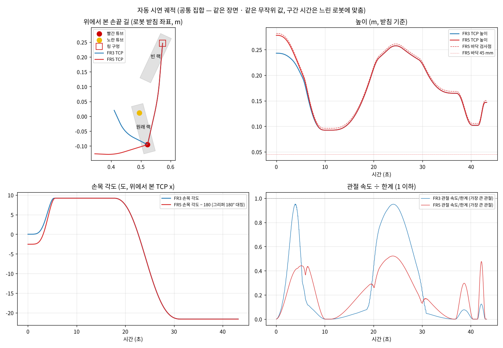

### 6-2. 판정 · 저장 · 재시도

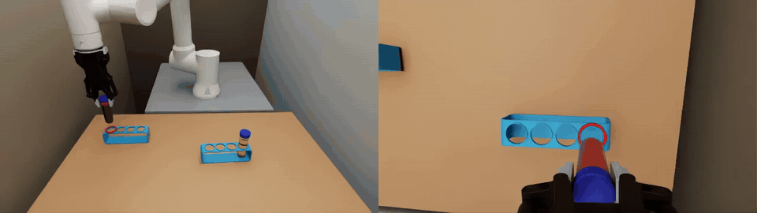

- **판정:** 구멍 턱 높이에서 튜브 축의 거리 ≤ 2 mm · 바닥 깊이 · 기울기 ≤ 12° · 멈춤 확인 (노란 튜브 · 링 제자리)
- **저장:** 성공만 LeRobot v2(GR00T 형식)로 저장. 실패는 이유와 함께 `review/버림/`에 남김
- **재시도:** 같은 장면을 한 번 더 시도하고, 그래도 실패하면 그 장면은 포기하고 다음 장면으로

### 6-3. FR3 · FR5 짝 시연

FR3가 장면을 저장하면 FR5가 **같은 시드로 같은 장면**을 바로 이어서 수행합니다. 장면마다 두 로봇 모두 할 수 있는지 미리 확인해 `set`(common · fr3_only · fr5_only)과 `pair_id`를 남깁니다.

### 6-4. 데이터 형식

| 항목 | 값 |
|---|---|
| 영상 | `observation.images.third` · `observation.images.wrist`, 640×360, 30 fps, H.264 |
| 상태 `observation.state` | 손끝 x · y · z + 자세 rot6d(회전 행렬 앞 두 행) + 그리퍼(0 벌림 \~ 1 닫힘) + 관절 (FR3 7 · FR5 6) |
| 동작 `action` | 같은 배치의 목표값 |
| 지시문 | `task_index` → `put the red tube in the red slot` |
| 기록 | `progress/episodes.jsonl` — 장면 · 시드 · `pair_id` · `set` · 판정 값 · 한 스텝 시간 |

지금은 848×480 으로 모으고 (`--cam-res 848x480`), 학습에는 로봇마다 **실물 형식**으로 바꿔 씁니다 (`tools/common_to_real.py`) — 10 Hz · 판마다 첫 화면 밝기를 실물 목표로 · 실물 상태 정의 (FR3 손끝 xyz + rot6d + 손가락 폭, FR5 손끝 xyz + rot6d + 그리퍼 반폭) · 행동은 손끝 상대 이동 + 그리퍼 ([보고서 3](docs/report03_realmatched_data/README.md)).

## 7. 수식 (요약)

좌표계 · 핀홀 투영 · 카메라 맞추기 · 역기구학 · 튜브 모델 · 끼는 각과 깔때기 받침 · 랜덤화 조건 · 색온도 · 시간 법칙 · 경로 · SO(3) 자세 보간 · 축을 따라 꽂기 · 판정 · FR5 보조 · 데이터 표현까지, 코드가 계산하는 그대로의 식과 적용은 [docs/math_ko.md](docs/math_ko.md)에 있습니다. 핵심만 옮기면:

**카메라 맞추기** — 사진 점 $`u_i`$ 와 3D 점 $`X_i`$ 의 재투영 오차 최소제곱

```math
\min_{R,\,t}\;\sum_i \big\lVert u_i - \pi\big(K(RX_i+t)\big)\big\rVert^2
```

**시간 법칙** — 구간마다 최소 저크, 구간 시간은 두 로봇의 관절 속도 · 가속도 한계로

```math
s(\tau)=10\tau^3-15\tau^4+6\tau^5,\qquad
T_v=\max_{\tau,j}\frac{\lvert Q'_j(s)\,s'(\tau)\rvert}{\dot q_j^{max}},\quad
T_a=\sqrt{\max_{\tau,j}\frac{\lvert Q''_j s'^2+Q'_j s''\rvert}{\ddot q_j^{max}}}
```

```math
T=\max\big(T_{cart},\ 1.05\max(T_v,T_a),\ T_{floor},\ 0.6\ \text{s}\big)
```

$`T_{floor}`$ 는 두 로봇 중 느린 쪽에 맞춘 공통 시간입니다.

**성공 판정** — 튜브 축 위에서 높이가 턱 높이 $`z_c`$ 인 점과 구멍 가운데 $`h`$ 의 수평 거리

```math
p(z_c)=b+\frac{z_c-b_z}{a_z}\,a,\qquad d=\big\lVert\,[p(z_c)-h]_{xy}\big\rVert\le 2\ \text{mm}
```

## 8. 데이터 품질 도구

| 도구 | 하는 일 |
|---|---|
| 확인용 페이지 `review/index.html` | 시연마다 시작 · 마지막 사진, 3인칭 \| 손목 나란히 영상(단계 · 그리퍼 · 판정 글자), 버린 시연과 이유 |
| `tools/common_progress.py` | 저장 수 · 성공률 · 끝날 시각 · 짝 현황 · 한 스텝 시간 내역 |
| `tools/common_check_dataset.py` | LeRobot v2 형식 점검 (행 수 = 영상 화면 수, 빈 값 없음 …) |
| `tools/common_check_motion.py` | 상태 · 동작에서 홀로 튀어나온 가속도(움직임 튐) 찾기 |

## 9. 데이터셋 현황 (갱신)

**지금 학습 데이터 (로봇마다, 11-13 \~ 18):** 실물 맞춤 시뮬 1,000 판 + DAgger 구간 (FR5 597 · FR3 449, 각 300 판에서) — [보고서 7](docs/report07_sim2real_1000/README.md) · [8](docs/report08_dagger_1114_1116/README.md)

| 갈래 | 판 | 동작 | 학습에 넣는 구간 |
|---|---|---|---|
| ① 기본 | 150 | 실물 자동 수집기와 같은 동작을 실수 없이 | 전부 |
| ② 보정 | 300 | 어림 자리 위에서 멈춤 → 옆으로 1 \~ 8 mm 고침 → 내려감 | 전부 |
| ③ 빗나감 + 바로잡기 | 250 | 10 \~ 40 mm 빗나간 자리 위에서 멈춤 → 내려가며 바로잡음 | 빗나간 자리부터 |
| ④ 실패에서 다시 하기 | 150 | 헛잡음 → 다시 쥠, 꽂다 걸림 → 다시 꽂음 | 실패한 상태부터 |
| ⑤ 실물 빈틈 | 150 | ② · ③ 동작을 실물 데이터에 없던 먼 쪽 · 넓게 흔든 배치에서 | ② · ③ 과 같음 |

곧장 가는 깨끗한 시연은 ① 150 판뿐입니다. 실패의 거의 전부가 「마지막 1 \~ 3 cm 를 고치지 않음」 이라, ② · ③ · ④ 가 그 동작을 직접 보여 줍니다.

<details>
<summary>처음 짝 100 개 (11-02 ~ 03, 640×360 · 30 Hz)</summary>

| | 저장 | 버림 · 포기 | 성공률 (시도마다) | 시연 길이 (시뮬) | 시연 1개에 걸린 실제 시간 |
|---|---|---|---|---|---|
| FR3 | 100 | 버림 16 · 포기 2 | 86 % | 약 41 초 | 약 6 분 |
| FR5 | 100 | 버림 1 · 포기 0 | 99 % (쥔 동안 붙이기 보조) | 약 41 초 | 약 6 분 |
| 짝 (둘 다 저장) | 99 | — | — | — | — |

그 뒤 A 200 짝 · B 300 짝을 더 모았고, 실물과 다르게 모은 설정 (30 Hz · 640×360 · 상태 · 행동 정의 · 노출) 과 돔 조명 문제는 [보고서 2](docs/report02_vla100_bench/README.md) · [3](docs/report03_realmatched_data/README.md) 에서 고쳤습니다.

</details>

## 10. VLA — GR00T N1.7

- **모델:** 기본 모델 `nvidia/GR00T-N1.7-3B` (`NEW_EMBODIMENT`) 을 로봇마다 미세조정 (시각 · 언어 백본은 얼리고 행동 부분을 학습)
- **학습:** batch size 64 × 20,000 번 고침 (표본 128 만 — FR3 는 32 개씩 두 번 모아 한 번 고침), 학습률 1e-4, 색 흔들기 켬. 처음의 batch size 16 은 큰 데이터일수록 덜 배워 바꿈 ([보고서 5](docs/report05_main_bench_stop/README.md))
- **입력 · 출력:** 카메라 2 대 (모델 입력 452×256, 비율 유지) + 손끝 상태 + 그리퍼 → 손끝 상대 이동 + 그리퍼, action chunk 16 칸 (10 Hz → 1.6 초)
- **벤치마크:** 수집기의 장면 · 판정을 그대로 쓰고 입력만 정책으로 (`lab/common_bench.py` · 정책 서버 `tools/common_groot_server.py`). 장면마다 첫 판, 물리 튐 = 실패, S0 \~ S9 단계 채점 (`tools/common_bench_stage.py`), VLA + 수식 (`lab/common_bench_hybrid.py`) 은 따로 보고
- **DAgger:** 정책을 300 장면에서 돌려 정책이 빗나간 자리에서 수식이 바로잡은 구간만 더해 다시 학습 ([보고서 8](docs/report08_dagger_1114_1116/README.md))

## 11. 결과 (갱신)

실물 맞춤 시뮬 · 학습에 쓰지 않은 같은 50 장면 · 장면마다 첫 판 (물리 튐 = 실패) 의 성공률입니다 (2026-11-19, [보고서 9](docs/report09_final_1116_1119/README.md)).

| 로봇 · 모델 | 정책만 · 고정 | 정책만 · 무작위 | VLA + 수식 · 고정 | VLA + 수식 · 무작위 |
|---|---|---|---|---|
| FR5 · 1,000 판 | 62 % | 40 % | 88 % | 96 % |
| FR5 · 1,000 판 + DAgger | 68 % | 74 % | 94 % | 98 % |
| FR3 · 1,000 판 | 4 % | 4 % | 98 % | 78 % |
| FR3 · 1,000 판 + DAgger | 62 % | 34 % | 100 % | 90 % |

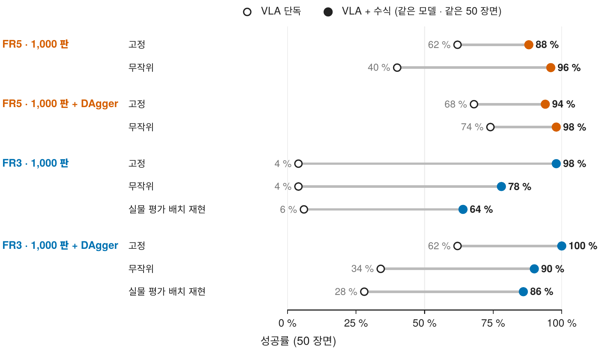

- **정책만:** GR00T N1.7 이 혼자 집고 꽂은 결과. FR5 는 학습 영상을 FR3 와 같은 방식 (848×480 → 비율을 지켜 452×256) 으로 바꾸자 고정 배치 16 → 62 % 가 되었고, 두 로봇 모두 **DAgger** (정책이 실제로 틀린 자리에서 수식이 바로잡은 구간만 더해 다시 학습) 로 크게 올랐습니다 — FR5 의 「가까운 튜브로 가는 버릇」, FR3 의 「약 6 mm 높게 닫음」 을 고침.
- **VLA + 수식:** 정책이 튜브 · 칸을 고르고, 정책이 뚜껑 · 빨간 칸 25 mm 안으로 오면 마지막 잡기 · 꽂기만 자동 시연 수식이 넘겨받는 실행 (실물 FR3 스테이션과 같은 구조). 수식은 정책이 고른 튜브를 바꾸지 않습니다.
- FR3 의 실물 평가 배치 재현 (10 배치 × 조명 5) 은 1,000 판 6 % → DAgger 28 % (VLA + 수식 64 → 86 %).

**읽을 때 주의.** 시뮬 성공률은 실물 성공률의 예측이 아니라, 같은 시뮬 · 같은 물리에서 모델끼리 견주는 도구입니다. FR5 시뮬은 실물에 없는 쥐기 보조 (쥔 동안 붙이기) 에 기대고, FR3 시뮬 (Isaac 기본 Panda 모델) 에는 그 보조가 없습니다. 고정 배치는 사실상 배치 둘 × 25 장면이라, 처음 보는 자리에서의 성능은 무작위 배치로 읽습니다. 자세한 분석은 [보고서 4](docs/report04_sim_bench/README.md) · 진행 기록 [5](docs/report05_main_bench_stop/README.md) ~ [9](docs/report09_final_1116_1119/README.md).

## 12. 로드맵

- [x] 실측 에셋 · 디지털 트윈 (FR3 · FR5)
- [x] Isaac Lab 도메인 랜덤화
- [x] 자동 시연 수집기 · 짝 시연 · 확인용 페이지 · 데이터 점검 도구
- [x] GR00T N1.7 미세조정 (시연 100 개) · 첫 시뮬 벤치 — [보고서 2](docs/report02_vla100_bench/README.md)
- [x] 실물 형식 맞추기 (10 Hz · 848×480 · 상태 · 행동 정의 · 노출) · 돔 조명 고치기 · 실물 설정 짝 시연 — [보고서 3](docs/report03_realmatched_data/README.md)
- [x] 학습량 (batch size 64) · 물리 튐 규칙 · 단계별 진단 — [보고서 5](docs/report05_main_bench_stop/README.md) · [6](docs/report06_improve_1112_1113/README.md)
- [x] 실물 맞춤 시뮬 (카메라 · 받침 높이 · 시작 자세 · 색) · 로봇마다 1,000 판 — [보고서 7](docs/report07_sim2real_1000/README.md)
- [x] VLA + 수식 · S0 \~ S9 채점 · DAgger (FR5 · FR3) · FR5 영상 형식을 FR3 와 같게 — [보고서 4](docs/report04_sim_bench/README.md) · [8](docs/report08_dagger_1114_1116/README.md) · [9](docs/report09_final_1116_1119/README.md)
- [ ] 실물과 같은 조건의 수식 점검 (카메라로 찾음) · VLA + 수식 보조 벤치 — 시험 기간 뒤
- [ ] 실물 FR5 평가 결과와 S0 \~ S9 비교
- [ ] 다음 실험 하나 — DAgger 2 회차 · FR5 그리퍼 모델 단순화 · 노란 링 과제 · 강화학습 미세조정 · GR00T N2
- [ ] 실물 적용 (Sim-to-Real)

## 13. 실행 방법

```bash
# 1) Isaac Lab 설치 (Isaac Sim 6.0.1 을 따로 풀어 그 사본에만 설치)
bash lab/common_lab_install.sh
# 2) FR3 자동 시연 100개
bash lab/common_lab_run.sh lab/common_collector.py --robot franka --input auto --new-folder "demo" --base-seed 1103 --auto-count 100
# 3) 같은 장면을 FR5로 (FR3 폴더를 따라감, 조작 화면은 다른 포트)
F=$(ls -td datasets/fr3/*demo*/ | head -1)
bash lab/common_lab_run.sh lab/common_collector.py --robot fr5 --input auto --new-folder "demo" --base-seed 1103 --auto-follow "$F" --panel-port 8801
# 4) 진행 보기 · 점검
python3 tools/common_progress.py --memo demo --watch 60
python3 tools/common_check_motion.py --memo demo
```

조작 화면은 브라우저 `http://127.0.0.1:8800` (FR5 는 8801).

## 14. 폴더 구성과 환경

```
├── common_isaacsim_run.py   Isaac Sim 단독 장면 (FR3 · FR5)
├── config/                  공용 장면 · 로봇별 설정 · 랜덤화 · 자동 시연 · Rack 받침
├── lab/                     Isaac Lab 환경 · 수집기 · 자동 운전 · 궤적 생성기
├── tools/                   에셋 만들기 · 카메라 맞추기 · 점검 · GR00T 스크립트
├── assets/usd/              튜브 · Rack · 링 USD
└── docs/                    설명 문서 · 수식 정리 · 그림
```

Ubuntu · NVIDIA RTX 5090 · Isaac Sim 6.0.1 · Isaac Lab v3.0.0-beta2.patch1 · GR00T N1.7 (별도 uv 환경)

---

<details>
<summary><b>🍪 Behind the Scenes — 여기까지 온 과정</b></summary>

### 과제는 세 번 바뀌었다
1. **바구니에 넣기** — 정밀함이 필요 없는 「놓기」라 VLA의 정밀 조작을 보기 어려웠음
2. **빈 Rack의 가까운 구멍** — 목표를 말(규칙)로 정하니 어느 구멍인지 애매함
3. **빨간 링 구멍 (최종)** — 눈에 보이는 표시로 목표를 정하고, 틈 1 mm 정밀 삽입에 집중

### 부딪힌 문제들
- **튜브가 8° 기운 채 끼었다** — 물이 든 둥근 바닥 튜브는 무게중심이 반구 중심보다 높아 홀로 서지 못하고, 속이 빈 Rack에서 넘어가다 턱에 걸림 (지름 30 원기둥이 두께 5 · 지름 31 구멍에 걸리는 각 = 8.0°). → 시뮬 전용 보이지 않는 45° 깔때기 받침으로 가운데에 앉힘

  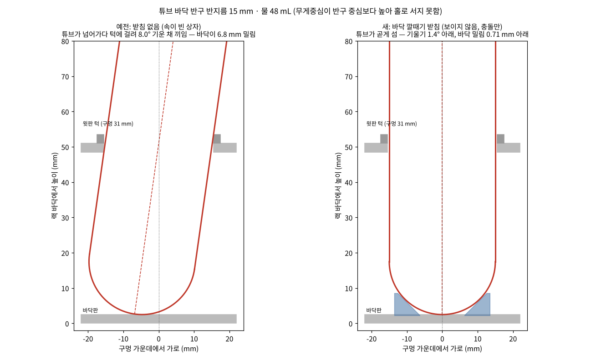
- **FR5가 튜브를 놓쳤다** — 쥐는 힘 한계를 올려도 들어 옮기다 미끄러짐. → 쥔 동안 손끝 기준 튜브 자세를 유지하는 시뮬 보조(놓으면 다시 물리)
- **시뮬이 실제 시간의 0.07배였다** — 확인용 영상 만들기가 CPU를 다 써 버림. → 가장 낮은 우선순위 · 코어 2개, 한 스텝 시간을 물리 · 카메라 · 나머지로 나눠 재며 병목을 찾음
- **「튜브로 가기」가 오래 걸렸다** — 손목 회전이 이동 내내 이어짐. → 회전을 시간 비례 최소 저크로 바꿔 평균 11.2 → 8.2 초 (관절 한계는 그대로)
- **영상 속 팔이 튀어 보였다** — 팔이 아니라 영상 압축의 기준 장면 탓(8.3초마다 화면 전체가 순간 바뀜). → 확인용 영상 압축을 고치고, 데이터 숫자로 튐을 직접 점검하는 도구를 만듦
- **실물과 다른 기록 주기로 모았다** — 시뮬은 30 Hz, 실물은 10 Hz. 학습 설정은 실물과 하나하나 견줬지만 데이터 자체는 견주지 않아, 같은 「행동 16칸」이 실물 1.6 초 · 시뮬 0.53 초가 됨. → 로봇마다 실물 형식으로 바꾸는 변환기, 학습 전 데이터 점검표
- **돔 조명이 Isaac 을 켤 때마다 바뀌었다** — 튜브 · 홀더 USD 에 Blender 「월드」 돔(`env_light`)이 딸려 와, 렌더러가 켤 때마다 우리 돔과 이것 중 하나를 고름 → 실행마다 화면 밝기가 약 134 / 185 로 갈리고, FR3 벤치는 학습과 다른 조명에서 돎. 세기가 1이라 무해하다고 보고 경고에서 뺐던 것. → 물체 USD 의 그 조명을 끄고, 조명은 설정 값이 아니라 실행마다의 밝기로 확인
- **물리가 튄 판을 다시 하게 해 줬다** — FR5 에서 시뮬 접촉이 깨진 판을 서버 오류로 보고 세지 않은 채 같은 장면을 다시 해, FR5 에만 두 번째 기회를 준 셈이었음. → 튄 판은 실패로, 장면마다 첫 판만 셈 (100 판 모델 12/50 → 6/50) — [보고서 5](docs/report05_main_bench_stop/README.md)
- **데이터를 늘릴수록 성적이 내려갔다** — batch size 16 이라 같은 20,000 스텝에서 600 판 모델은 데이터를 1.5 \~ 2.6 번만 봄 (실물은 18 \~ 37 번). → batch size 64 로, FR3 같은 200 판에서 0/50 → 13/50
- **벤치가 실제 시간의 1/34 로 돌았다** — CPU 시계가 느린 예비 시계로 바뀌고 큰 메모리 쓰기가 0.7 GB/s 로 묶임 (메모리 모듈 71 \~ 79 도). → 다시 켜기, 기록 영상은 복사 없이 넘기기, 1 분마다 메모리 온도 · 속도 기록
- **「1,000 판」 이 675 판이었다** — 빗나감 + 보정 시연은 멈춤 단계 이름이 달라 변환기가 통째로 뺌. → 두 이름 모두 찾고, 보내기 전에 조각 수로 막는 관문 — [보고서 7](docs/report07_sim2real_1000/README.md)
- **빨간 뚜껑이 영상 압축에 지워졌다** — 256×256 · 4:2:0 압축이 작은 빨간 뚜껑의 빨강을 약 80 % 지움. → 색 보존 (4:4:4) 을 거쳐, FR3 와 같은 848×480 → 452×256 변환으로 FR5 정책만 고정 16 → 62 % — [보고서 9](docs/report09_final_1116_1119/README.md)
- **FR5 는 가까운 튜브로 갔다** — 데이터는 고른데 (빨강이 가까운 판 53 %) 모델이 색 대신 자리를 지름길로 배움. 같은 화면을 20 번 물어도 20 번 다 두 튜브 가운데를 겨눔. → DAgger 로 빨강이 먼 25 장면에서 빨간 튜브로 간 판 0 → 18 — [보고서 8](docs/report08_dagger_1114_1116/README.md)
- **FR3 는 6 mm 높게 닫았다** — 시연은 언제나 정확한 높이까지 내려가 「높게 멈췄으면 더 내려간다」 는 장면이 없었음. → FR3 DAgger 로 정책만 고정 배치 2 → 31/50

자세한 기록: [docs/12-자동수집기.md](docs/12-자동수집기.md) · 진행 기록 [보고서 5](docs/report05_main_bench_stop/README.md) \~ [9](docs/report09_final_1116_1119/README.md)
</details>
