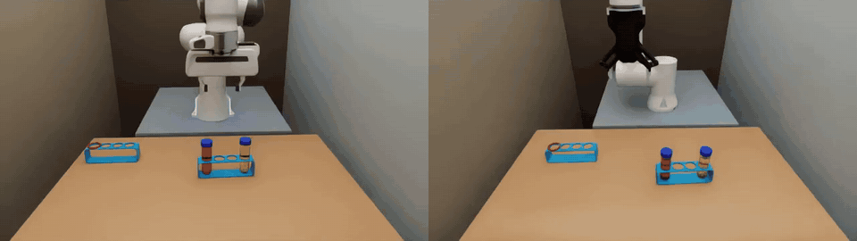
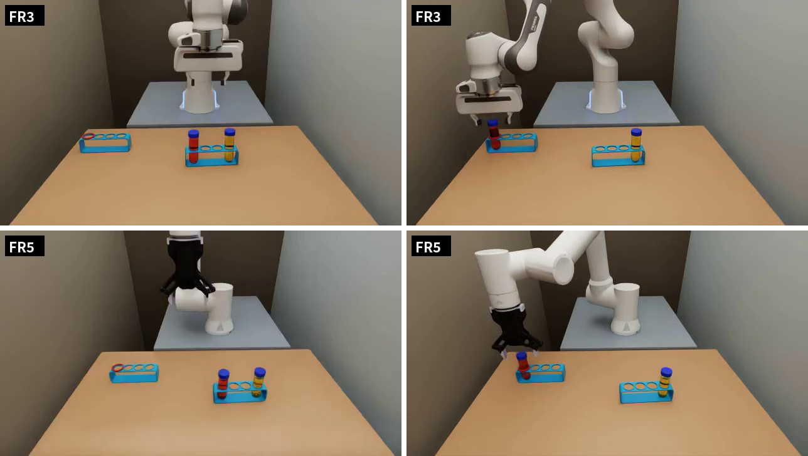
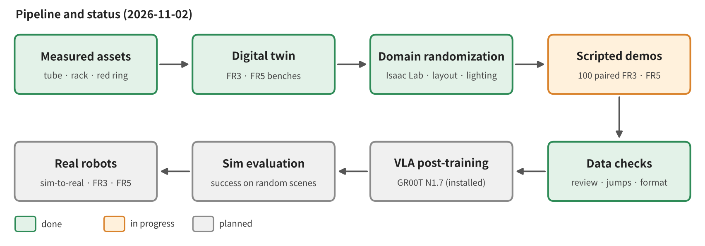
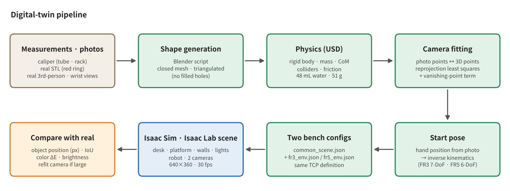
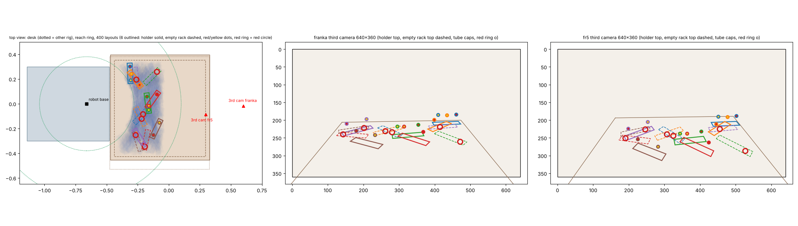
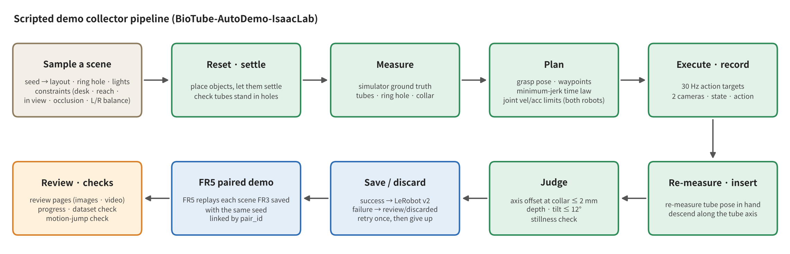
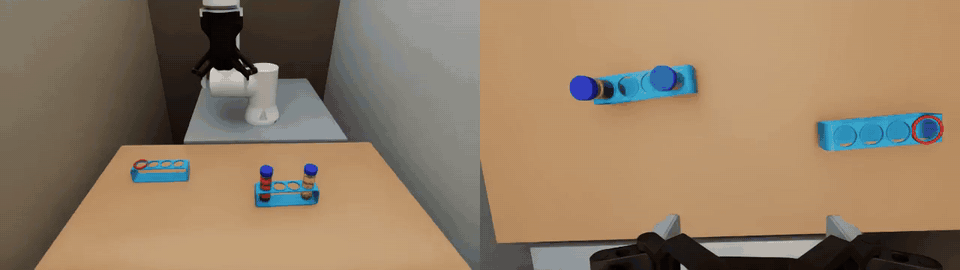
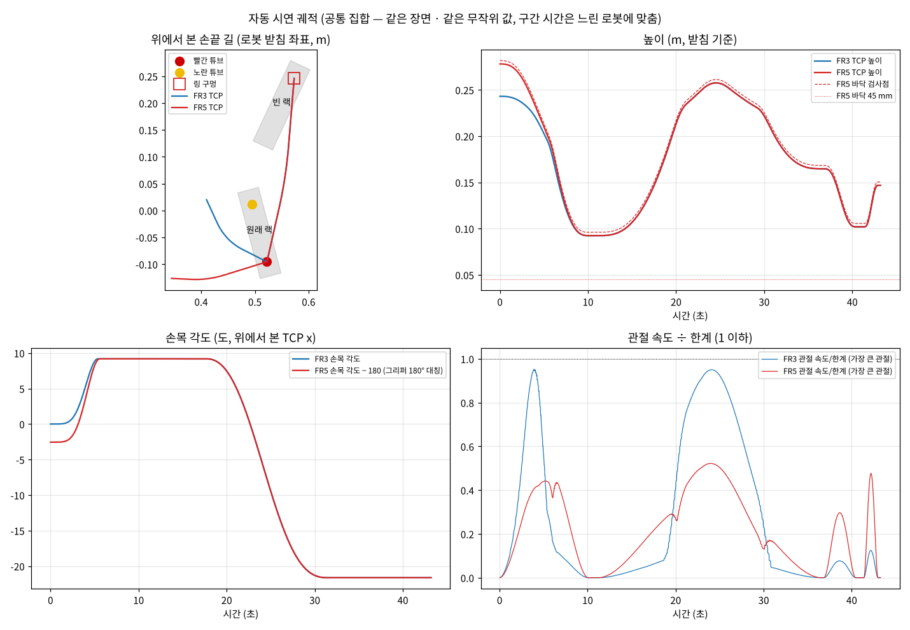
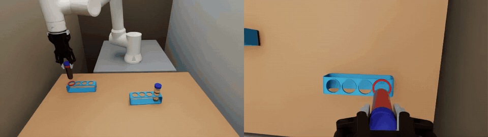
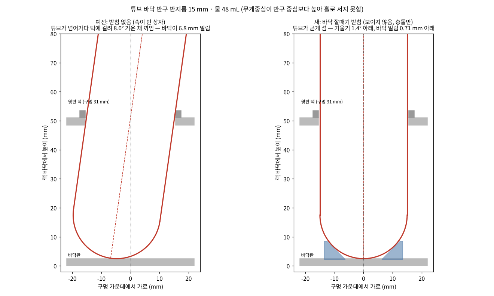

# BioTube-Insertion-VLA-IsaacLab

### Can a 30 mm tube go into a 31 mm hole? — Sim-to-Real VLA for precision insertion of bio-lab tubes (Franka FR3 · FAIRINO FR5, Isaac Sim / Isaac Lab)

[한국어](README.md) · [Contents](#contents) · Equation notes: [docs/math_en.md](docs/math_en.md) · Official write-up: [BioRoboticsIsaacSim / sim_isaac](https://github.com/SungjinDavidLee/BioRoboticsIsaacSim/tree/main/sim_isaac)



Paired demonstrations of the same scene (1103-27), each performed by one robot with its own workcell cameras. 1× video (third-person · wrist): [demo_pair_scene27.mp4](figures/demo_pair_scene27.mp4)

> **Latest news**
> - 2026-11-10 · [Report 3 — Paired demos re-collected with real-matched settings: math-model probability and precision, real-format conversion, comparison with real data](docs/report03_realmatched_data/README_EN.md)
> - 2026-11-06 · [Report 2 — GR00T trained on 100 demos: benchmark results, data-collection mistakes, and how we will fix them](docs/report02_vla100_bench/README_EN.md) · development log [docs/12](docs/12-자동수집기.md) updated (Korean)
> - 2026-11-04 · Fine-tuned GR00T N1.7 (100 demos each for FR3 · FR5) · benchmark on 50 unseen scenes
> - 2026-11-03 · Added [Real setup → digital twin](docs/real_to_twin/README_EN.md) · FR3 finished collecting 100 demonstrations
> - 2026-11-02 · Started automatic collection of 100 FR3 · FR5 paired demonstrations
> - 2026-11-02 · GR00T N1.7 installed
> - 2026-11-02 · Added review video · motion-jump check tools

---

## Contents

1. **Overview · task · pipeline** — [1](#1-overview) · [2](#2-task) · [3](#3-overall-pipeline-updated)
2. **[Real setup → digital twin](docs/real_to_twin/README_EN.md)** — from measurements to shapes, image regions (segments), camera fitting, comparison with colour segments · summary in [4](#4-digital-twin-isaac-sim) · [per-robot differences](#per-robot-differences)
3. **Domain randomization (Isaac Lab)** — [5](#5-domain-randomization-isaac-lab)
4. **Scripted demo collector (BioTube-AutoDemo-IsaacLab)** — [6](#6-biotube-autodemo-isaaclab--scripted-demo-collector) · detailed development notes (Korean) [docs/12-자동수집기.md](docs/12-자동수집기.md)
5. **Equations** — summary [7](#7-equations-summary) · full notes [docs/math_en.md](docs/math_en.md) ([digital twin](docs/math_en.md#4-equations-and-application--digital-twin) · [domain randomization](docs/math_en.md#5-equations-and-application--domain-randomization) · [scripted demos](docs/math_en.md#6-equations-and-application--scripted-demo-generation-and-success-check))
6. **Data quality tools · dataset** — [8](#8-data-quality-tools) · [9](#9-dataset-status-updated)
7. **GR00T · results · roadmap** — [10](#10-vla--gr00t-n17) · [11](#11-results-updated) · [12](#12-roadmap) · **[Report 2 — benchmark results · mistakes and fixes](docs/report02_vla100_bench/README_EN.md)**
8. **How to run · folders** — [13](#13-how-to-run) · [14](#14-folder-structure-and-environment)
9. **🍪 How we got here** — [at the bottom](#the-task-changed-three-times)

Official write-up (lab repository): [BioRoboticsIsaacSim / sim_isaac](https://github.com/SungjinDavidLee/BioRoboticsIsaacSim/tree/main/sim_isaac)

## 1. Overview

In a bio lab, inserting a centrifuge tube into a rack is a precision manipulation with only 1 mm of clearance. This repo contains the full simulation-side pipeline for performing this manipulation with a VLA (Vision-Language-Action) model.

1. Measure the real workcells (FR3 · FR5) and build a **digital twin** in Isaac Sim,
2. **randomize the scenes** in Isaac Lab,
3. collect paired data for both robots with a scripted demo collector (**BioTube-AutoDemo-IsaacLab**) that **generates, checks, and saves demonstrations on its own** via path planning, and then
4. **post-train GR00T N1.7** on that data and transfer it to the real robots — that is the goal.

## 2. Task

| Item | Description |
|---|---|
| Instruction | `put the red tube in the red slot` |
| Scene | Source rack (red-water and yellow-water tubes in the two end holes) + empty rack (red ring on one hole) |
| Success | At the hole-collar height (51 mm above the rack bottom), the tube axis passes **within 2 mm** of the hole center, the tube reaches the bottom, and the tilt is **within 12°**. The yellow tube and the ring stay in place |
| Difficulty | Tube 30 mm · hole 31 mm → 1 mm clearance. The bottom is a hemisphere (radius 15 mm), so even a slight misalignment tilts the tube and it catches on the collar |
| Randomized per scene | Position · orientation of both racks, red/yellow left-right order, red-ring hole (red slot; one of 4), lighting brightness · color |



## 3. Overall pipeline (updated)



## 4. Digital twin (Isaac Sim)



- **Measured assets:** the tube (length 108 mm, body 30 mm, cap 33×13 mm, hemispherical bottom R 15 mm) and the 4-hole rack (165×40×51 mm, hole pitch 37 mm) were measured with calipers, built with Blender scripts, and converted to USD with physics attached (rigid body · mass · collision · friction). The red ring is an STL of the real part (inner 34 · outer 41 · height 5 mm)
- **Colored-water tubes:** translucent body + 48 mL of water. Water height · mass · center of mass computed from the volume equation (51 g)
- **Camera fitting:** the positions · angles of the third-person · wrist cameras are determined by least-squares minimization of the reprojection error between points in the real images and the 3D positions of the same points (third-person error 2–4 px)
- **Start pose:** joint values set by solving inverse kinematics for the hand position estimated from the image
- **Two workcells:** the FR3 and FR5 workcells are reproduced separately, and the TCPs of both robots use the same definition (rubber pad contact surface − 7.12 mm)
- **Comparison with the real setup:** object position (px) · overlap (IoU) · color difference (ΔE) · brightness are measured numerically

### Per-robot differences

The scene, pipeline, and success check are the same for both robots; only the following differ.

| Item | FR3 | FR5 |
|---|---|---|
| Robot · gripper | Franka Research 3 · Franka Hand (parallel, 40 mm per side) | FAIRINO FR5 · DH-Robotics AG-95 (47.5 mm per side) |
| Arm joints | 7 | 6 |
| TCP | Flange + 97.0 mm | Flange + 171.2 mm (both: pad contact surface − 7.12 mm) |
| Planning limits | Joints 0.8 rad/s (joint 7: 0.15 rad/s) | Joints 15 °/s · 120 °/s², point at flange + 167.6 mm ≥ 45 mm above the table |
| Third-person camera | (1.26, −0.02, 0.47) m in the base frame, pitch −21.4°, FOV 69.7° | (0.96, −0.09, 0.50) m, pitch −31.7°, FOV 87° |
| Start pose | [2.8, −16.0, 0, −150.9, 0, 134.9, 47.8]° | [−4.0, −70.2, −110.2, −89.6, 90.0, −1.5]° |
| Sim assist | None (grasp by physics only) | Keeps the tube pose fixed relative to the TCP while grasped (back to physics on release) |
| State · action dimension | 17 (TCP 9 + gripper 1 + joints 7) | 16 (TCP 9 + gripper 1 + joints 6) |

## 5. Domain randomization (Isaac Lab)



- **What changes:** position · orientation of both racks, red/yellow left-right order, red-ring hole, lighting brightness (×0.6–1.4) · color (5000–8500 K)
- **Conditions (resampled until all are met):** on the table · spacing between the two racks · **0.38–0.76 m and within ±70° from both robot bases** · **inside both robots' third-person views** · not occluded by the robot body. Re-checked with inverse kinematics for both robots at the planning stage
- **Balancing:** left-right combinations · ring holes are shuffled in blocks so that they appear evenly
- **Pairing:** with the same seed, both robots receive the same layout · lighting

## 6. BioTube-AutoDemo-IsaacLab — scripted demo collector



### 6-1. Phases of a demonstration



| Phase | What it does |
|---|---|
| Go to tube | From the start pose to above the red tube's cap. The wrist turns so the fingers open along the source-rack row |
| Pre-grasp pause · grasp | Closes the gripper over 0.5 s. If it stalls on contact, the "grasp latch" is set |
| Hold and wait · carry | Lifts and carries along a curve, turning the wrist toward the empty-rack row |
| Pause above hole · align with hole | **Re-measures** the in-hand tube pose and places the tube bottom over the hole axis |
| Insert | Descends **along the tube axis** |
| Release · retract upward | Releases, pauses, then retracts upward |

The path methods (minimum-jerk · rounded polyline · rotation about the vertical axis · joint-velocity check) were ported from the real-robot FR3 scripted demo code (`gello_auto.py`), and FR5 uses the same limits as the real-robot safety filter (joints 15 °/s · 120 °/s², the point at flange + 167.6 mm at least 45 mm above the table).
Height · arc · dwell time · speed (0.85–1.15×) are varied slightly for each demonstration to add diversity.



### 6-2. Check · save · retry



- **Check:** tube-axis distance at the hole-collar height ≤ 2 mm · bottom depth · tilt ≤ 12° · at-rest check (yellow tube · ring in place)
- **Save:** only successes are saved, as LeRobot v2 (GR00T format). Failures are kept in `review/버림/` (discarded) together with their reasons
- **Retry:** the same scene is attempted once more; if it still fails, that scene is given up and the collector moves on to the next scene

### 6-3. FR3 · FR5 paired demonstrations

When FR3 saves a scene, FR5 immediately performs **the same scene with the same seed**. For each scene, whether both robots can perform it is checked in advance, and `set` (common · fr3_only · fr5_only) and `pair_id` are recorded.

### 6-4. Data format

| Item | Value |
|---|---|
| Video | `observation.images.third` · `observation.images.wrist`, 640×360, 30 fps, H.264 |
| State `observation.state` | TCP x · y · z + orientation rot6d (first two rows of the rotation matrix) + gripper (0 open – 1 closed) + joints (FR3 7 · FR5 6) |
| Action `action` | Target values in the same layout |
| Instruction | `task_index` → `put the red tube in the red slot` |
| Records | `progress/episodes.jsonl` — scene · seed · `pair_id` · `set` · check values · per-step time |

## 7. Equations (summary)

From coordinate frames, pinhole projection, camera fitting, inverse kinematics, the tube model, the jamming angle and funnel seat, randomization conditions, color temperature, the time law, paths, and SO(3) orientation interpolation to insertion along the axis, the success check, the FR5 assist, and the data representation, the equations exactly as the code computes them, together with how they are applied, are in [docs/math_en.md](docs/math_en.md). The key ones:

**Camera fitting** — least squares on the reprojection error between photo points $`u_i`$ and 3D points $`X_i`$

```math
\min_{R,\,t}\;\sum_i \big\lVert u_i - \pi\big(K(RX_i+t)\big)\big\rVert^2
```

**Time law** — minimum-jerk per segment, with the segment duration set by the joint velocity · acceleration limits of both robots

```math
s(\tau)=10\tau^3-15\tau^4+6\tau^5,\qquad
T_v=\max_{\tau,j}\frac{\lvert Q'_j(s)\,s'(\tau)\rvert}{\dot q_j^{max}},\quad
T_a=\sqrt{\max_{\tau,j}\frac{\lvert Q''_j s'^2+Q'_j s''\rvert}{\ddot q_j^{max}}}
```

```math
T=\max\big(T_{cart},\ 1.05\max(T_v,T_a),\ T_{floor},\ 0.6\ \text{s}\big)
```

$`T_{floor}`$ is the common duration matched to the slower of the two robots.

**Success check** — horizontal distance between the point on the tube axis whose height equals the collar height $`z_c`$ and the hole center $`h`$

```math
p(z_c)=b+\frac{z_c-b_z}{a_z}\,a,\qquad d=\big\lVert\,[p(z_c)-h]_{xy}\big\rVert\le 2\ \text{mm}
```

## 8. Data quality tools

| Tool | What it does |
|---|---|
| Review page `review/index.html` | Per demonstration: first · last frames, side-by-side third-person \| wrist video (with phase · gripper · check text overlays), discarded demonstrations and their reasons |
| `tools/common_progress.py` | Saved count · success rate · estimated finish time · pairing status · per-step time breakdown |
| `tools/common_check_dataset.py` | LeRobot v2 format check (row count = number of video frames, no empty values …) |
| `tools/common_check_motion.py` | Finds isolated acceleration spikes (motion jumps) in state · action |

## 9. Dataset status (updated)

First 100 pairs (Nov 2 – 3, base seed 1103, layout A):

| | Saved | Discarded · given up | Success rate (per attempt) | Demo length (sim) | Wall-clock time per demo |
|---|---|---|---|---|---|
| FR3 | 100 | 16 discarded · 2 given up | 86 % | about 41 s | about 6 min |
| FR5 | 100 | 1 discarded · 0 given up | 99 % (in-hand hold assist) | about 41 s | about 6 min |
| Pair (both saved) | 99 | — | — | — | — |

Since then we collected 200 more A pairs · 300 B pairs (tubes in any rack holes; FR5 still following B). The settings that differ from the real robots (30 Hz · 640×360 · state · action definitions · exposure)
and the dome light that changed with each collector run are covered in Sections 4 · 5 of [Report 2](docs/report02_vla100_bench/README_EN.md) — fixed with a converter (`tools/common_to_real.py`) and re-collection.

## 10. VLA — GR00T N1.7

- **Now:** the base model `nvidia/GR00T-N1.7-3B` (`NEW_EMBODIMENT`) fine-tuned per robot on 100 demos (`tools/common_groot_train.sh` — training server, 20000 steps · batch 16 · LR 1e-4, same settings as the real FR5 training)
- **Input · output:** 2 cameras + TCP state + gripper → relative TCP motion + gripper, in chunks of 16 steps (current data 30 Hz → 0.53 s, real format 10 Hz → 1.6 s)
- **Benchmark:** reuses the collector's scenes · judgment with the policy as the input (`lab/common_bench.py` · policy server `tools/common_groot_server.py`), analysis `tools/common_bench_target.py` · viewer `tools/common_bench_view.py`
- **Next:** retrain in the real format (10 Hz) · with 300 demos (FR5 training now) → data with the real settings (ab) → compare FR3 only · FR5 only · both

## 11. Results (updated)

| | Training demos | Success on 50 unseen scenes | 95 % CI |
|---|---|---|---|
| FR3 | 100 | 2 / 50 (4 %) | 1.1–13.5 % |
| FR5 | 100 | 1 / 50 (2 %) | 0.4–10.5 % |

Real-robot models trained on 100 demos are similar (FR3 5 % · FR5 0 %; the real 200-demo model reaches 30 %). We suspect layout memorization instead of color, grasp precision, and a short action chunk;
the FR3 benchmark ran under a lighting state different from its training data and will be re-measured. Details in [Report 2](docs/report02_vla100_bench/README_EN.md).

## 12. Roadmap

- [x] Measured assets · digital twin (FR3 · FR5)
- [x] Isaac Lab domain randomization
- [x] Scripted demo collector · paired demonstrations
- [x] Review page · data check tools
- [x] 100 FR3 · FR5 paired demonstrations
- [x] GR00T N1.7 data loading test · fine-tuning (100 demos) · sim benchmark — [Report 2](docs/report02_vla100_bench/README_EN.md)
- [ ] Sim zero-shot (50 scenes — only a 2-scene trial so far)
- [ ] Matching the real format (10 Hz · 848×480 · state · action definitions · exposure) · fixing the dome light — in progress
- [ ] Retraining with format · number of demos · layout changed — two FR5 runs training
- [ ] Re-collection with the real settings (ab) · per-robot comparison
- [ ] Real-world deployment (Sim-to-Real)

## 13. How to run

```bash
# 1) Install Isaac Lab (extract a separate copy of Isaac Sim 6.0.1 and install into that copy only)
bash lab/common_lab_install.sh
# 2) 100 FR3 scripted demonstrations
bash lab/common_lab_run.sh lab/common_collector.py --robot franka --input auto --new-folder "demo" --base-seed 1103 --auto-count 100
# 3) The same scenes with FR5 (follows the FR3 folder; control panel on a different port)
F=$(ls -td datasets/fr3/*demo*/ | head -1)
bash lab/common_lab_run.sh lab/common_collector.py --robot fr5 --input auto --new-folder "demo" --base-seed 1103 --auto-follow "$F" --panel-port 8801
# 4) Monitor progress · run checks
python3 tools/common_progress.py --memo demo --watch 60
python3 tools/common_check_motion.py --memo demo
```

The control panel is at `http://127.0.0.1:8800` in the browser (8801 for FR5).

## 14. Folder structure and environment

```
├── common_isaacsim_run.py   Standalone Isaac Sim scene (FR3 · FR5)
├── config/                  Shared scene · per-robot settings · randomization · scripted demos · rack seat
├── lab/                     Isaac Lab environment · collector · auto-run · trajectory generator
├── tools/                   Asset building · camera fitting · checks · GR00T scripts
├── assets/usd/              Tube · rack · ring USD
└── docs/                    Documentation · equations · figures
```

Ubuntu · NVIDIA RTX 5090 · Isaac Sim 6.0.1 · Isaac Lab v3.0.0-beta2.patch1 · GR00T N1.7 (separate uv environment)

---

<details>
<summary><b>🍪 Behind the Scenes — How we got here</b></summary>

### The task changed three times
1. **Putting it in a basket** — a "place" action that needs no precision, so the VLA's precise manipulation was hard to observe
2. **The nearest hole of the empty rack** — defining the target in words (a rule) made it ambiguous which hole was meant
3. **The red-ring hole (final)** — the target is defined by a visible marker, focusing on precision insertion with 1 mm clearance

### Problems we ran into
- **The tube jammed at an 8° tilt** — a water-filled round-bottom tube has its center of mass above the center of its hemisphere, so it cannot stand on its own, and in the hollow rack it toppled and caught on the collar (the angle at which a cylinder of diameter 30 jams in a hole of diameter 31 through a plate of thickness 5 = 8.0°). → A sim-only, invisible 45° funnel seat settles it in the center

  
- **FR5 dropped the tube** — even with a higher grip-force limit, the tube slipped while being lifted and carried. → A sim assist that keeps the tube pose fixed relative to the TCP while grasped (back to physics on release)
- **The sim ran at 0.07× real time** — generating the review videos was using up all the CPU. → Lowest priority · 2 cores, and the bottleneck was found by measuring the per-step time split into physics · camera · rest
- **"Go to tube" took too long** — the wrist rotation continued throughout the whole motion. → Changed the rotation to time-proportional minimum-jerk, mean 11.2 → 8.2 s (joint limits unchanged)
- **The arm seemed to jump in the videos** — it was not the arm but the video compression's keyframes (the whole image changed abruptly every 8.3 s). → Fixed the review-video compression and built a tool that checks for jumps directly from the data values
- **We recorded at a different rate from the real robots** — sim at 30 Hz, real at 10 Hz. The training configuration was compared with the real one item by item, but the data itself was not, so the same "16-step action chunk" became 1.6 s on the real robots and 0.53 s in sim. → A converter to the real format per robot, and a data checklist before training
- **The dome light changed every time Isaac started** — the tube · holder USDs carried Blender's "world" dome (`env_light`), and at each start the renderer picked either our dome or this one → first-image brightness split into about 134 / 185 per run, and the FR3 benchmark ran under lighting different from its training. We had removed it from the warnings because its intensity was 1. → Turned that light off in the object USDs, and now check lighting by the per-run brightness rather than by the settings

Detailed log: [docs/12-자동수집기.md](docs/12-자동수집기.md)
</details>
