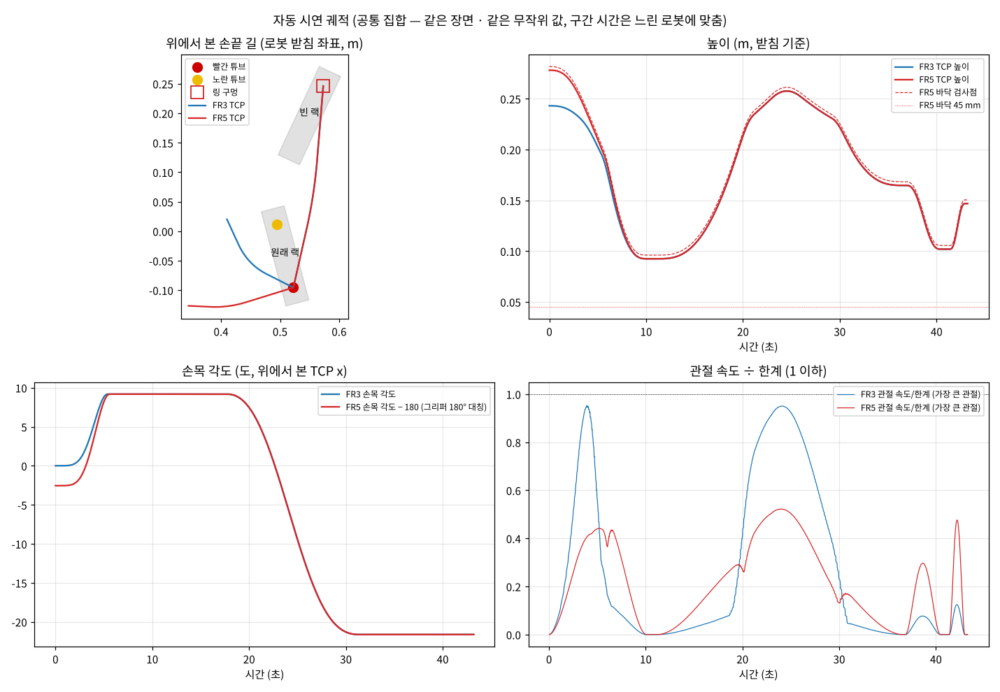
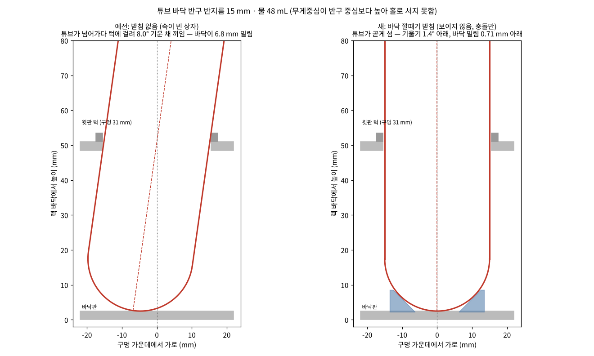

# 12 — 자동 수집기 (GR00T 학습용 시연 자동 생성, 수집기 2.7 · 궤적 1.3)

2026-10-31, zip 5.17 · 5.18 (5.18 에서 바뀐 것은 13 절 · 확인용 폴더는 14 절) · 2026-11-02 zip 5.19 (15 절) · zip 5.20 (16 절 — 튜브가 기운 채 끼던 것 · 100 개 모으기). 계획은 `docs/11-GR00T-자동수집기-계획.md`, 과제(빨간 슬롯)는 `docs/10-빨간슬롯과제.md`.

## 0. 한눈에

- 수집기를 `--input auto` 로 켜면 사람이 누르던 1 시작 · 2 종료 · 2-1 저장 / 2-2 폐기 · 4 새 장면을 스스로 한다.
- 로봇은 빨간 튜브 뚜껑을 집고, 수직으로 들어, 곡선으로 옮기면서 손목을 빈 랙 방향에 맞춰 돌리고, 빨간 링 구멍에 천천히 꽂은 뒤 놓고 위로 빠진다.
- 궤적은 실물 FR3 GELLO 스테이션의 `gello_auto.py` 를 시뮬에 맞게 옮기고 올린 것이다 (최소 저크 · 둥글린 꺾은선 · 수직 축 회전만 · 관절 속도 검사 · 감쇠 최소제곱 역기구학).
- 장면마다 FR3 · FR5 두 로봇 모두 같은 무작위 값으로 할 수 있는지 확인하고, 시연 정보에 `set` (common · fr3_only · fr5_only) 와 `pair_id` (짝 번호) 를 남긴다.
- 기록은 지금 수집기와 같은 형식 (LeRobot v2 + `meta/modality.json`, 30 fps, 절대값) — GR00T 쪽 설정은 10절.

## 1. 파일과 역할

| 파일 | 역할 | 판 |
|---|---|---|
| `lab/common_auto_plan.py` | **궤적 생성기.** 장면 + 지금 관절값 → 손끝 길 · 손목 각도 → 역기구학 → 스텝마다 관절 목표 · 그리퍼. Isaac 없이 돌아감 (numpy 만). `--check N` 으로 무작위 배치 N 개를 미리 확인 | 1.0 (새 파일) |
| `lab/common_collect_auto.py` | **자동 운전.** 장면마다 시뮬에서 물체 자리를 재고 → 두 로봇 확인 → 계획 → 기록 → 단계마다 다시 재서 다음 단계 → 판정 → 저장/폐기 → 다음 장면 | 1.0 (새 파일) |
| `lab/common_collect_inputs.py` | 입력에 `auto` (AutoInput) 추가 — 궤적을 스텝마다 내보냄. `observe()` (실제 그리퍼 값) | 1.5 → 1.6 |
| `lab/common_collector.py` | `--input auto` · `--auto-*` · `--pair` · `--base-seed` 옵션, 자동 운전 연결, 저장 정보에 `set` · `pair_id` | 2.3 → 2.4 |
| `lab/common_collect_store.py` | 새 폴더의 기본 시드를 정해서 만들기 (`--base-seed`) | 1.1 → 1.2 |
| `config/common_auto.json` | 자동 시연 설정 — 속도 · 로봇별 한계 · 바닥 검사 · 잡는 높이 · 꽂기 · 손목 규칙 · 길 모양 · 무작위 범위 · 그리퍼 · 수집 방식 | 새 파일 |
| `tools/common_groot_install.sh` | GR00T N1.7 을 `~/tsk/groot/` 에 따로 설치하고 GPU · 접근을 확인 | 1.0 (새 파일) |
| `tools/common_groot_modality.py` | GR00T 미세조정용 modality 설정 (우리 데이터 키 → GR00T) | 1.0 초안 (새 파일) |
| `tools/common_groot_smoke.sh` | 수집 폴더 하나로 GR00T 데이터 읽기 · 학습 2 스텝 시험 | 1.0 (새 파일) |

## 2. 한 장면의 흐름

```
장면 놓기 (수집기 2.3 과 같음: 배치 · 조명 무작위, 자리 잡기 확인)
  → 시뮬에서 재기: 빨간 튜브 · 노란 튜브 · 원래 랙 · 빈 랙 · 링 구멍 (로봇 받침 좌표)
  → 두 로봇 확인: FR3 · FR5 각각 같은 무작위 값으로 처음부터 끝까지 계획 (nominal) → 태그 common / fr3_only / fr5_only
  → 공통 집합이면 두 로봇 모두 될 때만 진행, 구간 시간 = 둘 중 느린 쪽
  → 1 시작 (기록)
  → 1 집기:   시작 자세 → 곡선 → 튜브 위 → 수직 하강 → 멈춤 → 쥐기 (수집기의 「쥠」 을 기다림)
  → 재기:     쥔 튜브 바닥 가운데가 손끝에서 어디 있는지
  → 2 옮기기: 수직으로 들기 → 곡선 (튜브가 랙에서 다 빠진 뒤 손목 회전) → 링 구멍 위 → 수직으로 조금 내려 멈춤
  → 재기:     다시 (옮기는 동안 손 안에서 밀렸을 수 있음)
  → 3 꽂기:   구멍 가운데에 맞춤 → 천천히 수직 하강 → 원래 깊이 + 1 cm 에서 놓기 → 위로 빠지기 → 잠깐 멈춤
  → 2 종료 → 자동 판정 (빨간 튜브가 링 구멍에 · 링 제자리 · 노란 튜브 제자리 · 멈춰 있음)
  → 성공이고 헛잡음 · 카메라 문제 없음 → 2-1 저장 → 새 장면
     아니면 2-2 폐기 → 같은 장면을 무작위 값만 바꿔 한 번 더 (--auto-retry) → 그래도 안 되면 새 장면
  → 저장 수가 --auto-count 에 닿으면 세이브하고 끝
```

## 3. 궤적

### 3-1. 실물 gello_auto 와 같은 것

- 시간 법칙: 최소 저크 `s = 10τ³ − 15τ⁴ + 6τ⁵` (출발 · 도착에서 속도 · 가속도 0). 가장 빠른 순간은 평균의 약 1.9 배.
- 길: 꺾은선의 꺾이는 곳을 2차 베지어로 둥글림 (반지름 0.03 ~ 0.06 m) → 멈추지 않고 이어짐. 멈추는 곳은 쥐기 · 구멍 위 · 놓기 · 끝뿐.
- 손목: 수직 축(튜브 축)으로만 회전, 기울이지 않음. 들어 올린 튜브가 랙에서 다 빠진 뒤부터 돌림 (`path.rot_clear_m` 0.06).
- 속도: 평균 옮기기 0.12 · 수직 0.06 m/s × 0.5 (실물 `speed_scale`), 시연마다 × 0.85 ~ 1.15. 관절 속도 한계를 넘으면 그 구간 시간을 늘림.
- 놓는 깊이: 원래 꽂혀 있던 깊이 + 10 mm (실물 `slot.release_h`).
- FR3 역기구학: 감쇠 최소제곱, 남는 자유도는 시작 자세 쪽으로 (실물 `ik_step` 과 같은 식). FR5: 해석해 중 직전 값에 가장 가까운 것.

### 3-2. 올린 것

1. **시뮬 정답 상태를 씀.** 실물은 손목 카메라 사진 + 호모그래피 보정으로 자리를 어림하지만, 시뮬은 튜브 · 랙 · 링의 실제 자리를 안다. 그리고 쥔 직후 · 꽂기 직전 두 번 「손 안 튜브 자리」 를 재서 목표를 고친다 — 목표는 손끝이 아니라 **튜브 바닥 가운데**가 구멍 가운데에 오는 것. 명령한 손끝 기준으로 재므로 로봇이 목표를 조금 못 따라가는 만큼도 같이 고쳐진다.
2. **손목 각도 규칙 「랙 방향에 맞춤」** (3-3).
3. **관절 궤적을 한 번만 풂.** 길 위 촘촘한 점(4 mm · 2° 마다)에서 역기구학을 풀고, 시간은 해석적으로 정한다 — 속도 = Q′(s)·ṡ/T, 가속도 = (Q″(s)·ṡ² + Q′(s)·s̈)/T² 이라 T = 1 로 한 번 계산하면 한계를 지키는 가장 짧은 T 가 바로 나온다. 실물처럼 「시간 늘려 다시 풀기」 를 반복하지 않고, 가속도 한계(FR5 120 °/s²)도 같이 본다.
4. **두 로봇 공통 집합** (4절).
5. **FR5 실물 안전 필터와 같은 검사** (3-4).
6. **접근 길도 곡선** (실물은 홈 → 튜브 위가 직선), 들어 옮기는 튜브가 노란 튜브 뚜껑 · 랙 위로 지나가는지 확인 (필요하면 더 높이 듦).
7. **180° 대칭 두 방향 중 빠른 쪽.** 그리퍼는 180° 돌려도 같은 손가락 방향이다. FR3 는 팔 모양에 따라 7번 관절이 손목 각도보다 훨씬 많이 돌 때가 있어(손목 각도 +78° 에 7번 관절 −120°), 손목 관절이 60° 넘게 돌면 다른 방향도 풀어 보고 전체 시간이 짧은 쪽을 쓴다 (잡을 때 방향 · 꽂을 때 방향을 같이 봄).

### 3-3. 손목 각도 규칙 (`config/common_auto.json` yaw)

손가락은 TCP y 축으로 벌어진다 (두 로봇 같은 정의). 규칙은 화면에 보이는 것(랙 방향)으로 정해져야 정책이 배울 수 있다.

| `rule` / `finger_line` | 뜻 | 비교: 같은 배치 40 개 (공통 시간, 60 초 한계 없이) |
|---|---|---|
| **rack / along_row (기본)** | 손가락이 랙 줄 방향으로 벌어짐 — 시작 자세(손가락이 좌우)와 같은 방향이라 덜 돌림. 집을 때 = 원래 랙, 꽂을 때 = 빈 랙 기준 | 평균 37.8 초, 잡을 때 손목 최대 68° |
| rack / nearest | 줄 방향 · 수직 중 덜 돌리는 쪽 (최대 45°) | 평균 35.6 초 — 경계(45°)에서 두 방향이 섞여 배우기 어려움 |
| rack / across_row | 줄과 수직 (실물 gello_auto 의 'perp') | 평균 61.7 초 — 잡을 때 평균 65° 돌림 |
| natural | 팔이 도는 만큼만 (손목 관절을 거의 안 돌림, 실물 기본) | 평균 28.9 초 — 손목을 「알맞게 돌리는」 동작이 거의 없음 |

- `jitter_deg` (6°): 규칙 각도에 더하는 작은 무작위 (같은 장면이면 두 로봇 같은 값).
- 벌린 손가락이 다른 튜브 뚜껑에 닿는 각도는 쓰지 않는다 (지금 배치는 빨강 · 노랑이 랙 양 끝이라 닿을 일이 없음).

### 3-4. 속도 한계 · 바닥 (`robots`)

| | FR3 | FR5 |
|---|---|---|
| 관절 최고 속도 | 0.8 rad/s (46 °/s), **7번 관절 0.15 rad/s (9 °/s)** — 실물 임피던스 제어에서 손목 끝이 늦게 따라가서 실물 gello_auto 가 묶은 값 | **15 °/s** — 실물 롤아웃 상한 (`~/fr5cap/teleop.json`, 실험 때 VCAP=15 로 고정 예정) |
| 가속도 | 안 봄 | 120 °/s² |
| 바닥 검사 | TCP 높이 ≥ 20 mm | 플랜지 + 167.6 mm 점의 베이스 z ≥ 45 mm (실물 `teleop_safety.py` 와 같은 점 · 값) |

- 원칙: **시뮬 시연 속도 ≤ 실물 롤아웃 상한.** 더 빠르면 실물에서 필터가 잘라 정책이 배운 움직임과 실제 움직임이 달라진다.
- 바닥 검사는 사고 방지용이 아니라 「실물 안전 필터가 거부할 동작이 시연에 들어가지 않게」 거르는 검사다. 이 과제는 뚜껑을 잡아 그 점이 약 95 mm 라 걸리지 않는다. `floor_check`: reject (기본) · warn · off.
- 실험 상한이 바뀌면 (예: 45 °/s) `robots.fr5.vmax_deg_s` 한 줄만 바꾼다. 시연 정보 `input_stats.auto.limits` 에 시연마다 쓴 값이 남는다.

### 3-5. 잡는 높이 · 꽂기

- 뚜껑(13 mm)을 잡는다 — 실물 FR3 gello_auto 도 뚜껑을 쥔다 (쥔 폭 31.7 mm). TCP 를 튜브 윗면에서 4 ~ 9 mm 아래에 둔다 (패드 끝은 TCP 보다 7.1 mm 아래 → 뚜껑 아래끝 근처).
- 꽂기: 튜브 바닥을 빈 랙 윗면 + 4 mm 높이에서 구멍 가운데 바로 위에 맞춘 뒤 0.02 m/s 로 수직 하강, 튜브 바닥이 구멍 바닥 + 10 mm 일 때 놓는다.
- 쥔 튜브가 손끝에서 가로 15 mm 넘게 벗어나 있거나 8° 넘게 기울어 있으면 잘못 쥔 것으로 보고 그 시연은 버린다 (`place.max_offset_mm` · `max_tilt_deg`).

## 4. 두 로봇 공통 집합 · 짝

- **태그:** 장면마다 두 로봇을 같은 무작위 값으로 계획해 본다. 둘 다 되면 `common`, 지금 로봇만 되면 `fr3_only` / `fr5_only`.
- `--auto-set common` (기본): 두 로봇 모두 되는 장면만 모은다. `--auto-set own`: 지금 로봇만 되면 모으고 태그를 남긴다 (차이 집합).
- **같은 시간:** 공통 집합이면 구간(접근 · 옮기기 · 꽂기 · 빠지기) 시간을 두 로봇 중 느린 쪽에 맞춘다 (`collect.shared_timing`) → 짝 시연이 같은 시각에 같은 단계. 대개 FR3 가 느리다 (7번 관절 9 °/s).
- **짝 번호:** `pair_id` = 「기본시드-장면번호」. 같은 `--base-seed` 로 만든 FR3 폴더 · FR5 폴더는 장면 번호가 같으면 배치 · 조명 · 링 구멍 · 무작위 값이 같다.
- `--pair` (자동이면 기본): 장면 순서(좌우 조합 · 링 구멍)를 저장 수와 무관하게 시드로만 정한다 — 사람 수집기(2.3)는 「저장 수가 적은 조합부터」 라 실패가 다르면 두 폴더의 장면이 어긋났다.
- `--auto-follow 폴더`: 먼저 FR3 로 모은 폴더에 저장된 장면 번호만 차례로 돈다 → 짝을 최대로.
- 시연이 60 초를 넘는 배치는 건너뛴다 (`limits.max_total_s`) — 공통 집합이면 두 로봇이 같은 장면을 건너뛰므로 짝은 그대로.

## 5. 저장되는 것

스텝마다 값 · 영상은 지금 수집기와 같다 (30 fps, state/action = 손끝 9 + 그리퍼 + 관절, 절대값). 시연 정보(`progress/episodes.jsonl`)에 더해지는 것:

- `set` · `pair_id` · `auto_attempt` (그 장면 몇 번째 시도), `input` = "auto"
- `input_stats.auto`: 무작위 값(`params`), 두 로봇 확인 결과(`check`), 구간 시간 하한(`time_floors_s`), 로봇별 한계(`limits`), 손목 규칙,
  시뮬에서 잰 장면(`scene_measured`), 단계별 계획 값(`pick` · `place` · `insert` — 손목 각도 · 들어 올린 높이 · 손 안 튜브 자리 · 맞춘 거리),
  단계별 시작 스텝(`timeline`)

## 6. 실행

```bash
cd ~/tsk/Medical_bio_experiment
# 0) Isaac 없이 궤적 확인 (무작위 배치 200 개, 4 분쯤) — 둘 다 되는 비율 · 시연 길이 · 손목 회전 · 관절 속도 · 바닥, 그림 한 장
python3 lab/common_auto_plan.py --check 200 --plot logs/87_auto_plan.png 2>&1 | tee logs/87_auto_plan_check.log
# 1) FR3 로 먼저 (공통 집합, 기본 시드를 정해서 새 폴더, 5 개만 시험) — 조작 화면 http://127.0.0.1:8800 에서 지켜봄
bash lab/common_lab_run.sh lab/common_collector.py --robot franka --input auto --new-folder "auto common" --base-seed 1031 --auto-count 5 --auto-realtime 2>&1 | tee logs/88_auto_fr3.log
# 2) FR5 를 그 폴더를 따라서 (같은 기본 시드, 같은 장면만 — 짝)
bash lab/common_lab_run.sh lab/common_collector.py --robot fr5 --input auto --new-folder "auto common" --base-seed 1031 --auto-follow datasets/fr3/폴더이름 --auto-realtime 2>&1 | tee logs/89_auto_fr5.log
# 3) 확인
grep -n "자동" logs/88_auto_fr3.log | tail -20
python3 tools/common_check_dataset.py datasets/fr3/폴더이름
```

- `--auto-realtime` 은 보기용 (실제 시간에 맞춰 돌림). 빼면 시뮬이 되는 만큼 빨리 돈다 — 시연 시간은 시뮬 시간(1/30 초 스텝)이라 데이터는 같다.
- 조작 화면: 기록 중 **2 종료** = 이번 시연을 버리고 자동 멈춤 (시도 수에 안 넣음), 대기 중 **1 시작** = 다시. 끝내기는 멈춘 뒤 조작 화면 끝내기 또는 Ctrl+C.
- 로그 줄: `자동: 장면 #3 시도 1 — common, 예상 38 초 (FR3 38 초 · FR5 31 초), 잡는 손목 +24° · 계획 0.9 초`, `자동: 저장 3/5 — 장면 #3 (common, 1031-3)`, `자동: 버림 — 이유 → 같은 장면 다시`.

## 7. 확인한 것 (작업 환경, 2026-10-31)

- **궤적 (Isaac 없이):** 무작위 배치 200 개 — 공통 190 개 (95 %), 관절 속도 / 한계 최대 1.0 이하, FR5 바닥 검사점 가장 낮은 곳 94 mm (바닥 45). 자세히는 7-1.
- **수집기 자동 운전 (가짜 Isaac Lab — 물리 대신 「그리퍼가 막혀 닫히면 튜브가 손을 따라옴」 흉내):**
  - FR5 · FR3 각각 집기 → 옮기기 → 꽂기 → 저장 끝까지, 자동 판정 성공, `tools/common_check_dataset.py` 문제 0.
  - 기록한 관절 명령 속도 최대 FR5 10 °/s (한계 15 — 공통 시간이라 FR3 에 맞춰 더 느림), 그리퍼 0/1.
  - 쥔 튜브를 손끝에서 7 mm 밀어 두면 (`FAKE_ATTACH_SLIP_MM=7`) 잰 자리 `[7.0, 0, 104] mm` 로 고쳐 구멍 가운데(0.0 mm)에 꽂힘 — 고치지 않으면 7 mm 빗나감.
  - 헛잡음 (그리퍼가 안 막힘) → 2 초 뒤 버림 → 같은 장면 다시 → 다시 실패 → 새 장면.
  - 같은 `--base-seed` 의 FR3 · FR5 폴더에서 같은 번호 장면의 배치 · 조명이 같음, `--auto-follow` 로 FR3 폴더의 장면 2 번만 골라 FR5 가 바로 그 장면으로 감.
  - 조작 화면 2 종료 → 자동 멈춤 → 1 시작 → 다시 (같은 무작위 값으로).
  - 사람 입력 (`--input hold`) 1 시작 · 2 종료 · 저장이 2.3 과 같음.
- **안 된 것 (워크스테이션에서 봐야 함):** 실제 물리 — AG-95 · Franka 손으로 뚜껑을 쥐고 들 때 미끄러지는지, 구멍 틈(구멍 31 mm · 튜브 30 mm, 한쪽 0.5 mm)에 꽂히는지, 0.5 g 링이 밀리는지, 화면.

### 7-1. 무작위 배치 200 개 (시드 5, 기본 설정 — `python3 lab/common_auto_plan.py --check 200 --seed 5`, 배치당 0.6 초)

| | FR3 | FR5 |
|---|---|---|
| 계획 됨 | 190 / 200 (10 개는 60 초 넘어 건너뜀) | 200 / 200 |
| 태그 | common 190 · fr5_only 10 | |
| 시연 길이 (혼자) | 평균 37.6 · 20.4 ~ 59.9 초 | 평균 30.8 · 20.9 ~ 46.0 초 |
| 시연 길이 (공통 시간 = 느린 쪽) | 평균 38.0 초 | 평균 38.1 초 |
| 관절 속도 / 한계 최대 | 1.0 이하 | 1.0 이하 |
| 손목 관절 회전 — 접근 · 옮길 때 (평균 / 최대) | 7번 24.7 / 88.9° · 36.4 / 101.6° | 6번 25.0 / 82.8° · 37.0 / 94.9° |
| 구간 시간 평균 — 접근 · 옮기기 · 꽂기 | 12.0 · 17.4 · 3.5 초 | 8.6 · 13.9 · 3.5 초 |
| 바닥 검사점 가장 낮은 곳 | 90.5 mm (바닥 20) | 94.1 mm (바닥 45) |



그림 (첫 배치, 공통 집합): 왼쪽 위 = 위에서 본 손끝 길 (두 로봇 시작점이 달라 접근 길만 다르고 잡은 뒤는 같은 길), 오른쪽 위 = 높이
(쥐기 0.09 m → 들기 0.26 m → 구멍 위 0.17 m → 꽂기 0.10 m → 빠지기), 왼쪽 아래 = 손목 각도 (두 로봇 같은 손가락 방향 — FR5 는 180° 대칭이라 −180 해서 그림),
오른쪽 아래 = 가장 빠른 관절의 속도 ÷ 한계 (1 이하, 공통 시간이라 FR5 는 반쯤).
FR3 는 7번 관절 9 °/s 때문에 손목을 많이 돌려야 하는 배치에서 길어진다. 손목 규칙을 바꿔 본 비교 (같은 배치 40 개, 60 초 한계 없이)는 3-3 표.

## 8. 실물 물리에서 안 될 때 고칠 곳

| 보이는 것 | 고칠 곳 |
|---|---|
| 꽂다가 랙 테두리에 걸림 (튜브가 덜 꽂힘 · 기울어짐) | `place.entry_clear_m` 를 키움 (더 위에서 맞춤), `speed.insert_mps` 를 줄임, `place.release_h_m` 를 키움 (덜 깊이 밀고 놓아 떨어뜨림) |
| 쥔 튜브가 옮기는 동안 밀림 | `grasp.tcp_below_top_m` (뚜껑 더 가운데), `config/common_collector.json grasp` (쥐는 힘), 속도 `speed.scale` |
| 헛잡음이 많음 | `gripper.close_timeout_s`, 잡는 높이, 수집기 쥠 판정 (`grasp.stall_*`) |
| FR3 시연이 너무 김 | `robots.franka.vmax_last_rad_s` (실물 값 0.15 — 실물 담당과 상의), `yaw.finger_line` nearest, `limits.max_total_s` |
| FR5 실험 상한이 바뀜 | `robots.fr5.vmax_deg_s` |

## 9. 받은 답 (2026-10-31, FR5 담당) · 남은 것

- z_min 45 mm: 로봇 베이스 좌표 z, 플랜지에서 공구축 167.6 mm 점 (teleop_safety.py `fk_points` 마지막 점, `TOOL_Z = 167.6`, 파일의 30 은 teleop.json 45 로 덮임). → `robots.fr5.floor_*`.
- 속도 상한: 실험 동안 고정 · 실행마다 기록하는 패치는 FR5 쪽(`patch_vcap.py`)에서. 시뮬은 시연마다 `limits` 를 남김.
- 기록 주기: FR5 `fr5rec record.rate_hz` 3/5/10 중 고름 (3 은 장비 한계가 아니라 예전 데이터와 맞추려던 값). 시뮬은 30 fps 로 저장 → GR00T 데이터로 바꿀 때 솎음. 섞을 데이터는 같은 주기여야 함 (권장 10 Hz).
- **남은 것:** 실물 FR5 받침–책상 높이 차 (시뮬 12 mm, 받침이 높음 — 재 주시면 시뮬 받침을 맞춤), FR3 실물 기록 주기 · 데이터 정의 (GELLO 담당), Hugging Face N1.7 접근, A6000 기계 사양.

## 10. GR00T N1.7 설치 · 데이터 시험

```bash
cd ~/tsk/Medical_bio_experiment
bash tools/common_groot_install.sh 2>&1 | tee logs/90_groot_install.log          # ~/tsk/groot/Isaac-GR00T, uv sync --python 3.12, GPU · 접근 확인
# Hugging Face 접근이 「안 됨」 이면: https://huggingface.co/nvidia/Cosmos-Reason2-2B · https://huggingface.co/nvidia/GR00T-N1.7-3B 에서 접근 요청 →
cd ~/tsk/groot/Isaac-GR00T && uv run huggingface-cli login && cd ~/tsk/Medical_bio_experiment
bash tools/common_groot_smoke.sh datasets/fr3/폴더이름 2>&1 | tee logs/91_groot_smoke.log   # Isaac 은 끄고
```

- 설치 스크립트가 하는 것: GPU · git-lfs · ffmpeg(4 ~ 7 이어야 — GR00T 영상 읽기 torchcodec 0.8 이 8 을 못 읽음) · 디스크 확인 → uv (없으면 `~/.local/bin`, `~/.bashrc` 는 안 고침) → clone → `uv sync --python 3.12` → import · PyTorch 가 RTX 5090 (sm_120) 을 아는지 · GPU 계산 → Hugging Face 접근 (`--download` 면 모델까지).
- 바꾸지 않는 것: `~/isaacsim`, `~/tsk/isaacsim_lab`, 시스템 파이썬 · apt, `~/.bashrc`. 되돌리기는 스크립트 머리말 (`rm -rf ~/tsk/groot` + 이 스크립트가 깐 uv 만).
- `tools/common_groot_modality.py` (초안): 영상 third · wrist, 상태 손끝 9 + 그리퍼 (기본 — 두 로봇 차원이 같아 한 태그로 같이 학습 가능), 행동 손끝 **상대** (`state_key` eef_9d, XYZ_ROT6D) + 그리퍼 절대, 행동 16 스텝 (`BIO_GROOT_HORIZON`, N1.7 최대 40), `NEW_EMBODIMENT`. GR00T 판이 바뀌면 import 이름 · rot6d 정의(우리는 회전 행렬 앞 두 행)를 smoke 시험 3 단계 출력으로 확인.
- smoke 시험: 우리 검사 → modality 설정 불러보기 → GR00T rot6d 코드 찾기 → `launch_finetune.py --max-steps 2 --global-batch-size 2`. RTX 5090 32 GB 는 미세조정 권장(40 GB 이상)보다 작아 메모리 부족이 날 수 있음 — 그 앞에 데이터 읽기가 됐으면 이 시험은 통과, 본 학습은 A6000 기계.
- 30 fps 데이터에서 16 스텝 = 0.53 초 앞. 10 Hz 로 솎는 변환 도구는 다음 단계 (주기 결정 뒤).

## 참고

- 실물 GELLO 자동 시연: `gello_tools/gello_auto.py` (plan_demo · cart_segment · blended_path · check_joints · _rule_yaw).
- Isaac-GR00T: https://github.com/NVIDIA/Isaac-GR00T (설치: Python 3.12 · CUDA 12.8 · `uv sync --python 3.12`, N1.7 행동 최대 40 스텝, 게이트 백본 `nvidia/Cosmos-Reason2-2B`), `getting_started/finetune_new_embodiment.md` (modality 설정 · `launch_finetune.py` · `open_loop_eval.py`).

## 13. 5.18 에서 고친 것 (워크스테이션 로그 88, FR3 자동 수집 첫 실행)

로그 88: 시도 11 번 중 저장 0 — 헛잡음 10 번 · 꽂기 실패 1 번. 노란 튜브 때문에 버린 것은 없음 (알림에 「노란 튜브가 밀림」 이 없음).
「튜브가 아직 움직임」 은 빨간 튜브 — 헛잡음으로 끝낼 때 그리퍼가 아직 쥐고 있어서.

| 본 것 | 원인 | 고친 것 |
|---|---|---|
| 헛잡음 — 「2.0 초 안에 튜브를 쥐지 못함 (그리퍼 60 %)」 | 그리퍼는 뚜껑에 닿아 60 % 에서 멈췄는데 수집기의 쥠(막혀 멈춤) 판정이 안 뜸 — 손가락이 닿은 채 조금씩 떨려 「속도 거의 0」 을 못 넘은 것으로 보임 | 자동 입력이 스스로도 봄 (입력 1.7): 그리퍼 값이 0.08 ~ 0.95 사이에서 0.3 초 동안 2 % 안에 머물면 쥔 것. 다 닫히면(0.95 넘음) 빈손 → 헛잡음 |
| 그리퍼를 닫을 때 반동으로 랙이 살짝 움직임 (사용자) | 자동은 그리퍼 명령을 0 → 1 로 한 번에 바꿔 손가락이 세게 부딪힘 | 0.5 초에 걸쳐 닫음 (`gripper.close_ramp_s`). 쥘 때 랙이 밀린 거리를 알림에 한 줄 (`자동: 쥠 (…) — … 원래 랙이 x mm 밀림`) |
| (생길 수 있는 문제) 랙이 5 mm 넘게 밀리면 노란 튜브가 제 구멍이어도 실패 | 판정이 노란 튜브를 「처음 놓인 자리」 와 비교 | 노란 튜브는 「지금 원래 랙 자리 기준으로 자기 구멍에 있나」 (lab 2.8). 랙이 밀린 거리 `holder_moved_mm` 는 판정 결과에 남기고 5 mm 넘으면 알림 (실패로 치지 않음) |
| 꽂기 실패 1 번 (장면 #3 시도 1) — 빨간 튜브가 목표 구멍 밖 | 로그만으로는 모름 | ① 꽂기를 「구멍 바로 위로 맞춤 → 0.2 초 멈춤 → 다시 재기 → 수직으로 꽂기」 로 나눔 (궤적 1.1) ② 단계마다 손 안 튜브 자리 · 밀린 정도 · 고친 거리를 알림에 ③ 실패하면 「튜브 바닥이 목표 구멍에서 가로 x mm · 높이 z mm, 기울기」 ④ 버린 시연도 확인용 영상 (14 절) |
| `--auto-follow datasets/fr3/폴더이름` 을 그대로 실행 → FR5 가 끝없이 모음 | 따라갈 폴더를 못 찾으면 따라가기 없이 진행했음 (개수 제한도 없어짐) | 못 찾으면 수집을 시작하지 않고 끝냄 |

시간 · 스텝: 저장 스텝은 시뮬 1 초에 30 개 (로그: 412 스텝 = 13.7 초, 1489 스텝 = 49.6 초). 계획 길이 28 ~ 55 초 = 840 ~ 1650 스텝, FR3 는 최대 60 초 (1800 스텝).
실제 시계로는 시뮬이 실제의 0.46 ~ 0.49 배 속도라 (카메라 두 대 렌더) 28 초 시연이 약 60 초 걸림.

## 14. 확인용 폴더 (수집기 2.5, `tools/common_make_review.py`)

```
datasets/
  fr3/  (fr5/ 도 같은 모양)
    001_20261031_auto_common/        수집 폴더 = GR00T 데이터셋 (data/ · videos/ · meta/ · progress/ 는 그대로)
      review/                         사람이 보는 확인용
        001/                          저장한 첫 시연 (데이터 파일 이름은 episode_000000 — GR00T 규칙대로 0 부터)
          start.png   시작 자세 (3인칭 | 손목 나란히, 위에 글자 띠)
          end.png     마지막 자세
          video.mp4   3인칭 | 손목 나란히 + 글자 띠 (로봇 · 확인 번호 · 장면 · 시도 · 짝 · 시간 · 단계 · 그리퍼 · 판정)
          info.txt    한눈에 (배치 · 조명 · 판정 값 · 손목 각도 · 손 안 튜브 자리 · 랙 밀림 · 단계별 시각)   info.json (같은 것, index 용)
        002/ …
        버림/001_장면3_시도1/   자동 수집에서 버린 시연 (같은 파일 + 버린 이유, 학습 데이터에는 없음)
        index.html    한 페이지 목록 (저장 · 버림, 사진 · 영상 · 정보) — 브라우저로 열기
        review.log    만든 기록
```

- 수집기가 2-1 저장 · (자동) 2-2 폐기 때마다 이 도구를 따로 띄움 → 시뮬은 멈추지 않음 (52 초 시연 하나에 약 10 초). 수집기를 끝낼 때 아직 만드는 중이면 최대 3 분 기다림.
- 글자 띠는 영어 (영상 안 글자는 한글 글꼴이 없는 곳에서도 보이게), 띠 색: 초록 = 성공 · 빨강 = 실패. Pillow 가 없으면 띠만 (글자 없이).
- 끄기: `--no-review`. 사람 입력에서도 버린 시연을 남기려면 `--review-discarded`, 자동에서 안 남기려면 `--no-review-discarded`.
- 이미 모은 폴더 (5.17 로 모은 것 포함): `python3 tools/common_make_review.py datasets/fr3/폴더` (이미 만든 것은 건너뜀, `--force` 로 다시).

## 15. 5.19 에서 고친 것 (2026-11-02, 로그 89 FR5 · 실물 최종 링)

### 15-1. 「실패 뒤 다음으로 안 넘어가고 그대로 대기」 (FR5)

- 받은 로그 89 는 FR5 가 튜브를 쥔 줄(185 줄)에서 끝나 그 뒤가 없다. 그래서 코드를 따라가 원인을 찾았다.
- **원인 (코드에서 찾음, 5.17 · 5.18 모두):** 기록 중에 다음 단계 계획(옮기기 · 구멍 맞추기 · 꽂기)이 실패하면 운전이 「실패」 를 걸었지만,
  다음 스텝에 자동 입력의 지금 단계(「옮기기 계획해 줘」 요청)가 그 표시를 다시 덮어썼다 → 운전이 같은 계획을 다시 하고 또 실패 → 끝없이 반복.
  알림도 찍지 않아 로그에는 아무것도 없고 로봇은 쥔 채 그 자리에 서 있었다. 쥔 줄 바로 뒤에서 로그가 멈춘 것과 맞는다.
- **고친 것:**
  - 입력 1.8: 한 번 「실패」 가 걸리면 남은 단계를 하지 않고 계속 「실패」 (덮어쓰지 않음).
  - 자동 운전 1.2: 계획 실패는 `!! 자동: 옮기기 계획 실패 — 이유 (기록을 끝내고 버림)` 한 줄 → 바로 2 종료 → 버림 → 같은 장면 다시 / 새 장면.
  - 예상 못 한 오류도 멈춰 기다리지 않음: Traceback 과 `!! 자동 운전 오류: … 이 시연은 버리고 다음으로 (연달아 n 번째)` → 다음으로. 연달아 3 번이면 그때 멈춤.
  - 기록이 계획 시간 × 1.5 + 30 초를 넘으면 「시간 초과」 로 끝냄. 대기에서 10 초 넘게 시작을 못 하면 새 장면.
  - 단계가 바뀔 때마다 `자동: [12.7 초] 옮기기` 한 줄 (`collect.log_phases`) — 다음에 멈추면 어느 단계인지 바로 보임.
- 가짜 환경 확인: 옮기기 계획 실패를 일부러 냄 → 한 줄 알림 · 12.7 초에 끝내고 버림 → 같은 장면 다시 → 저장. 오류를 세 번 연달아 냄 → 두 번은 다음으로, 세 번째에 멈춤.

### 15-2. 실물 최종 링 D

- `docs/09-빨간슬롯링.md` 2-0 절. 안쪽 34 · 바깥 41 · 높이 5 mm — 링 윗면이 턱보다 2.5 mm 높다.
- 궤적 1.2: 빈 랙 「윗면」 = 턱 · 링 윗면 중 높은 쪽 (꽂기 시작 · 구멍 위 멈춤 · 옮길 때 여유). 시뮬에서 잰 링 자리 + 링 높이(`config/common_ring_model.json` 의 쓰는 모양)로 셈.
- 수집기 2.6: 링 모양이 C 가 아니면 설정 지문에 넣음 → D 데이터는 새 폴더. `assets/usd/ring_red.usda` 모양이 설정과 다르면 시작하지 않음.

## 16. 5.20 — 튜브가 랙 안에서 기운 채 끼던 것 + 100 개 모으기 (2026-11-02)

### 16-1. 로그 96 (FR3, 장면 9 개 · 시도 15 번) — 성공 4 · 실패 11

| 실패 이유 (알림) | 번 | 실제로 일어난 일 |
|---|---|---|
| `빨간 튜브가 빈 랙 구멍에 없음` — 바닥 5.0~9.7 mm 밀림 · 기울기 6~11° · 높이 0 | 7 | 끝까지 꽂혔는데 **기운 채** 서 있음. 판정이 「바닥 가운데가 구멍 가운데 5 mm 안」 이라 실패 (2 번은 5.0 · 5.1 mm) |
| `노란 튜브가 밀림` (빨간 튜브는 2.7~2.8 mm · 4° 로 정상) | 2 | 원래 랙의 노란 튜브도 기운 채 서 있어 같은 바닥 기준에 걸림 |
| `튜브가 아직 움직임` (빨간 튜브 2.0 mm · 3°) | 1 | 놓은 뒤 튜브가 기울어 가는 중에 판정 |
| `쥔 튜브가 11.0° 기울어짐 (허용 8°)` | 1 | 원래 랙에서 기운 채 서 있던 튜브를 그대로 쥠 |

같이 보인 것: 쥘 때 손 안 튜브 기울기가 이미 최대 6° (가로 8.9 mm · 손끝 아래 102 mm = 5°), 옮기는 동안 손 안에서 1.5~10.5 mm 밀림.
FR5 는 사용자 화면 (10:41) 에서 쥔 튜브를 들어 올리다 손가락 사이로 빠짐 (쥐는 힘 3 N·m — 실물 AG-95 의 가장 약한 쪽).

### 16-2. 원인 — 시뮬 랙은 속이 빈 상자, 튜브는 홀로 서지 못함



- 랙은 윗판 턱(구멍 31 mm, 두께 5 mm — 윗판 2.5 + 테두리 2.5)만 튜브를 잡고, 아래는 바닥판뿐이다 (속이 빈 상자).
- 튜브는 바닥이 반구(반지름 15 mm)이고 물 48 mL 로 51 g 이다. 무게중심이 반구 중심보다 높아 **서 있으면 넘어가는 쪽이 안정** — 넘어가다 턱에 걸릴 때까지 기운다.
- 지름 30 원기둥이 두께 5 · 지름 31 구멍에 걸리는 각이 **8.0°** 다 (30/cos θ + 5 tan θ = 31). 그때 바닥은 구멍 가운데에서 약 **6.8 mm** 밀린다 — 로그의 5~10 mm · 6~11° 와 맞다.
- 실물은 구멍이 튜브와 거의 같아(30 mm) 곧게 선다. 시뮬은 구멍을 1 mm 넓혀 두어야 해서 (같으면 끼어 떨림) 이 기울기가 생긴다.
- 쥘 때: 원래 랙에서 기운 튜브를 그대로 쥐어 손 안에서 5° 기운다. 꽂을 때: 1.2 까지는 튜브 바닥을 구멍 가운데에 맞추고 **수직으로** 내렸다 —
  5° 기운 튜브는 내려갈수록 턱 높이의 몸통이 옆으로 밀려 (40 mm 들어가면 3.3 mm, 틈은 0.5 mm) 턱에 끼었다가 놓을 때 튄다.

### 16-3. 고친 것 (`config/common_rack_fit.json` · `config/common_auto.json` · `config/fr5_gripper_sim.json` 에서 하나씩 끄고 켬)

| 고친 것 | 어디 | 끄면 (5.19 와 같음) |
|---|---|---|
| **바닥 깔때기 받침** — 바닥판 위 구멍마다 보이지 않는 45° 깔때기 (충돌만, 시뮬 전용). 곧게 선 튜브에는 안 닿고 (0.05 mm 떨어짐, 높이 · 자리 예전과 같음), 밀리면 반구를 가운데로 미끄러뜨림 → 튜브 기울기 0.9° 아래. 원래 랙 · 빈 랙 둘 다 | `tools/common_make_rack_seat_usd.py` 1.0 → `assets/usd/holder_dynamic_seat.usda` (holder_dynamic.usda 를 참조 + 깔때기 96 조각). lab 2.9 가 씀 | `seat.use` false |
| **튜브 축을 따라 꽂기** — 꽂기 직전에 잰 손 안 튜브 축으로, 축이 턱 높이(랙 바닥 + 51 mm)에서 구멍 가운데를 지나는 선 위로 내림 → 턱을 지나는 몸통 자리가 그대로 (8° 까지 안 닿음). 튜브가 곧으면 수직과 같음 (계획 시간 · 공통 집합 그대로) | 궤적 1.3 `place.descend` = axis · 자동 운전 1.3 | `place.descend` vertical |
| **턱 기준 판정** — 축이 턱 높이에서 구멍 가운데 2 mm 안 · 바닥이 구멍 바닥 + 10 mm 아래 · 기울기 12° 아래면 꽂힘 (기울어 꽂혀도 꽂힌 것). 빨간 튜브 · 노란 튜브 · 자리 잡은 뒤 확인 | lab 2.9 `rack_fit_of` | `success.rule` bottom |
| **튀는 것 줄이기** — 튜브 · 링 · 랙 강체: 겹침 풀 때 최고 0.3 m/s, 반복 계산 16 / 4 | lab 2.9 (spawn rigid_props) | `tube_body.use` false |
| **FR5 쥐는 힘** 3 → 8 N·m. 실물은 70 % (그릇 과제에서 기록된 유일한 값, 100 % 에서 미끄러져 낮춤) = 손가락 하나 약 112~117 N. 구동 관절이 회전 관절(너클)이라 패드 힘 = 토크 ÷ 너클 축에서 접촉점까지 거리 — 이 거리를 수집기가 처음 쥘 때 시뮬에서 재서 `FR5 쥐는 힘 어림 … 실물 115 N 에 맞추려면 … effort_limit = x` 로 알려 줌 (`target_pad_force_n` 115) | `config/fr5_gripper_sim.json` `drive.effort_limit` · 수집기 2.7 | 3.0 |
| 놓은 뒤 튀었는지 — 빨간 튜브 위 · 옆 최고 속력 · 최고 기울기 (위 0.15 m/s · 옆 0.25 m/s 넘으면 실패 이유에 「놓은 뒤 튀었음」) | 자동 운전 1.3 (시연 정보 `after_release`) | — |
| 장면마다 원래 랙 두 튜브 기울기 (`… · 원래 랙 튜브 기울기 빨강 0.4° · 노랑 0.6°`) | 자동 운전 1.3 | — |
| 실패 이유에 턱 기준 값 (`축이 턱 높이에서 구멍 가운데와 0.3 mm`), 노란 튜브 거리, 아직 움직인 속력 | 자동 운전 1.3 | — |

- 받침 파일이 없거나 치수가 config 와 다르면 수집기가 시작 전에 멈추고 만드는 명령을 알려 준다.
- 설정 지문에 랙 꽂힘 설정이 들어가 **새 폴더로** 모은다 (물리가 달라졌으므로). 셋 다 끄면 지문이 5.19 와 같다. FR5 는 그리퍼 설정이 바뀌어 지문이 다르다.

### 16-4. 속도 (로그 99 · 사용자 화면 10:47)

- **창 없이(`--headless`)는 효과 없음:** Isaac Lab 3.0 은 `--viz` 를 주지 않으면 원래 창 없이 돈다 (로그 99 5 줄). 같은 장면 시도 1: 0.31 배 (로그 96 0.33), 3인칭 밝기 171.9 (171.8) — 같음.
- **시도 사이에 0.07 배까지 느려진 것:** 버린 시연의 확인용 영상(ffmpeg 읽기 2 · 쓰기 1, 기본은 모든 코어)이 다음 시도 앞부분과 겹쳤다.
  시도 전체로는 약 10 % (로그 96 같은 장면: 0.33 → 0.29). 확인용 영상 도구 1.1 + 수집기 2.7: 가장 낮은 우선순위(nice 19) · ffmpeg 코어 2 개
  (`config/common_collector.json` 에 `"review": {"threads": 2, "nice": 19}` 를 넣으면 바꿀 수 있음, 없으면 이 값).
- **나머지 0.3 배는 시뮬 자체:** 시연마다 `시간: 시뮬 33.4 초를 실제 108 초에 (0.31 배) — 한 스텝 107 ms = 물리 … · 그리기 … · Isaac Lab 나머지 … · 카메라 읽기 … · 영상 쓰기 … · 자동 계산 … · 기타 …`
  한 줄로 어디에 드는지 보인다 (물리 · 그리기는 Isaac Lab 의 `env.sim.step` · `env.sim.render` 를 감싸 잼 — 못 감싸면 그 칸이 빠지고 「Isaac Lab 나머지」 에 들어감).
  그림(유리 튜브 비침) · 물리 스텝 · 해상도는 데이터가 바뀌므로 건드리지 않았다.
- 기록하지 않는 스텝(장면 놓고 자리 잡는 40 스텝)의 그리기 건너뛰기는 넣지 않음 — 시도 하나에 3 % 안팎이라 얻는 것보다 위험(카메라 화면이 늦게 따라옴)이 큼.

### 16-5. FR3 · FR5 같이 돌기 (자동 운전 1.3)

- FR5 를 `--auto-follow FR3폴더` 로 켰을 때 그 폴더를 FR3 수집기가 **쓰는 중**이면 (잠금 `progress/lock.json` 이 살아 있으면), 남은 장면이 없어도 끝내지 않고
  5 초마다 새로 저장된 장면을 읽어 바로 뒤따라 한다. FR3 가 끝나고 남은 장면까지 하면 FR5 도 끝난다. 기다리는 동안은 시뮬을 덜 돌린다.
- 조작 화면 포트가 겹치지 않게 FR5 는 `--panel-port 8801` (브라우저 http://127.0.0.1:8801).
- 로그 줄: `자동: 따라가기 — 그 폴더를 지금 다른 수집기가 쓰는 중 → 같이 돎`, `자동: 따라가기 — 새로 저장된 장면 3`, `… 가 다음 장면을 저장하기를 기다림`.
- 컴퓨터(CPU)가 빠듯하면 둘이 나눠 쓰느라 각각 느려진다 — 그래도 따로 차례로 돌리는 것보다 느려지지는 않는다 (FR5 는 FR3 가 저장할 때만 움직임).
- **5.21 (수집기 2.8 · 자동 운전 1.4):** 5.20 은 FR5 가 기다리는 동안에도 초당 4~5 스텝을 계산(그리기 포함)해 컴퓨터를 절반쯤 썼다
  (사용자 화면: FR3 혼자 0.31 배 → FR5 를 같이 켜자 0.16 배). 이제 기다리는 동안은 시뮬을 멈추고 0.5 초씩 쉼 — 물리 · 그리기 0.

### 16-6. 100 개 모으기

명령은 README 「자동 수집기」 의 5.20 절 (넣기 → 받침 만들기 → FR3 100 개 + FR5 같이 → 확인용 영상 → 되돌리기). 처음 3~5 개 시연에서 볼 것:

| 줄 | 좋으면 | 아니면 |
|---|---|---|
| `[lab] 랙 꽂힘 설정 … 바닥 받침 켬 (holder_dynamic_seat.usda)` | 시작할 때 한 번 | 받침 파일을 먼저 (README 5.20 의 2) |
| `원래 랙 튜브 기울기 빨강 … · 노랑 …` | 둘 다 1.5° 아래 | 받침이 안 먹음 — 로그를 보낼 것 |
| `자동: 쥠 … 손 안 튜브 가로 … mm` | 3 mm 안팎 (예전 9 mm) | 〃 |
| `꽂기 직전 — 튜브 기울기 … 튜브 축을 따라 꽂음` | 기울기 2° 아래 | |
| `자동: 저장` / `버림 — 이유` | 저장이 대부분 | 이유를 보고 멈춤 · 로그 |
| `시간: … 한 스텝 … ms = …` | 칸별 시간 (병목 확인용) | |

### 16-7. 확인한 것 (작업 환경 — 가짜 Isaac Lab) · 안 된 것

- 받침 도구: 치수 확인 (끼는 각 8.0° · 바닥 밀림 6.83 mm / 받침 기울기 0.91° · 옆 움직임 0.07 mm · 옆 받침 · 랙 벽까지 4 mm · 끝 구멍 3.5 mm), usda 를 만들고 서명 확인 · 파일 없음 · 치수 다름 멈춤.
- 손 안에서 5° 기운 튜브 (`FAKE_ATTACH_TILT_DEG=5`): 손 안 가로 8.8 mm (로그 96 의 8.9 mm 와 같음). 놓는 순간 축이 턱 높이에서 구멍 가운데와
  **축 따라 0.08 mm** · 수직(예전) 3.29 mm. FR5 6° 도 0.09 mm.
- 판정 (`rack_fit_of`): 8° 기운 채 꽂힘 → 턱 기준 꽂힘 · 바닥 기준 아님 (바닥 6.8 mm), 다른 구멍 · 덜 꽂힘(바닥 25 mm 위) · 누움 → 둘 다 아님.
- 같이 돌기: FR3 3 개 저장하는 동안 FR5 가 저장 장면 1 · 2 · 3 을 차례로 뒤따라 저장, FR3 가 끝난 뒤 FR5 도 끝남.
- 궤적: 무작위 배치 30 개 공통 집합 · 시간이 1.2 와 같음 (곧은 튜브로 계획). 확인용 영상 `--threads 2` 로 만들어짐. 셋 다 끈 설정 → 지문에 랙 꽂힘 설정 없음 (5.19 와 같음).
- FR5 쥐는 힘 어림 줄: 가짜 로봇에서 `너클 축 → 손끝 90 mm → 8.0 N·m 면 패드 하나 약 89 N — 실물 115 N 에 맞추려면 10.4` (가짜 로봇 치수라 값은 의미 없음, 줄이 나오는지만).
- **안 된 것 (워크스테이션에서):** 실제 물리에서 받침이 튜브를 곧게 세우는지 (SDF 랙 + 볼록 조각 함께), FR5 너클 축 → 손끝 실제 거리 · 8 N·m 에서 미끄러지지 않는지 · 떨리지 않는지, 튀는 정도, `시간:` 줄의 칸별 값.

### 16-8. 5.22 — 「튜브로 가기」 짧게 + 놓은 뒤 흔들림 · 「아직 움직임」 고침 (로그 101, 장면 1103-1)

| 본 것 (로그 101 · 확인용 영상) | 원인 | 고친 것 |
|---|---|---|
| 시도 1: 바닥 0.4 mm · 축 0.8 mm · 기울기 1° 로 잘 꽂혔는데 `튜브가 아직 움직임 (0.13 m/s)` 로 버림 | 「멈춤」 을 끝 스텝 한 번의 속력(0.05 m/s 아래)으로만 봄 — 제자리 접촉 떨림 한 순간에 걸림 | 자동 운전 1.5: 마지막 0.5 초 동안 튜브 자리 변화가 1.5 mm 안이면 멈춘 것 (`collect.still_disp_mm`). 알림 `끝 속력 … 이지만 … 자리 변화 … mm → 제자리 떨림` |
| 「튜브로 가기」 26.5 초 (시연 53.5 초의 절반) | FR3 7번 관절이 54° 돌아야 하는데 9 °/s 한계 + 회전을 길 비율 smoothstep 으로 내려가기 전까지만 → 가장 빠른 순간이 커서 구간 전체가 늘어남 (기록: 7번 관절 최고 8.2 °/s, 다른 관절은 3 °/s 아래) | 궤적 1.4: 회전을 시간에 고르게 (`path.approach_rot_profile` time) + 내려가는 중에도 잡는 자리 3.5 cm 위까지 돌림 (`path.approach_rot_low_m`). 관절 한계는 그대로 |
| 성공 시연 (`episode_000000`) 에서도 놓은 뒤 튜브가 랙 안에서 흔들림 (사용자) | 랙이 가벼운(35 g 추정) 움직이는 물체라 꽂힌 튜브(51 g) · 랙 · 책상 접촉이 서로 밀며 떨림. 곧게 선 튜브가 깔때기와 바닥판에 함께 0.05 mm 로 닿아 있던 것도 한몫으로 봄. 쥘 때 랙 3~4 mm 밀림도 같은 까닭 | `config/common_rack_fit.json` `rack_body.mode` = kinematic (원래 랙 · 빈 랙 고정 — 예전 holder_mode static 과 같은 방식), 깔때기 `clear_mm` 0.05 → 0.25 (곧게 선 튜브는 받침에 안 닿음, 기울기 1.4° 아래). 받침 USD 를 다시 만들어야 함, 설정 지문이 바뀌어 새 폴더 |
| 시간 줄 `물리 70 · 그리기 0 · Isaac Lab 나머지 49 · 카메라 읽기 63` | Isaac Lab 3.0 은 카메라를 읽을 때 그림 | 칸 이름을 「카메라 (그리기 · 읽기)」 로. 이때 FR5 가 기다리며 계속 계산하고 있었음 (5.21 에서 고침) |

무작위 배치 31 개 (같은 배치끼리, `--check 40 --seed 3`): FR3 다가가기 평균 11.2 → 8.2 초 (가장 많이 준 배치 −11.3 초), FR5 7.5 → 6.8 초,
공통 시연 35.0 → 32.4 초, 관절 속도 / 한계 최대 0.97. 60 초 넘어 건너뛰던 배치 7 개가 됨 (공통 31 → 38 / 40). 옮기기는 그대로 (time 으로 하면 오히려 0.4 초 길어서).

- 가짜 환경 (같은 장면 1103-1): 「쥐기 전 멈춤」 이 26.5 초 → 17.3 초, 계획 52 → 43 초. FR3 2 개 + FR5 같이 돌기 2 개 저장.
- 시도 2 의 헛잡음 (`그리퍼가 다 닫힘 95 %`, 튜브는 원래 랙에서 6° 기욺) 은 원인 확인 중 — 로그 188~199 줄 · `review/버림/002_…` 영상이 필요.

### 16-9. 5.23 — FR5 가 쥔 튜브를 들어 옮기다 떨어뜨림 → 「쥔 동안 붙이기」 (수집기 2.9)

- **본 것 (사용자 영상 11:45, FR5 장면 1103-1 시도 1):** 24 초에 뚜껑을 쥐고 들어 올림 → 25~27 초 동안 뚜껑이 손끝 아래로 차츰 내려감 → 27.5 초에 떨어짐.
  쥐는 힘 한계를 3 → 8 N·m 로 올린 뒤에도 같음 (실물은 미끄러지지 않음).
- **원인 (확실하지 않음):** 튜브 51 g 은 패드 힘 몇 N 이면 버티므로, 시뮬 AG-95 모형에서 쥐는 힘이 패드까지 제대로 오지 않는 것으로 봄
  (구동 너클 하나 + 소프트웨어로 따라가는 관절 넷의 열린 사슬, 패드 마찰을 물리 엔진에 넣는 줄의 성공 여부 미확인). 모형을 고치려면 실제 패드 접촉 힘을 재야 함.
- **고친 것:** `config/fr5_gripper_sim.json` `hold_assist.use` true — 그리퍼가 쥔 뒤 (수집기 쥠 판정 또는 자동 입력의 쥠, 그리퍼 명령 > 0.5) 놓을 때까지
  쥔 튜브를 손끝에 붙임: 쥔 순간의 「손끝 기준 튜브 자세」 를 매 스텝 다시 써 넣고, 손끝 속도 + 그 스텝 동안 중력으로 떨어질 만큼을 속도로 줌.
  놓으면 (그리퍼 명령 ≤ 0.5) 그만 → 다시 물리 (떨어져 받침에 앉는 것 · 판정은 그대로 물리). 쥔 순간 뚜껑 가운데가 손끝에서 25 mm 넘게 떨어져 있으면 붙이지 않음 (헛잡음).
- 알림: `쥔 동안 붙이기 (시뮬 보조): 빨강 — 뚜껑 가운데가 손끝에서 3.1 mm …`, 놓을 때 `쥔 동안 붙이기: 놓음 — 다시 물리로`.
- 영상 · 상태 값은 「단단히 쥔 것」 과 같음. FR3 는 물리로만 쥠 (미끄러지지 않아서). FR5 설정이 바뀌어 FR5 는 새 폴더.
- 가짜 환경: FR5 가 쥔 뒤 튜브가 손을 따라 옮겨지고 (손 안 자리 변화 0.0 mm), 구멍 위에서 놓을 때 붙이기가 풀림.


### 16-10. 5.24 — 확인용 영상이 VLC 에서 색 줄무늬로 깨짐 → 높이 16 의 배수 (확인용 영상 1.2)

- **본 것 (사용자 화면 13:48 · 14:10):** `review/018/video.mp4` 등 확인용 영상이 VLC 에서 물체 둘레에 색 줄무늬가 번진 것처럼 보임. 사진(start · end.png)은 깨끗.
- **파일은 정상:** 같은 파일을 ffmpeg 로 처음부터 끝까지 풀면 오류 0, VLC 에서 깨진 0.6 초(step 18) 장면도 깨끗. 학습 데이터(`videos/` 의 카메라 영상)와는 따로 만든 사본.
- **사용자 시험 (VLC 설정 그대로):** A = 앞뒤 장면 참조(B 프레임) 없이 · 기준 장면 1 초마다 → 그대로 깨짐. B = A + 높이 408 → 416 (16 의 배수) → **깨끗**.
  → VLC 의 그래픽카드 풀기(하드웨어 가속 디코딩)가 높이가 16 의 배수가 아닌 영상 (1280 × 408 = 카메라 360 + 글자 띠 48) 을 잘못 그리는 것으로 봄.
- **고친 것 (`tools/common_make_review.py` 1.2):**
  - 새로 만드는 확인용 영상: 글자 띠 48 → 56 px (높이 416), 폭도 16 의 배수로, B 프레임 없음 · 기준 장면 1 초마다. 카메라 화면 · 글자 내용은 같음.
    수집기는 저장할 때마다 이 도구를 새로 띄우므로 **수집을 멈추지 않고 바꿔 넣으면 다음 저장부터** 새 모양.
  - `--reencode`: 이미 만든 영상 (저장 `review/001…` · 버림 `review/버림/…`) 을 카메라 원본을 다시 읽지 않고 video.mp4 위에 띠 색 8 px 를 붙여 다시 인코딩
    (영상 1 개에 몇 초). 예전 영상은 `review/_old_videos/` 로 옮겨 둠 (`--no-keep-old` 면 지움). info.json 에 `video_style: safe` → 두 번 돌려도 다시 하지 않음.
    2 분 안에 만든 영상은 (수집기가 쓰는 중일 수 있어) 건너뜀.
  - `--video-style old` = 1.1 그대로 (손으로 돌릴 때).
- VLC 에서 바로 보려면 (파일과 무관): Tools → Preferences → Input / Codecs → Hardware-accelerated decoding → Disable → Save → VLC 다시 켜기.
- 가짜 환경: 수집기와 같은 부름 (`--episode N --threads 2`) → 1280 × 416 · B 프레임 0 · 기준 장면 1 초마다, `--reencode` 저장 1 · 버림 6 개 → 모두 1280 × 416 · B 프레임 0,
  예전 영상 `_old_videos/` 에, 다시 돌리면 「이미 safe」, `--video-style old` → 1280 × 408 · B 프레임 있음 (1.1 과 같음).

### 16-11. 5.25 — 확인용 영상에서 「움직임이 튐」 → 영상 압축 탓 (확인용 영상 1.3), 데이터는 따로 점검 (`tools/common_check_motion.py` 1.0)

- **본 것 (사용자 14:27):** FR5 확인용 영상 018 · 024 에서 움직임이 튀어 보임.
- **영상 분석 (024, 959 장 · 018, 1180 장):** 손목 카메라 화면이 옮겨 가는 양(위상 상관)으로 본 손의 움직임은 매끄러움 (홀로 튄 스텝 없음, 떨림 성분 0.3 px 아래).
  큰 변화는 8.3 · 16.7 · 25 초 (250 · 500 · 750 번째 장) 에만 — 확인용 영상 1.1 의 기준 장면(키프레임) 자리. 그 장에서 벽 · 탁자 같은 멈춰 있는 것까지 한꺼번에 바뀜
  (압축 화질이 기준 장면에서 다시 맞춰지며 화면 전체가 순간 바뀜). 024 의 8.3 초는 팔이 거의 멈춘 때라 더 눈에 띔. 4 장마다 화질이 조금씩 오르내림 (B 프레임 구조).
- **확인용 영상 1.3:** 실제 카메라 영상 400 장으로 압축 방식을 견줌 (원본과의 차이가 장 사이에 갑자기 바뀌는 양, 최대):
  1.1 (화질 23 · 기준 250 장 · B 프레임) 0.39 / 1.2 (화질 23 · 기준 30 장) 0.44 / 화질 18 · 기준 30 장 0.26 / **화질 18 · 기준 10 장 · ipratio 1 → 0.11** / 매 장 기준 장면 0.38.
  → safe = 화질 18 · 기준 장면 10 장마다 (카메라 영상 `videos/` 와 같은 장 — 확인용 영상이 새로 바뀌는 장을 더하지 않음) · 기준 장면과 다른 장의 화질을 같게 (x264 `ipratio=1.0`).
  파일은 1.1 의 2 ~ 3 배 (40 초 시연 4 ~ 5 MB). 값은 맨 위 `CRF` · `GOP`.
  이미 만든 저장 시연은 `--force` (카메라 원본에서 다시 → 예전 압축 흔적이 남지 않음, 시연 하나에 10 초 안팎), 버린 시연은 `--reencode` (원본 카메라 영상은 지워져 있어 영상 위에 다시 씀 —
  예전 흔적은 남지만 VLC 에서 안 깨짐). 1.2 로 만든 영상은 info.json 이 safe 라 `--reencode` 가 건너뜀 (`--force` 로는 다시 만듦).
- **학습 데이터:** 상태 · 동작 숫자는 영상 압축과 무관. 카메라 영상(`videos/`)은 기준 장면 10 장마다 · B 프레임 없음 · 화질 18 — 같은 종류의 아주 약한 압축 흔들림이 1/3 초마다 있으나
  조명 무작위보다 훨씬 작음.
- **`tools/common_check_motion.py`:** 저장된 시연의 상태 · 동작(손끝 자리, 관절)을 직접 읽어 가속도가 그 시연 99 % 값의 4 배 넘고 바닥 값(손끝 2 m/s² · 관절 10 rad/s²)도
  넘는 「홀로 튀어나온 스텝」 을 찾음 + 카메라 같은 화면 반복 · 빈 화면. 읽기만 (수집 중에 돌려도 됨).
- 가짜 환경: 시연 6 개 → 튀는 스텝 0. 일부러 손끝을 4 mm 순간 이동 · 관절 하나를 한 스텝 2.9° 튀게 한 시연 → 그 스텝들을 찾음 (13.33 초 옮기기 · 20.00 초 옮기기).

### 16-12. 5.26 — 100 개 뒤: FR5 빠진 장면 · FR3 실패 장면을 FR5 로 · GR00T 로봇별 학습 (자동 운전 1.6 · 수집기 2.10, 2026-11-03)

- **본 것 (사용자 13:10 진행 화면):** FR3 저장 100 · 버림 16 (모두 「튜브가 손에서 벗어남」) · 건너뛴 장면 5 · 포기한 장면 2, FR5 저장 99 · 버림 0 · 건너뛴 장면 1. 짝 99, FR3 만 1.
- **왜 FR5 가 99 에서 끝났나:** 따라가기 1.5 는 「지금 장면보다 번호가 큰 저장 장면」 만 차례로 했음 → FR5 가 한 장면을 건너뛰면 그 장면으로 돌아가지 않음. 이어 하기(--folder)도 지금 장면이 마지막 장면이라 할 것이 없음.
- **1.6 따라가기 = 할 항목 목록(큐):** 따라갈 폴더의 기록(progress/episodes.jsonl · history.jsonl)으로 목록을 만들고, 이 폴더에서 이미 한 항목은 뺌.
  고르는 법 `--auto-follow-mode`: `saved` (저장 장면 중 이 폴더에 없는 것 — 기본), `gave_up` (포기한 장면의 버린 시도를 같은 시도 번호로 한 번씩), `failed` (버린 시도 전부를 같은 시도 번호로),
  `skipped` (건너뛴 장면). 저장 · 버림 · 건너뜀 뒤 새 장면을 만들지 않고 다음 항목 장면을 바로 불러옴. 시연 정보 · 버림 기록에 follow (어느 폴더 · 고르는 법 · 정한 시도 번호).
- **같은 시도 번호 = 같은 값:** 계획 무작위 값은 `rng([기본 시드, 장면, 시도, 23])` — 기본 시드 · 장면 · 시도가 같으면 속도 배율 · 손목 흔들림 · 쥐는 깊이 · 머무는 시간이 같고,
  공통 집합의 구간 시간도 두 로봇 계획에서 정하므로 같음. 그래서 FR3 가 첫 시도에 실패하고 다시 해서 저장한 장면은, FR5 짝 폴더의 첫 시도가 이미 「FR3 가 실패한 그 값」 으로 한 것.
  남은 것은 FR3 가 포기한 장면의 시도들뿐 → `gave_up`.
- **읽을 때 주의:** FR5 는 쥔 동안 붙이기(16-9 절, 시뮬 보조)가 켜져 있어 쥔 뒤 튜브가 빠지지 않음 → FR3 의 「튜브가 손에서 벗어남」 과 같은 실패는 FR5 에서 일어날 수 없음.
  FR5 성공은 그 장면 · 그 값으로 경로와 꽂기가 된다는 뜻 (쥐기 물리 비교가 아님).
- **`tools/common_scene_report.py` 1.0 (읽기만):** [1] 폴더 요약 (저장 · 버린 시도 · 포기 · 건너뜀 · 첫 시도 저장 · 버린 이유별) [2] FR5 에 빠진 장면과 이유 [3] FR3 가 실패한 시도마다 FR3 결국 · FR5 짝 폴더 · FR5 다시 돌린 폴더(이름에 fr3fail) [4] FR3 가 건너뛴 장면. `--json` 으로 보고서 8 장 표의 원본.
- **`tools/common_groot_train.sh` 1.0 (학습 서버):** GPU 확인 (nvidia-smi · 고른 GPU 가 비었는지), 데이터 점검 (문제가 있으면 멈춤), 이 GR00T 판이 아는 옵션만 넘김 (`--save-total-limit` · `--color-jitter-params` 는 있을 때만),
  `~/tsk/groot/runs/<로봇>_<시연 수>ep_<날짜>/` 에 학습 + `run_info.txt`. 기본 스텝 20000 · 묶음 32 · 5000 스텝마다 저장 · 영상 색 흔들기 (NVIDIA 시뮬 미세조정 예제: 20000 스텝 · 묶음 12 · 48 GB GPU 에서 2~3 시간).
  FR3 · FR5 를 GPU 하나씩에 따로 — 같은 modality 설정(손끝 9 + 그리퍼, 손끝 상대 행동 16 스텝)이라 나중에 둘을 같이 학습한 것과 견줄 수 있음.
- 가짜 환경 시험: FR3 폴더(저장 9 · 버린 시도 6 · 포기 2 · 건너뜀 1 · 사용자 멈춤 1)와 FR5 폴더(한 장면 건너뜀)로 — saved 이어 하기는 빠진 장면 하나만 (실패 → 같은 장면 시도 2 → 저장),
  gave_up 은 시도 4 개를 순서대로 같은 시도 번호로 한 번씩, 다시 켜면 남은 것만, 사용자 멈춤은 실패로 세지 않음, 기본 시드가 다르면 멈춤. 학습 스크립트는 가짜 nvidia-smi · uv 로 옵션 · 결과 폴더 · 쓰는 중인 GPU 거절을 확인.
- **이미 설치된 GR00T 쓰기 (사용자 13:54 — 「서버에도 설치돼 있을 것」):** `tools/common_groot_find.sh` 1.0 이 홈 · /opt · /data 아래 Isaac-GR00T 폴더와 그 파이썬(.venv · conda)을 찾아
  import gr00t · torch · GPU · 우리 modality 설정이 쓰는 이름 · 코드의 N1.7 언급을 보고, 쓸 수 있으면 `BIO_GROOT_REPO` · `BIO_GROOT_PY` 두 줄을 보여 줌.
  smoke 1.1 · train 1.1 은 그 두 값을 쓰고 `uv run` 대신 그 파이썬을 직접 부름 (남의 `.venv` 를 바꾸지 않게), 결과는 `BIO_GROOT_RUNS` (기본 `~/tsk/groot/runs`). 가짜 설치로 찾기 · 학습 명령까지 확인.

### 16-13. 5.27 — 따라가기에서 「건너뜀」 이면 다음 시도 번호의 값으로 한 번 더 (자동 운전 1.7, 2026-11-03)

- **장면 보고서 (로그 117):** FR3 저장 100 · 버린 시도 16 (모두 「튜브가 손에서 벗어남」) · 포기 2 (장면 10 · 40) · 건너뜀 5 (18 · 55 · 57 · 86 = FR3 시연 60 초 넘음, 101 = FR5 닿지 못함),
  첫 시도에 저장 88 / 102 장면. FR5 저장 99 · 버림 0 · 건너뜀 1 (장면 23), 첫 시도에 저장 99 / 99.
- **FR3 실패 16 개 → FR5:** 11 개 (장면 27 · 29 · 37 · 67 · 70 · 74 · 75 · 77 · 88 · 98 · 106 의 시도 1) 는 FR5 짝 폴더가 같은 시도 번호 = 같은 무작위 값으로 저장.
  장면 23 시도 1 은 FR5 가 계획부터 안 됨 (옮기기 자리에 닿지 못함). 남은 4 개 = 장면 10 · 40 의 시도 1 · 2 (포기한 장면) → 로그 119 (`gave_up`).
- **장면 23 이 99 개에서 빠진 이유:** 따라가기 1.6 은 「건너뜀」 을 그 항목의 끝으로 보고 다음으로 넘어감. 계획이 되는지는 시도의 무작위 값에 따라 달라지므로 (닿는 자리 · 시간 한계),
  1.7 은 시도 번호를 정하지 않은 항목(saved · skipped)에서 건너뛰면 재시도 설정만큼 다음 시도 번호의 값으로 다시 계획. 자리 잡기 확인 실패(settle)면 장면을 다시 놓은 뒤.
- 가짜 환경 시험: 장면 23 시도 1 건너뜀 → 시도 2 값으로 저장 · 두 번 건너뛰면 항목 끝 · failed 의 정한 시도는 건너뛰어도 한 번만.

### 16-14. 5.28 — 움직임 점검 1.1 (손끝 자세 · 관절 이름) · GR00T 찾기 · 설치 1.1 (2026-11-03)

- **본 것 (로그 115):** FR3 100 개에서 튀는 스텝 177 곳 (시연 77 개) — 모두 「상태 관절」, 대부분 옮기기 구간 (예: 시연 005 의 13.3 초 35.8 rad/s², 014 의 15.9 초 31.0 rad/s²).
  같은 시연의 동작(목표) 관절 각가속도는 최대 0.9 rad/s², 실제 손끝 자리 가속도도 최대 0.89 m/s² (튐 기준 2 m/s² 아래). 목표와 실제 손끝 차이 FR3 가운데 16.7 mm · 최대 49 mm, FR5 8.7 · 12 mm.
  FR5 는 튐 0 (관절 각가속도 최대 5.8 rad/s²). → 시뮬 FR3 팔이 목표를 늦게 따라가다 어떤 관절이 순간 크게 움직임 (원인 확인 중 — 어느 관절인지부터).
- **학습과의 관계:** GR00T 기본 설정 (`BIO_GROOT_STATE=eef`, `BIO_GROOT_ACTION=eef_rel`) 은 상태 = 손끝 자리 · 자세 · 그리퍼, 동작 = 목표 손끝 · 그리퍼 → 관절은 안 씀.
  다만 손목 회전 관절이 튀면 손끝 자세(rot6d)가 같이 튐 → 1.0 은 자세를 안 봤으므로 1.1 에서 봄.
- **점검 1.1:** 자세 각속도 $`\omega_k = \mathrm{Log}(R_k^\top R_{k+1})\cdot f`$, 각가속도 $`\lVert\omega_{k+1}-\omega_k\rVert\cdot f`$ (rot6d → 회전 행렬은 수집기와 같은 약속: 셋째 행 = 첫째 × 둘째),
  튐 = 그 시연 99 % 값의 4 배 넘고 5 rad/s² 넘음. 관절 튐은 그 스텝에서 가장 크게 튄 관절 이름. 폴더마다 「학습에 쓰는 칸」 · 「관절」 튐 수를 나눠 보임.
  가짜 데이터: 손목(7 번) 한 스텝 2.9° → 자세 · 7 번 관절 튐으로 잡힘, 1 번 관절만 한 스텝 2.9° (자리 · 자세 그대로) → 관절 1 번만, 학습 칸 0.
- **GR00T 찾기 1.1:** 다른 학습 서버의 GR00T 를 1.0 이 못 찾음 (이름이 Isaac-GR00T 인 폴더만 찾았음). 이름 무관하게 `gr00t/experiment/launch_finetune.py` 로 찾고, 지금 도는 파이썬의 작업 폴더도 봄.
  그 서버에는 실제로 Isaac-GR00T 설치가 없었음 (GPU 1 의 프로세스는 `~/lerobot` — LeRobot, 모델 캐시에 GR00T N1.7 · Cosmos-Reason2-2B 는 있음) → 우리 폴더 `~/tsk/groot` 에 설치.
- **설치 1.1:** 다른 학습 서버에 git-lfs 가 없어 `uv sync` 가 「torchcodec-0.8.0-…-aarch64.whl: Invalid zip file structure」 (LFS 안내문 `version …` 을 zip 으로 읽음) 로 멈춤 (로그 121).
  1.1 은 git-lfs 가 없으면 1 단계에서 멈추고 sudo 없는 설치 (`~/.local/bin`) 를 보여 줌, `.whl` 만 LFS 로 받음.

### 16-15. 5.30 — sch 에서 학습: 실물 학습과 같은 설정 · 파이토치로 GPU 확인 · 설정 견주기 (학습 1.3 · 견주기 1.0, 2026-11-03)

- **실물 학습 설정 (sch `~/gr00t_runs/fr5_rack_v1`, 로그 없이 화면으로 확인):** 20000 스텝 · 7000 마다 저장 · 한도 5 · `global_batch_size` 16 · 학습률 1e-4 · GPU 1 장 ·
  학습하는 부분 projector · diffusion · vlln (언어 모델 · 영상 인코더 고정) · 영상 흔들기 brightness 0.3 … · 로봇 꼬리표 `new_embodiment`. 정책 서버 출력 「행동 ['eef', 'gripper'] × 16」.
  우리 1.2 와 다른 것은 묶음 (32) 뿐 → 1.3 기본 16. 학습률 · 학습하는 부분은 그 판의 기본값에 맡기지 않고 명시 (`--help` 에 있을 때만).
- **sch 의 GPU:** 커널 쪽 드라이버와 라이브러리 판이 어긋나 `nvidia-smi` 가 안 됨 (재부팅 전). 정책 서버는 CUDA 오류 없이 뜸 (경고는 「Can't initialize NVML」 하나)
  → 파이토치는 GPU 를 쓸 수 있을 수 있음. 1.3 은 nvidia-smi 대신 `torch.cuda.mem_get_info` 로 그 GPU 가 비었는지 봄 (CUDA 를 못 쓰면 「재부팅 필요」 로 멈춤).
- **설정 견주기:** 같은 GR00T 판 (sch 51d4c89) 으로 돌린 두 학습의 `experiment_cfg` 를 펼쳐 비교 — 20 스텝 시험 (로그 130) 과 실물 학습을 견줘 (로그 131)
  스텝 · 저장 간격 말고 다른 것이 없으면 본 학습 (로그 122 FR3 · 123 FR5). 가짜 설정 (python 꼬리표가 붙은 yaml, 사전 / 문자열로 저장된 영상 흔들기) 으로 시험함.
- **명령 묶음의 컴퓨터 이름 확인:** 워크스테이션용 명령을 sch 창에서 쳐서 (zip · FR5 데이터는 워크스테이션에 있음) 아무 일도 안 되고, 확인 명령은 워크스테이션 창에서 돈 일이 있었음
  → 5.30 의 명령 묶음은 첫 줄에서 `hostname` 을 보고 다르면 멈춤 (괄호 안 `exit` 라 창은 안 닫힘).

### 16-16. 5.31 — sch 시험 통과 · 실물과 설정 마저 맞춤 (GR00T 학습 1.4, 2026-11-03)

- **시험 (로그 130):** sch GPU 0, 판 어긋남 그대로 (재부팅 없이) 20 스텝 학습 · 저장 성공. FR5 데이터 점검 문제 0. 처음 한 번 상대 행동 통계 6.5 분 (수집 폴더 `meta/` 에 남음).
  20 스텝 80 초 (첫 데이터 읽기 기다림 약 40 초 포함), 손실 1.17 → 1.08. 학습하는 변수 51.5 % (16.2 억 / 31.4 억 — projector · diffusion · vlln).
- **견주기 (로그 131):** 학습률 일정 · 예열 · 감쇠 · 최적화기 · bf16 · 저장 한도 · 학습하는 부분 · 씨앗까지 실물과 같음. 다른 것은 영상 흔들기 (실물 null) · 저장 방식 (실물 옵티마이저까지) · 이름뿐
  → 1.4 기본값을 실물과 같게 (흔들기 끔, 옵티마이저까지 저장). 행동 설정 `state_key` 는 실물 None · 우리 `eef_9d` 인데, 행동과 상태 이름이 같아 (실물 eef ↔ eef, 우리 eef_9d ↔ eef_9d) 기준 상태가 같음.
- **본 학습:** FR3 (로그 122) · FR5 (로그 123) 각 20000 스텝, 7000 · 14000 · 20000 저장. 걸리는 시간은 실물 학습 체크포인트 시각과 진행 줄로 어림.

### 16-17. 5.32 — GR00T 벤치마크: 정책이 같은 장면을 직접 풂 (수집기 2.11 · 벤치 1.0 · 정책 서버 1.0, 2026-11-03)

- **왜:** 학습(sch, FR3 · FR5 각 100 개)이 도는 동안 사전학습 GR00T 의 제로샷 성공률을 재고, 학습이 끝나면 같은 도구 · 같은 장면으로 체크포인트를 잼 (시도 수 같게).
- **방식:** 수집기의 장면 · 카메라 · 판정을 그대로 쓰고 입력만 정책으로 (`--input policy`). 운전은 자동 운전을 이어받아 장면 고르기 (두 로봇 모두 되는 장면) · 저장을 같이 씀.
  시도마다 성공 (자동 판정 1 초 유지) 또는 60 초에서 끝, 모두 저장 + 결과 줄. 단계 점수 쥠 → 들어 올림 → 슬롯 위 → 꽂음.
- **GR00T 쪽 (워크스테이션 c56f541):** 서버 실행 파일이 `Gr00tPolicy(embodiment_tag, model_path, device, strict)` 를 씀 → 우리 서버도 같게.
  사전학습 모델 안의 DROID 설정 (`processor_config.json`): 영상 `exterior_image_1_left` · `wrist_image_left` 시점 −15 · 0, 상태 `eef_9d` · `gripper_position` · `joint_position`,
  행동 40 칸 (`eef_9d` 상대 XYZ_ROT6D · 그리퍼 절대 · 관절 상대), 지시문 `annotation.language.language_instruction`, 영상 230 자르기 → 256.
  `GR00T-N1.7-LIBERO` 는 sch 캐시에 내용이 없어 (12 KB) 이번에는 사전학습 + DROID 만.
- **시험 (가짜 GR00T 서버 · 가짜 장면):** FR3 · FR5 모두 역기구학 실패 0, 4 번 물어 손끝이 앞 6 cm · 아래 3 cm (가짜 행동대로), 지시문 키는 검사에 맞춰 바꿈,
  운전은 성공 (6 초에 판정 → 1 초 유지 → 7 초에 끝) · 시간 초과 · 요약 파일까지 확인. 실제 Isaac 에서는 2 장면 시험 (로그 135) 으로 먼저 확인.
- **5.33 (정책 서버 1.1):** 워크스테이션에서 서버가 두 번 멈춤 — 오프라인이면 transformers 토크나이저의 「Mistral 모델인지」 물음 (`model_info`) 이 `OfflineModeIsEnabled`,
  온라인이면 Cosmos-Reason2-2B 가 gated 라 `401`. 기본 오프라인 + 그 물음만 실패해도 「아님」 으로 넘어가게 서버 안에서 고쳐 끼움 (가짜 transformers 로 확인).
- **5.34 (정책 서버 1.2):** 1.1 의 고쳐 끼우기가 안 걸림 (transformers 가 `model_info` 를 함수 안에서 불러옴 — 「오프라인 (캐시만)」 만 찍힘).
  `huggingface_hub` 의 `model_info` 자체를 감싸고, GR00T 의 Cosmos 처리기는 캐시 폴더 경로로 부르게 함 (경로면 transformers 가 묻지 않음). 두 겹 모두 가짜 모듈로 확인.
- **5.35 (벤치 1.1 · 수집기 2.12):** 시도를 끝내는 조건 넷 — 성공 (판정 1 초 유지) · 스텝 한계 (기본 1800 = 60 초 × 30 Hz) · 실제 시간 한계 (기본 300 초) ·
  멈춤 (손끝 10 초 동안 5 mm 안 · 그리퍼 그대로). 시뮬 5 초마다 진행 줄, 결과에 끝난 이유 · 실제 초. 가짜 장면으로 넷 모두 + 진행 줄 확인.

### 16-18. 5.37 — 시연 선별 프로그램 (`tools/common_curate.py` 1.0, 2026-11-03)

- **계획 (사용자):** 실물 데이터가 220 개로 늘어남. 시뮬은 100 개와 그 학습을 그대로 두고 500 개를 더 모아 (총 600), 고른 데이터와 전부를 견줌. 실물과 견줄 100 · 220 개 학습도.
  선별 기준은 시뮬 따로 (문제가 생기는 곳이 다름 — 시뮬: 쥔 동안 붙이기 · 제자리 떨림 판정 · 자동 계획, 실물: 사람 조작의 망설임 · 카메라 끊김), 벤치마크 결과를 보기 전에 고정.
- **구성:** 서버 (브라우저, 고른 결과가 바로 저장 · 수집 중에도 새 시연이 보임) · 로봇마다 한 번 고르고 짝 맞춘 묶음은 자동 · 짝 보기 (한쪽에만 경고가 있어도 두 로봇을 나란히).
- **지표:** 빨강 (화면 수 · 카메라 · NaN · 판정 · 읽기) 은 자동으로 뺌, 노랑 (튐 · 지연 · 멈춤 · 반복 동작 · 되돌아감 · 길이 · 과제 · 밝기) 은 점수에서 빼고 사람이 확인.
  반복 동작 · 되돌아감 · 길이는 폴더 가운데값 기준 (자동 시연은 경로 비가 1.2 쯤이라 절대값보다 폴더 안에서 튀는 것을 봄).
- **학습 폴더:** 고른 것 · 짝 맞춤 · 여러 폴더 합치기 · 앞 N 개 — 번호 다시 · meta 새로 · build.json 에 출처, 데이터 점검까지. 220 (100 + 500 의 앞 120) · 600 도 같은 명령.
- **시험:** 가짜 폴더로 넣은 문제 모두 잡힘, 학습 폴더 넷 모두 데이터 점검 통과, 브라우저 화면 오류 0.

### 16-19. 5.38 — 끊긴 GR00T 학습 이어 가기 (학습 1.5, 2026-11-04)

- **본 것:** sch FR5 100 개 학습이 18216 / 20000 스텝에서 `CUDA error: the launch timed out and was terminated` 로 꺼짐 (메모리 부족 아님, 같은 GPU 에 정책 서버가 같이 떠 있었음).
  GPU 계산 하나가 너무 오래 걸려 드라이버가 끊은 것 — 화면 감시 시간 제한 (그 GPU 가 화면도 그림) 이나 드라이버 문제가 흔한 까닭. FR3 (GPU 0) 은 끝까지 감.
- **이어 가기:** GR00T 의 `--resume-from-checkpoint` — 옵티마이저 · 학습률 일정 · 스텝 수를 되살리고 데이터는 건너뛰지 않고 순서 씨앗만 바꿈 (씨앗 + 스텝).
  학습 스크립트 1.5 가 `BIO_GROOT_RESUME` 로 그 학습의 설정을 `run_info.txt` 에서 읽어 같게 하고, 오류로 끝나면 한 번 자동으로 이어 감 (`BIO_GROOT_AUTORESUME`).
- **규칙:** 긴 학습 중인 GPU 에는 정책 서버 등 다른 것을 띄우지 않음 (두 GPU 를 나눠 씀: 학습 하나 · 서버 하나).

### 16-20. 5.39 — 배치 방식 B · 렌더링 멈춤 감시 · 수학 모델 성공률 (2026-11-04)

- **왜:** 시작 배치가 늘 「두 튜브가 원래 랙 양 끝」 (A) 이면 VLA 가 배치를 외울 수 있음 → B: 두 튜브가 원래 랙의 아무 두 구멍 (붙어도 됨), 빨간 링은 빈 랙 또는 같은 랙의 빈 구멍.
  A 는 그대로 남겨 따로 쓸 수 있음. 학습에서는 A · B 를 섞고, 비율은 학습 폴더를 만들 때 (선별 프로그램 build) 정함 — 수집은 폴더를 따로.
- **B 갈래:** 간격 1 · 2 · 3 칸 × 링 같은 랙 · 빈 랙 = 여섯, 장면 번호로 고르게 (FR3 · FR5 짝). 빨강이 노랑의 화면 왼쪽 / 오른쪽 · 빈 랙 좌우 균형은 A 와 같음.
- **붙은 튜브:** 손가락을 랙 줄을 따라 벌리면 옆 뚜껑에 닿음 → 가로로 벌림 (90° 돌린 줄). 꽂을 곳 옆에 튜브가 있으면 잡을 때부터 가로로, 꽂을 때도 잡은 줄 그대로
  (옮기며 손목 90° 를 돌리지 않음 — 정책에는 「옆에 튜브가 있으면 가로로 쥔다」 는 규칙). 혼자 돌려 보기에서 두 로봇 모두 됨 31 → 68 / 72.
- **목표 랙:** 링이 있는 랙을 판정 · 측정 · 꽂기의 기준으로 (같은 랙이면 원래 랙).
- **렌더링 멈춤:** Isaac RTX 그리기가 멈추면 수집기 안에서는 못 잡음 → 살아 있음 기록 + 바깥 감시 (`lab/common_collect_watch.py`) 가 끄고 같은 폴더로 다시 띄움,
  같은 장면에서 두 번이면 건너뜀. 따라가는 FR5 는 감시 표시 (watch.json) 를 보고 기다림.
- **수학 모델 성공률:** 장면 보고서 [5] — 폴더 · 갈래마다 시도마다 · 장면마다 · 계획이 된 비율.

### 16-21. 5.40 — 벤치에서 손이 먼저 간 튜브 (2026-11-04)

- FR3 벤치 (100 개 학습, 체크포인트 20000) 37 시도: 쥠 15 · 들어 올림 8 · 슬롯 위 4 · 성공 1 — 연결은 맞고 정확도가 모자람. 노란 튜브로 가는 시도가 있음.
- `tools/common_bench_target.py`: 시도마다 손이 먼저 간 튜브를 정하고 빨강의 화면 쪽 · 가까운 쪽별로 나눔 → 색을 따르는지 자리 습관인지.
  A 학습 데이터는 두 튜브가 늘 랙 양 끝이고 지시문이 하나뿐이라 「빨강」 을 가리는 단서는 화면의 튜브 속 액체 색 몇 픽셀뿐 — B 배치 (아무 구멍) 가 자리 습관을 깸.
- **결과 (로그 163, 39 시도):** 학습 시연 30 개는 모두 빨강 (도구 확인). 벤치는 빨강 21 · 노랑 11 · 안 감 7 — 튜브까지 간 32 번 중 빨강 66 %.
  빨강이 화면 왼쪽 / 오른쪽 67 · 65 %, 시작 손끝에 가까운 튜브 빨강 / 노랑 67 · 65 %, 화면 왼쪽 튜브로 간 비율 50 % → **자리 습관이 아니라 색 구분이 약함**.
  조명 색온도 평균 빨강으로 감 6404 K · 노랑 6421 K → 조명 색 탓 아님 (밝기 배율 0.97 · 1.04, 안 감 0.84 — 수가 적어 판단 보류).
  원인 후보: 시연 100 개 · 고정한 영상 · 언어 모델 · 같은 지시문으로는 색 단서 (256×256 입력에서 튜브 폭 약 7 픽셀의 액체 색) 를 확실히 배우기 어려움.
  다음: 학습 장면 벤치 (시드 1103, 10 개) 로 외운 장면에서도 헷갈리는지, FR5 벤치 같은 표, 220 · 600 · B 데이터로 나아지는지.

### 16-22. 5.41 · 5.42 — 벤치 실패 갈래 · 수집이 느린 이유 (2026-11-04)

- **FR3 벤치 50 (100 개 학습, 체크포인트 20000):** 성공 2 (4 %). 처음 막힌 곳 — 노랑으로 감 15 · 튜브에 못 감 11 · 빨강에 갔지만 못 쥠 12 · 쥐었지만 못 듦 5 ·
  들었지만 슬롯에 못 감 3 · 슬롯 위에서 못 꽂음 2. 목표 고르기 (52 %) 와 쥐기가 가장 큰 막힘, 뒤 단계는 단계마다 약 반씩 남음.
  빨강을 고른 비율 62 % (자리 습관 없음 · 조명 색 무관) → 색 구분이 약함.
- **수집이 느린 이유:** pair500 FR3 시간당 저장 10 개 (500 개 = 50 시간), 돌아간 시간의 96 % 가 「기록 중」 (시뮬 1 초 = 실제 약 7 초).
  한 스텝 241 ms (FR3 · FR5 동시) / 162 ms (혼자) — 물리 · 카메라 그리기 · Isaac Lab 나머지가 대부분, 조작 화면 (html) 은 2 ~ 3 %.
  설정마다 한 스텝 시간을 재는 도구 (`lab/common_speed_probe.py`) 로 고칠 곳을 정함.
- **재 본 것 (로그 166 · 167, 2026-11-04 저녁, CPU performance · 다른 Isaac 없음):** 환경만 (로봇 제자리) 한 스텝 60 ms (물리 GPU 27 · 카메라 23),
  물리 CPU 37 ms · 카메라 없음 28 · 빠른 그리기 60 (반투명 · 반사는 시간에 영향 없음) · 물리 1/60×2 41 · 16 스텝마다만 그리기 39.
  실제 수집 (FR3 혼자 · GPU 물리 · 조작 화면 탭 닫음): 3 / 3 저장, 한 스텝 91 ~ 123 ms (평균 약 107 ms = 11-02 로그 99 와 같음, 시뮬 1 초 = 실제 약 3 초).
  pair500 의 241 · 280 ms 는 FR3 · FR5 동시 + CPU 절전 모드 + 열어 둔 조작 화면 탓. 조작 화면을 열어 두면 카메라 칸이 약 50 ms 로 늘어남.
  **CPU 물리는 쓰지 않음:** 빠르지만 손가락이 튜브에 닿아도 쥐는 힘이 0 N 으로 잡혀 튜브를 못 듦 (FR3 22 번 중 저장 2, 접촉 계산이 GPU 와 다름).

### 16-23. 5.43 — 밤새 자동 (2026-11-04)

- `lab/common_pipeline.py`: 벤치 줄 (FR5 벤치 50 → FR3 학습 장면 10 → 분석) 과 수집 줄 (A 이어 → B 확인 → B 300 → FR3 실패를 FR5 로 → 보고서) 을 함께, 모두 감시 프로그램으로 감쌈.
  일마다 목표 개수를 폴더에서 세어 끝났으면 건너뜀 → 꺼졌다 켜도 같은 명령으로 이어감. 목표에 못 미치면 같은 폴더로 두 번까지 다시.
- 수집기 2.14: 감시 아래에서 「자동 멈춤」 10 분 · 「폴더 고르기」 3 분이면 끝냄 → 감시가 다시 띄움. 벤치 1.2: 정책 서버가 돌아오면 스스로 이어 감 (2 시간 넘으면 끝).
- 시연 선별 사용법은 `docs/13-시연선별-사용법.md`.


### 16-24. 5.44 — Isaac 은 GPU 하나에 하나씩 (2026-11-04)

- **본 것 (로그 173 · 174, 5.43 파이프라인 시작 뒤 40 분):** Isaac 셋 (FR5 벤치 · FR3 수집 · FR5 따라가기) 을 같이 돌리니 한 스텝 FR3 345 ~ 545 · FR5 567 ~ 578 · 벤치 450 ~ 553 ms.
  혼자일 때 (FR3 107 · FR5 142 · 벤치 162) 의 3.4 ~ 5 배. 저장은 30 분에 FR3 2 개, 벤치 시도 하나가 실제 839 초 (한계 1200 초에 가까움).
- **까닭 — 일이 많아서가 아님:** CPU (Threadripper PRO 5995WX 64 코어 · 128 스레드, performance) 는 87 ~ 89 % 놂, Isaac 하나가 코어 2 ~ 3 개만 씀, 메모리 629 GB 중 44 GB · 스왑 0,
  GPU (RTX 5090) 는 22 % 만 바쁨. 느려진 것은 물리 (165 ~ 192 ms) · 카메라 (212 ~ 235) · Isaac Lab 나머지 (102 ~ 117) — 모두 GPU 를 쓰고 기다리는 부분,
  CPU 만 쓰는 자동 계산 (2 ~ 3 ms) · 영상 쓰기 (21 ~ 26) 는 그대로. → GPU 하나를 여러 프로그램이 번갈아 쓰며 GPU 일이 끝나기를 서로 기다림 (작은 계산이 많고 그때마다 기다리는 물리 · 그리기에 특히 나쁨).
- **결론:** 셋이 같이 (한 스텝 약 550 ms) 는 하나씩 차례로 (107 + 142 + 162 = 411 ms) 보다 느림. 둘이 같이 (11-03 pair500 241 · 280 ms) 도 차례로 (107 + 142 = 249) 와 비슷 —
  GPU 하나에서 Isaac 을 여러 개 띄워도 일이 더 되지 않음. 파이프라인 1.1 의 기본을 「차례로」 로: 벤치 줄 → 수집 줄, 수집은 FR3 가 목표까지 → FR5 가 그 폴더를 따라감.
  벤치 시도도 실제 약 5 ~ 6 분 (한계 1200 초에서 멂).
- **더 빠르게 하려면 (나중):** 한 Isaac 안에서 장면 여럿 (num_envs > 1, Isaac Lab 본래 방식 — 수집기 · 자동 궤적 · 기록을 여러 장면용으로 바꿔야 함) 또는 GPU 를 더 (다른 컴퓨터).
- **시연 선별 1.2:** 걸러 보기로 표가 비면 까닭과 「걸러 보기 풀기」, 요약 줄에 선별에 든 폴더, 불러오는 동안 버튼 잠금 · 걸린 초. 브라우저가 먼저 끊은 요청 (BrokenPipe) 은 조용히 넘김.

### 16-25. 5.45 — FR5 벤치 결과 · 원인 분석 · 벤치 분석 화면 · 색 바꾸기 벤치 · 「다음에 할 일」 (2026-11-05)

**FR5 벤치 50 (100 개 학습 · 체크포인트 20000 · 시드 7700 = FR3 벤치와 같은 50 장면, 로그 150 · 168) — 성공 1 (2 %), FR3 2 (4 %).**

| (같은 50 장면, 둘 다 50 번) | FR3 | FR5 |
|---|---|---|
| 손이 먼저 간 튜브: 빨강 / 노랑 / 안 감 | 24 / 15 / 11 | 13 / 13 / 24 |
| 튜브로 간 것 중 빨강 | 62 % (24/39) | 50 % (13/26) |
| 시작 손에 더 가까운 튜브로 간 비율 | 49 % (19/39) | 81 % (21/26) |
| 빨강에 간 뒤: 쥠 → 듦 → 슬롯 위 → 성공 | 24 → 12 → 7 → 4 → 2 | 13 → 12 → 7 → 1 → 1 |
| 목표 고르기에서 실패 (노랑 + 안 감) | 52 % | 74 % |

- 장면끼리 맞대면 FR3 가 빨강으로 간 24 장면에서 FR5 도 빨강은 7 번 → 장면이 어려워서가 아님. 9 · 11 · 20 · 24 · 48 · 50 은 둘 다 어느 튜브에도 못 감 (영상 볼 후보).
- FR5 는 빨강에 가면 잘 쥠 (12/13, AG-95 · 쥔 동안 붙이기) 이지만 들어 올린 7 번 중 4 번 넘어짐 (21 · 25 · 27 · 35).
- **분석 도구 1.1 의 갈래 문제:** 「쥠」 = 그리퍼가 무엇에든 막혀 멈춤이라, FR5 「쥐었지만 못 듦」 15 번 중 10 번은 어느 튜브에서도 25 mm 밖에서 닫힌 것
  (5 번은 빨강에서 26 ~ 39 mm — 빨강을 노리다 빗나감으로 보임). 진짜 「빨강을 쥐었지만 못 듦」 은 5 번 (7 · 28 · 38 · 41 · 42) → 1.2 에서 갈래를 나눔.

**FR3 학습 장면 벤치 10 (시드 1103, 로그 162 · 169) 대 새 장면 앞 10 번 (시드 7700 장면 1 ~ 11) — 같은 수로.**

| | 학습 장면 10 | 새 장면 10 |
|---|---|---|
| 빨강 / 노랑 / 안 감 | 8 / 0 / 2 | 6 / 2 / 2 |
| 빨강에 간 뒤: 쥠 / 듦 / 슬롯 위 / 성공 | 5 / 3 / 3 / 0 | 3 / 3 / 1 / 1 |

- 목표 고르기: 학습 장면에서는 빨강 8 / 8 (새 장면 빨강 비율 62 % 면 8 번 모두 빨강일 확률 약 2 %) → **배치 (장면 모양) 로 목표 자리를 외움 — 지름길 학습**.
  색 (튜브 폭 약 7 픽셀) 보다 랙 배치 (화면의 큰 부분) 가 쉬운 단서이고, 학습 데이터는 장면마다 한 번 · 늘 빨강이라 배치만 외워도 다 맞음.
- 손놀림: 학습 장면에서도 성공 0 → 데이터 다양성만이 아니라 **정밀도 · 어긋난 뒤 바로잡기** 문제 (자동 시연은 늘 완벽 — 조금 어긋나면 본 적 없는 상태).
- 10 번씩이라 경향으로 봄 → 색 바꾸기 벤치로 확인 (아래).

**학습 데이터 확인 (로그 176):** 빨강이 시작 손에 더 가까운 시연 FR3 50 % · FR5 47 %, 빨강 화면 왼쪽 51 · 50 %, 받침에 가까운 쪽 40 · 40 % — 데이터에 자리 쏠림 없음.
→ 「FR5 가 데이터 탓에 가까운 쪽 습관을 배웠다」 는 추정은 **틀림** (철회). 색을 모를 때 손이 먼저 다가간 튜브에 끌려가는 것으로 봄 (추정).

**카메라 (로그 177, 장면 1 시작 화면 FR3 · FR5):** 두 튜브 뚜껑이 모두 파랑 — FR5 손목 카메라는 바로 위에서 보아 **빨강 · 노랑이 똑같이 보임**,
FR3 손목 카메라는 비스듬해 옆면 액체 색이 조금 보임. FR5 가 색을 쓸 수 있는 곳은 3인칭 화면의 몇 픽셀뿐 → FR5 가 색을 더 못 읽는 까닭으로 봄.
실물 FR5 도 뚜껑이 둘 다 파랑이지만, **실물 손목 화면 (`ref_fr5/wrist_real.png`) 에는 뚜껑 아래로 액체 색 (빨강 · 노랑) 이 조금 보임** — 시뮬은 액체가 어둡게 비쳐 보이지 않음 (2026-11-05 다시 보고 바로잡음 — 처음에는 「실물도 같은 문제」 라고 잘못 적었음). 튜브 겉모습 차이로 다룸 (`docs/15`). 카메라는 실물에 맞춘 것이라 옮기지 않음.
(같은 그림의 FR3 3인칭에 앞 장면 랙의 흐릿한 잔상 — 첫 화면만인지 확인할 것.)

**원인 정리 (2026-11-05):** ① 색으로 목표를 못 고름 (지름길 학습, 실패의 52 ~ 74 %) ② 손놀림이 정밀하지 않고 바로잡지 못함 (학습 장면에서도 성공 0)
③ FR5 만: 색 단서가 더 약함 (손목 화면) → 가까운 튜브에 끌려감 · 빗나간 쥐기 10 / 50 · 들어 올린 뒤 넘어짐 4 / 7.
처방: B 배치 (배치 다양화, 예약됨) · **C 노랑 목표 시연** (같은 장면에서 지시문에 따라 목표가 달라짐 → 지시문 · 색을 봐야 맞힘) · D 되잡기 시연 · 체크포인트별 비교.

**만든 것 (zip 5.45):**
- `tools/common_bench_target.py` 1.2 — 갈래 9 개 (빗나간 쥐기 · 들었다가 떨어뜨림 새로), 쥔 대상 · 놓은 때 · 놓을 때 목표 구멍 거리, 색 바꾸기면 「원래 빨강 자리로 감」.
  다른 도구가 `analyze()` · `trace()` 를 불러 씀.
- `tools/common_bench_view.py` · `.html` 1.0 — 벤치 분석 화면 (사용법 `docs/14`): 단계 막대 · 갈래 칸 · 영상 · 그래프 · 사람이 갈래 다시 정하기 · 두 벤치 맞대기 · 조건별 · 마크다운.
- 수집기 2.15 · 배치 뽑기 2.8 — `--bench-swap-colors`: 장면을 뽑은 뒤 빨강 · 노랑 자리만 맞바꿈 (랙 · 링 · 조명 · 지시문 그대로, 난수를 쓰지 않아 같은 장면).
- 파이프라인 1.2 — `config/common_pipeline_next.json` 「다음에 할 일」: 정해진 일이 끝나면 차례로, 하나 끝낼 때마다 파일을 다시 읽음 (도는 중에 일을 더 넣어도 됨).
  서버가 필요한 벤치는 서버가 켜질 때까지 「기다림」 으로 두고 다른 일부터 (수집이 서버 때문에 멈추지 않음). 지금 목록: FR5 학습 장면 벤치 10 (로그 180) ·
  FR3 · FR5 색 바꾸기 벤치 10 (181 · 182) · 분석 넷 (183 ~ 186, 셋이 끝난 뒤). seen · swap 폴더가 서로 섞이지 않게 찾기 고침.
- **시험 (여기, 가짜 데이터):** 갈래 9 개 모두 규칙대로, 색 바꾸기 셈, 화면 (두 벤치 · 갈래 고치기 · 되돌리기 · 맞대기 칸 · 마크다운) 오류 0,
  파이프라인 (8891 서버 꺼짐 → FR3 색 바꾸기 먼저 → 도는 중에 넣은 수집 일 → 서버 켜자 FR5 둘 → 분석) 끝까지.

### 16-26. 5.46 — 멈춘 곳을 py-spy 없이 남김 · 멈춤 판정 5 분 (2026-11-05)

- **본 것 (로그 156 · 190):** B 수집 (pairB 1105) 이 장면 #8 기록 3 초 (누적 스텝 9177, 18:35:27) 에서 멈춤 — 감시 1.0 이 10 분 뒤 (18:45:30) 잡아 끄고 같은 폴더로 다시 띄움
  (장면 #8 다시 해서 저장, 이어 감). 멈춘 곳은 「py-spy 없음」 으로 못 남김 (11-04 의 108 개째와 같은 종류인지 모름). py-spy 는 설치해도 우분투 보안 설정
  (다른 프로세스 들여다보기 제한, ptrace) 때문에 sudo 없이는 막힐 수 있음.
- **수집기 2.16:** 감시가 준 BIO_COLLECT_STACKFILE 이 있으면 SIGUSR1 을 받을 때 파이썬 faulthandler 가 모든 스레드의 「지금 어느 줄」 을 그 파일에 씀
  (C 코드 — 렌더링 · 영상 쓰기 — 안에서 막혀 있어도 씀, Isaac 이 다 뜬 뒤 등록).
- **감시 1.1:** 멈춤이면 살아 있음 기록의 pid (common_collector.py 인지 확인) 에만 SIGUSR1 → 폴더 `progress/hang_<시각>.txt` 로 옮기고 주 스레드 위쪽 줄을 로그에.
  멈춤 판정 10 → 5 분 (수집기는 2 초마다 기록 — 따라가기에서 기다리는 동안도 기록함, Isaac 켜지는 동안은 --start-min 20 분이 따로).
- **시험 (가짜 수집기가 C 안에서 막힘):** 멈춤을 잡아 faulthandler 기록 (스레드 2 개, 주 스레드 fake_render → main_loop → <module>) → 다시 띄움 → 정상 끝.

### 16-27. 5.47 — 실물 답 대조 · 「장면 여러 개」 속도 시험 (2026-11-05)

- **실물 쪽 답 (FR3 · FR5 담당, `docs/실물답_20261105/`) 대조 → `docs/15-실물맞추기-목록.md`.** 요점:
  - 같은 시연 수끼리 견주면 실물도 시뮬과 비슷 — 실물 FR3 100 판 모델 1 / 20 (5 %), 200 판 6 / 20 (30 %), 실물 FR5 100 판 0 / 30, 시뮬 100 개 FR3 2 / 50 · FR5 1 / 50.
    11-05 에 「시뮬이 실물보다 낮다」 고 본 것은 실물 200 판 모델 (30 %) 과 견준 것이었음. 실물 FR3 v1 실패 19 번 중 14 번이 헛잡음 (시뮬 FR5 빗나간 쥐기와 같은 모습).
  - 실물 두 로봇 모두 10 Hz · 848×480 · 100 % 자동 시연 · 실패 판 뺌 · 판마다 노출을 바꿔 시작 화면 밝기를 맞춤. 시뮬은 30 Hz · 640×360 · 밝기를 맞추지 않음.
  - **기록 주기는 시뮬 쪽 실수:** 10-31 에 「학습 데이터로 바꿀 때 실물 주기로 솎는다」 고 정해 두고 도구를 미뤘고, 11-03 학습 설정은 실물과 견줬지만 데이터 주기는 견주지 않아 30 Hz 그대로 학습됨.
  - 상태 · 행동 정의가 실물 FR3 · FR5 끼리도 다름 (rot6d 앞 두 열 / 앞 두 행, 행동 = 보낸 명령 / 다음 측정 상태, 그리퍼 값, 손끝 기준점 103.4 / 167.6 mm, FR5 작업 프레임 −77.2°)
    → 시뮬은 원본을 다 남기고, 로봇마다 실물 형식은 변환기에서 만듦 (실물 쪽 변환과 같은 구조).
- **사용자 결정 (11-05):** 같은 랙 · 튜브 · 링 — 10-26 실측값 그대로 기준 (FR5 쪽 숫자는 둘레 환산 · 설정값이 섞여 쓰지 않음, 링은 11-02 STL v3).
  조명 무작위는 그대로 + 선별기에 「실물 조명 색 · 밝기 분포와 비슷한 시연만 고르기」. 「FR3 실패 시도를 FR5 로」 는 유지 (수학 모델 시험). A · B 모두 「한 Isaac 안에 장면 여러 개」 로 다시 모음.
- **속도 재기 1.1 + 묶음 (`lab/common_speed_series.sh`):** 며칠 들여 만들기 전 관문. 장면 1 · 2 · 4 · 8 · 16, 848×480, 보통 · 묶음 카메라 — 수집기 · 벤치가 하나도 없을 때만 돎
  (B · FR3 실패 시도가 끝난 뒤 스스로). 도는 수집에 영향 없음 (이 도구가 만든 환경 설정만 바꿈).
  시험 (가짜 설정 · 가짜 실행): 카메라 바꾸기 (센서 클래스는 옮기지 않음) · 해상도 · 간격, 묶음 카메라가 없는 판이면 알림, 표의 장면당 시간 · 기준 대비, 다른 수집기가 있으면 기다림 · 실패한 시험 표시.

### 16-28. 5.47 ~ 5.51 — 속도 시험 · 변환기 · 실물 맞추기 (2026-11-05 ~ 06)

- **5.47 · 5.48 속도 시험 묶음:** 「한 Isaac 안에 장면 여러 개」 를 만들기 전 관문 — 장면 1 · 2 · 4 · 8 · 16, 848×480, 보통 · 묶음 카메라, 「기록할 때 10 Hz」 (세 스텝마다 그림).
  수집기 · 벤치가 하나도 없을 때 스스로 돎 (로그 188, 결과 표 189).
- **5.49 변환기 (`docs/16`):** AB · ab → 로봇마다 실물 형식. 워크스테이션 시험 (로그 190, A 앞 3 개씩) 문제 0 — 판마다 약 30 초 (10 Hz 300 프레임),
  첫 화면 밝기 FR3 3인칭 126 (실물 목표 127) · 손목 157 (139), FR5 179 · 185 (147) → A 는 `--exposure match` 로 바꿈 (로그 191).
  **FR3 가 뚜껑을 쥐었을 때 손가락 폭 25.4 mm** (실물 31 ~ 34 mm, 뚜껑 33 mm) — 시뮬 손가락이 뚜껑에 파고드는 것으로 보임, 확인할 것.
- **5.50 설정 묶음 `real_1105` · `--cam-res` · 실물 형식 벤치:** FR5 관절 상한 45 °/s · fr5auto 구간 속도 · 로봇마다 제 속도 — 궤적만 계산 (무작위 12 배치, 이 환경) FR5 30.4 → 19.4 초.
  묶음 없이는 1.5 와 결과 파일이 글자까지 같음.
- **5.51 튜브 겉모습:** 불투명 물 (OmniPBR) 변형 + 실물 사진 색에 맞추는 도구 (뚜껑 밝기로 나눈 색을 견줌) + `--tube-look real`.


### 16-29. 5.53 — sch 에서 FR5 학습 둘: 실물 형식 100 개 · 지금 형식 300 개 (학습 1.6 · modality 설정 1.1, 2026-11-06)

- **왜:** 보고서 2 (`reports/02_vla100_bench`) 의 의심 — ① 시연 수 부족, ③ 행동 묶음이 짧음 (30 Hz → 16 칸 = 0.53 초, 실물 10 Hz → 1.6 초). sch 가 비어 (11-06 19 시) 사용자가 「FR5 학습 둘」 을 고름.
  두 학습 모두 지금 FR5 모델 (시연 100 개 · 30 Hz · 체크포인트 20000, 벤치 1 / 50) 과 같은 50 장면 (기본 시드 7700) 벤치로 견줌 — 벤치 시도 수는 같게 (50).
  - 형식 효과: 같은 시연 100 개 (`*_pair100b_1103`) → `tools/common_to_real.py --memo A100 --exposure match` → `datasets/real_fmt/fr5_A100_10hz`. 바뀐 것이 여럿 (주기 · 정의 · 영상 크기 · 손목 180° · 노출) 이라 「실물 형식 전체」 의 효과.
    주기만의 효과를 따로 보려면 나중에 「주기만 바꾼 변환」 이 필요 (지금 변환기에는 없음).
  - 시연 수 효과: 형식 그대로 `*_pair100b_1103` 100 + `*_pair500_1104` 200 → `tools/common_curate.py build --out fr5_A300`. 스텝 20000 · 묶음 16 · 학습률 1e-4 그대로 (데이터만 다름 — 300 개는 한 번 남짓 봄).
- **학습 1.6:** `meta/modality.json` 상태 이름이 `eef` · `gripper` 면 실물 형식 — `BIO_GROOT_DATASET` 로 폴더를 modality 설정에 넘김, 로봇 이름은 `meta/sim_source.json`, 결과 폴더 `<로봇>_<수>ep_real10hz_<시각>`,
  `run_info.txt` 의 modality 줄이 형식마다 다르고 (이어 학습 때 견줌) `format` 줄을 더함. 임시 파일을 학습마다 따로 (`mktemp -d`, 잘 끝나면 지움). 우리 형식은 1.5 와 같음.
- **modality 설정 1.1:** 실물 형식이면 상태 `eef` · `gripper`, 행동 `eef` (RELATIVE · XYZ_ROT6D · 기준 상태 `eef`) · `gripper` (ABSOLUTE), 영상 이름은 그 폴더의 modality.json 차례대로, 지시문 `annotation.human.task_description`.
  실물 FR5 답 (modality.json state eef 0:9 · gripper 9:11, 행동 eef 상대 XYZ_ROT6D · gripper 절대, 영상 agentview · wrist) 과 같음. rot6d 는 FR5 실물 · 시뮬 모두 앞 두 행이라 GR00T 의 상대값 계산과 맞음
  (FR3 실물 형식은 앞 두 열 — GR00T 로 학습할 때 상대값 계산의 행 · 열 약속을 먼저 확인할 것).
- **벤치:** 벤치 1.3 이 정책 서버의 상태 이름 (`eef` · `gripper`) 을 보고 `fr5_real10` (10 Hz · 16 칸 중 8 칸 · 노출 맞추기) 을 스스로 고름. 300 개 모델은 지금처럼 `ours`.
- **시험 (이 환경):** 가짜 GR00T (옵션 목록 · modality 설정을 실제로 불러 나눔을 찍음 · 체크포인트 폴더) · 가짜 nvidia-smi 로 실물 형식 · 우리 형식 학습을 동시에 → 나눔 · 결과 폴더 · run_info 맞음,
  실물 형식 이어 학습 · 1.5 로 만든 옛 결과 폴더 이어 학습 됨, 행동 칸 수를 바꿔 이어 가면 멈춤. 실물 형식 가짜 데이터도 `common_check_dataset.py` 문제 0.
  워크스테이션 묶음 (① — 폴더 찾기 · 300 개 합치기 · 100 개 바꾸기 · 점검 · 보내기) 은 가짜 수집 폴더 (100 · 0 · 200 개) 로 끝까지 돌려 봄.

### 16-30. 5.54 — 돔 조명이 실행마다 켜졌다 꺼짐 · 변환기 1.3 (돔 고치기 1.0, 2026-11-06)

- **본 것 (로그 202):** 수집기 실행 (Isaac 켜기) 마다 「첫 화면 밝기 ÷ 조명 배율^(1/2.2)」 가 약 134 아니면 약 183 ~ 193 두 무리로 갈림 — 장면마다가 아니라 실행마다.
  | 폴더 | 어두움 (약 134) | 밝음 (약 185) |
  |---|---|---|
  | FR3 A 005 · 009 (300) | 300 | 0 |
  | FR5 A 007 (100) | 100 | 0 |
  | FR5 A 010 (200) | 3 | 197 |
  | FR3 B 012 (300) | 74 (실행 0 · 3) | 226 (실행 1 · 2) |
  | FR5 B 012 (11-06 19 시까지 123) | 0 | 123 |
  튜브 겉모습 맞추기도 실행마다 137 ↔ 185 로 번갈았고, 어두운 실행에만 「Failed to upload DomeLight texture ./textures/color_0C0C0C.exr」 (로그 195 · 193).
- **까닭 (추정 — 고친 뒤 확인):** 튜브 · 홀더 USD 는 Blender 에서 내보낸 것이라 Blender 「월드」 가 DomeLight `env_light` (세기 1, 거의 검은 텍스처) 로 들어 있음
  (장면의 [check] 조명 줄: Holder · TubeRed · TubeYellow · DestRack 의 `geom/env_light`). RTX 는 돔 조명을 하나만 쓰는데 켤 때마다 우리 돔 (세기 2400, 전체 빛의 약 1/3) 과
  이 돔 중 하나를 고름 → 이 돔을 고르면 그 텍스처를 올리려다 오류 + 빛은 천장 하나뿐이라 어두움. 기록 (시연마다 조명 배율 · 색) 에는 남지 않음.
- **왜 고치나 (사용자 질문 11-06):** 조명 무작위 (장면마다 배율 · 색, 기록됨, 같은 장면이면 FR3 · FR5 같음) 와 달리, 이건 실행마다 몰리고 · 기록이 안 되고 ·
  같은 장면의 짝도 갈림 (FR3 A 는 모두 어두움, FR5 A 의 200 은 거의 밝음) — 조명 고르기 · 로봇 비교 · 벤치 비교가 흔들림. 어두운 장면도 원하면 돔 세기를 조명 무작위 항목으로 따로 넣음.
- **영향:** 지금 FR3 · FR5 100 개 모델은 둘 다 어두운 데이터로만 학습. 11-06 시작한 FR5 300 개 학습은 어두움 103 · 밝음 197 이 섞여, 100 개와의 차이에 시연 수와 조명 상태가 같이 들어감.
  실물 형식 100 개 (`--exposure match`) 는 밝기를 147 로 맞췄지만 그림자 · 대비는 어두운 상태 그대로. 벤치 (11-04 · 05) 가 어느 상태였는지는 로그 210 에서 확인.
- **고치기 (`tools/common_dome_fix.py` 1.0):** assets/usd 의 물체 USD (와 그것이 참조로 부르는 파일) 에 적힌 조명 prim 을 active = false 로 (백업 뒤, 되돌리기 있음).
  우리 조명 파일 (`lab_lights_*.usda`) 과 프로젝트 밖 파일은 건드리지 않음. pxr 은 Isaac 의 파이썬 (`~/tsk/IsaacLab/_isaac_sim/python.sh`) 로.
  시험 (이 환경 — pxr 이 없어 같은 함수만 흉내 낸 가짜 pxr): 찾기 (참조 따라감 · 조명 파일 뺌) · 끄기 · 백업 · 다시 찾기 0 · 되돌리기. 실제 pxr 로는 `--selftest` 를 워크스테이션에서 먼저.
  고친 뒤 확인: 다음 수집기 · 벤치의 [check] 조명 줄에 「← DR 밖의 조명」 DomeLight 가 없고, 실행마다 밝기 ÷ 배율이 한 무리 (약 185).
- **변환기 1.3:** 202 에서 `005 #85` 원본은 1020 장이 다 풀림 → 191 에서 멈춘 것은 다시 만드는 단계가 219 장으로 짧게 나온 것. 장마다 고르기로 다시 만들고, 그래도 안 되면 그 시연만 빼고 처음부터 (`docs/16`).
  시험 (가짜 데이터): 보통 · 한 번에 만들기만 짧음 (→ 다시 만듦, 화소 차 0) · 원본도 짧음 (→ 빼고 다시, 2 / 3 개) 모두 점검 문제 0.
