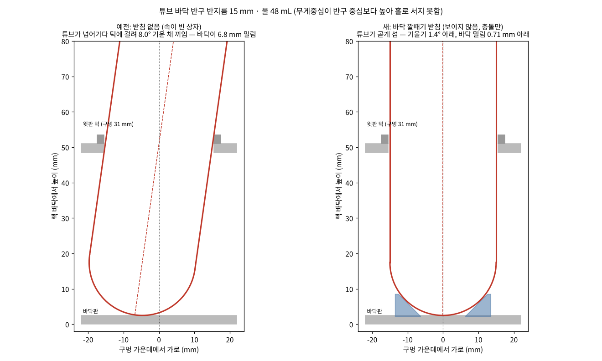

# Equations and application — BioTube-Insertion-VLA-IsaacLab

This document collects **the equations the code actually computes** in the digital twin, domain randomization, and scripted demo collector, together with where and how each equation is used. It has the same content as Sections 4–6 of Report 1 in the lab repo. [한국어](math_ko.md) · [README](../README_EN.md)

## 4. Equations and application — digital twin

### 4-1. Coordinate frames and notation

- $`\{B\}`$: robot base frame (= Isaac Lab environment frame). $`+x`$ forward, $`+y`$ left, $`+z`$ up. The base is at $`(-0.66,\,0,\,0.912)`$ m in world coordinates, and the table top is at $`z_w = 0.900`$ m.
- TCP frame for top-down grasping: $`z_{tcp} = -\hat z`$, $`x_{tcp}`$ = wrist direction (yaw), and the fingers open along $`y_{tcp}`$.
- One control step $`\Delta t = 4 \times \tfrac{1}{120} \approx 0.0333`$ s → 30 Hz (recorded once every 4 physics steps).
- $`[\,v\,]_\times`$: the cross-product matrix of vector $`v`$. $`\operatorname{Exp}`$ · $`\operatorname{Log}`$: the exponential · logarithm maps between rotation matrices and rotation vectors.

### 4-2. Pinhole projection

For a camera image of width $`W`$, height $`H`$, and horizontal FOV $`\phi`$, the focal length (in pixels) is

```math
f_x = f_y = \frac{W/2}{\tan(\phi/2)}
```

The principal point is at the image center. The camera frame follows the OpenGL convention (right · up · back), so $`R_c = [\,\mathbf r\;\;\mathbf u\;\;-\mathbf f\,]`$, and projecting the camera coordinates $`P_c = R_c^\top (X - c)`$ of a world point $`X`$ onto the image gives

```math
u = \frac{W}{2} + f_x\,\frac{P_{c,x}}{-P_{c,z}}, \qquad
v = \frac{H}{2} - f_x\,\frac{P_{c,y}}{-P_{c,z}}
```

The forward direction is built from yaw $`y`$ and pitch $`p`$ as $`\mathbf f = (\cos p\cos y,\ \cos p\sin y,\ \sin p)`$, with right $`\mathbf r = \widehat{\mathbf f \times \hat z}`$ and up $`\mathbf u = \mathbf r \times \mathbf f`$, and the result is then rotated by the roll angle.

**Application.** At 640×360, the FR3 third-person camera (FOV 69.7°) has $`f_x = 459.6`$ px and the FR5 one (87°) has $`337.2`$ px. This equation is shared by camera fitting (Section 4-3) and the "in view" condition of randomization (Section 5-1). In the Isaac Sim camera, it is entered as a focal length of 18 mm and a horizontal aperture of $`2\cdot 18\tan(\phi/2)`$.

### 4-3. Camera fitting — reprojection-error least squares

Given points $`u_i`$ picked in the real image and their 3D positions $`X_i(\theta_{obj})`$, we jointly solve for the camera pose $`\theta_{cam}`$ and (if needed) the object layout $`\theta_{obj}`$.

```math
\min_{\theta}\;\sum_i w_i\,\big\lVert \pi\!\left(X_i;\,\theta\right) - u_i \big\rVert^2 \;+\; \sum_k \lambda_k\, r_k(\theta)^2
```

$`r_k`$ are the additional constraints below. The solver is `scipy.optimize.least_squares` (TRF), run from multiple starting points, keeping the lowest-cost solution.

- **FR3 third-person (10–11 unknowns):** camera position 3 · yaw · pitch · roll (+ FOV), rack layout $`(c_x, c_y, \theta, \text{pitch})`$. 9 points (rack 8 · base 1). **Vanishing-point constraint:** the two side edges of the table (world $`x`$ direction) meet at $`(398, 0)`$ in the photo, so the projection $`\pi_{dir}(-\hat x)`$ of the direction $`-\hat x`$ is tied to that point.

```math
r_{vp} = 0.3\,\big(\pi_{dir}(-\hat x) - (398,\,0)\big)
```

  Result: with the FOV left free, 69.7° and a reprojection RMS of **1.9 px** (2.7 px with the FOV fixed at 87°). From the photo alone, FOV and distance trade off against each other (57–87° with the same error).
- **FR5 third-person (15 unknowns):** camera 6, $`(x, y, \psi)`$ of the source rack · place location, table edges 3. FOV fixed at the D405 spec of 87°. 15 points + a **parallel-line constraint** (signed perpendicular distance between 6 observed table-edge points and the projected edge lines) + a table prior $`(d-d_0)/0.05`$. Result RMS **4.1 px**.
- **Wrist camera:** mounting position · tilt relative to the hand. The fingers at the bottom of the image are determined only by the mounting position (independent of the arm pose), so the fingers are given a weight of 2. FR3: fingers 1.3 px · rack points 14.1 px; FR5: fingers 1.4 px · points 8.6 px. The rack-point error is large because the real hand is slightly rotated relative to the rack row (a difference in arm pose, not in the camera).

### 4-4. Start pose — from the image via inverse kinematics

The hand position $`p_h`$ is first solved from image points (with the hand orientation fixed to point down), and the joint values are then obtained by inverse kinematics.

**FR3:** joints 3 and 5 are set to 0 and only 5 joints are solved.

```math
\min_{q}\;\big\lVert\, 10\,(p(q) - p_h) \,\big\rVert^2 + \big\lVert \operatorname{vec}\!\big(R(q) - R_{down}\big) \big\rVert^2
```

→ $`q = [2.8,\,-16.0,\,0,\,-150.9,\,0,\,134.9,\,47.8]^\circ`$.

**FR5:** the flange pose $`R_h = [\,\mathbf y\times\mathbf z,\ \mathbf y,\ \mathbf z\,]`$ ($`\mathbf z = -\hat z`$) is solved with analytical IK (Section 6-8), and among the 8 solutions the one closest to the saved real-robot pose is chosen → $`[-4.03,\,-70.18,\,-110.20,\,-89.62,\,90.00,\,-1.47]^\circ`$ (joint-limit margin 49.8°).

### 4-5. Tube model — water height and center of mass

Tube inner radius $`r_i = 15 - 1 = 14`$ mm (1 mm wall). The volume of water filled from the bottom up to height $`h`$ is hemisphere + cylinder:

```math
V(h)=\begin{cases}\dfrac{\pi h^2(3r_i-h)}{3}, & h\le r_i\\[2mm]
\dfrac{2}{3}\pi r_i^3+\pi r_i^2\,(h-r_i), & h>r_i\end{cases}
```

Solving $`V(h) = 48`$ mL by bisection (80 iterations) gives $`h = 82.62`$ mm (water surface 83.62 mm from the tube tip). The water's center of mass, using the cross-sectional area $`A(z)=\pi r(z)^2`$, is $`\bar z = \sum A z / \sum A = 44.57`$ mm. Combined with the empty tube of 3 g (center of mass $`0.55L`$, an estimate):

```math
z_{com}=\frac{3\cdot(0.55\cdot108)+48\cdot44.57}{51}=45.45\ \text{mm}
```

**Application.** The mass of 51 g and the center of mass are set in the USD MassAPI. $`z_{com} = 45.45 \text{ mm} > R = 15`$ mm, i.e. the center of mass is higher than the center of the bottom hemisphere, so **the tube cannot stand on its own on the hemisphere** (any slight tilt produces a torque that tilts it further). This is the cause of the problem in Section 4-6.

### 4-6. Jamming angle and funnel seat

**Jamming angle.** When a cylinder of diameter $`D`$ tilted by $`\theta`$ passes through a plate of thickness $`t`$, the horizontal width it occupies inside the plate is $`D/\cos\theta + t\tan\theta`$. The smallest angle at which this exceeds the hole diameter $`d_h`$ is the jamming angle.

```math
\frac{D}{\cos\theta}+t\tan\theta>d_h,\qquad D=30,\ t=5,\ d_h=31\ \text{mm}\ \Rightarrow\ \theta_{jam}=8.02^\circ
```

At this angle the tube tip is displaced $`48.5\tan\theta = 6.83`$ mm from the hole center. In the hollow sim rack, because of Section 4-5, the tube toppled and caught on the collar at this angle (all 11 early failures were of this kind). By the same inequality, **if the tube is inserted along an axis that passes through the center of the hole collar, it does not touch the collar up to 8.02°** — this is the basis for the insertion method of Section 6-7 and the check of Section 6-9.

**Funnel seat (sim only, invisible collider).** For each hole, a ring whose inner face is inclined at $`\alpha = 45^\circ`$ is placed on the bottom plate. Letting the inner radius at height $`z`$ above the bottom-plate top be $`r = r_0 + z/\tan\alpha`$, the condition for the distance between the hemisphere of an upright tube (center $`(0, R)`$) and the face to equal the clearance $`c`$ is

```math
R\cos\alpha + r_0\sin\alpha = R + c\quad\Rightarrow\quad r_0=\frac{R(1-\cos\alpha)+c}{\sin\alpha}
```

With $`R = 15`$, $`c = 0.25`$ mm, $`r_0 = 6.57`$ mm, and the radius at a height of 6 mm is 12.57 mm (capture range). The hemisphere touches the face at $`(R\sin\alpha,\ R(1-\cos\alpha)) = (10.61,\ 4.39)`$ mm. Lateral play $`c/\sin\alpha = 0.35`$ mm, residual tilt $`\arctan\!\big((0.5+0.35)/36\big) = 1.36^\circ`$. Since the friction coefficient 0.5 < $`\tan\alpha = 1`$, the hemisphere slides along the face toward the center.

The inner vertices of the ring, which is split into 24 convex pieces, have their radius multiplied by $`\sec(\pi/24) = 1.00863`$. This puts the middle of each flat piece face on the cone surface so that the faces do not dig inward.



### 4-7. Sim–real comparison metrics

| Metric | Equation · method |
|---|---|
| Object position | Find rack (H 86–104, S ≥ 110, V ≥ 70) · cap (H 105–132) blobs in HSV and compare center · width · tilt (px) |
| Overlap | Rack-region IoU $`= \lvert M_s \cap M_r\rvert / \lvert M_s \cup M_r\rvert`$ |
| Color difference | CIE76 $`\Delta E = \lVert \text{Lab}_s - \text{Lab}_r \rVert_2`$ (sRGB → linear → XYZ → Lab with D65 reference). ≤ 2: barely perceptible, ≥ 10: clearly different |
| Brightness | $`Y = 0.2126\bar R + 0.7152\bar G + 0.0722\bar B`$, R/G · B/G ratios |

In the first measurement, the third-person rack position matched within 3 px, and the table color was ΔE 9.6. The real wrist camera recorded much darker images because of auto exposure · white balance (ΔE 29). To cover this gap in training, the lighting brightness · color are randomized (Section 5-3).

## 5. Equations and application — domain randomization

### 5-1. Layout sampling and rejection conditions

Positions are sampled uniformly from the region where the two workcell tables overlap (30 mm inside the edges): in world coordinates, $`x \in [-0.44,\ 0.295]`$, $`y \in [-0.425,\ 0.352]`$ m. Orientations are sampled around the reference angle $`\psi_0`$ (the leftward direction in the third-person view, $`\psi_0 = -91.2^\circ`$):

```math
\psi_{rack} = \psi_0 + U(-45^\circ,\ 45^\circ), \qquad \psi_{tube} \sim U(0^\circ,\ 360^\circ)
```

A sampled layout is used only if it satisfies all of the following **in order** (up to 20 empty-rack draws per source rack, up to 6000 draws in total).

1. **On the table:** the four bottom corners of both racks are inside the table box
2. **Reach annulus:** from both robot bases, both end holes of the source rack and all 4 holes of the empty rack satisfy

```math
0.38 \le \sqrt{x^2+y^2} \le 0.76\ \text{m}, \qquad |\operatorname{atan2}(y,x)| \le 70^\circ
```

   (the IK check is done for both robots at the planning stage — Section 6-8)
3. **In view:** in each robot's third-person camera, every check point has depth > 0 and $`m \le u \le W-m,\ m \le v \le H-m`$, $`m = 16`$ px (projection of Section 4-2). For the source rack, 8 box corners + 5 cap points per end hole; for the empty rack, 8 corners
4. **No occlusion:** Section 5-2
5. **Spacing:** ≥ 0.06 m between the footprints of the two racks (overlap by a separating-axis test, otherwise the minimum point–edge distance)
6. **Left-right consistency:** "red on the left/right" and "empty rack on the left/right", determined from the image $`u`$ coordinates, agree between the two cameras and match the requested combination

### 5-2. Occlusion check — line-of-sight segments and robot capsules

The robot links in the start pose are approximated as capsules $`(a_j, b_j, \rho_j)`$ (segment + radius). A check point is occluded if the minimum distance (Ericson's segment–segment distance) between the line-of-sight segment $`\overline{cX}`$ from camera $`c`$ to check point $`X`$ and any capsule segment is smaller than that capsule's radius.

```math
\text{occluded} \iff \exists j:\ \operatorname{dist}\big(\overline{cX},\ \overline{a_j b_j}\big) < \rho_j
```

FR5 link radii [0.075, 0.065, 0.06, 0.05, 0.05, 0.05] m, flange→TCP 0.06 m, finger bar radius 0.035 m. Franka: 8 links at 0.07 m.

### 5-3. Lighting — brightness and color temperature

For brightness, the dome (2400) and ceiling (4800) lights are multiplied by the same factor $`g \sim U(0.6,\ 1.4)`$. Color temperature is sampled uniformly in mired units — an interval that looks uniform to the human eye.

```math
K = \frac{1}{U\!\left(\tfrac{1}{8500},\ \tfrac{1}{5000}\right)}
```

For the color, chromaticity coordinates are obtained from the Kang et al. (2002) approximation of the blackbody locus $`x(T), y(T)`$, $`XYZ = (x/y,\ 1,\ (1-x-y)/y)`$ is converted to linear sRGB ($`c = M_{sRGB}\,XYZ`$), then 6500 K is mapped to white and the luminance is normalized to 1.

```math
\mathbf c = \frac{c(T) \oslash c(6500)}{0.2126\,c_r + 0.7152\,c_g + 0.0722\,c_b}
```

**Application.** 5000 K → (1.164, 0.978, 0.738) (warm), 8500 K → (0.886, 1.009, 1.248) (cool). Because of the luminance normalization, changing the color changes the image brightness only through $`g`$. This is meant to cover the way real camera image brightness changes with the time of day · weather, and the same ranges are used for both robots.

### 5-4. Balancing and seeds

- **Left-right combination · ring hole:** in paired collection, these are determined by the scene number $`n`$. Each block of 4 scenes contains a shuffle of the 4 cases, each appearing once.

```math
\text{choice}(n) = \operatorname{perm}_4\big(\text{rng}[\,s,\ \lfloor (n-1)/4 \rfloor,\ \text{salt}\,]\big)\big[(n-1) \bmod 4\big]
```

  (combination salt 7, ring-hole salt 11). In every 4 scenes, each case appears exactly once.
- **Seed splitting:** layout $`\text{rng}[s, n]`$, lighting $`[s, n, 1]`$, trajectory randomness $`[s, n, \text{attempt}, 23]`$. As long as the base seed $`s`$ and the scene number $`n`$ match, **FR3 and FR5 receive the same layout · lighting · ring hole**. This underlies the paired demonstrations (`pair_id = s-n`) and the experiment of re-running scenes that FR3 failed on FR5 (Section 8-4).

## 6. Equations and application — scripted demo generation and success check

### 6-1. Minimum-jerk time law

Each motion segment advances the progress $`s`$ over the normalized time $`\tau = t/T \in [0,1]`$ with the minimum-jerk polynomial.

```math
s(\tau)=10\tau^3-15\tau^4+6\tau^5,\qquad
s'(\tau)=30\tau^2(1-\tau)^2,\qquad
s''(\tau)=60\tau(1-\tau)(1-2\tau)
```

Since velocity and acceleration are zero at the start and end, the segments join smoothly. The maxima are $`\max s' = 15/8 = 1.875`$ ($`\tau = 1/2`$) and $`\max|s''| = 10/\sqrt3 \approx 5.77`$ ($`\tau = (3\pm\sqrt3)/6`$).

**Application.** The path $`p(s)`$ (Section 6-3) and the orientation $`R(s)`$ (Section 6-4) are advanced with this $`s(t/T)`$. At 30 Hz, the $`k = 1..n`$-th point $`Q_k = Q\big(s(k\Delta t/T)\big)`$ is sent as the action target.

### 6-2. Segment duration — joint velocity · acceleration limits

**Cartesian-space time.** Mean speed per segment $`v = v^{cfg}\cdot\sigma\cdot f`$ ($`\sigma = 0.5`$, $`f \sim U(0.85,\ 1.15)`$ per demonstration): travel 0.06f · vertical 0.03f · alignment 0.015f · insertion 0.02f m/s. For example, for the carry segment:

```math
T_{cart}^{carry}=\frac{\ell_{lift}}{v_{vert}}+\frac{\lVert mid-p_{lift}\rVert+\lVert p_{above}-mid\rVert}{v_{cart}}+\frac{z_{above}-z_{hov}}{v_{vert}}
```

**Joint-limit time.** Differentiating the joint path $`q(t) = Q(s(t/T))`$ gives

```math
\dot q=\frac{Q'(s)\,s'(\tau)}{T},\qquad
\ddot q=\frac{Q''(s)\,s'^2+Q'(s)\,s''}{T^2}
```

Computing this once at $`T = 1`$ directly yields the shortest duration that respects the limits.

```math
T_v=\max_{\tau,j}\frac{\lvert Q'_j(s(\tau))\,s'(\tau)\rvert}{\dot q_j^{max}},\qquad
T_a=\sqrt{\max_{\tau,j}\frac{\lvert Q''_j s'^2+Q'_j s''\rvert}{\ddot q_j^{max}}},\qquad
T_{min}=\max(T_v,\ T_a)
```

In the special case where the joints move linearly in $`s`$, this becomes $`T_v = 1.875\,\Delta q/\dot q^{max}`$, $`T_a = \sqrt{5.77\,\Delta q/\ddot q^{max}}`$. The code evaluates it numerically at 801 values of $`\tau`$ ($`Q'`$ = `np.gradient`, $`Q''`$ smoothed with a 5-point moving average).

**Final duration.**

```math
T=\max\big(T_{cart},\ 1.05\,T_{min},\ T_{floor},\ 0.6\ \text{s}\big),\qquad n=\lceil T/\Delta t\rceil,\quad T\leftarrow n\,\Delta t
```

$`T_{floor}`$ is the **common duration for both robots**. After planning both robots with the same random values, each segment is matched to the slower robot with $`T^{floor}_k = \max_r T^{(r)}_k`$ (approach · carry · retract). Limits: FR3 joints 0.8 rad/s (joint 7: 0.15 rad/s), FR5 15 °/s · 120 °/s². If a whole demonstration exceeds 60 s, that scene is skipped.

**Example (a single layout).** FR3 carry: $`T_{cart} = 12.81`$ s, $`T_{min} = 24.05`$ s (joint 7 rotates 67.3°) → $`1.05 \times 24.05 = 25.25`$ → 758 steps = **25.27 s**. FR5 carry had $`T_{min} = 13.21`$ s, but becomes 25.27 s with the common duration. Average over 30 layouts: FR3 alone 37.3 s · FR5 alone 30.5 s → common 37.9 · 37.8 s. The joint velocity/limit ratio of the recorded actions is at most 1.0.

### 6-3. Path — corner rounding and arc length

Each interior vertex $`b`$ (neighbors $`a, c`$) of the polyline $`[\,p_0,\ via,\ p_{pre},\ p_g\,]`$ is rounded with a quadratic Bézier curve.

```math
r=\min(r^{cfg},\ 0.45\,\ell_a,\ 0.45\,\ell_c),\qquad P_1=b-r\,\hat e_a,\quad P_2=b+r\,\hat e_c
```

```math
B(u)=(1-u)^2P_1+2u(1-u)\,b+u^2P_2,\qquad u\in[0,1]
```

Because the vertex itself is the control point, the curve is tangent to both edges. The rounded path is turned into a dense polyline $`S_k`$, and progress is mapped to arc length using the cumulative length $`d_k`$.

```math
p(s)=\operatorname{lerp}\big(sL;\ d_k,\ S_k\big),\qquad L=d_{end},\ s\in[0,1]
```

**Application.** Approach via point $`via = \tfrac12(p_0+p_{pre}) + (v_x, v_y, h_{arc})`$, $`v_{x,y} \sim U(\pm 0.03)`$, $`h_{arc} \sim U(0,\ 0.04)`$ m. Rounding distances 0.06 · 0.03 m (approach), 0.04 · 0.06 · 0.04 m (carry). IK is solved at $`M = \operatorname{clip}(\lceil L/0.004\rceil + \lceil\theta_{deg}/2\rceil,\ 24,\ 4000)`$ points, with linear interpolation in joint space in between.

### 6-4. Orientation interpolation — SO(3) exp · log

Two orientations $`R_0 \to R_1`$ are connected along the geodesic.

```math
\omega=\operatorname{Log}\!\big(R_1R_0^\top\big),\qquad R(s)=\operatorname{Exp}\!\big(u(s)\,\omega\big)\,R_0
```

$`\operatorname{Exp}`$ is the Rodrigues formula $`I+\sin\theta\,[\hat k]_\times+(1-\cos\theta)[\hat k]_\times^2`$, and $`\operatorname{Log}`$ is $`\theta=\arccos\big((\operatorname{tr}R-1)/2\big)`$, $`\omega=\frac{\theta}{2\sin\theta}(R_{32}-R_{23},\ R_{13}-R_{31},\ R_{21}-R_{12})`$ (near $`\theta \approx \pi`$, computed separately from a column of $`(R+I)/2`$). When both orientations point down, $`R_1R_0^\top = R_z(\Delta\psi)`$, so the rotation is **only about the vertical axis**.

There are two progress functions $`u(s)`$.

```math
\text{smoothstep:}\ u=3x^2-2x^3,\ x=\tfrac{s-s_0}{s_1-s_0}
\qquad
\text{time:}\ u=s_{mj}\!\left(\frac{s_{mj}^{-1}(s)-t_0}{t_1-t_0}\right)
```

Since $`s_{mj}^{-1}(s(\tau)) = \tau`$, in the `time` mode **the rotation itself is minimum-jerk in time**. When the whole segment is used, the peak wrist angular velocity is smoothstep $`1.5 \times 1.875 = 2.81`$ vs. time $`1.875`$, i.e. 1/3 lower.

**Application.** The `time` mode is used for the approach, and the rotation continues until the TCP is 3.5 cm above the grasp point. The wrist pushes less against the joint limits, so the mean approach time dropped from 11.2 s → 8.2 s (joint limits unchanged).

### 6-5. Wrist orientation rule

The downward-facing TCP orientation is parameterized by a single yaw $`\psi`$.

```math
R(\psi)=\big[\,(\cos\psi,\ \sin\psi,\ 0)^\top\ \ (\sin\psi,\ -\cos\psi,\ 0)^\top\ \ (0,\ 0,\ -1)^\top\,\big]
```

The candidate angles follow the rack orientation so that **the fingers open along the rack row**: $`\psi = \psi_{rack} + 90^\circ + j + 180^\circ k`$ ($`j = 6^\circ\cdot U(-1,1)`$). Up to 3 are kept in order of least wrist rotation, and angles at which the open fingers (a rectangle) would touch a neighboring cap (radius 16.5 mm + 6 mm) are excluded. The second, 180°-symmetric candidate is solved only when the last-joint rotation of the first candidate exceeds 60°, and the choice is made by $`(T_{min},\ |\Delta q_{last}|)`$ in that order.

### 6-6. Grasp pose and in-hand transform

Given the tube tip $`b`$, axis $`\hat a`$, and tube length $`L_t = 0.108`$ m,

```math
p_g = b + \hat a\,(L_t - \delta),\qquad \delta \sim U(0.004,\ 0.009)\ \text{m}
```

The TCP is 99–104 mm from the tube tip and the fingertips are 92–97 mm (the cap spans 95–108 mm). After grasping, the position of the in-hand tube tip is measured in TCP coordinates.

```math
o = R_c^\top\,(b - p_c)
```

$`(p_c, R_c)`$ is the forward-kinematics TCP of the commanded joint values, so the tracking error is also captured in $`o`$. It is measured **three times** — right after grasping · above the hole · just before insertion. If $`\lVert o_{xy}\rVert > 15`$ mm or the tube is tilted more than 8°, that demonstration is discarded. From then on, targets are set as "where to put the tube tip," and the TCP target becomes $`p = b^{*} - R\,o`$.

### 6-7. Inserting along the tube axis

The measured in-hand axis is transferred to the hand orientation used for insertion, $`R_t`$ (the orientation re-leveled to horizontal).

```math
\hat a=\frac{R_t\,R_c^\top\,a_w}{\lVert R_t\,R_c^\top\,a_w\rVert}
```

The tube tip is lowered along the line that passes through the center $`c_0`$ of the target hole at collar height with direction $`\hat a`$.

```math
\ell(z)=c_0+\hat a\,\frac{z-c_{0,z}}{a_z},\qquad
b_{ent}=\ell\big(z^{dst}_{top}+0.004\big),\qquad
b_{rel}=\ell\big(z_{floor}+0.010\big)
```

```math
p_{ent}=b_{ent}-R_t\,o,\qquad p_{rel}=b_{rel}-R_t\,o
```

If $`a_z < \cos 12^\circ`$, it descends vertically. If the tube is tilted by $`\theta`$, the tip moves sideways by $`(z_{ent}-z_{rel})\tan\theta`$ as it descends (e.g., for a 47.5 mm descent, 5° → 4.16 mm). In that case, vertical insertion leaves the axis 3.3 mm off at collar height, whereas insertion along the axis keeps it within 0.1 mm (verified in a test environment). Per Section 4-6, if the axis passes through the collar center, the tube does not touch the collar up to 8°.

### 6-8. Inverse kinematics and joint checks

**FR3 (7-DoF, numerical):** damped least squares + null-space motion toward the start pose.

```math
e=\begin{bmatrix}p^*-p\\ \operatorname{Log}(R^*R^\top)\end{bmatrix},\qquad
J_{:,i}=\begin{bmatrix}z_i\times(p-o_i)\\ z_i\end{bmatrix}
```

```math
\Delta q=J^\top\big(JJ^\top+10^{-4}I\big)^{-1}e+\big(I-J^+J\big)\,0.02\,(q_{ref}-q),\qquad J^+=J^\top\big(JJ^\top+10^{-6}I\big)^{-1}
```

Starting from the previous point's solution, up to 40 iterations; it fails if more than 1 mm · 0.5° remains. Modified DH: $`d = [0.333, 0, 0.316, 0, 0.384, 0, 0]`$, $`a = [0, 0, 0, 0.0825, -0.0825, 0, 0.088]`$.

**FR5 (6-DoF, analytical):** UR-style solution with up to 8 solutions.

```math
\theta_1=\operatorname{atan2}(p_{05,y},\,p_{05,x})\pm\arccos\!\big(d_4/r\big)+\tfrac{\pi}{2},\qquad
\theta_5=\pm\arccos\!\Big(\frac{p_x\sin\theta_1-p_y\cos\theta_1-d_4}{d_6}\Big)
```

$`p_{05} = p - d_6 z_6`$, and the two-joint planar problem $`c_3 = (L^2-a_2^2-a_3^2)/(2a_2a_3)`$. Every solution is re-verified by forward kinematics, and the solution closest to the previous point is chosen (it fails if it jumps by more than 0.35 rad between points). Standard DH: $`d = [0.152, 0, 0, 0.102, 0.102, 0.100]`$, $`a = [0, -0.425, -0.395, 0, 0, 0]`$.

**Checks.** All points within $`[q_{lo}+3^\circ,\ q_{hi}-3^\circ]`$. For FR5, the point 167.6 mm from the flange must be at least 45 mm high in the base frame (57 mm above the table); for FR3, the TCP height must be at least 20 mm. Over 30 layouts, the lowest points were FR5 94.4 mm · FR3 90.8 mm. If both robots pass these checks for a scene, it becomes `set = common`.

### 6-9. Success check — collar-based

After transforming the tube tip $`r`$ and the axis $`\hat a`$ into the empty-rack frame, find the point on the axis whose height equals the collar height $`z_c`$.

```math
p_c = r+\hat a\,\frac{z_c-r_z}{a_z}\quad(a_z>0.2),\qquad
d_{ax}=\big\lVert\,p_{c,xy}-(x_h,\ 0)\,\big\rVert,\qquad z_c=\tfrac12(48.5+53.5)=51\ \text{mm}
```

Success requires all of:

```math
d_{ax}\le 2\ \text{mm},\qquad r_z<z_{floor}+10\ \text{mm},\qquad \arccos R_{33}<12^\circ
```

In addition: the nearest hole = the target hole, the ring stays in place within 3 mm · 10°, the yellow tube stays in its original hole under the same rule, and the red tube has come to rest (Section 6-10).

**Why collar-based.** When judging by tip position (old rule: tip within 5 mm · 10°), a tube tilted 8° without the seat had its tip displaced by 6–8 mm and was reported as "inserted but failed." What actually decides whether the tube has gone into the hole is the collar, so the check looks at whether the axis passes through the hole center at collar height.

### 6-10. Rest and bounce checks

If the last-step speed $`\lVert v\rVert < 0.05`$ m/s, the tube is at rest. Even if not, it is considered at rest if, after release, the positions over the last 15 steps (0.5 s) satisfy

```math
\Delta=\max_k\big\lVert p_k-p_{last}\big\rVert<1.5\ \text{mm}
```

(this prevents in-place jitter from being discarded as "still moving"). A bounce at the moment of release, $`\max v_z > 0.15`$ or $`\max\lVert v_{xy}\rVert > 0.25`$ m/s, is only flagged (appended to the discard reason).

### 6-11. FR5 hold assist (sim assist)

At the first step where the grasp latch is set, the tube within 25 mm of the TCP is selected and its pose relative to the hand, $`{}^{tcp}T_{tube} = T_{tcp}^{-1}\,T_{tube}`$, is stored; then, at every step while grasped, the following are written into the sim:

```math
T_{tube}=T_{tcp}\,{}^{tcp}T_{tube},\qquad
v=\frac{p_t-p_{t-1}}{\Delta t},\qquad
\omega=\frac{\operatorname{Log}\!\big(R_tR_{t-1}^\top\big)}{\Delta t}
```

```math
v_{tube}=v+\omega\times\big(p_{tube}-p_{tcp}\big),\qquad
v_{tube,z}\mathrel{+}=g\,\Delta t\,\frac{n+1}{2n}
```

The last term adds in advance the distance the tube would fall under gravity during one step ($`n = 4`$ physics substeps). In semi-implicit Euler with substep $`h = \Delta t/n`$, the displacement is $`\Delta t\,v_0 - g\Delta t^2\frac{n+1}{2n}`$, so adding this value makes the end-of-step position correct (0.204 m/s at $`n = 4`$). When the gripper command opens to 0.5 or below, the assist stops and control returns to physics (release · insertion checks remain pure physics).

**Grip force estimate.** With the knuckle drive limit $`\tau_{lim}`$ and the lever arm $`\ell`$ (mean axial distance between the TCP and the knuckle), $`F \approx \tau_{lim}/\ell`$. Matching 70 % of the real gripper's force, $`F^* = 115`$ N, requires $`\tau = F^*\ell`$.

### 6-12. Data representation — rot6d, state · action

Orientation is written as the **first two rows** of the rotation matrix.

```math
\text{rot6d}=[\,R_{11},\,R_{12},\,R_{13},\,R_{21},\,R_{22},\,R_{23}\,],\qquad r_3=r_1\times r_2
```

- **State:** $`[\,p_{tcp}(q),\ \text{rot6d},\ g,\ q\,]`$ — FR3 17-D, FR5 16-D, absolute values in the base frame. Gripper $`g = \operatorname{clip}\big((\bar q_g-g_{open})/(g_{closed}-g_{open})\big)`$ (0 open – 1 closed).
- **Action:** the same layout, computed from that step's target joint values $`q^*`$. Once the grasp latch is set, the gripper action is 1.
- **GR00T input (draft):** state = TCP 9 + gripper, action = relative TCP (reference = current TCP state) + absolute gripper, chunks of 16 steps (0.53 s). Dropping the joints allows FR3 and FR5 to be trained with a single model.

### 6-13. Motion-jump check

Velocity and acceleration are computed by finite differences of state · action.

```math
v_k=(x_{k+1}-x_k)\,f,\qquad a_k=(v_{k+1}-v_k)\,f,\qquad f=30\ \text{Hz}
```

A step is a "jump" if its acceleration is more than 4× the demonstration's top-1 % value and also exceeds a floor value (TCP 2 m/s² · joints 10 rad/s²).

```math
a_k>\max\!\big(a_{floor},\ 4\,P_{99}(a)\big)
```

Smooth speeding up and slowing down are not flagged; only isolated spike steps are. In a test demonstration with a deliberately injected 4 mm TCP teleport · 2.9° one-step joint jump, the check found exactly those steps.
