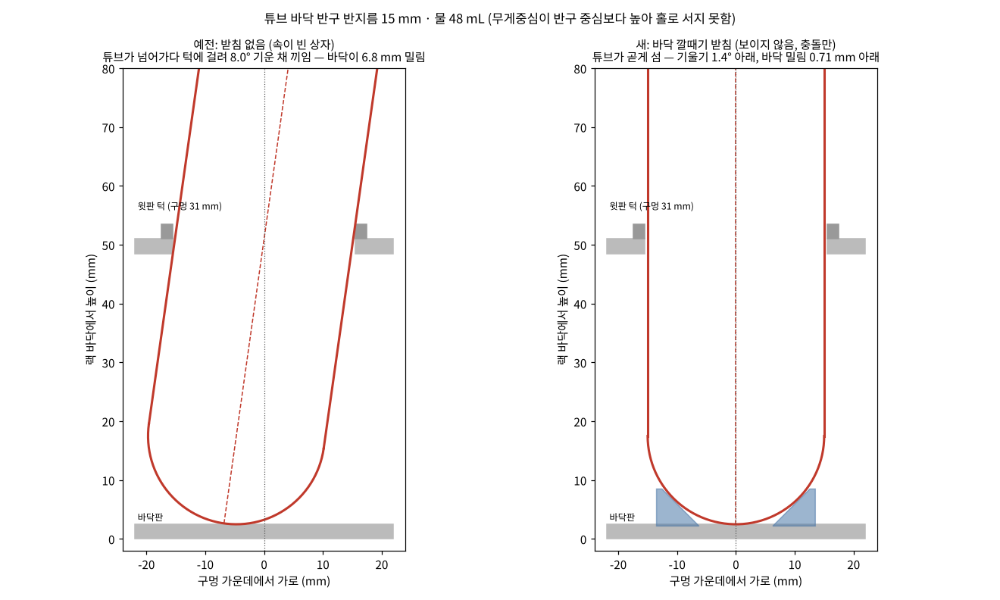

# 수식과 적용 — BioTube-Insertion-VLA-IsaacLab

이 문서는 디지털 트윈 · 도메인 랜덤화 · 자동 시연 수집기에서 **코드가 실제로 계산하는 식**과 그 식이 어디에 어떻게 쓰였는지를 모은 것입니다. 연구실 레포 보고서 1의 4\~6장과 같은 내용입니다. [English](math_en.md) · [README](../README.md)

## 4. 수식과 적용 — 디지털 트윈

### 4-1. 좌표계와 표기

- $`\{B\}`$: 로봇 받침 좌표계 (= Isaac Lab 환경 좌표계). $`+x`$ 앞, $`+y`$ 왼쪽, $`+z`$ 위. 받침의 world 자리는 $`(-0.66,\,0,\,0.912)`$ m, 책상 윗면은 $`z_w = 0.900`$ m.
- 위에서 아래로 쥐는 TCP 좌표계: $`z_{tcp} = -\hat z`$, $`x_{tcp}`$ = 손목 방향(yaw), 손가락은 $`y_{tcp}`$ 방향으로 벌어진다.
- 제어 한 스텝 $`\Delta t = 4 \times \tfrac{1}{120} \approx 0.0333`$ s → 30 Hz (물리 4 스텝마다 한 번 기록).
- $`[\,v\,]_\times`$: 벡터 $`v`$ 의 외적 행렬. $`\mathrm{Exp}`$ · $`\mathrm{Log}`$: 회전 행렬과 회전 벡터 사이의 지수 · 로그 사상.

### 4-2. 핀홀 투영

카메라 화면 폭 $`W`$, 높이 $`H`$, 수평 화각 $`\phi`$ 일 때 초점 거리(픽셀)는

```math
f_x = f_y = \frac{W/2}{\tan(\phi/2)}
```

주점은 화면 가운데다. 카메라 좌표계는 OpenGL 규칙(오른쪽 · 위 · 뒤)이라 $`R_c = [\,\mathbf r\;\;\mathbf u\;\;-\mathbf f\,]`$ 이고, world 점 $`X`$ 의 카메라 좌표 $`P_c = R_c^\top (X - c)`$ 를 화면에 비추면

```math
u = \frac{W}{2} + f_x\,\frac{P_{c,x}}{-P_{c,z}}, \qquad
v = \frac{H}{2} - f_x\,\frac{P_{c,y}}{-P_{c,z}}
```

앞 방향은 yaw $`y`$ · 숙임 $`p`$ 로 $`\mathbf f = (\cos p\cos y,\ \cos p\sin y,\ \sin p)`$, 오른쪽 $`\mathbf r = \widehat{\mathbf f \times \hat z}`$, 위 $`\mathbf u = \mathbf r \times \mathbf f`$ 를 만든 뒤 roll 만큼 돌린다.

**적용.** 640×360에서 FR3 3인칭(화각 69.7°)은 $`f_x = 459.6`$ px, FR5(87°)는 $`337.2`$ px. 이 식은 카메라 맞추기(4-3절)와 랜덤화의 「화면 안」 조건(5-1절)에서 같이 쓴다. Isaac Sim 카메라에는 초점 거리 18 mm, 가로 조리개 $`2\cdot 18\tan(\phi/2)`$ 로 넣는다.

### 4-3. 카메라 맞추기 — 재투영 오차 최소제곱

실물 화면에서 찍은 점 $`u_i`$ 와 그 점의 3D 위치 $`X_i(\theta_{obj})`$ 가 있을 때, 카메라 자세 $`\theta_{cam}`$ 와 (필요하면) 물체 배치 $`\theta_{obj}`$ 를 함께 푼다.

```math
\min_{\theta}\;\sum_i w_i\,\big\lVert \pi\!\left(X_i;\,\theta\right) - u_i \big\rVert^2 \;+\; \sum_k \lambda_k\, r_k(\theta)^2
```

$`r_k`$ 는 아래의 추가 조건이다. 풀이는 `scipy.optimize.least_squares` (TRF), 여러 시작점에서 풀어 비용이 가장 작은 것을 고른다.

- **FR3 3인칭 (10\~11개 미지수):** 카메라 위치 3 · yaw · 숙임 · roll (+ 화각), Rack 배치 $`(c_x, c_y, \theta, \text{간격})`$. 점 9개(Rack 8 · 받침 1). **소실점 조건:** 책상 양옆 모서리(world $`x`$ 방향)는 사진에서 $`(398, 0)`$ 에서 만나므로 방향 $`-\hat x`$ 의 투영 $`\pi_{dir}(-\hat x)`$ 을 그 점에 묶는다.

```math
r_{vp} = 0.3\,\big(\pi_{dir}(-\hat x) - (398,\,0)\big)
```

  결과: 화각을 풀게 두면 69.7°, 재투영 RMS **1.9 px** (화각 87° 고정이면 2.7 px). 사진만으로는 화각과 거리가 서로 바꿔 맞춰진다(같은 오차로 57\~87°).
- **FR5 3인칭 (15개 미지수):** 카메라 6, 원래 Rack · 놓을 곳의 $`(x, y, \psi)`$, 책상 모서리 3. 화각은 D405 사양 87°로 고정. 점 15개 + **평행선 조건**(관측한 책상 모서리 점 6개와 투영한 모서리 선 사이의 부호 있는 수직 거리) + 책상 사전값 $`(d-d_0)/0.05`$. 결과 RMS **4.1 px**.
- **손목 카메라:** 손 기준 장착 위치 · 기울기. 화면 아래의 손가락은 장착 위치로만 정해지므로(팔 자세와 무관) 손가락에 무게 2를 준다. FR3는 손가락 1.3 px · Rack 점 14.1 px, FR5는 손가락 1.4 px · 점 8.6 px. Rack 점 오차가 큰 것은 실물 손이 Rack 줄에 대해 조금 돌아가 있어서다(카메라가 아니라 팔 자세 차이).

### 4-4. 시작 자세 — 화면에서 역기구학으로

손 위치 $`p_h`$ 를 화면 점에서 먼저 풀고(손 방향은 아래를 보게 고정), 관절값을 역기구학으로 구한다.

**FR3:** 3번 · 5번 관절을 0으로 두고 5개 관절만 풂.

```math
\min_{q}\;\big\lVert\, 10\,(p(q) - p_h) \,\big\rVert^2 + \big\lVert \mathrm{vec}\!\big(R(q) - R_{down}\big) \big\rVert^2
```

→ $`q = [2.8,\,-16.0,\,0,\,-150.9,\,0,\,134.9,\,47.8]^\circ`$.

**FR5:** 플랜지 자세 $`R_h = [\,\mathbf y\times\mathbf z,\ \mathbf y,\ \mathbf z\,]`$ ($`\mathbf z = -\hat z`$) 를 해석적 역기구학(6-8절)으로 풀어 8개 해 중 실물 저장 자세에 가장 가까운 것을 고름 → $`[-4.03,\,-70.18,\,-110.20,\,-89.62,\,90.00,\,-1.47]^\circ`$ (관절 한계 여유 49.8°).

### 4-5. 튜브 모델 — 물 높이와 무게중심

튜브 안쪽 반지름 $`r_i = 15 - 1 = 14`$ mm (벽 1 mm). 바닥에서 높이 $`h`$ 까지 찬 물의 부피는 반구 + 원기둥:

```math
V(h)=\begin{cases}\dfrac{\pi h^2(3r_i-h)}{3}, & h\le r_i\\[2mm]
\dfrac{2}{3}\pi r_i^3+\pi r_i^2\,(h-r_i), & h>r_i\end{cases}
```

$`V(h) = 48`$ mL 를 이분법(80번)으로 풀면 $`h = 82.62`$ mm (튜브 끝에서 물 윗면 83.62 mm). 물의 무게중심은 단면적 $`A(z)=\pi r(z)^2`$ 로 $`\bar z = \sum A z / \sum A = 44.57`$ mm. 빈 튜브 3 g (무게중심 $`0.55L`$, 어림값)과 합치면

```math
z_{com}=\frac{3\cdot(0.55\cdot108)+48\cdot44.57}{51}=45.45\ \text{mm}
```

**적용.** 질량 51 g과 무게중심을 USD MassAPI에 넣는다. $`z_{com} = 45.45 \text{ mm} > R = 15`$ mm, 즉 무게중심이 바닥 반구의 중심보다 높아 **튜브는 반구 위에 홀로 서지 못한다**(조금만 기울면 더 기우는 쪽으로 돌림힘이 생김). 4-6절 문제의 원인이다.

### 4-6. 기울어 끼는 각과 깔때기 받침

**끼는 각.** 지름 $`D`$ 원기둥이 $`\theta`$ 만큼 기울어 두께 $`t`$ 판을 지날 때 판 안에서 차지하는 가로 폭은 $`D/\cos\theta + t\tan\theta`$ 다. 이것이 구멍 지름 $`d_h`$ 를 넘는 가장 작은 각이 끼는 각이다.

```math
\frac{D}{\cos\theta}+t\tan\theta>d_h,\qquad D=30,\ t=5,\ d_h=31\ \text{mm}\ \Rightarrow\ \theta_{jam}=8.02^\circ
```

이때 튜브 끝은 구멍 가운데에서 $`48.5\tan\theta = 6.83`$ mm 밀린다. 속이 빈 시뮬 Rack에서는 4-5절 때문에 튜브가 넘어가다 이 각에서 턱에 걸렸다(초기 실패 11번이 모두 이 경우). 같은 부등식 때문에 **구멍 턱 가운데를 지나는 축을 따라 넣으면 8.02°까지는 턱에 닿지 않는다** — 6-7절의 꽂기 방식과 6-9절 판정의 근거다.

**깔때기 받침 (시뮬 전용, 보이지 않는 충돌체).** 구멍마다 바닥판 위에 안쪽 면이 $`\alpha = 45^\circ`$ 로 기운 고리를 둔다. 바닥판 윗면에서 높이 $`z`$ 의 안쪽 반지름을 $`r = r_0 + z/\tan\alpha`$ 라 하면, 곧게 선 튜브의 반구(중심 $`(0, R)`$)와 면 사이 거리가 틈 $`c`$ 가 되는 조건은

```math
R\cos\alpha + r_0\sin\alpha = R + c\quad\Rightarrow\quad r_0=\frac{R(1-\cos\alpha)+c}{\sin\alpha}
```

$`R = 15`$, $`c = 0.25`$ mm 이면 $`r_0 = 6.57`$ mm, 높이 6 mm에서 반지름 12.57 mm(받아 주는 범위). 반구가 면에 닿는 점은 $`(R\sin\alpha,\ R(1-\cos\alpha)) = (10.61,\ 4.39)`$ mm. 옆 움직임 여유 $`c/\sin\alpha = 0.35`$ mm, 남는 기울기 $`\arctan\!\big((0.5+0.35)/36\big) = 1.36^\circ`$. 마찰계수 0.5 < $`\tan\alpha = 1`$ 이라 반구는 면을 따라 가운데로 미끄러진다.

볼록 조각 24개로 나눈 고리의 안쪽 꼭짓점은 반지름에 $`\sec(\pi/24) = 1.00863`$ 을 곱해 둔다. 평평한 조각 면의 가운데가 원뿔 면 위에 오게 해 면이 안쪽으로 파고들지 않게 하려는 것이다.



### 4-7. 시뮬–실물 비교 지표

| 지표 | 식 · 방법 |
|---|---|
| 물체 위치 | HSV로 Rack(H 86\~104, S ≥ 110, V ≥ 70) · 뚜껑(H 105\~132) 덩어리를 찾아 중심 · 폭 · 기울기 비교 (px) |
| 겹침 | Rack 영역 IoU $`= \lvert M_s \cap M_r\rvert / \lvert M_s \cup M_r\rvert`$ |
| 색 차이 | CIE76 $`\Delta E = \lVert \text{Lab}_s - \text{Lab}_r \rVert_2`$ (sRGB → 선형 → XYZ → D65 기준 Lab). 2 이하 거의 못 느낌, 10 이상 확실히 다름 |
| 밝기 | $`Y = 0.2126\bar R + 0.7152\bar G + 0.0722\bar B`$, R/G · B/G 비 |

첫 측정에서 3인칭 Rack 위치는 3 px 안으로 맞았고, 책상 색은 ΔE 9.6이었다. 실물 손목 카메라는 자동 노출 · 흰색 균형 때문에 훨씬 어둡게 찍혔다(ΔE 29). 이 차이를 학습에서 덮으려고 조명 밝기 · 색을 무작위로 바꾼다(5-3절).

## 5. 수식과 적용 — 도메인 랜덤화

### 5-1. 배치 뽑기와 거절 조건

자리는 두 실험대 책상이 겹치는 영역(가장자리 30 mm 안쪽)에서 고르게 뽑는다: world 기준 $`x \in [-0.44,\ 0.295]`$, $`y \in [-0.425,\ 0.352]`$ m. 방향은 기준 각 $`\psi_0`$ (3인칭 화면 왼쪽 방향, $`\psi_0 = -91.2^\circ`$) 에서

```math
\psi_{rack} = \psi_0 + U(-45^\circ,\ 45^\circ), \qquad \psi_{tube} \sim U(0^\circ,\ 360^\circ)
```

뽑은 배치는 아래를 **차례로** 모두 만족해야 쓴다(원래 Rack 하나에 빈 Rack을 최대 20번, 전체 최대 6000번).

1. **책상 안:** 두 Rack 바닥 네 모서리가 책상 상자 안
2. **도달 고리:** 두 로봇 받침에서 원래 Rack의 양 끝 구멍과 빈 Rack의 4개 구멍이 모두

```math
0.38 \le \sqrt{x^2+y^2} \le 0.76\ \text{m}, \qquad |\mathrm{atan2}(y,x)| \le 70^\circ
```

   (역기구학 확인은 계획 단계에서 두 로봇 모두 한다 — 6-8절)
3. **화면 안:** 각 로봇의 3인칭 카메라에서 모든 확인 점이 깊이 > 0 이고 $`m \le u \le W-m,\ m \le v \le H-m`$, $`m = 16`$ px (4-2절 투영). 원래 Rack은 상자 꼭짓점 8개 + 끝 구멍마다 뚜껑 점 5개, 빈 Rack은 꼭짓점 8개
4. **가림 없음:** 5-2절
5. **간격:** 두 Rack 바닥 사이 ≥ 0.06 m (분리축 검사로 겹침, 아니면 점–변 최소 거리)
6. **좌우 일치:** 화면 $`u`$ 좌표로 정한 「빨강이 왼쪽/오른쪽」 「빈 Rack이 왼쪽/오른쪽」이 두 카메라에서 같고, 요청한 조합과 맞음

### 5-2. 가림 판정 — 시선 선분과 로봇 캡슐

시작 자세의 로봇 링크를 캡슐 $`(a_j, b_j, \rho_j)`$ (선분 + 반지름) 로 어림한다. 카메라 $`c`$ 에서 확인 점 $`X`$ 까지의 시선 선분 $`\overline{cX}`$ 와 각 캡슐 선분 사이 최소 거리(Ericson의 선분–선분 거리)가 반지름보다 작으면 가린 것이다.

```math
\text{가림} \iff \exists j:\ \mathrm{dist}\big(\overline{cX},\ \overline{a_j b_j}\big) < \rho_j
```

FR5 링크 반지름 [0.075, 0.065, 0.06, 0.05, 0.05, 0.05] m, 플랜지→TCP 0.06 m, 손가락 막대 반지름 0.035 m. Franka 링크 8개 0.07 m.

### 5-3. 조명 — 밝기와 색온도

밝기는 돔(2400) · 천장(4800)에 같은 배율 $`g \sim U(0.6,\ 1.4)`$ 를 곱한다. 색온도는 미레드(mired) 단위에서 고르게 뽑는다 — 사람 눈에 고르게 보이는 간격이다.

```math
K = \frac{1}{U\!\left(\tfrac{1}{8500},\ \tfrac{1}{5000}\right)}
```

색은 Kang et al.(2002)의 흑체 궤적 근사 $`x(T), y(T)`$ 로 색도 좌표를 얻고, $`XYZ = (x/y,\ 1,\ (1-x-y)/y)`$ 를 선형 sRGB로 바꾼 뒤($`c = M_{sRGB}\,XYZ`$), 6500 K를 흰색으로 맞추고 밝기(휘도)를 1로 정규화한다.

```math
\mathbf c = \frac{c(T) \oslash c(6500)}{0.2126\,c_r + 0.7152\,c_g + 0.0722\,c_b}
```

**적용.** 5000 K → (1.164, 0.978, 0.738) (따뜻함), 8500 K → (0.886, 1.009, 1.248) (차가움). 밝기 정규화 때문에 색을 바꿔도 화면 밝기는 $`g`$ 로만 바뀐다. 실물 카메라 화면 밝기가 시간 · 날씨에 따라 바뀌는 것을 덮기 위한 것이며, 두 로봇에 같은 범위를 쓴다.

### 5-4. 균형과 시드

- **좌우 조합 · 링 구멍:** 짝 수집에서는 장면 번호 $`n`$ 으로 정한다. 4장면을 한 묶음으로 4가지를 한 번씩 섞는다.

```math
\text{choice}(n) = \mathrm{perm}_4\big(\text{rng}[\,s,\ \lfloor (n-1)/4 \rfloor,\ \text{salt}\,]\big)\big[(n-1) \bmod 4\big]
```

  (조합 salt 7, 링 구멍 salt 11). 4장면마다 각 경우가 정확히 한 번 나온다.
- **시드 나누기:** 배치 $`\text{rng}[s, n]`$, 조명 $`[s, n, 1]`$, 궤적 무작위 $`[s, n, \text{시도}, 23]`$. 기본 시드 $`s`$ 와 장면 번호 $`n`$ 만 같으면 **FR3 · FR5가 같은 배치 · 조명 · 링 구멍**을 받는다. 짝 시연(`pair_id = s-n`)과, FR3가 실패한 장면을 FR5로 다시 해 보는 실험(8-4절)의 바탕이다.

## 6. 수식과 적용 — 자동 시연 생성과 판정

### 6-1. 최소 저크 시간 법칙

각 이동 구간은 정규화 시간 $`\tau = t/T \in [0,1]`$ 에서 진행률 $`s`$ 를 최소 저크 다항식으로 움직인다.

```math
s(\tau)=10\tau^3-15\tau^4+6\tau^5,\qquad
s'(\tau)=30\tau^2(1-\tau)^2,\qquad
s''(\tau)=60\tau(1-\tau)(1-2\tau)
```

시작 · 끝에서 속도 · 가속도가 0이라 구간 사이가 매끄럽게 이어진다. 최대값은 $`\max s' = 15/8 = 1.875`$ ($`\tau = 1/2`$), $`\max|s''| = 10/\sqrt3 \approx 5.77`$ ($`\tau = (3\pm\sqrt3)/6`$).

**적용.** 경로 $`p(s)`$ (6-3절)와 자세 $`R(s)`$ (6-4절)를 이 $`s(t/T)`$ 로 진행시킨다. 30 Hz로 $`k = 1..n`$ 번째 점 $`Q_k = Q\big(s(k\Delta t/T)\big)`$ 를 동작 목표로 보낸다.

### 6-2. 구간 시간 — 관절 속도 · 가속도 한계

**직교 공간 시간.** 구간별 평균 속도 $`v = v^{cfg}\cdot\sigma\cdot f`$ ($`\sigma = 0.5`$, 시연마다 $`f \sim U(0.85,\ 1.15)`$): 이동 0.06f · 위아래 0.03f · 맞추기 0.015f · 꽂기 0.02f m/s. 예를 들어 옮기기는

```math
T_{cart}^{carry}=\frac{\ell_{lift}}{v_{vert}}+\frac{\lVert mid-p_{lift}\rVert+\lVert p_{above}-mid\rVert}{v_{cart}}+\frac{z_{above}-z_{hov}}{v_{vert}}
```

**관절 한계 시간.** 관절 경로 $`q(t) = Q(s(t/T))`$ 를 미분하면

```math
\dot q=\frac{Q'(s)\,s'(\tau)}{T},\qquad
\ddot q=\frac{Q''(s)\,s'^2+Q'(s)\,s''}{T^2}
```

$`T = 1`$ 에서 한 번 계산해 두면 한계를 지키는 가장 짧은 시간이 바로 나온다.

```math
T_v=\max_{\tau,j}\frac{\lvert Q'_j(s(\tau))\,s'(\tau)\rvert}{\dot q_j^{max}},\qquad
T_a=\sqrt{\max_{\tau,j}\frac{\lvert Q''_j s'^2+Q'_j s''\rvert}{\ddot q_j^{max}}},\qquad
T_{min}=\max(T_v,\ T_a)
```

관절이 $`s`$ 에 대해 곧게 움직이는 특별한 경우 $`T_v = 1.875\,\Delta q/\dot q^{max}`$, $`T_a = \sqrt{5.77\,\Delta q/\ddot q^{max}}`$ 이 된다. 코드는 801개 $`\tau`$ 에서 수치로 계산한다($`Q'`$ = `np.gradient`, $`Q''`$ 는 5점 이동평균으로 다듬음).

**최종 시간.**

```math
T=\max\big(T_{cart},\ 1.05\,T_{min},\ T_{floor},\ 0.6\ \text{s}\big),\qquad n=\lceil T/\Delta t\rceil,\quad T\leftarrow n\,\Delta t
```

$`T_{floor}`$ 는 **두 로봇 공통 시간**이다. 같은 무작위 값으로 두 로봇의 계획을 모두 세운 뒤 구간마다 $`T^{floor}_k = \max_r T^{(r)}_k`$ 로 느린 로봇에 맞춘다(다가가기 · 옮기기 · 빠지기). 한계: FR3 관절 0.8 rad/s (7번 0.15 rad/s), FR5 15 °/s · 120 °/s². 시연 전체가 60 s를 넘으면 그 장면은 건너뛴다.

**예 (같은 배치 하나).** FR3 옮기기: $`T_{cart} = 12.81`$ s, $`T_{min} = 24.05`$ s (7번 관절이 67.3° 돎) → $`1.05 \times 24.05 = 25.25`$ → 758 스텝 = **25.27 s**. FR5 옮기기는 $`T_{min} = 13.21`$ s 였지만 공통 시간으로 25.27 s. 배치 30개 평균: FR3 혼자 37.3 s · FR5 혼자 30.5 s → 공통 37.9 · 37.8 s. 기록된 동작의 관절 속도/한계 비는 최대 1.0.

### 6-3. 경로 — 모서리 둥글리기와 호 길이

꺾은선 $`[\,p_0,\ via,\ p_{pre},\ p_g\,]`$ 의 안쪽 꼭짓점 $`b`$ (이웃 $`a, c`$) 를 2차 베지어 곡선으로 둥글린다.

```math
r=\min(r^{cfg},\ 0.45\,\ell_a,\ 0.45\,\ell_c),\qquad P_1=b-r\,\hat e_a,\quad P_2=b+r\,\hat e_c
```

```math
B(u)=(1-u)^2P_1+2u(1-u)\,b+u^2P_2,\qquad u\in[0,1]
```

꼭짓점 자신이 조절점이라 곡선이 두 변에 접한다. 둥글린 길을 촘촘한 꺾은선 $`S_k`$ 로 만들고 누적 길이 $`d_k`$ 로 진행률을 호 길이에 맞춘다.

```math
p(s)=\mathrm{lerp}\big(sL;\ d_k,\ S_k\big),\qquad L=d_{end},\ s\in[0,1]
```

**적용.** 다가가기 경유점 $`via = \tfrac12(p_0+p_{pre}) + (v_x, v_y, h_{arc})`$, $`v_{x,y} \sim U(\pm 0.03)`$, $`h_{arc} \sim U(0,\ 0.04)`$ m. 둥글림 거리 0.06 · 0.03 m(다가가기), 0.04 · 0.06 · 0.04 m(옮기기). 역기구학은 $`M = \mathrm{clip}(\lceil L/0.004\rceil + \lceil\theta_{deg}/2\rceil,\ 24,\ 4000)`$ 개 점에서 풀고, 사이는 관절 공간에서 선형 보간한다.

### 6-4. 자세 보간 — SO(3) 지수 · 로그

두 자세 $`R_0 \to R_1`$ 사이를 측지선으로 잇는다.

```math
\omega=\mathrm{Log}\!\big(R_1R_0^\top\big),\qquad R(s)=\mathrm{Exp}\!\big(u(s)\,\omega\big)\,R_0
```

$`\mathrm{Exp}`$ 는 로드리게스 식 $`I+\sin\theta\,[\hat k]_\times+(1-\cos\theta)[\hat k]_\times^2`$, $`\mathrm{Log}`$ 는 $`\theta=\arccos\big((\mathrm{tr}R-1)/2\big)`$, $`\omega=\frac{\theta}{2\sin\theta}(R_{32}-R_{23},\ R_{13}-R_{31},\ R_{21}-R_{12})`$ ($`\theta \approx \pi`$ 에서는 $`(R+I)/2`$ 의 열로 따로 계산). 두 자세가 모두 아래를 보면 $`R_1R_0^\top = R_z(\Delta\psi)`$ 라 **수직 축으로만** 돈다.

진행 함수 $`u(s)`$ 는 두 가지다.

```math
\text{smoothstep:}\ u=3x^2-2x^3,\ x=\tfrac{s-s_0}{s_1-s_0}
\qquad
\text{time:}\ u=s_{mj}\!\left(\frac{s_{mj}^{-1}(s)-t_0}{t_1-t_0}\right)
```

$`s_{mj}^{-1}(s(\tau)) = \tau`$ 이므로 `time` 방식은 **회전 자체가 시간에 대해 최소 저크**다. 구간 전체를 쓸 때 손목 각속도 최대는 smoothstep $`1.5 \times 1.875 = 2.81`$ 대 time $`1.875`$ 로 1/3 낮다.

**적용.** 다가가기에 `time` 방식을 쓰고 회전을 손끝이 쥐는 점 3.5 cm 위에 올 때까지 이어 가게 했다. 손목이 관절 한계를 덜 밀어 다가가기 평균이 11.2 s → 8.2 s로 줄었다(관절 한계는 그대로).

### 6-5. 손목 방향 규칙

아래를 보는 TCP 자세를 yaw $`\psi`$ 하나로 쓴다.

```math
R(\psi)=\big[\,(\cos\psi,\ \sin\psi,\ 0)^\top\ \ (\sin\psi,\ -\cos\psi,\ 0)^\top\ \ (0,\ 0,\ -1)^\top\,\big]
```

후보 각은 Rack 방향에 맞춰 **손가락이 Rack 줄을 따라 벌어지게** $`\psi = \psi_{rack} + 90^\circ + j + 180^\circ k`$ ($`j = 6^\circ\cdot U(-1,1)`$). 손목을 덜 돌리는 순서로 최대 3개를 남기고, 벌린 손가락(직사각형)이 옆 뚜껑(반지름 16.5 mm + 6 mm)에 닿는 각은 뺀다. 180° 대칭인 두 번째 후보는 첫 후보의 마지막 관절 회전이 60°를 넘을 때만 풀어, $`(T_{min},\ |\Delta q_{last}|)`$ 순으로 고른다.

### 6-6. 쥐기 자세와 손 안 변환

튜브 끝 $`b`$, 축 $`\hat a`$, 튜브 길이 $`L_t = 0.108`$ m 에서

```math
p_g = b + \hat a\,(L_t - \delta),\qquad \delta \sim U(0.004,\ 0.009)\ \text{m}
```

TCP는 튜브 끝에서 99\~104 mm, 손가락 끝은 92\~97 mm (뚜껑은 95\~108 mm). 쥔 뒤에는 손 안 튜브 끝의 위치를 TCP 좌표로 잰다.

```math
o = R_c^\top\,(b - p_c)
```

$`(p_c, R_c)`$ 는 명령 관절값의 순기구학 TCP라 추종 오차까지 $`o`$ 에 담긴다. **세 번** 잰다 — 쥔 직후 · 구멍 위 · 꽂기 직전. $`\lVert o_{xy}\rVert > 15`$ mm 이거나 튜브가 8° 넘게 기울었으면 그 시연은 버린다. 이후 목표는 「튜브 끝을 어디에 둘지」로 세우고 TCP 목표는 $`p = b^{*} - R\,o`$ 로 바꾼다.

### 6-7. 튜브 축을 따라 꽂기

잰 손 안 축을 꽂을 때의 손 자세 $`R_t`$ (수평으로 다시 맞춘 자세) 기준으로 옮긴다.

```math
\hat a=\frac{R_t\,R_c^\top\,a_w}{\lVert R_t\,R_c^\top\,a_w\rVert}
```

목표 구멍 턱 높이의 가운데 $`c_0`$ 를 지나고 방향이 $`\hat a`$ 인 직선을 따라 튜브 끝을 내린다.

```math
\ell(z)=c_0+\hat a\,\frac{z-c_{0,z}}{a_z},\qquad
b_{ent}=\ell\big(z^{dst}_{top}+0.004\big),\qquad
b_{rel}=\ell\big(z_{floor}+0.010\big)
```

```math
p_{ent}=b_{ent}-R_t\,o,\qquad p_{rel}=b_{rel}-R_t\,o
```

$`a_z < \cos 12^\circ`$ 이면 수직으로 내린다. 튜브가 $`\theta`$ 기울어 있으면 끝은 $`(z_{ent}-z_{rel})\tan\theta`$ 만큼 옆으로 움직이며 내려간다(예: 47.5 mm 내릴 때 5° → 4.16 mm). 수직으로 꽂으면 같은 경우 턱 높이에서 축이 3.3 mm 어긋나지만, 축을 따라 꽂으면 0.1 mm 안이다(시험 환경 확인). 4-6절에 따라 축이 턱 가운데를 지나면 8°까지 턱에 닿지 않는다.

### 6-8. 역기구학과 관절 검사

**FR3 (7축, 수치):** 감쇠 최소제곱 + 영공간에서 시작 자세 쪽으로.

```math
e=\begin{bmatrix}p^*-p\\ \mathrm{Log}(R^*R^\top)\end{bmatrix},\qquad
J_{:,i}=\begin{bmatrix}z_i\times(p-o_i)\\ z_i\end{bmatrix}
```

```math
\Delta q=J^\top\big(JJ^\top+10^{-4}I\big)^{-1}e+\big(I-J^+J\big)\,0.02\,(q_{ref}-q),\qquad J^+=J^\top\big(JJ^\top+10^{-6}I\big)^{-1}
```

앞 점의 해에서 시작해 최대 40번, 1 mm · 0.5° 넘게 남으면 실패. 수정 DH: $`d = [0.333, 0, 0.316, 0, 0.384, 0, 0]`$, $`a = [0, 0, 0, 0.0825, -0.0825, 0, 0.088]`$.

**FR5 (6축, 해석해):** UR형 해법으로 최대 8개 해.

```math
\theta_1=\mathrm{atan2}(p_{05,y},\,p_{05,x})\pm\arccos\!\big(d_4/r\big)+\tfrac{\pi}{2},\qquad
\theta_5=\pm\arccos\!\Big(\frac{p_x\sin\theta_1-p_y\cos\theta_1-d_4}{d_6}\Big)
```

$`p_{05} = p - d_6 z_6`$, 2관절 평면 문제 $`c_3 = (L^2-a_2^2-a_3^2)/(2a_2a_3)`$. 모든 해를 순기구학으로 다시 확인하고, 앞 점에 가장 가까운 해를 고른다(점 사이 0.35 rad 넘게 튀면 실패). 표준 DH: $`d = [0.152, 0, 0, 0.102, 0.102, 0.100]`$, $`a = [0, -0.425, -0.395, 0, 0, 0]`$.

**검사.** 모든 점이 $`[q_{lo}+3^\circ,\ q_{hi}-3^\circ]`$ 안. FR5는 플랜지에서 167.6 mm 떨어진 점의 높이가 받침 기준 45 mm 이상(책상 위로는 57 mm), FR3는 TCP 높이 20 mm 이상. 배치 30개에서 가장 낮았던 점은 FR5 94.4 mm · FR3 90.8 mm. 장면마다 두 로봇 모두 이 검사를 통과하면 `set = common` 이 된다.

### 6-9. 성공 판정 — 턱 기준

튜브 끝 $`r`$ 과 축 $`\hat a`$ 를 빈 Rack 좌표로 옮긴 뒤, 축 위에서 높이가 턱 높이 $`z_c`$ 인 점을 구한다.

```math
p_c = r+\hat a\,\frac{z_c-r_z}{a_z}\quad(a_z>0.2),\qquad
d_{ax}=\big\lVert\,p_{c,xy}-(x_h,\ 0)\,\big\rVert,\qquad z_c=\tfrac12(48.5+53.5)=51\ \text{mm}
```

성공 조건은 모두 만족:

```math
d_{ax}\le 2\ \text{mm},\qquad r_z<z_{floor}+10\ \text{mm},\qquad \arccos R_{33}<12^\circ
```

여기에 가장 가까운 구멍 = 목표 구멍, 링이 3 mm · 10° 안에 그대로, 노란 튜브가 같은 규칙으로 원래 구멍에 그대로, 빨간 튜브가 멈춤(6-10절).

**왜 턱 기준인가.** 끝 위치로 판정하면(예전 규칙: 끝 5 mm · 10° 안) 받침 없이 8° 기운 튜브는 끝이 6\~8 mm 밀려 「꽂혔는데 실패」로 나왔다. 실제로 튜브가 구멍에 들어갔는지를 정하는 곳은 턱이므로, 턱 높이에서 축이 구멍 가운데를 지나는지를 본다.

### 6-10. 멈춤과 튐 판정

마지막 스텝 속력 $`\lVert v\rVert < 0.05`$ m/s 이면 멈춤. 아니어도 놓기 이후 최근 15 스텝(0.5 s)의 위치가

```math
\Delta=\max_k\big\lVert p_k-p_{last}\big\rVert<1.5\ \text{mm}
```

이면 멈춘 것으로 본다(제자리 떨림을 「아직 움직임」으로 버리던 것을 막음). 놓는 순간 튀어 오름은 $`\max v_z > 0.15`$ 또는 $`\max\lVert v_{xy}\rVert > 0.25`$ m/s 로 표시만 한다(버림 이유에 덧붙임).

### 6-11. FR5 쥔 동안 붙이기 (시뮬 보조)

쥠이 잡힌 첫 스텝에 TCP에서 25 mm 안의 튜브를 골라 손 기준 자세 $`{}^{tcp}T_{tube} = T_{tcp}^{-1}\,T_{tube}`$ 를 저장하고, 쥔 동안 매 스텝

```math
T_{tube}=T_{tcp}\,{}^{tcp}T_{tube},\qquad
v=\frac{p_t-p_{t-1}}{\Delta t},\qquad
\omega=\frac{\mathrm{Log}\!\big(R_tR_{t-1}^\top\big)}{\Delta t}
```

```math
v_{tube}=v+\omega\times\big(p_{tube}-p_{tcp}\big),\qquad
v_{tube,z}\mathrel{+}=g\,\Delta t\,\frac{n+1}{2n}
```

를 시뮬에 써 넣는다. 마지막 항은 한 스텝($`n = 4`$ 물리 하위 스텝) 동안 중력으로 떨어질 거리를 미리 보탠 것이다. 반암시적 오일러에서 하위 스텝 $`h = \Delta t/n`$ 의 변위는 $`\Delta t\,v_0 - g\Delta t^2\frac{n+1}{2n}`$ 이므로, 이 값을 더하면 스텝 끝 위치가 맞는다($`n = 4`$ 에서 0.204 m/s). 그리퍼 명령이 0.5 이하로 열리면 멈추고 다시 물리로 돌아간다(놓기 · 꽂힘 판정은 물리 그대로).

**쥐는 힘 어림.** 너클 구동 한계 $`\tau_{lim}`$ 과 지렛대 $`\ell`$ (TCP와 너클 사이 축 방향 거리 평균)로 $`F \approx \tau_{lim}/\ell`$. 실물 70 % 힘 $`F^* = 115`$ N에 맞추려면 $`\tau = F^*\ell`$ 이 필요하다.

### 6-12. 데이터 표현 — rot6d, 상태 · 동작

자세는 회전 행렬의 **앞 두 행**으로 쓴다.

```math
\text{rot6d}=[\,R_{11},\,R_{12},\,R_{13},\,R_{21},\,R_{22},\,R_{23}\,],\qquad r_3=r_1\times r_2
```

- **상태:** $`[\,p_{tcp}(q),\ \text{rot6d},\ g,\ q\,]`$ — FR3 17차원, FR5 16차원, 받침 기준 절대값. 그리퍼 $`g = \mathrm{clip}\big((\bar q_g-g_{open})/(g_{closed}-g_{open})\big)`$ (0 벌림 \~ 1 닫힘).
- **동작:** 같은 배치를 그 스텝의 목표 관절값 $`q^*`$ 에서 계산. 쥠이 잡히면 그리퍼 동작은 1.
- **GR00T 입력 (초안):** 상태 = 손끝 9 + 그리퍼, 동작 = 손끝 상대값(기준 = 지금 손끝 상태) + 그리퍼 절대값, 16 스텝 묶음(0.53 s). 관절을 빼서 FR3 · FR5를 한 모델로 학습할 수 있다.

### 6-13. 움직임 튐 점검

상태 · 동작의 유한 차분으로 속도 · 가속도를 구한다.

```math
v_k=(x_{k+1}-x_k)\,f,\qquad a_k=(v_{k+1}-v_k)\,f,\qquad f=30\ \text{Hz}
```

한 스텝의 가속도가 그 시연의 상위 1 % 값보다 4배 넘게 크고 바닥 값(손끝 2 m/s² · 관절 10 rad/s²)도 넘으면 「튐」이다.

```math
a_k>\max\!\big(a_{floor},\ 4\,P_{99}(a)\big)
```

매끄럽게 빨라지고 느려지는 것은 걸리지 않고 홀로 튀어나온 스텝만 걸린다. 손끝 4 mm 순간 이동 · 관절 2.9° 한 스텝 튐을 일부러 넣은 시험 시연에서 그 스텝을 정확히 찾았다.
