# 실물 환경 → 디지털 트윈

2026-11-03 · Sim-to-Real Post-Training (시뮬레이션 파트) · [English](README_EN.md) · [← 목차](../../README.md#목차)

실물 FR3 · FR5 실험대를 시뮬로 옮긴 과정을 정리한다. 무엇을 실물에서 재고, 실물 카메라 화면을 어떤 영역(세그먼트)으로 나눠 어떤 값을 얻었는지, 그 값이 시뮬의 어디에 들어갔는지, 그리고 실물과 얼마나 맞는지 잰 방법과 결과를 차례로 적는다.
식의 전체 유도는 수식 정리의 [4장](../math_ko.md#4-수식과-적용--디지털-트윈)에 있고, 여기서는 이 과정에 쓰인 식만 다시 적는다.

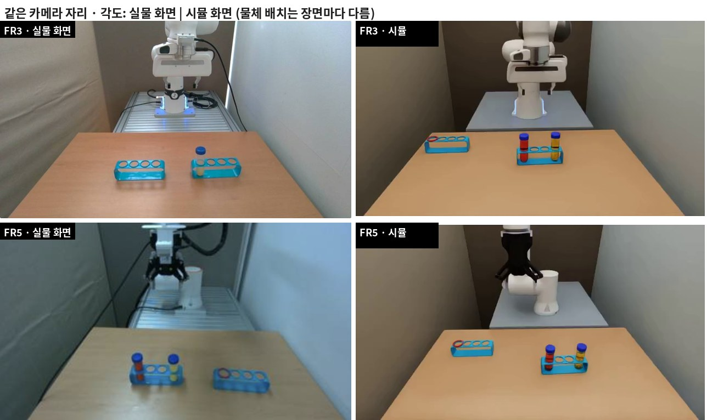

왼쪽은 실물 카메라 화면이고, 오른쪽은 같은 자리 · 각도 · 화각으로 맞춘 시뮬 카메라 화면이다. 물체 배치는 장면마다 무작위라 서로 다르다. FR3 실물 화면은 카메라를 맞출 때(10-27) 찍은 이전 배치이고, FR5 실물 화면(11-03)은 지금 과제 배치다(빨간 링이 씌워진 빈 Rack + 빨간 · 노란 물 튜브 Rack).

**목차**

1. [한눈에 — 실물에서 무엇을 가져왔나](#1-한눈에--실물에서-무엇을-가져왔나)
2. [실물 실험대와 카메라 화면](#2-실물-실험대와-카메라-화면)
3. [물체 — 실측에서 모양으로](#3-물체--실측에서-모양으로)
4. [화면 영역(세그먼트) 따기 → 장면 배치](#4-화면-영역세그먼트-따기--장면-배치)
5. [점 찍기 → 카메라 맞추기](#5-점-찍기--카메라-맞추기)
6. [색으로 딴 세그먼트로 실물과 비교](#6-색으로-딴-세그먼트로-실물과-비교)
7. [남은 차이와 대응](#7-남은-차이와-대응)
8. [코드와 설정 파일](#8-코드와-설정-파일)

## 1. 한눈에 — 실물에서 무엇을 가져왔나

| 실물에서 | 어떻게 | 시뮬에 들어간 값 | 맞는 정도 |
|---|---|---|---|
| 튜브 · Rack 모양 | 캘리퍼 실측 + 사진 비율 → Blender 스크립트 메시 | 튜브 108 × 30 mm, 뚜껑 33 × 13 mm, Rack 165 × 40 × 51 mm, 구멍 31 mm | 부피가 식과 0.3 % 안 |
| 빨간 링 | 실물 STL | 안 34 · 밖 41 · 높이 5 mm | 실물 파일 그대로 |
| 책상 · 받침대 · 벽 | 3인칭 화면에서 영역의 꼭짓점을 찍어 책상 높이 면으로 되짚음 | 책상 0.80 × 0.85 m (윗면 0.900 m), 받침대 · 벽 자리 | 화면 윤곽이 겹침 (그림 5) |
| 책상 색 | 책상 영역 5곳의 중앙값 | sRGB (173, 134, 105) | 3인칭 ΔE 9.6 |
| 3인칭 카메라 | 화면 점 · 모서리 선의 재투영 오차 최소제곱 | 자리 · 각도 · 화각 | FR3 1.9 px, FR5 4.1 px |
| 손목 카메라 | 손가락 · 물체 점의 재투영 오차 최소제곱 | 손 기준 장착 자리 · 기울기 | 손가락 FR3 1.3 px, FR5 1.4 px |
| 시작 자세 | 화면에서 손 위치 → 역기구학 | FR3 7 관절 · FR5 6 관절 | 화면 어림 (실측 관절값이 아님) |
| 검증 | 실물 · 시뮬 화면에서 같은 색 범위로 세그먼트를 따서 비교 | — | 3인칭 Rack 중심 차 3 px 이하 |

px 는 화면 크기 640 × 360 기준이다(FR3 사진 825 × 462, FR5 화면 611 × 346 에서 잰 값은 이 크기로 환산).

## 2. 실물 실험대와 카메라 화면

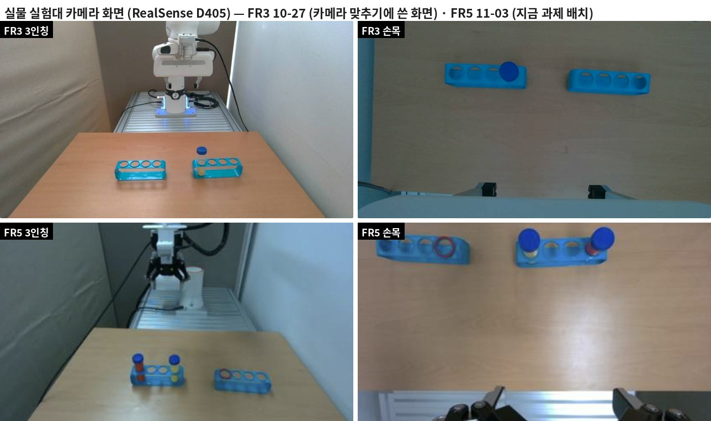

- 실물 실험대는 FR3 와 FR5 두 대다. 각각 3인칭 카메라와 손목 카메라로 RealSense D405 를 쓴다.
- 위에 검은 천막을 쳐 햇빛을 막았다. 그래서 조명은 고르게 퍼지고 밝기만 바뀐다. 시뮬도 그림자 없는 고른 빛으로 만들고, 밝기와 색온도만 무작위로 바꾼다.
- FR3 화면은 카메라를 맞출 때 쓴 화면(10-27)이라 물체 배치가 이전 과제의 것이다. FR5 화면은 지금 과제 배치(11-03)다. FR5 카메라를 맞출 때 쓴 화면(10-28)은 5장에 있다. 카메라 자리 · 책상 · 받침대는 과제와 상관없이 같으므로, 이전 배치 화면으로 맞춘 값을 그대로 쓴다.
- FR5 화면 아래 표시(11-03): 두 카메라 모두 848 × 480 · 30 fps, 흰색 균형 값 3인칭 3600 · 손목 3800 (화면에 표시된 카메라 설정값).

## 3. 물체 — 실측에서 모양으로

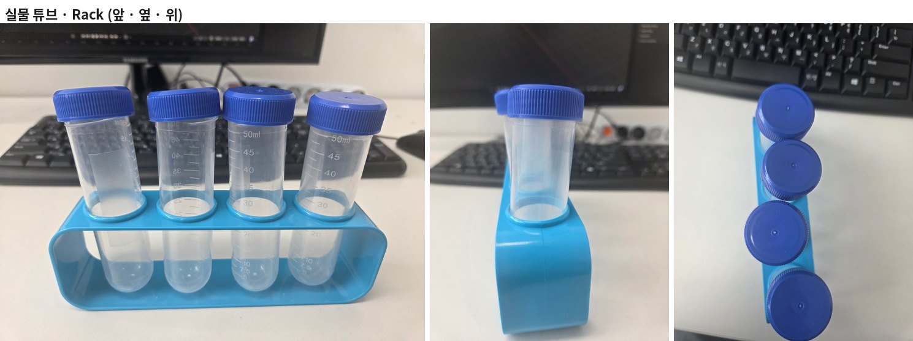

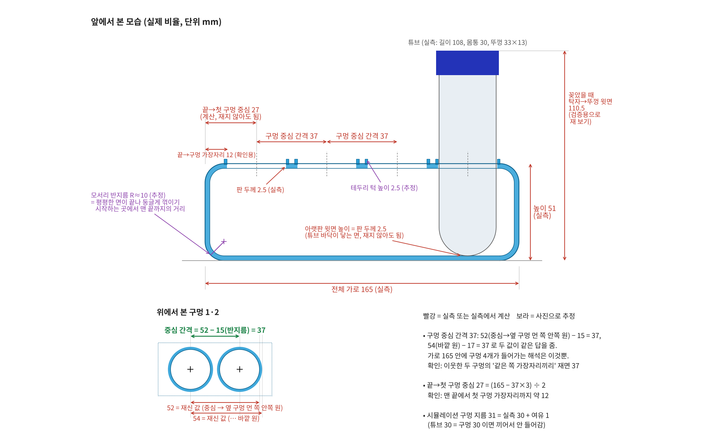

| 물체 | 실측 | 사진 · 계산으로 정한 것 | 시뮬 |
|---|---|---|---|
| 튜브 | 길이 108, 몸통 지름 30, 뚜껑 33 × 13 (mm) | 바닥 반구 반지름 15 (몸통의 반), 벽 두께 1 (추정) | 강체, 몸통 · 뚜껑 볼록 충돌체, 물 48 mL (51 g) |
| Rack | 가로 165, 폭 40, 높이 51, 판 두께 2.5 (mm) | 구멍 간격 37 = 52 − 15 = 54 − 17 (두 값이 같은 답), 끝 → 첫 구멍 27 = (165 − 37 × 3) / 2, 모서리 반지름 약 10 · 턱 높이 2.5 (사진 추정) | 구멍 4 개, 구멍 지름 31 |
| 빨간 링 | 실물 STL | — | 안 34 · 밖 41 · 높이 5 mm, 목표 구멍 턱 위 |

- **구멍 31 mm:** 실측은 30 mm 지만 시뮬에서 튜브 30 mm 와 구멍 30 mm 가 같으면 끼어서 들어가지 않는다. 그래서 여유 1 mm 를 더했다. 사진에서도 튜브가 조금 기울어 꽂혀 있어, 실제 구멍도 30 mm 보다 조금 클 가능성이 크다.
- **모양 확인:** 스크립트가 만든 메시는 모두 닫힌 메시이고 면이 바깥을 향한다. 튜브 몸통 부피는 64,896 mm³ 로 식의 값 65,031 mm³ 와 0.3 % 안이고, Rack 띠 부피도 40,682 mm³ 대 40,698 mm³ 다.
- **물:** 실물 사진의 튜브는 비어 있지만, 과제에서는 빨간 물 · 노란 물 48 mL 를 넣는다. 물 높이 · 무게 · 무게중심은 수식 정리 [4-5절](../math_ko.md#4-5-튜브-모델--물-높이와-무게중심)의 부피 식으로 계산했다.

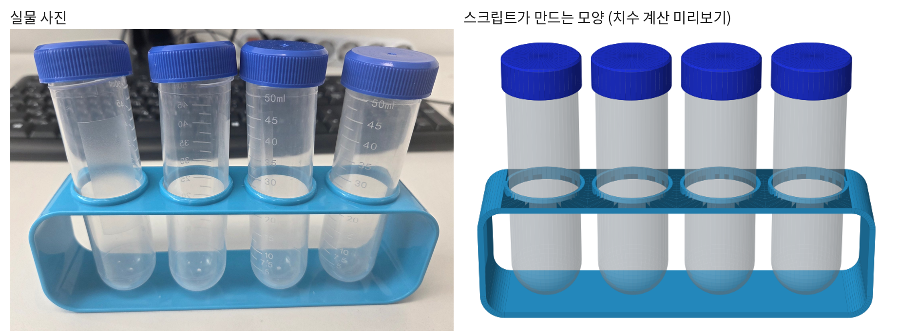

## 4. 화면 영역(세그먼트) 따기 → 장면 배치

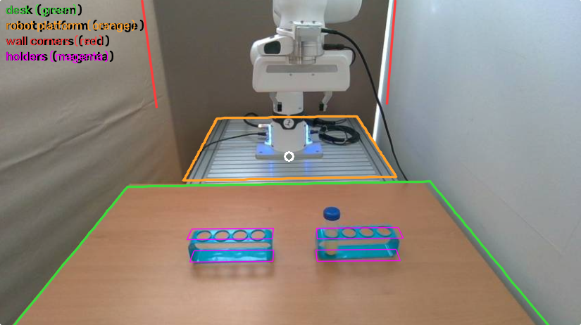

실물 3인칭 화면을 네 영역으로 나눴다. 영역마다 꼭짓점을 화면에서 찍어 다각형으로 땄다.

| 영역 | 색 | 얻은 것 |
|---|---|---|
| 책상 윗면 | 초록 | 먼 모서리 · 양옆 모서리 → 책상 자리 · 폭, 양옆 모서리가 모이는 점 → 카메라 숙임 |
| 로봇 받침대 (알루미늄) | 주황 | 받침대 앞 모서리 · 폭 |
| 벽 모서리 | 빨강 | 방 뒤 벽 · 옆 벽 자리 (세로선) |
| Rack | 자홍 | 카메라 맞추기의 점 (5장) |

### 4-1. 화면 점 → 책상 면 위의 점 (되짚기)

카메라 자리 $`c`$, 오른쪽 · 위 · 앞 방향 $`\mathbf r,\ \mathbf u,\ \mathbf f`$, 초점 거리 $`f_x`$ (수식 정리 [4-2절](../math_ko.md#4-2-핀홀-투영))를 알면, 화면 점 $`(u, v)`$ 를 지나는 광선의 방향은 투영 식을 거꾸로 풀어

```math
\mathbf d(u,v) = \frac{u - W/2}{f_x}\,\mathbf r \;-\; \frac{v - H/2}{f_x}\,\mathbf u \;+\; \mathbf f
```

이다. 이 광선이 높이 $`z_0`$ 인 면(책상 윗면 0.900 m, 받침대 윗면 0.912 m)과 만나는 점은

```math
X = c + \lambda\,\mathbf d,\qquad \lambda = \frac{z_0 - c_z}{d_z}\quad(\lambda > 0)
```

이다. 책상 먼 모서리의 두 끝을 되짚으면 책상의 먼 쪽 $`x`$ 와 양옆 $`y`$ 가 나온다. 앞 모서리는 화면 밖이라 책상 깊이 0.8 m 는 가정한 값이다. 벽은 바닥 높이 면으로 되짚은 세로선 자리로 어림했다.

- **FR3:** 맞춘 카메라(5장)로 되짚었다.
- **FR5:** 책상 먼 모서리 $`x_f`$ 와 양옆 $`y_l,\ y_r`$ 을 카메라와 같이 최소제곱의 미지수로 넣었다(5장). FR3 값에서 크게 벗어나지 않게 사전값 $`(d - d_0)/0.05`$ 를 더했다.

### 4-2. 책상 모서리가 모이는 점 → 카메라 숙임

책상 양옆 모서리는 실물에서 평행한 직선(로봇 앞뒤 방향, world $`x`$)이다. 그래서 화면에서는 한 점(소실점)에서 만난다. FR3 화면에서 두 모서리를 직선으로 맞추면 $`x = -0.8217\,y + 398.1`$ 과 $`x = 0.7850\,y + 397.7`$ 이고, 이 둘은 $`(398,\ 0)`$ 에서 만난다(825 × 462 기준).
방향 $`-\hat x`$ 의 투영이 이 점에 오도록 카메라 맞추기에 조건을 하나 더했다(수식 정리 [4-3절](../math_ko.md#4-3-카메라-맞추기--재투영-오차-최소제곱)).

```math
\pi_{dir}(\mathbf v) = \Big(\tfrac{W}{2} + f_x\,\tfrac{\mathbf v\cdot\mathbf r}{\mathbf v\cdot\mathbf f},\ \ \tfrac{H}{2} - f_x\,\tfrac{\mathbf v\cdot\mathbf u}{\mathbf v\cdot\mathbf f}\Big),\qquad
r_{vp} = 0.3\,\big(\pi_{dir}(-\hat x) - (398,\ 0)\big)
```

이 조건이 없을 때(판 3.1) 같은 평행선은 $`(400,\ 27)`$ 에서 만났다. 즉 카메라를 약 2.6° 덜 숙인 상태였다. 조건을 넣고 다시 풀자 카메라가 4.3 cm 높아지고 2.6° 더 숙여졌으며, 만나는 점은 $`(399,\ -1)`$ 이 되었다.
FR5 는 소실점 대신, 관측한 모서리 점 6 개와 투영한 모서리 선 사이의 부호 있는 수직 거리를 조건으로 넣었다(평행선 조건).

### 4-3. 결과 — 장면 배치

| 항목 | FR3 실험대 | FR5 실험대 | 근거 |
|---|---|---|---|
| 책상 윗면 | 0.900 m | 같음 | 받침대 윗면보다 12 mm 낮음 |
| 책상 먼 모서리 $`x`$ | −0.47 m | −0.475 m | 되짚기 · 최소제곱 |
| 책상 양옆 $`y`$ | −0.455 \~ 0.395 m | −0.528 \~ 0.382 m | 되짚기 · 최소제곱 |
| 책상 크기 | 0.80 × 0.85 m | 0.80 m × 0.91 m | 깊이 0.8 m 는 가정 (앞 모서리가 화면 밖) |
| 받침대 | 윗면 0.912 m, $`x`$ −1.14 \~ −0.48 m, 폭 0.60 m | 같음 | 받침대 영역 |
| 벽 | 뒤 $`x`$ −1.20 m, 옆 $`y`$ −0.57 m (커튼) · +0.44 m (흰 벽) | 같음 | 벽 모서리 세로선 (어림값) |

좌표는 world 기준(m, $`z`$ 위)이고 로봇 받침은 $`(-0.66,\ 0,\ 0.912)`$ 다. 두 실험대는 책상 · 받침대가 같은 종류라 높이 · 받침대 · 벽은 같은 값을 쓰고, 책상 자리 · 폭만 실험대마다 따로 둔다.

### 4-4. 책상 색

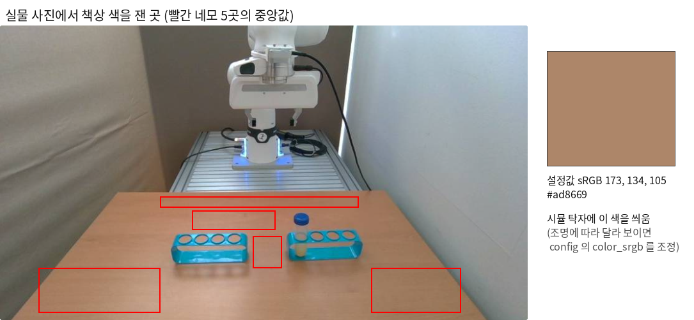

책상 영역 안의 다섯 곳(빨간 네모)에서 화소 sRGB 의 **중앙값**을 잡아 시뮬 책상 재질에 넣었다. 결과는 (173, 134, 105), 즉 #ad8669 다. 평균 대신 중앙값을 쓴 것은 나뭇결 · 반사 · Rack 그림자에 덜 끌리게 하려는 것이다.
FR5 카메라 화면(10-28)은 흰색 균형 때문에 같은 책상이 더 푸르게 찍혔다(182, 176, 149). 이 값을 쓰면 시뮬 책상이 청록색이 되므로, 같은 책상인 FR3 값을 두 실험대에 같이 쓴다.

## 5. 점 찍기 → 카메라 맞추기

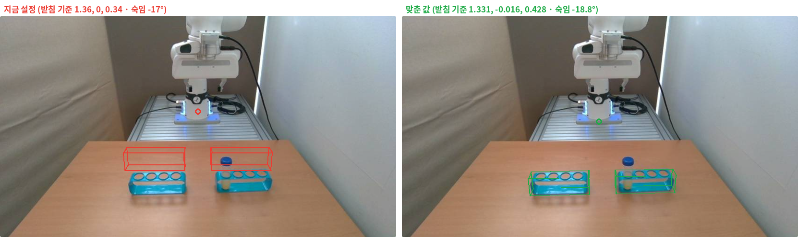

실물 화면에서 찍은 점 $`u_i`$ 와 같은 점의 3D 위치 $`X_i`$ 로 재투영 오차를 최소로 하는 카메라 자세를 찾았다. 물체 배치도 미지수에 같이 넣었다. 풀이는 `scipy.optimize.least_squares` (TRF)이고, 여러 시작점에서 풀어 가장 작은 것을 골랐다. 식은 수식 정리 [4-3절](../math_ko.md#4-3-카메라-맞추기--재투영-오차-최소제곱)에 있다.

```math
\min_{\theta}\;\sum_i w_i\,\big\lVert \pi\!\left(X_i;\,\theta\right) - u_i \big\rVert^2 \;+\; \sum_k \lambda_k\, r_k(\theta)^2
```

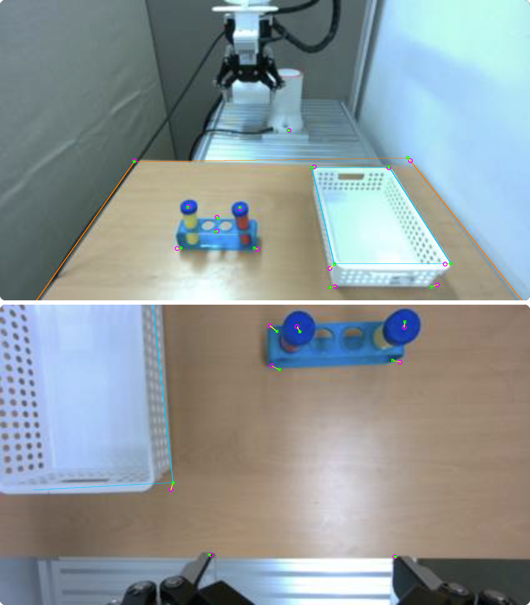

| 카메라 | 찍은 점 | 더한 조건 | 결과 (로봇 받침 기준) | 재투영 오차 |
|---|---|---|---|---|
| FR3 3인칭 | Rack 8 · 받침 1 | 소실점 (4-2절) | (1.26, −0.017, 0.471) m, yaw 179.0°, 숙임 −21.4°, roll −0.6°, 화각 69.7° | 1.9 px |
| FR5 3인칭 | 받침 · 책상 모서리 · Rack · 뚜껑 15 | 평행선 · 책상 사전값 | (0.957, −0.087, 0.503) m, yaw 180.4°, 숙임 −31.7°, roll −1.0°, 화각 87° (고정) | 4.1 px |
| FR3 손목 | 손가락 2 (무게 2) · Rack 8 · 뚜껑 1 | — | 손 기준 (0.075, −0.007, −0.063) m, tilt −3.7°, pan 0.3°, 화각 87° | 손가락 1.3 px · Rack 14.1 px |
| FR5 손목 | 손가락 끝 2 · Rack 3 · 뚜껑 2 · 모서리 1 | 테두리 선 2 | 손 기준 (0.082, −0.0045, 0.0253) m, tilt −7.3°, pan 5.1°, roll −1.3°, 화각 87° | 손가락 1.4 px · 점 8.6 px |

- **화각과 거리:** 사진만으로는 화각과 거리가 서로 바꿔 맞춰진다. FR3 는 57 \~ 87° 가 모두 같은 오차를 냈다. FR3 는 화각도 풀게 두어 69.7° 가 나왔고(87° 로 고정하면 2.7 px), FR5 는 D405 사양 87° 로 고정했다(80 \~ 94° 에서 오차 차이 없음).
- **손목 카메라:** 화면 아래의 손가락은 카메라가 손에 달린 자리로만 정해지고 팔 자세와는 무관하다. 그래서 손가락에 무게 2 를 줘 장착 자리를 먼저 맞췄다. Rack 점 오차가 큰 것은 실물 손이 Rack 줄에 대해 약 2° 돌아가 있어서다. 카메라가 아니라 팔 자세의 차이다.
- **시작 자세:** 화면의 손 위치를 같은 방법으로 풀고 역기구학으로 관절값을 정했다(수식 정리 [4-4절](../math_ko.md#4-4-시작-자세--화면에서-역기구학으로)). 실물 관절값을 받으면 그 값으로 바꾼다.

## 6. 색으로 딴 세그먼트로 실물과 비교

같은 기준으로 실물과 시뮬을 비교하려고, 두 화면에서 **같은 색 범위**로 Rack · 뚜껑 · 손가락 영역(세그먼트)을 자동으로 땄다. 그 영역의 중심 · 폭 · 기울기 · 겹침을 비교한다.

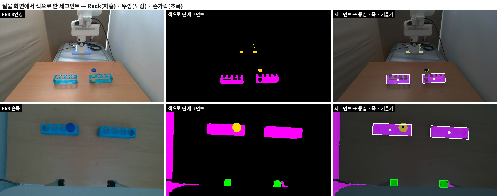

### 6-1. 색 범위 → 세그먼트

화면을 HSV 로 바꾼다(OpenCV: $`H \in [0, 180)`$, $`S, V \in [0, 255]`$). 범위는 실물 · 시뮬 화면에서 잰 값(Rack $`H`$ 92 \~ 103, 뚜껑 $`H`$ 104 \~ 118)에 여유를 둔 것이다.

```math
M_{rack} = \mathbf{1}\left[\,86 \le H \le 104,\ S \ge 110,\ V \ge 70\,\right],\qquad
M_{cap} = \mathbf{1}\left[\,105 \le H \le 132,\ S \ge 120,\ V \ge 40\,\right],\qquad
M_{finger} = \mathbf{1}\left[\,V \le 55\,\right]
```

잡티는 열기(3 × 3)로 지우고, 구멍 · 반사로 뚫린 곳은 닫기($`k \times k`$)로 메운다. $`k`$ 는 Rack 7, 뚜껑 · 손가락 3 이다.

```math
M' = \big((M \ominus B_3) \oplus B_3\big) \oplus B_k \ominus B_k
```

연결 요소(8 이웃)로 덩어리를 나누고 아래 조건으로 고른다.

| 세그먼트 | 최소 넓이 | 자리 조건 | 고르는 수 |
|---|---|---|---|
| Rack | $`0.002\,WH`$ | 가로 $`0.04W < \bar u < 0.96W`$ (화면 가장자리의 벽 · 케이블 제외) | 넓이 큰 순 2 개, 왼쪽부터 |
| 뚜껑 | $`0.0004\,WH`$ | 같음 | 1 개 |
| 손가락 (손목) | $`0.0005\,WH`$ | 화면 아래 30 % ($`\bar v > 0.7H`$), $`0.15W < \bar u < 0.85W`$ | 2 개 |

각 덩어리에서 중심 $`(\bar u, \bar v)`$, 감싸는 상자의 폭 $`w`$, 최소 넓이 사각형의 긴 변 기울기 $`\theta \in [-90^\circ, 90^\circ)`$ 를 잰다.
위 그림에서 받침의 파란 LED 도 뚜껑 범위에 잡히지만, 넓이 큰 것 하나만 쓰므로 결과에는 들어가지 않는다. 손목 화면 왼쪽 가장자리의 파란 영역도 넓이 · 자리 조건으로 빠진다.

실물 화면에서 딴 값 (640 × 360):

| 화면 | Rack (중심, 폭, 기울기) | 뚜껑 중심 | 손가락 중심 |
|---|---|---|---|
| FR3 3인칭 | (254.9, 274.8) 92 px −0.8° · (396.0, 270.1) 90 px −2.9° | (365.6, 236.4) | — |
| FR3 손목 | (224.7, 101.1) 150 px 2.1° · (454.4, 111.6) 151 px 3.6° | (273.7, 91.7) | (237.7, 307.2) · (432.3, 312.1) |
| FR5 3인칭 (11-03) | (289.2, 280.7) 98 px 0.0° · (441.5, 290.9) 103 px 4.4° | (315.9, 248.4) | — |
| FR5 손목 (11-03) | (119.9, 49.4) 169 px 3.1° · (308.2, 66.8) 53 px 0.0° (쪼개진 조각) | (379.7, 45.5) | (248.2, 346.4) · (507.5, 342.8) |

### 6-2. 비교 지표

시뮬 화면에서도 같은 방법으로 세그먼트를 따서($`s`$ = 시뮬, $`r`$ = 실물) 아래를 잰다.

| 지표 | 식 | 읽는 법 |
|---|---|---|
| 중심 차 | $`(\bar u_s - \bar u_r,\ \bar v_s - \bar v_r)`$ | 카메라 · 물체 자리 차이 (px, 화면 폭의 %) |
| 폭 비 · 간격 비 | $`w_s / w_r`$, 두 Rack 중심 간격의 비 | 1 보다 작으면 시뮬이 더 멂 (거리 · 화각) |
| 기울기 차 | $`\theta_s - \theta_r`$ | 카메라 roll · 물체 방향 |
| 겹침 | $`\mathrm{IoU} = \lvert M_s \cap M_r\rvert / \lvert M_s \cup M_r\rvert`$ | 1 = 완전히 겹침 |
| 책상 색 차 | $`\Delta E = \lVert \mathrm{Lab}(c_s) - \mathrm{Lab}(c_r) \rVert_2`$ (CIE76) | 2 아래 거의 못 느낌 · 2 \~ 10 보면 느낌 · 10 넘으면 확실히 다름 |
| 밝기 · 색 균형 | $`Y = 0.2126\,\bar R + 0.7152\,\bar G + 0.0722\,\bar B`$, $`\bar R / \bar G`$, $`\bar B / \bar G`$ | 노출 · 흰색 균형 차이 |

책상 색 $`c`$ 는 3인칭에서는 Rack 아래 띠, 손목에서는 화면 가운데 영역의 화소 중앙값이다. 파란 것($`85 \le H \le 135,\ S > 90`$)과 어두운 것($`V \le 40`$)은 뺀다. sRGB 를 선형으로 바꾼 뒤 XYZ (D65) → CIE Lab 으로 변환했다.

### 6-3. 결과 (FR3, 2026-10-27 첫 측정)

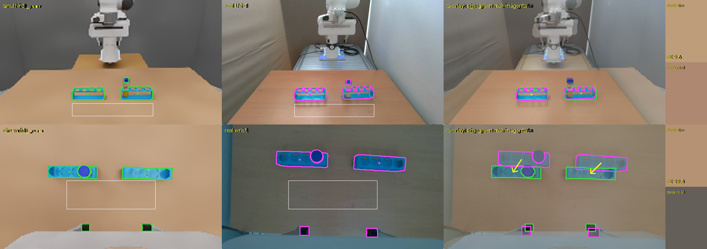

| 화면 | 항목 | 시뮬 − 실물 | 읽는 법 |
|---|---|---|---|
| 3인칭 | Rack 중심 | −2 \~ +1, −3 \~ 0 px | 카메라 · Rack 배치가 맞음 |
| 3인칭 | Rack 폭 비 · 간격 비 | 1.01 \~ 1.02 · 1.03 | 맞음 |
| 3인칭 | 책상 색 | (190, 157, 122) 대 (174, 136, 113), ΔE 9.6 | 시뮬이 조금 밝고 따뜻함 |
| 손목 | Rack 중심 | −24 \~ −30, +29 \~ +36 px | 이 측정 뒤 손목 카메라를 다시 맞춤 (5장, 손가락 1.3 px) |
| 손목 | 손가락 간격 비 | 0.91 | 같음 |
| 손목 | 책상 색 · 밝기 | ΔE 29.4 · 밝기 비 1.73 | 실물 손목 카메라가 훨씬 어둡고 회색빛 (자동 노출 · 흰색 균형) |

- 이 첫 측정은 사용자 창 캡처(400 × 112)를 키워서 잰 것이라 위치에 ±5 px 오차가 있다.
- 실물 Rack 은 반투명이라 안쪽이 덜 잡힌다. 그래서 위치가 맞아도 IoU 는 0.5 \~ 0.6 정도다. 이 값은 자리보다 모양 차이를 보는 데 쓴다.
- 3인칭은 실물과 거의 같다. 남은 큰 차이는 배경과 카메라 색 처리다(7장).

### 6-4. 한계 — 같은 색 범위가 FR5 화면에서는 일부만 맞음

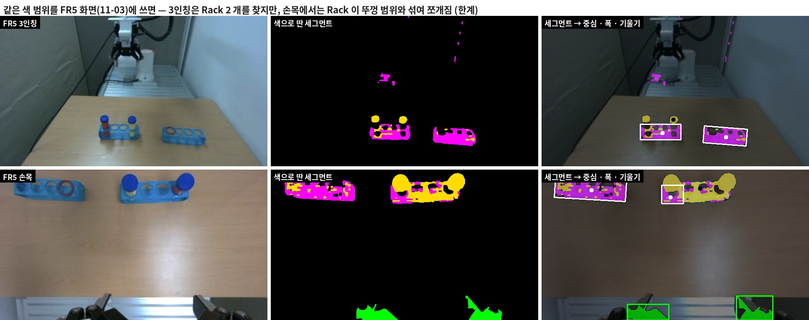

색 범위는 FR3 카메라 화면에 맞춰 정했다. 같은 범위를 FR5 화면(11-03, 지금 과제 배치)에 쓰면 아래처럼 된다.

- **3인칭:** Rack 2 개를 모두 찾는다. 다만 Rack 의 그늘진 쪽이 뚜껑 범위($`H \ge 105`$)로 넘어가 노랗게 섞인다.
- **손목:** 왼쪽(빈) Rack 은 잡히지만, 튜브가 꽂힌 오른쪽 Rack 은 대부분 뚜껑 범위로 넘어가 작은 조각(폭 53 px)만 Rack 으로 남는다.
- **이유:** FR5 카메라의 색 처리(흰색 균형 · 노출)가 FR3 와 달라 Rack 의 색상($`H`$)이 뚜껑 쪽으로 밀린다. 또 꽂힌 빨간 물 · 노란 물 튜브가 Rack 을 가린다.
- **대응:** FR5 카메라는 세그먼트 비교 없이 점 찍기(5장, 4.1 px)로 맞췄다.
- **다음:** 카메라마다 색 범위를 따로 잡거나(FR5 화면에서 Rack · 뚜껑 색을 다시 재기), 학습된 분할 모델로 세그먼트를 따는 방법을 검토한다.

## 7. 남은 차이와 대응

| 차이 | 크기 | 대응 |
|---|---|---|
| 카메라 노출 · 흰색 균형 | 손목 ΔE 29.4, 밝기 1.73 배. FR5 화면은 푸름 | 조명 무작위(밝기 × 0.6 \~ 1.4, 색온도 5000 \~ 8500 K, 수식 정리 [5-3절](../math_ko.md#5-3-조명--밝기와-색온도)), GR00T 학습 때 영상 색 흔들기. 실물 자동 흰색 균형 고정을 실물 담당과 협의 |
| 배경 | 실물은 커튼 · 흰 벽 · 알루미늄 받침대, 시뮬은 단색 면 | 자리 · 크기만 맞춤 (4-3절). 배경 무작위화는 선택 사항 |
| 화각 | FR3 69.7° (D405 사양 87° 와 다름) | 사진만으로는 화각과 거리를 구분 못 함 → 받침 \~ Rack 거리를 줄자로 재면 정해짐 |
| 시작 자세 | 화면에서 어림 | 실물 관절값을 받으면 교체 |
| 무게 | 튜브 51 g 은 계산값 | 저울로 재서 교체 |
| 맞춘 화면의 배치 | FR3 는 이전 과제 배치 (Rack 2 개), FR5 카메라 맞추기는 10-28 배치 (Rack · 바구니) | 카메라 · 책상은 과제와 무관. FR5 는 지금 과제 화면(11-03)을 받았으므로 시뮬 화면과의 6장 비교를 FR5 에도 할 수 있음 (색 범위를 FR5 에 맞춘 뒤) |

## 8. 코드와 설정 파일

| 파일 | 하는 일 |
|---|---|
| `tools/fr3_fit_cams_from_photo.py` | FR3 사진의 점 → 3인칭 카메라 · Rack 배치 · 손 위치 · 역기구학 · 손목 카메라 (numpy · scipy, 2 \~ 3 초) |
| `tools/fr5_fit_cams_from_photo.py` | FR5 화면의 점 · 모서리 선 → 카메라 · 책상 · 물체 배치 · 시작 자세 |
| `tools/common_compare_sim_real.py` | 시뮬 · 실물 화면에서 색 세그먼트를 따서 중심 · 폭 · 기울기 · IoU · ΔE · 밝기 비교 (그림 · json) |
| `tools/common_tube_holder_shape.py` · `common_make_tube_usd.py` · `common_make_ring_usd.py` | 실측값 → 튜브 · Rack 메시 (Blender) · 물 넣은 튜브 USD · 링 USD |
| `config/common_scene.json` | 두 실험대 공용 장면 (책상 높이 · 색, 받침대, 벽, 조명) |
| `config/fr3_env.json` · `config/fr5_env.json` | 실험대마다 다른 것 (로봇 · 시작 자세 · 3인칭 · 손목 카메라 · 책상 자리) |
