# Real setup → digital twin

2026-11-03 · Sim-to-Real Post-Training (simulation part) · [한국어](README.md) · [← Contents](../../README_EN.md#contents)

This page describes how the real FR3 and FR5 stations were moved into simulation. It covers what was measured on the real setup, how the real camera frames were split into regions (segments), which values those regions gave, where the values went in the simulation, and how the result was compared against the real setup.
The full derivations are in the equation notes, [chapter 4](../math_en.md#4-equations-and-application--digital-twin); only the equations used in this process are repeated here.

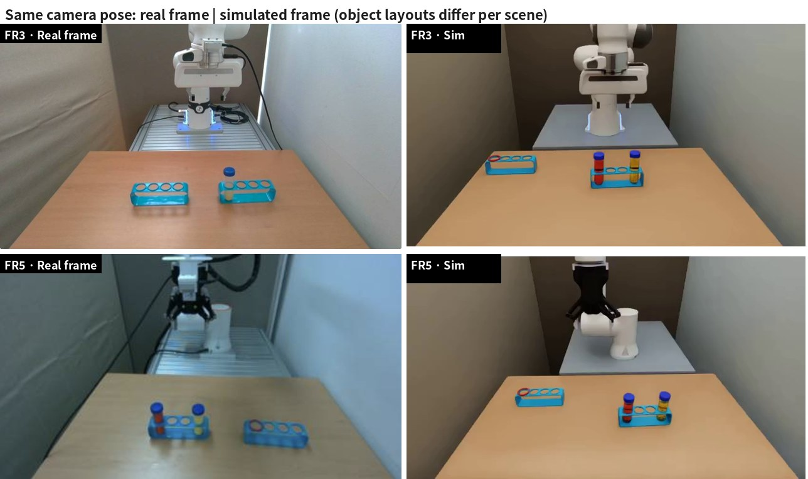

Left: real camera frame. Right: simulated camera frame with the same position, angle and field of view. The object layout is randomized per scene, so the layouts differ. The FR3 real frame is the earlier layout used for camera fitting (10-27). The FR5 real frame (11-03) shows the current task layout: an empty rack with the red ring, and a rack with the red and yellow liquid tubes.

**Contents**

1. [At a glance — what was taken from the real setup](#1-at-a-glance--what-was-taken-from-the-real-setup)
2. [Real stations and camera frames](#2-real-stations-and-camera-frames)
3. [Objects — from measurements to shapes](#3-objects--from-measurements-to-shapes)
4. [Image regions (segments) → scene layout](#4-image-regions-segments--scene-layout)
5. [Picked points → camera fitting](#5-picked-points--camera-fitting)
6. [Comparing with colour segments](#6-comparing-with-colour-segments)
7. [Remaining differences and how they are handled](#7-remaining-differences-and-how-they-are-handled)
8. [Code and configuration files](#8-code-and-configuration-files)

## 1. At a glance — what was taken from the real setup

| From the real setup | How | Value in the simulation | Agreement |
|---|---|---|---|
| Tube and rack shape | Caliper measurements + photo proportions → mesh built by a Blender script | Tube 108 × 30 mm, cap 33 × 13 mm, rack 165 × 40 × 51 mm, hole 31 mm | Volumes within 0.3 % of the formula |
| Red ring | Real STL | ID 34, OD 41, height 5 mm | The real file as is |
| Desk, platform, walls | Region corners picked in the third-person frame, back-projected onto the desk plane | Desk 0.80 × 0.85 m (top 0.900 m), platform and wall positions | Outlines overlap the frame (figure 5) |
| Desk colour | Median of five desk regions | sRGB (173, 134, 105) | Third-person ΔE 9.6 |
| Third-person camera | Least squares on the reprojection error of points and edge lines | Position, angles, field of view | FR3 1.9 px, FR5 4.1 px |
| Wrist camera | Least squares on the reprojection error of finger and object points | Mounting position and tilt relative to the hand | Fingers: FR3 1.3 px, FR5 1.4 px |
| Start pose | Hand position from the frames → inverse kinematics | FR3 7 joints, FR5 6 joints | Estimated from the frames (not measured joint values) |
| Check | Segments extracted with the same colour ranges from real and simulated frames, then compared | — | Third-person rack centre difference ≤ 3 px |

Pixels are given for a 640 × 360 frame (values measured on the 825 × 462 FR3 photo and the 611 × 346 FR5 frame were scaled to this size).

## 2. Real stations and camera frames

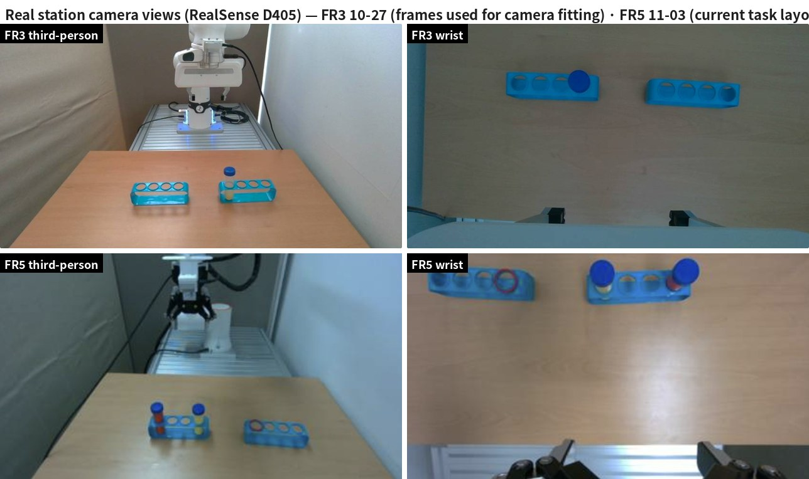

- There are two real stations, FR3 and FR5. Each uses a RealSense D405 as the third-person camera and another as the wrist camera.
- A black canopy over the stations blocks sunlight. The light is therefore diffuse and only its brightness changes. The simulation also uses shadow-free diffuse light, and only brightness and colour temperature are randomized.
- The FR3 frames are the ones used for camera fitting (10-27), so their object layout is from an earlier task. The FR5 frames show the current task layout (11-03). The frames used for FR5 camera fitting (10-28) are in chapter 5. The camera pose, desk and platform do not depend on the task, so values fitted on an earlier layout are kept.
- Shown under the FR5 frames (11-03): both cameras 848 × 480 at 30 fps, white-balance values 3600 (third-person) and 3800 (wrist), as displayed in the camera settings.

## 3. Objects — from measurements to shapes

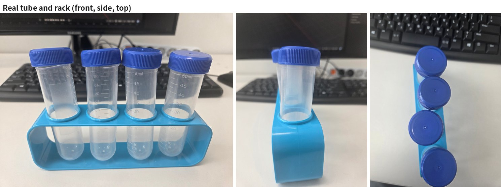

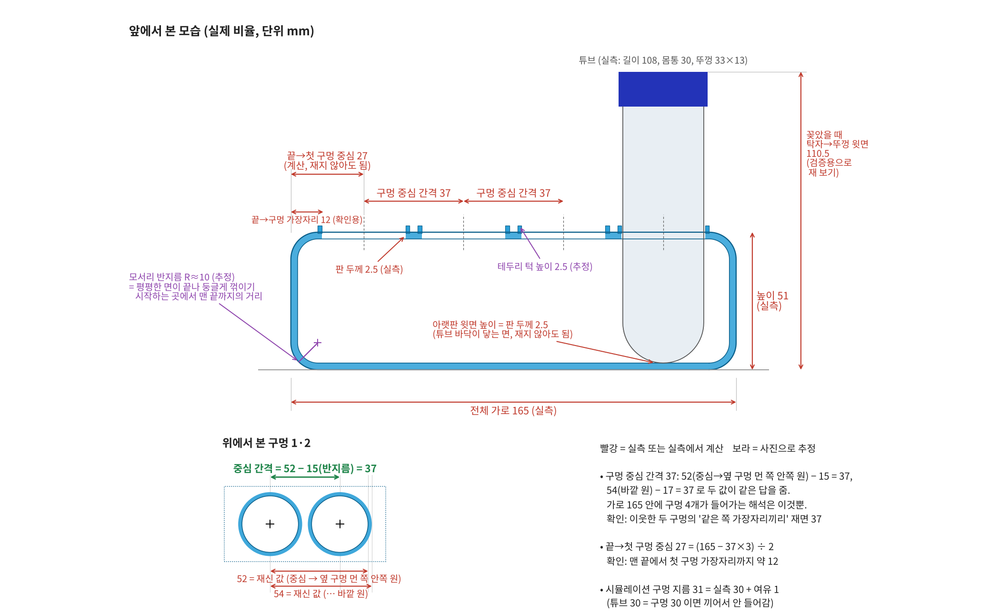

| Object | Measured | Set from photos or calculation | Simulation |
|---|---|---|---|
| Tube | Length 108, body diameter 30, cap 33 × 13 (mm) | Hemispherical bottom radius 15 (half the body), wall thickness 1 (estimated) | Rigid body, convex colliders for body and cap, 48 mL of liquid (51 g) |
| Rack | Length 165, width 40, height 51, plate thickness 2.5 (mm) | Hole pitch 37 = 52 − 15 = 54 − 17 (both give the same answer), end → first hole 27 = (165 − 37 × 3) / 2, corner radius about 10 and rim lip 2.5 (estimated from photos) | 4 holes, hole diameter 31 |
| Red ring | Real STL | — | ID 34, OD 41, height 5 mm, on the rim of the target hole |

- **31 mm hole:** The measured hole is 30 mm. In simulation, a 30 mm tube does not go into a 30 mm hole (it jams), so 1 mm of clearance was added. In the photos the tubes also sit slightly tilted, so the real hole is probably a little larger than 30 mm.
- **Shape check:** All meshes made by the script are closed, with faces pointing outward. The tube body volume is 64,896 mm³ against 65,031 mm³ from the formula (within 0.3 %), and the rack band is 40,682 mm³ against 40,698 mm³.
- **Liquid:** The tubes in the real photos are empty, but the task uses 48 mL of red and yellow liquid. Liquid height, mass and centre of mass come from the volume formula in the equation notes, [section 4-5](../math_en.md#4-5-tube-model--water-height-and-center-of-mass).

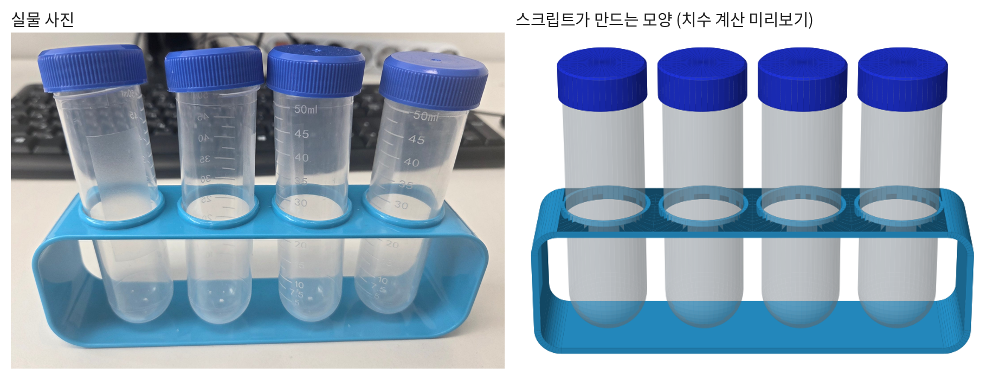

## 4. Image regions (segments) → scene layout

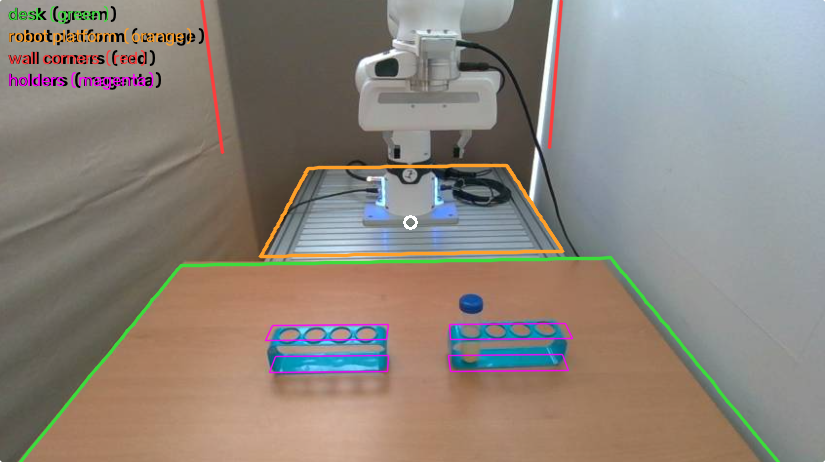

The real third-person frame was split into four regions. For each region, its corners were picked in the frame and the region was traced as a polygon.

| Region | Colour | What it gave |
|---|---|---|
| Desk top | Green | Far edge and side edges → desk position and width; point where the side edges meet → camera pitch |
| Robot platform (aluminium) | Orange | Front edge and width of the platform |
| Wall corners | Red | Back and side wall positions (vertical lines) |
| Racks | Magenta | Points for camera fitting (chapter 5) |

### 4-1. Image point → point on the desk plane (back-projection)

Given the camera position $`c`$, its right, up and forward directions $`\mathbf r,\ \mathbf u,\ \mathbf f`$, and the focal length $`f_x`$ (the equation notes, [section 4-2](../math_en.md#4-2-pinhole-projection)), inverting the projection gives the direction of the ray through image point $`(u, v)`$:

```math
\mathbf d(u,v) = \frac{u - W/2}{f_x}\,\mathbf r \;-\; \frac{v - H/2}{f_x}\,\mathbf u \;+\; \mathbf f
```

The ray meets the plane at height $`z_0`$ (desk top 0.900 m, platform top 0.912 m) at

```math
X = c + \lambda\,\mathbf d,\qquad \lambda = \frac{z_0 - c_z}{d_z}\quad(\lambda > 0)
```

Back-projecting the two ends of the desk's far edge gives the far $`x`$ and the side $`y`$ values. The front edge is outside the frame, so the 0.8 m desk depth is an assumption. The walls were estimated from the vertical lines back-projected onto the floor plane.

- **FR3:** back-projected with the fitted camera (chapter 5).
- **FR5:** the desk far edge $`x_f`$ and sides $`y_l,\ y_r`$ were added as unknowns to the same least squares as the camera (chapter 5), with a prior $`(d - d_0)/0.05`$ that keeps them close to the FR3 values.

### 4-2. Where the desk edges meet → camera pitch

The two side edges of the desk are parallel lines in the real world (robot forward axis, world $`x`$), so in the image they meet at one point (the vanishing point). Fitting lines to the two edges in the FR3 frame gives $`x = -0.8217\,y + 398.1`$ and $`x = 0.7850\,y + 397.7`$, which meet at $`(398,\ 0)`$ (in 825 × 462 pixels).
Camera fitting has one extra condition: the projection of direction $`-\hat x`$ must land on this point (the equation notes, [section 4-3](../math_en.md#4-3-camera-fitting--reprojection-error-least-squares)).

```math
\pi_{dir}(\mathbf v) = \Big(\tfrac{W}{2} + f_x\,\tfrac{\mathbf v\cdot\mathbf r}{\mathbf v\cdot\mathbf f},\ \ \tfrac{H}{2} - f_x\,\tfrac{\mathbf v\cdot\mathbf u}{\mathbf v\cdot\mathbf f}\Big),\qquad
r_{vp} = 0.3\,\big(\pi_{dir}(-\hat x) - (398,\ 0)\big)
```

Without this condition (version 3.1) the same parallel lines met at $`(400,\ 27)`$, meaning the camera was pitched about 2.6° too little. With the condition, the camera moved 4.3 cm higher and pitched 2.6° more, and the lines met at $`(399,\ -1)`$.
For FR5, instead of the vanishing point, the condition is the signed perpendicular distance between six observed edge points and the projected edge lines (parallel-line condition).

### 4-3. Result — scene layout

| Item | FR3 station | FR5 station | Basis |
|---|---|---|---|
| Desk top | 0.900 m | Same | 12 mm below the platform top |
| Desk far edge $`x`$ | −0.47 m | −0.475 m | Back-projection, least squares |
| Desk sides $`y`$ | −0.455 to 0.395 m | −0.528 to 0.382 m | Back-projection, least squares |
| Desk size | 0.80 × 0.85 m | 0.80 m × 0.91 m | 0.8 m depth assumed (front edge outside the frame) |
| Platform | Top 0.912 m, $`x`$ −1.14 to −0.48 m, width 0.60 m | Same | Platform region |
| Walls | Back $`x`$ −1.20 m, sides $`y`$ −0.57 m (curtain) and +0.44 m (white wall) | Same | Vertical wall-corner lines (estimates) |

Coordinates are in the world frame (m, $`z`$ up); the robot base is at $`(-0.66,\ 0,\ 0.912)`$. Both stations use the same kind of desk and platform, so heights, platform and walls share values; only the desk position and width are set per station.

### 4-4. Desk colour

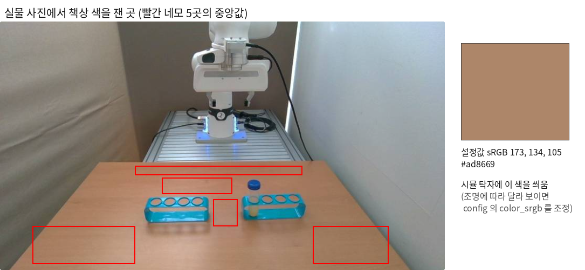

The **median** sRGB of the pixels in five places inside the desk region (red boxes) was used as the simulated desk material: (173, 134, 105), i.e. #ad8669. The median is used instead of the mean so that wood grain, reflections and rack shadows have less pull.
The FR5 camera frame (10-28) showed the same desk bluer because of its white balance (182, 176, 149). Using that value makes the simulated desk teal, so the FR3 value is used for both stations (it is the same desk).

## 5. Picked points → camera fitting

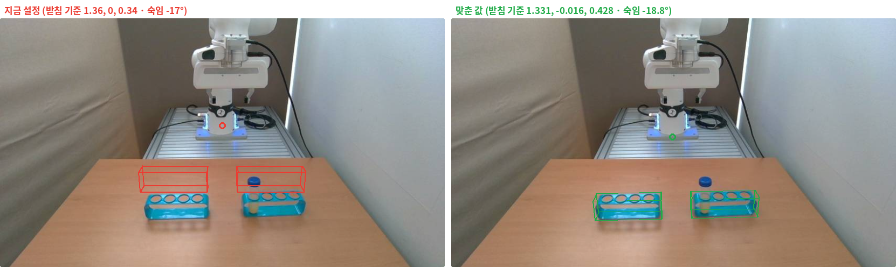

Points $`u_i`$ picked in the real frame and the 3D positions $`X_i`$ of the same points were used to find the camera pose with minimum reprojection error. The object layout was included in the unknowns. The solver is `scipy.optimize.least_squares` (TRF), run from several starting points, keeping the smallest cost. The equations are in the equation notes, [section 4-3](../math_en.md#4-3-camera-fitting--reprojection-error-least-squares).

```math
\min_{\theta}\;\sum_i w_i\,\big\lVert \pi\!\left(X_i;\,\theta\right) - u_i \big\rVert^2 \;+\; \sum_k \lambda_k\, r_k(\theta)^2
```

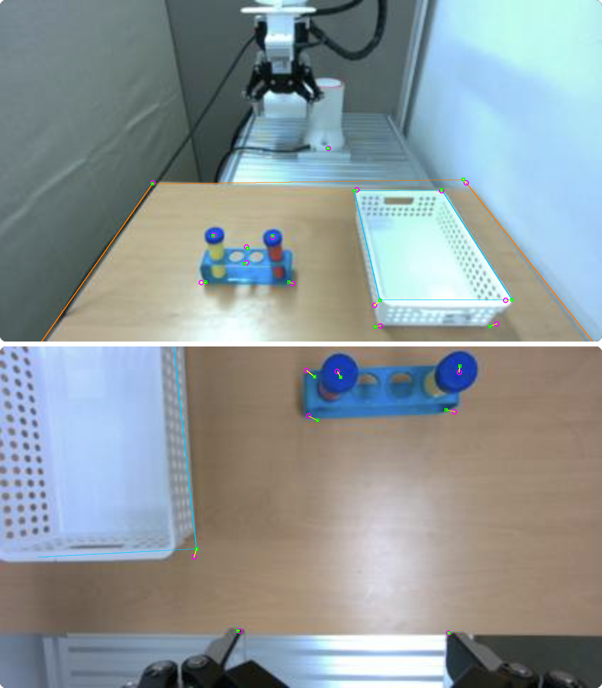

| Camera | Picked points | Extra conditions | Result (robot base frame) | Reprojection error |
|---|---|---|---|---|
| FR3 third-person | Racks 8, base 1 | Vanishing point (4-2) | (1.26, −0.017, 0.471) m, yaw 179.0°, pitch −21.4°, roll −0.6°, FOV 69.7° | 1.9 px |
| FR5 third-person | Base, desk edges, racks, caps: 15 | Parallel lines, desk prior | (0.957, −0.087, 0.503) m, yaw 180.4°, pitch −31.7°, roll −1.0°, FOV 87° (fixed) | 4.1 px |
| FR3 wrist | Fingers 2 (weight 2), racks 8, cap 1 | — | Hand frame (0.075, −0.007, −0.063) m, tilt −3.7°, pan 0.3°, FOV 87° | Fingers 1.3 px, racks 14.1 px |
| FR5 wrist | Fingertips 2, rack 3, caps 2, corner 1 | Rim lines 2 | Hand frame (0.082, −0.0045, 0.0253) m, tilt −7.3°, pan 5.1°, roll −1.3°, FOV 87° | Fingers 1.4 px, points 8.6 px |

- **Field of view and distance:** From a photo alone, field of view and distance trade off against each other; for FR3, 57° to 87° all gave the same error. For FR3 the field of view was left free and came out at 69.7° (2.7 px if fixed at 87°). For FR5 it was fixed at the D405 specification of 87° (no difference in error between 80° and 94°).
- **Wrist camera:** The fingers at the bottom of the frame depend only on where the camera is mounted on the hand, not on the arm pose. So the fingers got weight 2 and fixed the mount first. The larger rack error comes from the real hand being rotated about 2° relative to the rack row. That is an arm-pose difference, not a camera one.
- **Start pose:** The hand position in the frames was solved the same way, then the joint values came from inverse kinematics (the equation notes, [section 4-4](../math_en.md#4-4-start-pose--from-the-image-via-inverse-kinematics)). They will be replaced once the real joint values are available.

## 6. Comparing with colour segments

To compare real and simulated frames on the same basis, rack, cap and finger regions (segments) were extracted automatically from both with **the same colour ranges**. Their centres, widths, angles and overlap are then compared.

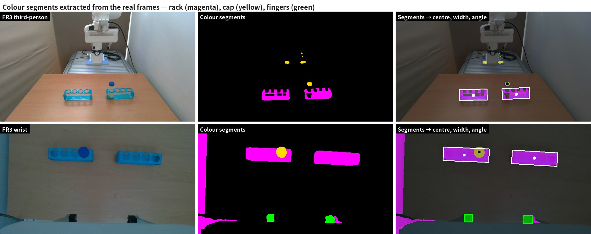

### 6-1. Colour ranges → segments

The frame is converted to HSV (OpenCV: $`H \in [0, 180)`$, $`S, V \in [0, 255]`$). The ranges are the values measured on real and simulated frames (rack $`H`$ 92 to 103, cap $`H`$ 104 to 118) plus a margin.

```math
M_{rack} = \mathbf{1}\left[\,86 \le H \le 104,\ S \ge 110,\ V \ge 70\,\right],\qquad
M_{cap} = \mathbf{1}\left[\,105 \le H \le 132,\ S \ge 120,\ V \ge 40\,\right],\qquad
M_{finger} = \mathbf{1}\left[\,V \le 55\,\right]
```

Specks are removed by opening (3 × 3), and holes from the rack openings and reflections are filled by closing ($`k \times k`$), with $`k`$ = 7 for racks and 3 for caps and fingers.

```math
M' = \big((M \ominus B_3) \oplus B_3\big) \oplus B_k \ominus B_k
```

The mask is split into connected components (8-neighbour) and blobs are selected as follows.

| Segment | Minimum area | Position condition | How many |
|---|---|---|---|
| Rack | $`0.002\,WH`$ | Horizontal $`0.04W < \bar u < 0.96W`$ (excludes walls and cables at the frame edges) | Two largest, left to right |
| Cap | $`0.0004\,WH`$ | Same | 1 |
| Fingers (wrist) | $`0.0005\,WH`$ | Bottom 30 % of the frame ($`\bar v > 0.7H`$), $`0.15W < \bar u < 0.85W`$ | 2 |

For each blob: centre $`(\bar u, \bar v)`$, bounding-box width $`w`$, and the angle of the long side of the minimum-area rectangle, $`\theta \in [-90^\circ, 90^\circ)`$.
In the figure above, the blue LED on the robot base also falls in the cap range, but only the largest cap blob is used, so it does not enter the result. The blue area at the left edge of the wrist frame is also removed by the area and position conditions.

Values taken from the real frames (640 × 360):

| Frame | Racks (centre, width, angle) | Cap centre | Finger centres |
|---|---|---|---|
| FR3 third-person | (254.9, 274.8) 92 px −0.8°; (396.0, 270.1) 90 px −2.9° | (365.6, 236.4) | — |
| FR3 wrist | (224.7, 101.1) 150 px 2.1°; (454.4, 111.6) 151 px 3.6° | (273.7, 91.7) | (237.7, 307.2); (432.3, 312.1) |
| FR5 third-person (11-03) | (289.2, 280.7) 98 px 0.0°; (441.5, 290.9) 103 px 4.4° | (315.9, 248.4) | — |
| FR5 wrist (11-03) | (119.9, 49.4) 169 px 3.1°; (308.2, 66.8) 53 px 0.0° (a split fragment) | (379.7, 45.5) | (248.2, 346.4); (507.5, 342.8) |

### 6-2. Comparison metrics

Segments are extracted the same way from the simulated frame ($`s`$ = sim, $`r`$ = real) and the following are measured.

| Metric | Formula | Reading |
|---|---|---|
| Centre difference | $`(\bar u_s - \bar u_r,\ \bar v_s - \bar v_r)`$ | Camera or object position difference (px, % of frame width) |
| Width ratio, gap ratio | $`w_s / w_r`$, ratio of the distance between the two rack centres | Below 1: the sim object looks farther (distance, field of view) |
| Angle difference | $`\theta_s - \theta_r`$ | Camera roll, object orientation |
| Overlap | $`\mathrm{IoU} = \lvert M_s \cap M_r\rvert / \lvert M_s \cup M_r\rvert`$ | 1 = full overlap |
| Desk colour difference | $`\Delta E = \lVert \mathrm{Lab}(c_s) - \mathrm{Lab}(c_r) \rVert_2`$ (CIE76) | Below 2 barely visible; 2 to 10 visible; above 10 clearly different |
| Brightness, colour balance | $`Y = 0.2126\,\bar R + 0.7152\,\bar G + 0.0722\,\bar B`$, $`\bar R / \bar G`$, $`\bar B / \bar G`$ | Exposure and white-balance difference |

The desk colour $`c`$ is the pixel median of the band below the racks (third-person) or of the central area (wrist), excluding blue ($`85 \le H \le 135,\ S > 90`$) and dark ($`V \le 40`$) pixels. sRGB is linearized, then converted XYZ (D65) → CIE Lab.

### 6-3. Result (FR3, first measurement on 2026-10-27)

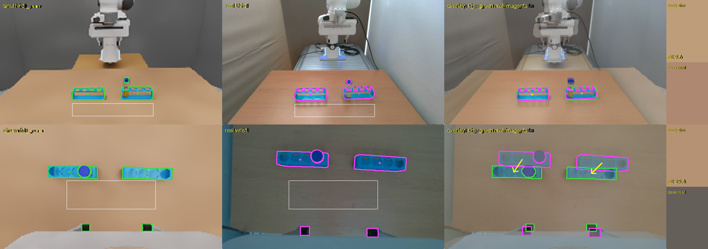

| Frame | Item | Sim − real | Reading |
|---|---|---|---|
| Third-person | Rack centres | −2 to +1, −3 to 0 px | Camera and rack layout agree |
| Third-person | Rack width ratio, gap ratio | 1.01 to 1.02, 1.03 | Agree |
| Third-person | Desk colour | (190, 157, 122) vs (174, 136, 113), ΔE 9.6 | Sim slightly brighter and warmer |
| Wrist | Rack centres | −24 to −30, +29 to +36 px | The wrist camera was refitted after this (chapter 5, fingers 1.3 px) |
| Wrist | Finger gap ratio | 0.91 | Same |
| Wrist | Desk colour, brightness | ΔE 29.4, brightness ratio 1.73 | The real wrist camera is much darker and greyer (auto exposure, white balance) |

- This first measurement was taken from an upscaled 400 × 112 window capture, so positions carry about ±5 px of error.
- The real rack is translucent, so its inside is picked up less. Even with matching positions, IoU is around 0.5 to 0.6, so it is used to look at shape differences rather than position.
- The third-person view matches the real one closely. The large remaining differences are the background and the camera colour processing (chapter 7).

### 6-4. Limitation — the same colour ranges only partly work on the FR5 frames

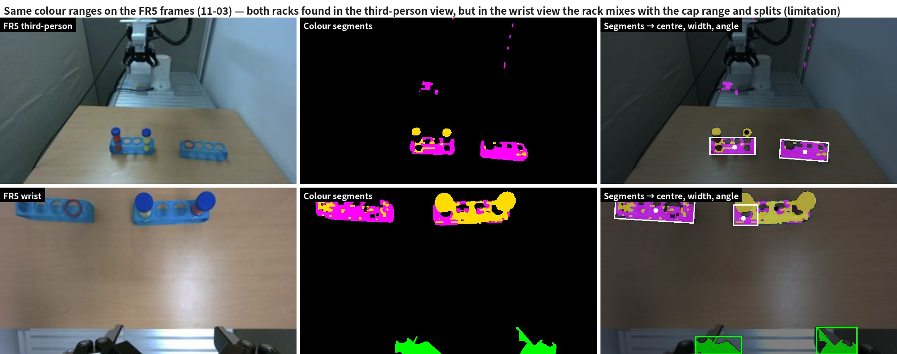

The colour ranges were set on the FR3 camera frames. Applied to the FR5 frames (11-03, current task layout):

- **Third-person:** both racks are found, but the shaded side of the racks crosses into the cap range ($`H \ge 105`$) and mixes in as yellow.
- **Wrist:** the left (empty) rack is found, but most of the right rack with the tubes crosses into the cap range, and only a small fragment (53 px wide) remains as rack.
- **Why:** the FR5 camera's colour processing (white balance, exposure) differs from FR3's, so the rack hue ($`H`$) shifts toward the cap range. The red and yellow liquid tubes in the rack also cover it.
- **What was done:** the FR5 cameras were fitted with picked points only (chapter 5, 4.1 px), without the segment comparison.
- **Next:** set colour ranges per camera (re-measure rack and cap colours on the FR5 frames), or extract the segments with a learned segmentation model.

## 7. Remaining differences and how they are handled

| Difference | Size | Handling |
|---|---|---|
| Camera exposure and white balance | Wrist ΔE 29.4, brightness ×1.73. FR5 frames are bluer | Light randomization (brightness ×0.6 to 1.4, colour temperature 5000 to 8500 K, the equation notes, [section 5-3](../math_en.md#5-3-lighting--brightness-and-color-temperature)), colour jitter on the frames during GR00T training. Fixing the real cameras' auto white balance is being discussed with the hardware team |
| Background | Real: curtain, white wall, aluminium platform. Sim: plain surfaces | Only positions and sizes are matched (4-3). Background randomization is optional |
| Field of view | FR3 69.7° (differs from the D405 specification of 87°) | Field of view and distance cannot be separated from a photo; measuring the base-to-rack distance with a tape measure would settle it |
| Start pose | Estimated from the frames | Replace with the real joint values when available |
| Mass | The 51 g tube is a calculated value | Replace with a scale measurement |
| Layout in the fitting frames | FR3: earlier task layout (two racks). FR5 camera fitting: 10-28 layout (rack and basket) | Camera and desk do not depend on the task. Now that a current-task FR5 frame (11-03) exists, the chapter 6 comparison against the simulated frame can be run for FR5 as well (after setting FR5 colour ranges) |

## 8. Code and configuration files

| File | What it does |
|---|---|
| `tools/fr3_fit_cams_from_photo.py` | Points in the FR3 photos → third-person camera, rack layout, hand position, inverse kinematics, wrist camera (numpy and scipy, 2 to 3 s) |
| `tools/fr5_fit_cams_from_photo.py` | Points and edge lines in the FR5 frames → cameras, desk, object layout, start pose |
| `tools/common_compare_sim_real.py` | Extracts colour segments from sim and real frames and compares centre, width, angle, IoU, ΔE and brightness (figure and json) |
| `tools/common_tube_holder_shape.py`, `common_make_tube_usd.py`, `common_make_ring_usd.py` | Measurements → tube and rack meshes (Blender), tube USD with liquid, ring USD |
| `config/common_scene.json` | Scene shared by both stations (desk height and colour, platform, walls, lights) |
| `config/fr3_env.json`, `config/fr5_env.json` | Per-station values (robot, start pose, third-person and wrist cameras, desk position) |
