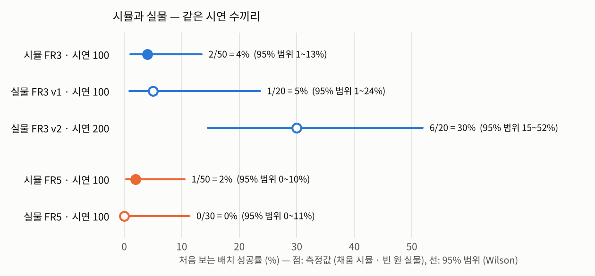
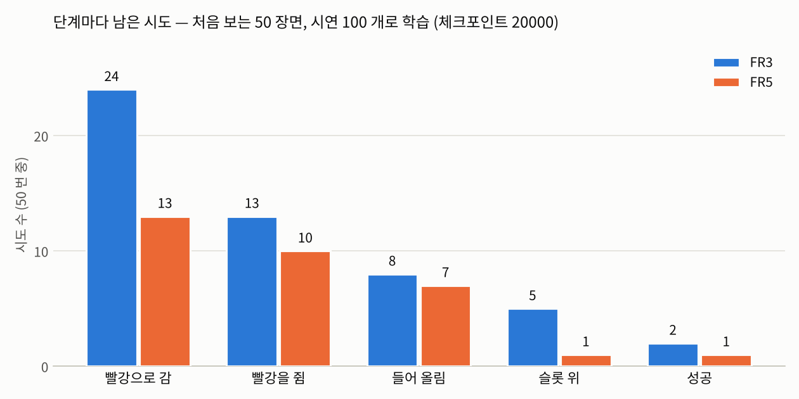
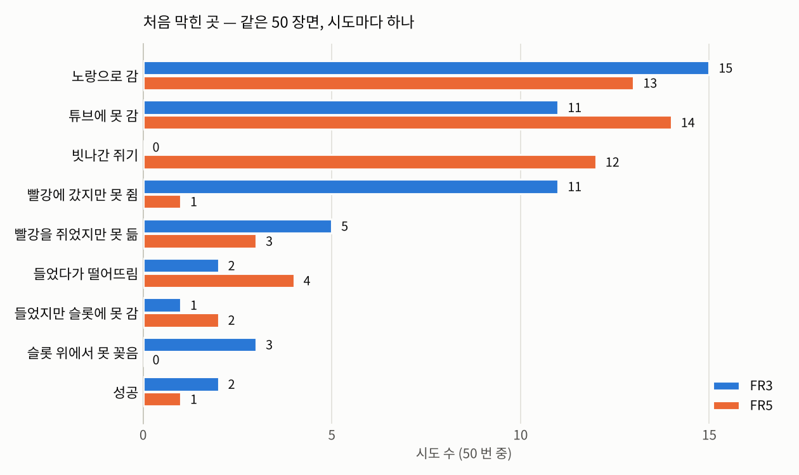
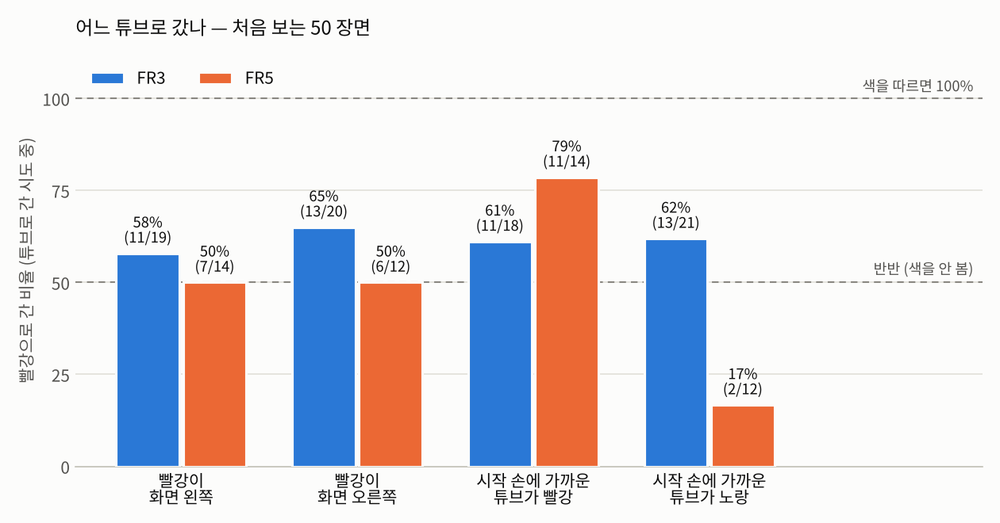

# 보고서 2 — 시연 100개로 학습한 GR00T: 벤치마크 결과, 수집 설정 실수와 고칠 방향

2026-11-06 · Sim-to-Real Post-Training (시뮬레이션 파트) · GR00T N1.7 · Isaac Sim 6.0.1 · Isaac Lab 3.0 · [English](README_EN.md)

공식본: [BioRoboticsIsaacSim / sim_isaac / 보고서 2](https://github.com/SungjinDavidLee/BioRoboticsIsaacSim/tree/main/sim_isaac/reports/02_vla100_bench) · 이 레포의 [첫 페이지](../../README.md)

## 요약

- 시뮬 자동 시연 100개(로봇마다)로 GR00T N1.7을 미세조정하고, 학습에 쓰지 않은 같은 50 장면에서 재 보니 **FR3 2/50 (4 %) · FR5 1/50 (2 %)** 였다. 실물도 시연 100개로 학습한 모델은 FR3 1/20 (5 %) · FR5 0/30 으로 비슷했다. 시뮬만 유독 낮은 것은 아니다.
- 실패가 한 단계에 몰려 있지는 않다. 빨강으로 가기 · 쥐기 · 들기 · 슬롯 위로 옮기기 · 꽂기를 단계마다 절반 안팎만 넘기고, 그 비율이 곱해져 4 %가 된다.
- 첫째로 의심하는 것은 **색을 보고 튜브를 고르지 못하는 것**이다. 튜브로 간 시도 가운데 빨강으로 간 비율이 FR3 62 % · FR5 50 %(반반)였다. FR5는 색이 아니라 시작 손에 가까운 튜브로 갔다(81 %). 학습에 쓴 장면 10개에서는 FR3가 8/8 빨강으로 갔으므로, 배치를 외웠을 뿐 「빨강을 고른다」는 규칙을 새 배치로 넓히지 못한 것으로 본다.
- 둘째는 **다루기**(쥐기 · 들기 · 꽂기)다. 학습에 쓴 장면에서도 FR3는 0/10이었다. 시연 수 부족, 행동 묶음이 짧은 것(아래 실수), 늘 한 번에 성공하는 자동 시연이라 어긋났을 때 바로잡는 법을 못 배운 것, 시뮬 FR3 쥐기 물리를 의심한다.
- 수집에서 **실물과 설정을 다르게 한 실수**가 있었다. 기록 주기 30 Hz(실물 10 Hz), 영상 640×360(실물 848×480), 로봇마다 다른 상태 · 행동 정의, 노출, FR5 궤적 속도가 달랐다. 그래서 같은 「행동 16칸」이 실물에서는 1.6초, 시뮬에서는 0.53초 앞을 본다. 이대로는 시뮬 모델을 실물과 같은 조건으로 견주거나, 두 데이터를 섞어 학습할 수 없다.
- 시뮬 안에서도 실수가 하나 있었다. 물체 USD에 딸려 들어온 Blender 돔 조명 때문에 **Isaac을 켤 때마다 우리 돔 조명이 빠지거나 들어갔다**(4-4절). 두 모델은 돔이 빠진 어두운 데이터로만 학습됐는데, **FR3 벤치는 돔이 들어간 밝은 상태에서 돌았다**(FR5 벤치는 학습과 같은 어두운 상태). 그래서 FR3 결과는 조명 차이만큼 낮게 나왔을 수 있고, 학습 때 조명으로 다시 잰다. 물체 USD의 이 조명은 11-06에 껐다.
- 고치는 방법은 두 가지다. 이미 모은 데이터(AB)는 **변환기**로 실물 형식으로 바꾸고, 사진에 박혀 바꿀 수 없는 것(해상도 · 튜브 겉모습 · FR5 궤적)은 **실물 설정으로 새로 모은다**(ab, 장면 여러 개 수집기). 그다음 형식 · 시연 수 · 배치를 하나씩 바꿔 같은 벤치로 잰다.

## 0. 용어

| 말 | 뜻 |
|---|---|
| VLA | 카메라 화면 · 지시문 · 로봇 상태를 받아 로봇 동작을 내는 모델 (Vision-Language-Action). 여기서는 NVIDIA GR00T N1.7 (30억 변수) |
| 미세조정 | 미리 학습된 모델을 우리 시연으로 더 학습시키는 것 |
| 체크포인트 | 학습 중간에 저장한 모델. 이 보고서의 값은 모두 20000 스텝째(마지막) |
| 벤치(마크) | 시뮬에서 모델에게 과제를 직접 시키고 자동으로 판정해 성공률을 재는 것 |
| 처음 보는 장면 | 학습 데이터(기본 시드 1103)와 다른 기본 시드 7700으로 만든 배치 · 조명 |
| 행동 묶음 | 모델이 한 번 물음에 내놓는 앞으로의 동작 16칸 |
| 수학 모델 (자동 수집기) | 시뮬의 정답 상태(튜브 · 구멍의 정확한 자리)를 보고 경로를 계산하는 시연 생성기 ([보고서 1](https://github.com/SungjinDavidLee/BioRoboticsIsaacSim/blob/main/sim_isaac/reports/01_sim_env_autodemo/README.md)) |
| A · B 배치 | A = 두 튜브가 원래 Rack 양 끝 구멍, B = 원래 Rack의 아무 두 구멍 |
| AB / ab | AB = 지금까지 모은 시뮬 데이터 (A 300 짝 = 100 + 추가 200, B 300 짝 — FR5 는 따라가는 중), ab = 실물 설정으로 새로 모을 데이터 |
| 95 % 범위 | 성공률의 신뢰 구간 (Wilson). 시도 수가 적을수록 넓다 |

## 1. 벤치마크 결과

### 1-1. 어떻게 쟀나

| 항목 | 값 |
|---|---|
| 모델 | GR00T N1.7 미세조정, 로봇마다 따로 (FR3 시연 100 · FR5 시연 100), 체크포인트 20000 |
| 장면 | 기본 시드 7700의 장면 1\~53 가운데 두 로봇 모두 계획이 되는 50개. **두 로봇이 같은 50 장면 · 같은 조명**을 받음. 배치 A |
| 입력 | 3인칭 · 손목 화면 (640×360) + 손끝 상태 + 지시문 `put the red tube in the red slot` |
| 실행 | 30 Hz. 한 번 물으면 행동 16칸을 모두 실행하고 다시 물음. 묻는 동안 시뮬은 멈춤 (추론 지연 없음) |
| 끝나는 조건 | 성공 판정이 1초 유지 · 60초 · 손끝이 10초 동안 5 mm 안에서 그대로 |
| 판정 | 수집기와 같은 턱 기준 판정 (보고서 1의 6-9절) |
| 재시도 | 없음 (첫 시도만) |
| 조명 상태 (돔, 4-4절) | FR3 벤치 · 학습 장면 벤치는 **돔 들어감(밝음)** — 학습 데이터는 돔 빠짐. FR5 벤치는 50 중 49가 돔 빠짐 — 학습과 같음 |

정책 서버는 학습 서버(sch)에 띄우고, 워크스테이션의 Isaac Lab이 HTTP로 묻는다. 한 시도에 약 110번 묻고, 한 번 왕복이 306 ms였다(그중 서버 안 계산 약 170 ms).

### 1-2. 성공률

| | 성공 | 95 % 범위 | 성공한 장면 (걸린 시뮬 시간) |
|---|---|---|---|
| FR3 | 2 / 50 = **4 %** | 1.1 \~ 13.5 % | 10 (37.5 s) · 44 (36.5 s) |
| FR5 | 1 / 50 = **2 %** | 0.4 \~ 10.5 % | 6 (26.5 s) |

95 % 범위는 Wilson 구간이다($`\hat p`$ = 성공률, $`n`$ = 시도 수, $`z = 1.96`$).

```math
\frac{\hat p + \frac{z^2}{2n} \;\pm\; z\sqrt{\frac{\hat p(1-\hat p)}{n} + \frac{z^2}{4n^2}}}{1 + \frac{z^2}{n}}
```

두 범위가 크게 겹치므로 **이 벤치로는 FR3와 FR5 중 어느 쪽이 나은지 말할 수 없다.** 게다가 FR3는 학습과 다른 조명에서, FR5는 같은 조명에서 쟀다(4-4절).

**실물과 견주기.** 실물 값은 FR3 · FR5 담당 기록(2026-11-05 · 06)이다.

<picture>
  <source media="(prefers-color-scheme: dark)" srcset="figures/simreal_dark.png">
  
</picture>

- 시연 100개로 학습한 모델은 시뮬 · 실물 모두 0\~5 %다.
- 실물 FR3는 시연 200개(v2)에서 30 %로 올랐다. 100개(v1)와의 차이는 p = 0.09라 확정은 아니지만, **시연 수가 큰 변수**일 가능성을 보여 준다.
- 실물과 시뮬은 장면 · 판정 · 시도 수가 달라 숫자를 그대로 견줄 수는 없다. 경향만 본다.

### 1-3. 어디서 막혔나 — 단계별

<picture>
  <source media="(prefers-color-scheme: dark)" srcset="figures/bench_funnel_dark.png">
  
</picture>

| 단계 (앞 단계를 넘은 시도 중) | FR3 | FR5 |
|---|---|---|
| 빨강으로 감 (처음 다가간 튜브가 빨강) | 24 / 50 (48 %) | 13 / 50 (26 %) |
| → 빨강을 쥠 | 13 / 24 (54 %) | 10 / 13 (77 %) |
| → 들어 올림 | 8 / 13 (62 %) | 7 / 10 (70 %) |
| → 목표 구멍 위 | 5 / 8 (63 %) | 1 / 7 (14 %) |
| → 꽂음 (성공) | 2 / 5 (40 %) | 1 / 1 |

성공률은 단계마다 넘어간 비율의 곱이다.

```math
P(\text{성공}) = \prod_{k} P(\text{단계 } k \mid \text{단계 } k-1), \qquad
\text{FR3: } 0.48 \times 0.54 \times 0.62 \times 0.63 \times 0.40 \approx 0.04
```

그래서 **한 단계만 고쳐서는 크게 오르지 않는다.** 예를 들어 FR3가 늘 빨강으로 간다 해도(48 → 100 %) 나머지가 그대로면 약 8 %다.

<picture>
  <source media="(prefers-color-scheme: dark)" srcset="figures/bench_branches_dark.png">
  
</picture>

시도마다 처음 막힌 곳 하나로 나눴다(정의는 부록 A).

- **노랑으로 감 (FR3 15 · FR5 13):** 가장 많은 갈래다. 1-4절에서 따로 본다.
- **튜브에 못 감 (11 · 14):** 어느 튜브에도 가까이 가지 않았다. 대부분 60초를 다 쓰고 끝났다(멈춤으로 끝난 것은 FR3 2 · FR5 3).
- **FR3 빨강에 갔지만 못 쥠 (11):** 빨강 위 가로 4\~22 mm(가운데값 11 mm)까지 갔지만 쥠이 잡히지 않았다.
- **FR5 빗나간 쥐기 (12):** 그리퍼를 닫았지만 손 안에 튜브가 없었다. 그때 가장 가까운 튜브까지 30\~232 mm(가운데값 48 mm), 그 튜브는 12번 중 10번이 빨강이었다. **실물 FR3 v1 실패 19번 중 14번이 같은 모습**(빨간 튜브에서 25\~63 mm 떨어진 헛잡음)이었다.
- **FR5 들었다가 떨어뜨림 (4):** 목표 구멍에서 50\~373 mm 떨어진 곳에서 그리퍼를 열었다. FR5는 시뮬 보조(쥔 동안 손 기준으로 튜브를 붙임)가 있어, 떨어뜨림은 정책이 그리퍼를 연 경우뿐이다.
- **FR3 슬롯 위에서 못 꽂음 (3):** 목표 구멍 위까지 갔지만 꽂지 못했다(1번은 튜브가 넘어짐).

### 1-4. 어느 튜브로 갔나

<picture>
  <source media="(prefers-color-scheme: dark)" srcset="figures/bench_target_dark.png">
  
</picture>

색을 보고 고른다면 어느 막대든 100 %여야 하고, 색을 전혀 안 보면 50 % 근처다. 화면 쪽이나 거리 같은 다른 습관을 따른다면 그 조건에서만 막대가 높거나 낮다.

- **FR3:** 빨강이 화면 왼쪽일 때 58 % · 오른쪽일 때 65 %, 시작 손에 가까운 튜브가 빨강일 때 61 % · 노랑일 때 62 %다. 특정 습관은 없지만 색을 따르는 힘이 약하다(빨강 62 %).
- **FR5:** 화면 쪽과는 상관없이 50 %였다. 반면 시작 손에 가까운 튜브가 빨강이면 79 %, 노랑이면 17 %로, **색 대신 가까운 튜브로 간다**(가까운 튜브로 간 비율 81 %). 학습 데이터에서 시작 손에 가까운 튜브가 빨강인 비율은 50 % · 47 %(FR3 · FR5)라, 이 습관은 데이터의 쏠림에서 온 것이 아니다.
- **장면이 어려워서가 아니다:** FR3가 빨강으로 간 24 장면에서 FR5가 빨강으로 간 것은 7번뿐이다. 같은 장면에서 두 모델이 다르게 골랐다.
- **학습에 쓴 장면 (FR3, 기본 시드 1103의 10 장면):** 튜브로 간 8번이 모두 빨강이었다(나머지 2번은 튜브에 못 감). 새 장면의 빨강 비율 62 %로 8번 모두 빨강일 확률은 $`0.62^8 \approx 2\,\%`$ 라 우연으로 보기 어렵다. **본 배치는 맞게 고르고, 새 배치에서는 못 고른다.**
- **왜 색보다 배치인가 (추정):** 3인칭 화면(640×360)에서 튜브 폭은 약 7 픽셀이고, FR5 손목 카메라는 위에서 파란 뚜껑만 보여 빨강 · 노랑이 같아 보인다. 반면 Rack 배치는 화면의 큰 부분을 차지한다. 학습 데이터는 장면마다 시연 하나 · 목표는 늘 빨강이라, 배치만 외워도 학습 데이터는 모두 맞힐 수 있다.
- **조명 (약한 경향):** FR3는 조명 배율이 낮은 절반(×0.6\~1.0)에서 빨강 14 · 노랑 5, 높은 절반(×1.0\~1.4)에서 빨강 10 · 노랑 10이었다. 표본이 작아 확정할 수 없고, 색온도에 따른 차이는 없었다.

### 1-5. 학습에 쓴 장면에서도 다루기가 안 됨

같은 FR3 모델로 학습 장면 10개를 돌린 결과는 단계별 8 → 6 → 3 → 3 → 0으로, **성공 0/10**이었다. 막힌 곳은 못 쥠 2 · 쥐었지만 못 듦 3 · 슬롯 위에서 못 꽂음 3(그중 2번 넘어짐) · 튜브에 못 감 2였다.

실물 FR3의 시연 100개 모델은 같은 배치를 반복했을 때 8/8, 학습과 비슷한 배치에서 13/16을 성공했다(FR3 담당 기록). 다만 실물에서 그 배치를 몇 번 학습했는지는 시뮬과 다를 수 있다. **본 장면에서 다루기가 되느냐**가 시뮬과 실물이 가장 크게 갈리는 곳이다.

다만 이 벤치는 돔 조명이 들어간 밝은 상태에서 돌았고, 학습 데이터는 모두 돔이 빠진 상태였다(4-4절). 고르기(8/8)는 됐지만, 쥐기 · 꽂기처럼 세밀한 화면 단서가 필요한 단계가 이 차이에 더 흔들렸을 수 있다. 학습 때와 같은 조명으로 다시 잰다(7절).

### 1-6. 성공률이 낮은 까닭 — 의심되는 것

| 순 | 의심 | 근거 | 확인 방법 (5-3절) |
|---|---|---|---|
| 1 | **시연 수 부족** (로봇마다 100개) | 100개끼리는 시뮬 · 실물 모두 0\~5 %, 실물 200개는 30 % | 100 · 300 · 600개 학습을 같은 벤치로 |
| 2 | **색이 아니라 배치를 외움** (지름길 학습) | 새 장면 빨강 62 % · 50 %, 학습 장면 8/8, FR5는 가까운 튜브로 81 %. 학습 배치가 A 하나뿐(두 튜브가 늘 양 끝)이고, 색 단서는 작음(튜브 폭 약 7 픽셀, FR5 손목 화면엔 뚜껑만) | 색 바꾼 벤치 (같은 배치에서 빨강 · 노랑 자리만 바꿈), 배치 B 섞기 |
| 3 | **행동 묶음이 짧음** (30 Hz → 0.53초) | 학습 장면에서도 다루기 0/10, 실물(10 Hz → 1.6초)은 같은 배치 8/8 | 같은 100개를 10 Hz로 바꿔 다시 학습 |
| 4 | **바로잡는 법을 못 배움** | 자동 시연은 늘 한 번에 성공해, 조금 어긋난 상태는 학습 데이터에 없음. 어긋나면 본 적 없는 상태가 되어 더 어긋남 | 회복 시연(헛잡음 뒤 다시 쥐기)을 섞은 학습 |
| 5 | **쥐는 위치가 부정확** | FR3 빨강 11 mm 안팎에서 못 쥠 11, FR5 헛잡음 12 (가운데값 48 mm), 실물 v1 헛잡음 14/19 | 1 · 3 · 4를 바꾼 학습에서 이 갈래가 줄어드는지 |
| 6 | **시뮬 FR3 쥐기 물리** | 수학 모델도 FR3는 116번 중 16번 튜브를 놓침(2-2절). 시뮬 손가락이 뚜껑(33 mm)을 쥘 때 폭이 25.4 mm (실물 31\~34 mm) — 손가락이 뚜껑에 파고드는 것으로 보임 | 손가락 접촉 확인 (6절) |
| 7 | **학습과 다른 조명에서 잰 벤치 (FR3)** | FR3 벤치 · 학습 장면 벤치는 돔 들어감(밝음), 학습 데이터는 돔 빠짐(4-4절). FR5 벤치는 학습과 같음. 조명 배율이 높은 장면에서 FR3가 노랑으로 간 비율이 높았던 것(1-4절)도 같은 쪽을 가리킴 | FR3를 학습 때 조명(돔 끔)으로 다시 벤치 |

1 · 2 · 5는 실물에서도 같이 보이는 문제이고, 3 · 6 · 7은 시뮬 데이터 · 물리 · 벤치 조건 쪽 문제일 수 있다.

## 2. 데이터 수집

### 2-1. 방법 (보고서 1 요약)

- **자동 수집기:** 시뮬 정답 상태로 경로를 계산해 시연을 만들고, 판정해 성공만 저장한다. FR3가 장면을 저장하면 FR5가 같은 기본 시드 · 장면 번호로 같은 장면을 만들어 이어 수행한다(짝 시연).
- **장면:** 배치 A, 기본 시드 1103. 장면마다 Rack 자리 · 방향, 빨강 · 노랑 좌우, 빨간 링 구멍, 조명(밝기 ×0.6\~1.4, 색온도 5000\~8500 K)을 무작위로 바꾼다.
- **기록:** 30 Hz, 3인칭 · 손목 640×360, 상태 · 행동 = 손끝 xyz + rot6d + 그리퍼 + 관절 (LeRobot v2).
- **FR5 시뮬 보조:** 쥔 동안 손 기준으로 튜브 자세를 유지한다(보고서 1의 6-11절). 그래서 FR5에는 「손에서 미끄러짐」 실패가 원래 없다.

### 2-2. 결과 (보고서 1의 8-2 · 8-3절)

| | 해 본 장면 | 저장 | 첫 시도에 저장 | 시도마다 성공 | 포기한 장면 | 건너뛴 장면 |
|---|---|---|---|---|---|---|
| FR3 (005) | 102 | 100 | 88 / 102 (86 %) | 100 / 116 (86 %) | 2 | 5 |
| FR5 (007) | 101 | 100 | 100 / 101 (99 %) | 100 / 101 (99 %) | 0 | 1 |

두 로봇 모두 저장한 짝은 99 장면이다(FR3만 장면 23, FR5만 장면 109).

| 실패 유형 | FR3 | FR5 |
|---|---|---|
| 손에서 벗어남 (옮기는 동안 손 안 튜브가 15 mm 넘게 밀림) | 16 (버린 시도 전부) | 0 (보조 때문에 원래 없음) |
| 빈 Rack 구멍에 없음 | 0 | 1 |
| 계획 실패 (건너뜀) | 5 — 시연이 60초를 넘음 4 (손목을 많이 돌려야 하는 배치), FR5가 닿지 못함 1 | 1 |
| 포기 (두 번 모두 실패) | 장면 10 · 40 — 같은 장면 · 같은 무작위 값으로 FR5는 4개 모두 저장 (폴더 008, 학습에는 안 씀) | — |

- **속도:** 시뮬 한 스텝에 실제 246 ms(FR3) · 271 ms(FR5), 시연 하나에 약 6분. 시연 길이는 평균 약 41초(시뮬).
- **학습 데이터 양 (어림):** 로봇마다 시연 100개 × 41초 × 30 Hz ≈ 12만 프레임.
- **그 뒤 수집:** A 추가 200 짝(009 · 010)은 끝났다. B 300 짝은 FR3가 끝나고 FR5가 따라가는 중이다(11-06 기준 127 / 300). 모두 같은 설정(4절의 실수가 그대로)으로 모았다.

## 3. 학습

| 항목 | 값 |
|---|---|
| 시작 모델 | `nvidia/GR00T-N1.7-3B` (기본 모델 — LIBERO 등으로 미세조정한 것이 아님). 실물 FR3 v1 · v2도 같은 시작 모델 |
| 로봇 꼬리표 | `NEW_EMBODIMENT` |
| 데이터 | FR3 005 (100) · FR5 007 (100), 로봇마다 따로 학습 |
| 입력 | 3인칭 · 손목 영상 (지금 한 장), 상태 = 손끝 xyz + rot6d + 그리퍼 (10), 지시문 |
| 출력 | 행동 16칸 = 손끝 상대값 (지금 손끝 기준) + 그리퍼 절대값 → 30 Hz 데이터라 0.53초 앞 |
| 학습하는 부분 | projector · diffusion · vlln (변수 51.5 %, 16.2억 / 31.4억). 언어 모델 · 영상 인코더는 고정 |
| 스텝 · 묶음 · 학습률 | 20000 · 16 · 1e-4, 7000 · 14000 · 20000에서 저장 |
| 기타 | bf16, seed 42, 영상 흔들기(증강) 끔 |
| 장비 | 학습 서버 sch (RTX PRO 6000 Blackwell), GPU 1장씩 |
| 결과 | FR3 마지막 손실 0.0105. FR5는 18216 스텝에서 CUDA 실행 시간 초과로 꺼짐(같은 GPU에 정책 서버가 떠 있었음) → 14000 체크포인트에서 이어 학습해 20000까지 |

- **학습량 (어림):** 20000 스텝 × 묶음 16 = 32만 샘플 ≈ 12만 프레임을 약 2.6번 본 셈이다.
- **실물과 설정 맞추기:** 11-03에 실물 FR5 학습의 설정 파일과 하나하나 견줘 학습률 일정 · 최적화기 · bf16 · 학습하는 부분 · 씨앗까지 같게 했다.
  다만 실물 FR3는 다른 도구(LeRobot `lerobot_train`, 영상 흔들기 켬, 묶음 32 × GPU 2장)로 학습했다.
- **제로샷 (학습 전 모델):** 사전학습 GR00T(DROID 꼬리표)로 2 장면만 시험했다. 결과는 0/2(쥠 0), 역기구학 실패 14.1 %였다. 50 장면 제로샷은 아직 돌리지 않았다.

## 4. 실수 — 실물과 다르게 모은 설정 · 시뮬 안의 돔 조명

### 4-1. 무엇이 달랐나

| 항목 | 실물 (FR3 · FR5) | 시뮬 AB | 나중에 바꿀 수 있나 |
|---|---|---|---|
| 기록 주기 | 10 Hz | **30 Hz** | 있음 (솎기) |
| 카메라 영상 | D405 848×480 (FR5는 학습 때 256×256으로 눌러 줄임) | **640×360** | 없음 (사진에 박힘) |
| 상태 · 행동 정의 | 로봇마다 다름 (아래 표) | 두 로봇이 같은 정의 | 있음 |
| 노출 | 판마다 시작 화면 밝기를 목표에 맞춤 (FR3 3인칭 127 · 손목 139, FR5 147) | 맞추지 않음 (첫 화면 FR3 126 · 157, FR5 179 · 185) | 밝기 보정만 (포화된 곳은 못 되돌림) |
| FR5 시연 궤적 | 실물 fr5auto 규칙: 관절 45 °/s, 구간별 속도 표, 한 판 가운데값 23.8초 | FR3와 같은 식 + 관절 15 °/s + 느린 로봇에 시간을 맞춤 → 약 30초 | 없음 |
| 튜브 겉모습 | 불투명한 색 액체 | 유리 속 물이 어둡게 보임 (노랑이 올리브색) | 없음 |
| FR3 학습 도구 | LeRobot (영상 흔들기, 묶음 32 × 2) | Isaac-GR00T (실물 FR5 설정) | 다시 학습 |

| 로봇별 정의 | 실물 FR3 | 실물 FR5 | 시뮬 AB |
|---|---|---|---|
| 상태 | xyz + rot6d + 손가락 폭 m (10) | xyz + rot6d + 반폭 + (−반폭) (11) | xyz + rot6d + 그리퍼 0\~1 (+ 관절) |
| rot6d | 회전 행렬 **앞 두 열** | 앞 두 행 | 앞 두 행 |
| 좌표계 | 받침 (`fr3_link0`) | 작업 프레임 (베이스를 z 둘레 −77.2° 돌린 것) | 받침 |
| 손끝 기준점 | 플랜지 + 103.4 mm | 플랜지 + 167.6 mm | FR3 97.0 · FR5 171.2 mm |
| 행동의 뜻 | 그 순간 보낸 명령, 그리퍼 1 = 열기 · 0 = 닫기 | 다음 측정 상태 | 그 스텝에 보낸 목표, 그리퍼 0 = 벌림 · 1 = 닫힘 |

**가장 큰 차이는 기록 주기다.** 모델 설정은 같아도 행동 묶음 하나가 덮는 시간이 세 배 다르다.

```math
T_{\text{묶음}} = \frac{H}{f}: \qquad \frac{16}{10\ \text{Hz}} = 1.6\ \text{s (실물)}, \qquad \frac{16}{30\ \text{Hz}} = 0.53\ \text{s (시뮬)}
```

옮기는 구간의 평균 속도 약 6 cm/s로 어림하면, 묶음 하나가 실물은 약 10 cm, 시뮬은 약 3 cm 앞을 본다. 두 튜브 사이(약 11 cm)보다 짧다.

### 4-2. 그래서 무엇을 못 하게 됐나

- **실물 모델과 같은 조건 비교:** 시간 길이 · 입력 형식이 달라, 1-2절의 시뮬–실물 비교는 경향만 볼 수 있다.
- **섞어 학습 · 실물에 바로 시험:** 같은 숫자가 로봇마다 다른 뜻이라(rot6d · 좌표계 · 그리퍼 값 · 행동의 뜻), 시뮬 데이터를 실물 학습에 섞거나 시뮬 모델을 실물에 바로 올릴 수 없다.
- **시뮬 안의 성능:** 학습과 벤치가 같은 형식이라 시뮬 결과 자체는 일관된다. 다만 묶음 길이(1-6절 의심 3)는 시뮬 성능에도 영향을 줄 수 있어 따로 시험한다.

### 4-3. 왜 일어났나

- 10-31에 「저장은 30 Hz 그대로, 기록 주기는 GR00T 데이터로 바꿀 때 솎는다」고 정했다. 그런데 솎는 변환기를 학습 전에 만들지 않아 30 Hz 그대로 학습에 넘어갔다.
- 11-03에 학습 **설정 파일**(학습률 · 묶음 · 학습하는 부분 등)은 실물과 하나하나 견줬지만, **데이터 자체**(주기 · 해상도 · 상태 · 행동 정의 · 밝기)는 견주지 않았다.
- 로봇마다 데이터 정의가 다르다는 것(rot6d 열 · 행, FR5 작업 프레임, 행동의 뜻)은 11-05 실물 쪽 답에서 처음 알았다. 그전에는 두 로봇이 같다고 가정했다.

### 4-4. 시뮬 안의 실수 — 돔 조명이 실행마다 바뀜

수집기 실행(Isaac 켜기)마다 시연의 첫 화면 밝기를 그 장면의 조명 배율로 덜어 보면, 값이 약 134 아니면 약 185로 갈린다. 같은 실행 안에서는 거의 같다.

| 데이터 | 돔 빠짐 (약 134) | 돔 들어감 (약 185) |
|---|---|---|
| FR3 A 300 (학습에 쓴 100 포함) | 300 | 0 |
| FR5 A 100 (학습에 씀) | 100 | 0 |
| FR5 A 추가 200 | 3 | 197 |
| FR3 B 300 | 74 | 226 |
| FR5 B (11-06 기준 123) | 0 | 123 |
| FR3 벤치 50 · 학습 장면 벤치 10 | 0 | 60 |
| FR5 벤치 50 | 49 | 1 |

- **까닭(추정):** 튜브 · 홀더 USD는 Blender에서 내보낸 것이라 Blender의 「월드」가 돔 조명 `env_light`(세기 1, 거의 검은색)로 같이 들어 있다. 렌더러는 돔 조명을 하나만 쓰는데, 켤 때마다 우리 돔(전체 빛의 약 1/3)과 이 돔 중 하나를 고른다. 이 돔을 고른 실행만 그 텍스처를 못 올렸다는 오류가 나고 어둡다.
- **조명 무작위와 무엇이 다른가:** 조명 무작위는 장면마다 뽑고 기록하며, 같은 장면이면 FR3 · FR5가 같은 조명을 받는다. 이 문제는 실행마다 수백 개가 한쪽으로 몰리고, 기록에 남지 않고, 같은 장면의 짝도 갈린다. 돔이 빠지면 빛이 천장 하나에서만 와서 그림자 · 대비까지 바뀌므로 노출 맞추기로도 되돌릴 수 없다.
- **왜 놓쳤나:** 장면의 조명 목록에 이 돔이 「DR 밖의 조명」으로 찍히고 있었다. 그런데 세기가 1이라 화면에 영향이 없다고 보고 경고에서 뺐다. 세기 값만 보고, 실행마다의 실제 밝기는 보지 않았다.
- **고치기:** 물체 USD의 이 조명을 꺼서 늘 우리 돔 하나만 쓰이게 했다(11-06, `tools/common_dome_fix.py`). 어두운 장면도 학습에 넣고 싶다면 돔 세기를 장면마다 뽑는 조명 무작위 항목으로 따로 넣는다.

### 4-5. 앞으로 지킬 것

- 학습 전에 **데이터 점검표**를 실물 데이터와 나란히 본다: fps · 영상 크기 · 상태 · 행동 배열과 뜻 · 첫 화면 밝기.
- 실물 형식 변환을 학습 데이터 만들기의 기본 단계로 둔다. 변환기가 판마다 위 값을 요약해 찍는다.
- 조명은 설정 값이 아니라 결과로 확인한다. 수집기 실행마다 첫 화면 밝기를 조명 배율로 덜어 한 무리인지 본다(`tools/common_session_light.py`).

## 5. 고치는 방법과 성능 향상 계획

### 5-1. 만든 것 (11-05 \~ 06)

| 무엇 | 하는 일 | 어디 |
|---|---|---|
| 실물 형식 변환기 1.3 | 시뮬 폴더 → 로봇마다 실물 형식. 10 Hz로 솎기 · 상태 · 행동 정의 · 손끝 기준점 · FR5 작업 프레임 · FR5 손목 영상 180° · 영상 크기 · 노출 맞추기(판마다 첫 화면 밝기를 실물 목표로). 원본은 읽기만 | `tools/common_to_real.py` |
| 돔 조명 찾기 · 끄기 | 수집기 실행마다 돔이 빠졌는지 보고(읽기만), 물체 USD 안의 Blender 돔을 끔(백업 · 되돌리기) | `tools/common_session_light.py` · `tools/common_dome_fix.py` |
| 설정 묶음 `real_1105` | FR5 관절 45 °/s · fr5auto 구간 속도, 로봇마다 제 속도 → FR5 시연 평균 30.4 → 19.4초 (궤적 계산, 무작위 12 배치) | `config/common_auto_profiles.json` |
| 848×480 · 실물 튜브 겉모습 | `--cam-res 848x480`, `--tube-look real` (불투명 액체, 실물 사진의 색 비율에 맞춤) | 수집기 2.17 · 2.18, `lab/common_tube_look.sh` |
| 장면 여러 개 수집기 1.0 | Isaac 하나에서 장면 N개를 같이 돌림. 장면 하나일 때 지금 수집기와 같은 결과(가짜 환경에서 확인), 워크스테이션 시험 중 | `lab/common_collect_multi.py` |
| 실물 형식 벤치 1.3 | 10 Hz로 정책을 돌리고, 실물 FR3처럼 16칸 중 앞 8칸만 실행하고 다시 물음 | `lab/common_bench.py` |
| 색 바꾼 벤치 | 학습 장면 그대로 빨강 · 노랑 자리만 맞바꿈. 원래 빨강 자리로 가면 배치를 외운 것, 바뀐 빨강으로 가면 색을 본 것. sch 정책 서버가 켜지면 자동으로 차례대로 돎 | 수집기 2.15 `--bench-swap-colors`, `lab/common_pipeline.py` |
| 벤치 분석 화면 | 벤치 둘을 단계 막대 · 갈래 카드 · 영상으로 맞대어 봄, 사람이 갈래를 다시 정할 수 있음 | `tools/common_bench_view.py` (`docs/14`) |

### 5-2. 데이터를 어떻게 고치나

| | 지금 데이터 AB | 새 데이터 ab |
|---|---|---|
| 기록 주기 · 상태 · 행동 정의 · 손끝 점 · FR5 작업 프레임 · 손목 뒤집기 | 변환기로 바꿈 | 변환기로 바꿈 |
| 노출 | 변환기의 밝기 보정 | 변환기의 밝기 보정 |
| 해상도 | 640×360 그대로 (못 바꿈) | 848×480으로 모음 |
| 튜브 겉모습 · FR5 궤적 | 그대로 (못 바꿈) | 실물 튜브 · `real_1105`로 모음 |
| 수집 방법 | — | 장면 여러 개 수집기 `--cam-res 848x480 --tube-look real --auto-profile real_1105` |

FR5 A 300개는 실물 형식으로 바꿨다(점검 문제 0). FR3 A는 변환기를 고쳐 다시 돌리는 중이다(6절의 #85).

### 5-3. 성능 향상 계획 — 하나씩 바꿔 같은 벤치로

| 순서 | 바꾸는 것 | 견주는 것 | 답하려는 질문 |
|---|---|---|---|
| 1 | 형식 | A 100개 30 Hz (지금 모델) ↔ 같은 100개를 실물 형식(10 Hz)으로 — **FR5는 11-06 학습 시작** | 묶음 길이 · 형식이 시뮬 성능에도 영향을 주나 (의심 3) |
| 2 | 시연 수 | 100 ↔ 300 ↔ 600 (A 300 + B 300) — **FR5 300은 11-06 학습 시작** | 실물처럼 수가 늘면 오르나 (의심 1). 실물 100 · 200개와 같은 수끼리 |
| 3 | 배치 | A만 ↔ A + B (튜브가 Rack의 아무 구멍) | 배치를 외우지 않고 색으로 고르게 되나 (의심 2) |
| 4 | 실물 설정 데이터 | AB 변환 ↔ ab | 해상도 · 튜브 겉모습 · FR5 궤적까지 맞추면 달라지나. 실물 모델과 같은 조건 비교 · 섞어 학습의 출발점 |
| 후보 | 시연 종류 | 노랑을 옮기는 시연(지시문의 색을 보게) · 헛잡음 뒤 다시 쥐는 회복 시연 | 색 일반화 · 쥐기 실패 회복 (의심 2 · 4) |
| 후보 | 조명 고르기 | 실물 첫 화면의 색 · 노출 분포에 맞는 조명만 남김 | 시뮬–실물 화면 차이 |

FR5 300개에는 돔이 빠진 시연 103개와 들어간 시연 197개가 섞여 있어(4-4절), 100개와의 차이에는 시연 수와 조명 상태가 함께 들어간다. 돔을 고친 뒤 모으는 ab부터는 조명 상태가 하나다.

**재는 규칙**

- 처음 보는 같은 50 장면(기본 시드 7700)과 학습 장면 10개를 쓰고, 비교하는 모델끼리 시도 수를 같게 한다. 재시도 없이 첫 시도만 잰다.
- 체크포인트 7000 · 14000 · 20000을 모두 잰다(지금은 20000만).
- **색 바꾼 벤치:** 같은 배치에서 빨강 · 노랑 자리만 바꾼다. 같은 자리로 가면 배치를 외운 것이다.
- 성공률에는 95 % 범위를 같이 적는다. 50번씩이면 4 %와 약 25 % 정도는 되어야 범위가 겹치지 않는다(12/50 → 14.3\~37.4 %).
- **조명 상태(돔)를 모델끼리 같게 한다.** 돔을 고친 뒤 기본은 돔 들어감이다. 돔이 빠진 데이터로 학습한 옛 모델은 학습 때 상태(돔 끔)로도 같이 잰다.
- 벤치 50 장면에 FR3 약 3.9시간 · FR5 약 5.9시간이 걸린다(정책 물음이 시도당 약 34초).

**목표.** 시뮬이 실물과 같은 경향(시연 수가 늘면 오르고, 같은 실패 갈래가 보임)을 보이면, 실물에서 하기 비싼 실험(시연 수 · 배치 · 조명 · 시연 종류)을 시뮬에서 먼저 골라 실물에 넘길 수 있다. 이것이 이 시뮬 파트의 쓸모다.

## 6. 한계와 확인 중인 것

- **돔 조명:** 수집기 실행마다 우리 돔이 빠지거나 들어갔다(4-4절). 지난 벤치에서 FR3는 학습과 다른 상태(돔 들어감), FR5는 같은 상태였다. 그래서 FR3 결과(4 %, 학습 장면 0/10)는 조명 차이만큼 낮게 나왔을 수 있다. 11-06에 물체 USD의 Blender 돔을 껐다. 노랑 튜브 겉모습 맞추기도 이제 마저 한다(빨강은 맞춤).
- **시뮬 FR3 손가락:** 뚜껑을 쥘 때 손가락 폭이 25.4 mm다(실물 31\~34 mm, 뚜껑 33 mm). 손가락이 뚜껑에 파고드는 것으로 보이며, FR3 쥐기 실패(수학 모델 16번, 벤치)와 관련이 있는지 확인한다.
- **FR5 시뮬 보조:** 쥔 동안 붙이기가 벤치에도 걸려 있어, FR5의 들기 · 옮기기는 실물보다 쉽다.
- **FR3 005 #85:** 실물 형식으로 바꿀 때 이 판에서 멈췄지만, 원본 영상은 1020장이 다 풀린다. 다시 만드는 단계의 문제였고 변환기를 고쳤다. 원본 그대로 쓴 지금 학습에는 영향이 없다.
- **벤치 범위:** 체크포인트 하나(20000), 처음 보는 장면 50개, 학습 장면 벤치는 FR3만 했다. 제로샷은 2 장면 시험뿐이다. 시뮬은 묻는 동안 멈추므로 실물의 추론 지연이 없다.
- **실물 비교:** 실물 값은 담당 기록에서 옮겼다. 장면 · 판정 · 시도 수가 달라 경향만 견준다.

## 7. 다음 단계

1. 돔 조명 고침(11-06) → 노랑 튜브 겉모습 맞추기 · FR3 A 실물 형식 변환(진행 중)
2. FR3 100개 모델을 학습 때 조명(돔 끔)으로 다시 벤치 — 조명 차이가 FR3 결과에 준 몫을 잼
3. sch FR5 학습 둘(실물 형식 100 · 지금 형식 300, 11-06 시작) → 지금 FR5 100개 모델과 같은 50 장면 · 같은 조명 상태로 벤치
4. B 수집 마무리 → 장면 여러 개 수집기 시험 → ab 수집(실물 설정, 돔 고친 뒤)
5. 밀린 벤치: FR5 학습 장면 · 색 바꾼 벤치
6. 시연 수 · 배치 비교 학습(5-3 순서 2 · 3) → 보고서 3

## 부록 A. 실패 갈래 정의 (`tools/common_bench_target.py` 1.2)

「가까이 갔다」 = 손끝이 튜브 축에서 가로 25 mm 안, 높이는 튜브 윗면 + 30 mm 아래. 「쥠 · 들어 올림 · 슬롯 위」는 벤치가 기록한 단계다.

| 갈래 | 판단 (위에서부터 처음 맞는 것) |
|---|---|
| 성공 | 자동 판정 성공 |
| 노랑으로 감 | 처음 가까이 간 튜브가 노랑 |
| 튜브에 못 감 | 어느 튜브에도 가까이 가지 않았고, 쥠 · 들어 올림이 없음 |
| 빨강에 갔지만 못 쥠 | 처음 가까이 간 튜브가 빨강, 쥠 · 들어 올림이 없음 |
| 빨강을 쥐었지만 못 듦 | 빨강을 쥐었지만 들어 올리지 못함 |
| 빗나간 쥐기 | 쥠 단계는 왔지만 쥔 것이 빨강이 아님 (손 안이 비었거나 다른 것) |
| 들었다가 떨어뜨림 | 들어 올렸지만 목표 구멍 위로 못 가고 튜브가 넘어짐 |
| 들었지만 슬롯에 못 감 | 들어 올렸지만 목표 구멍 위로 못 감 (넘어지지 않음) |
| 슬롯 위에서 못 꽂음 | 목표 구멍 위까지 갔지만 성공 판정이 안 남 |

## 부록 B. 코드 · 기록 위치

경로는 프로젝트 폴더 `Medical_bio_experiment/` 기준이다.

| 내용 | 파일 |
|---|---|
| 벤치 (정책으로 장면 풀기) · 정책 서버 | `lab/common_bench.py` · `tools/common_groot_server.py` |
| 벤치 분석 (갈래 · 먼저 간 튜브) · 분석 화면 | `tools/common_bench_target.py` · `tools/common_bench_view.py` |
| 수집 요약 · 수학 모델 성공률 | `tools/common_scene_report.py` |
| 실행마다 돔 상태 · 돔 끄기 | `tools/common_session_light.py` · `tools/common_dome_fix.py` |
| GR00T 학습 · modality 설정 | `tools/common_groot_train.sh` · `tools/common_groot_modality.py` |
| 실물 형식 변환기 | `tools/common_to_real.py` (사용법 `docs/16`) |
| 장면 여러 개 수집기 | `lab/common_collect_multi.py` (설계 `docs/17`) |
| 실물 맞추기 목록 | `docs/15-실물맞추기-목록.md` |
| 벤치 결과 폴더 | `datasets/fr3/010_20261104_bench_fr3_ck20000` · `datasets/fr5/011_20261104_bench_fr5_ck20000` · `datasets/fr3/011_20261105_bench_fr3_ck20000_seen` |
| 학습 데이터 폴더 | `datasets/fr3/005_20261102_pair100b_1103` · `datasets/fr5/007_20261102_pair100b_1103` |
