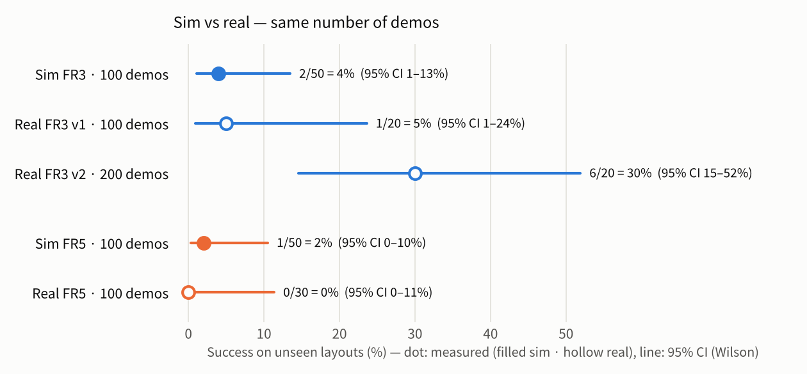
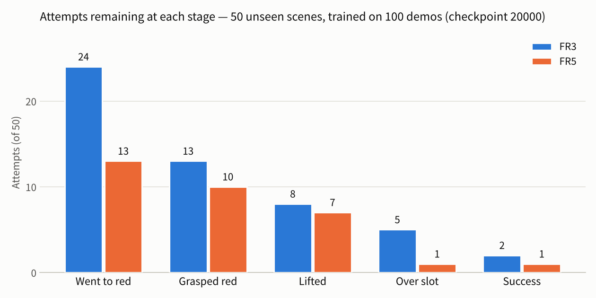
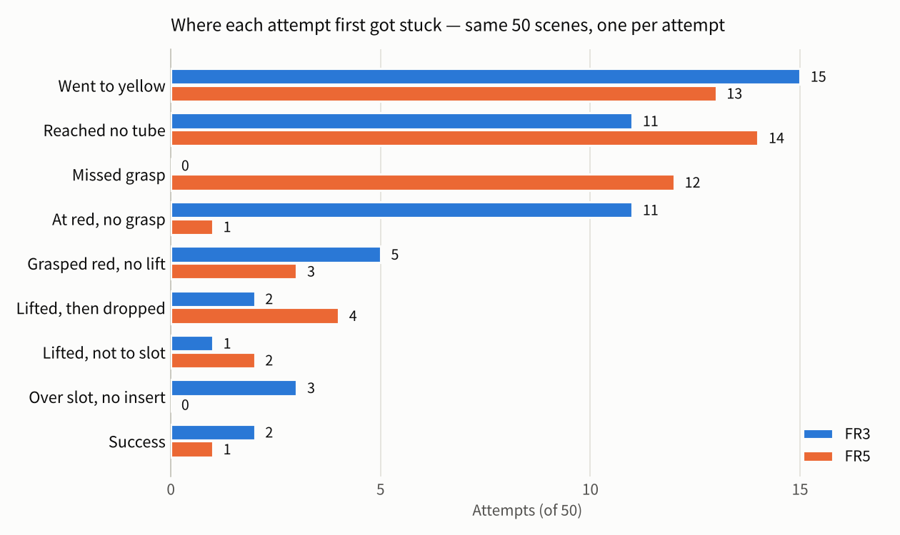
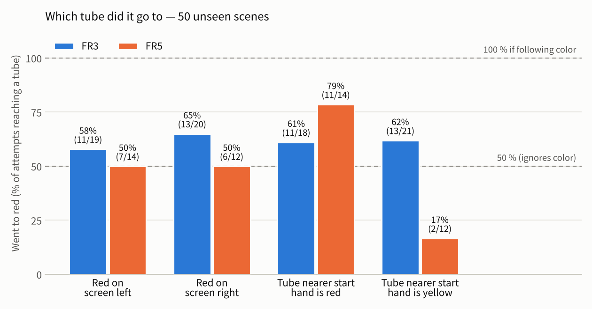

# Report 2 — GR00T trained on 100 demos: benchmark results, data-collection mistakes, and how we will fix them

2026-11-06 · Sim-to-Real Post-Training (simulation part) · GR00T N1.7 · Isaac Sim 6.0.1 · Isaac Lab 3.0 · [한국어](README.md)

Official copy: [BioRoboticsIsaacSim / sim_isaac / Report 2](https://github.com/SungjinDavidLee/BioRoboticsIsaacSim/tree/main/sim_isaac/reports/02_vla100_bench) · [front page](../../README_EN.md) of this repository

## Summary

- We fine-tuned GR00T N1.7 on 100 scripted sim demonstrations per robot and evaluated it on the same 50 scenes that were not used for training: **FR3 2/50 (4 %) · FR5 1/50 (2 %)**. Real-robot models trained on 100 demos were similar (FR3 1/20 = 5 %, FR5 0/30). The sim is not uniquely low.
- Failures are not concentrated in one stage. The policy passes each stage — going to the red tube, grasping, lifting, moving over the slot, inserting — only about half the time, and these rates multiply to 4 %.
- Our first suspicion is that **the policy does not pick the tube by color**. Among attempts that reached a tube, the red one was chosen 62 % (FR3) and 50 % (FR5, a coin flip) of the time. FR5 went to whichever tube was closer to its start hand (81 %). On 10 scenes used in training, FR3 went to red 8/8, so we read this as memorizing layouts rather than generalizing "pick red" to new layouts.
- Our second suspicion is **manipulation** (grasp · lift · insert). Even on training scenes FR3 scored 0/10. Candidates: too few demos, a short action chunk (see the mistakes below), scripted demos that always succeed in one go so the policy never learns to recover, and the sim FR3 grasp physics.
- We made **mistakes by collecting with settings that differ from the real robots**: recording rate 30 Hz (real 10 Hz), images 640×360 (real 848×480), per-robot state · action definitions, exposure, and FR5 trajectory speed. As a result, the same "16-step action chunk" looks 1.6 s ahead on the real robots but only 0.53 s ahead in sim. As is, the sim models cannot be compared with the real models under the same conditions, and the two datasets cannot be mixed for training.
- There was also a mistake inside the sim. Because of a Blender dome light that came along inside the object USDs, **our dome light was dropped or kept at random each time Isaac started** (Section 4-4). Both models were trained only on dark data with the dome dropped, but **the FR3 benchmark ran in the bright state with the dome present** (the FR5 benchmark ran in the same dark state as its training). The FR3 result may therefore be lower by however much this lighting gap costs, and we will re-measure it under the training lighting. The light inside the object USDs was turned off on 11-06.
- The fix has two parts. Data already collected (AB) is converted to the real format with a **converter**; what is baked into the images and cannot be changed (resolution · tube appearance · FR5 trajectory) is **re-collected with the real settings** (ab, multi-scene collector). Then we change format · number of demos · layout one at a time and measure each with the same benchmark.

## 0. Terms

| Term | Meaning |
|---|---|
| VLA | A model that takes camera images · an instruction · the robot state and outputs robot actions (Vision-Language-Action). Here NVIDIA GR00T N1.7 (3 B parameters) |
| Fine-tuning | Training a pretrained model further on our demonstrations |
| Checkpoint | A model saved during training. All numbers in this report use step 20000 (the last one) |
| Benchmark | Letting the model perform the task in sim, judging it automatically, and measuring the success rate |
| Unseen scenes | Layouts · lighting generated with base seed 7700, different from the training data (base seed 1103) |
| Action chunk | The 16 future action steps the model returns for one query |
| Scripted model (auto collector) | The demo generator that plans paths from the sim's ground-truth state (exact tube · hole poses) ([Report 1](https://github.com/SungjinDavidLee/BioRoboticsIsaacSim/blob/main/sim_isaac/reports/01_sim_env_autodemo/README_EN.md)) |
| Layout A · B | A = the two tubes are in the end holes of the source rack, B = any two holes of the source rack |
| AB / ab | AB = sim data collected so far (A 300 pairs = 100 + 200 more, B 300 pairs — FR5 still following), ab = data to be newly collected with the real settings |
| 95 % CI | Confidence interval of the success rate (Wilson). Wider with fewer trials |

## 1. Benchmark results

### 1-1. How we measured

| Item | Value |
|---|---|
| Model | GR00T N1.7 fine-tuned per robot (FR3 100 demos · FR5 100 demos), checkpoint 20000 |
| Scenes | The 50 scenes among scenes 1–53 of base seed 7700 that both robots can plan. **Both robots get the same 50 scenes and the same lighting.** Layout A |
| Input | Third-person · wrist images (640×360) + end-effector state + instruction `put the red tube in the red slot` |
| Execution | 30 Hz. Each query's 16 action steps are all executed before querying again. The sim pauses during queries (no inference latency) |
| Episode end | Success held for 1 s · 60 s · end-effector stays within 5 mm for 10 s |
| Judgment | The same collar-height judgment as the collector (Report 1, Section 6-9) |
| Retries | None (first attempt only) |
| Lighting (dome, 4-4) | FR3 benchmark and FR3 training-scene benchmark: **dome present (bright)** — training data had the dome dropped. FR5 benchmark: 49 of 50 with the dome dropped — same as training |

The policy server runs on the training server (sch), and Isaac Lab on the workstation queries it over HTTP. About 110 queries per attempt, 306 ms round trip each (about 170 ms of it inside the server).

### 1-2. Success rate

| | Success | 95 % CI | Successful scenes (sim time) |
|---|---|---|---|
| FR3 | 2 / 50 = **4 %** | 1.1–13.5 % | 10 (37.5 s) · 44 (36.5 s) |
| FR5 | 1 / 50 = **2 %** | 0.4–10.5 % | 6 (26.5 s) |

The 95 % CI is the Wilson interval ($`\hat p`$ = success rate, $`n`$ = trials, $`z = 1.96`$).

```math
\frac{\hat p + \frac{z^2}{2n} \;\pm\; z\sqrt{\frac{\hat p(1-\hat p)}{n} + \frac{z^2}{4n^2}}}{1 + \frac{z^2}{n}}
```

The intervals overlap heavily, so **this benchmark cannot say whether FR3 or FR5 is better.** In addition, FR3 was measured under lighting different from its training data and FR5 under the same lighting (Section 4-4).

**Comparison with the real robots.** Real numbers come from the FR3 · FR5 teams' records (2026-11-05 · 06).

<picture>
  <source media="(prefers-color-scheme: dark)" srcset="figures/simreal_en_dark.png">
  
</picture>

- Models trained on 100 demos score 0–5 % both in sim and on the real robots.
- Real FR3 rose to 30 % with 200 demos (v2). The difference from 100 demos (v1) has p = 0.09, so it is not conclusive, but it suggests **the number of demos is a major variable**.
- Sim and real differ in scenes · judgment · number of trials, so the numbers cannot be compared directly. We compare trends only.

### 1-3. Where it got stuck — by stage

<picture>
  <source media="(prefers-color-scheme: dark)" srcset="figures/bench_funnel_en_dark.png">
  
</picture>

| Stage (of attempts that passed the previous stage) | FR3 | FR5 |
|---|---|---|
| Went to red (first tube approached was red) | 24 / 50 (48 %) | 13 / 50 (26 %) |
| → Grasped red | 13 / 24 (54 %) | 10 / 13 (77 %) |
| → Lifted | 8 / 13 (62 %) | 7 / 10 (70 %) |
| → Over the target hole | 5 / 8 (63 %) | 1 / 7 (14 %) |
| → Inserted (success) | 2 / 5 (40 %) | 1 / 1 |

The success rate is the product of the pass rates of the stages.

```math
P(\text{success}) = \prod_{k} P(\text{stage } k \mid \text{stage } k-1), \qquad
\text{FR3: } 0.48 \times 0.54 \times 0.62 \times 0.63 \times 0.40 \approx 0.04
```

So **fixing a single stage does not raise the rate much.** For example, even if FR3 always went to red (48 → 100 %), with the other stages unchanged it would reach only about 8 %.

<picture>
  <source media="(prefers-color-scheme: dark)" srcset="figures/bench_branches_en_dark.png">
  
</picture>

Each attempt is assigned to the first place it got stuck (definitions in Appendix A).

- **Went to yellow (FR3 15 · FR5 13):** the largest branch. Section 1-4 looks at it separately.
- **Reached no tube (11 · 14):** never came close to any tube. Most used up the full 60 s (ended by stalling: FR3 2 · FR5 3).
- **FR3 at red, no grasp (11):** came within 4–22 mm laterally of the red tube (median 11 mm), but no grasp registered.
- **FR5 missed grasp (12):** the gripper closed with no tube in hand. The nearest tube was 30–232 mm away (median 48 mm) and was the red one in 10 of 12 cases. **14 of 19 real FR3 v1 failures looked the same** (empty grasps 25–63 mm from the red tube).
- **FR5 lifted, then dropped (4):** opened the gripper 50–373 mm away from the target hole. FR5 has a sim assist (the tube is held fixed in the hand frame while grasped), so a drop can only happen when the policy opens the gripper.
- **FR3 over slot, no insert (3):** reached above the target hole but did not insert (once the tube fell over).

### 1-4. Which tube did it go to

<picture>
  <source media="(prefers-color-scheme: dark)" srcset="figures/bench_target_en_dark.png">
  
</picture>

If the policy picked by color, every bar would be 100 %; if it ignored color, they would be near 50 %. If it followed another habit such as screen side or distance, the bars would be high or low only under that condition.

- **FR3:** 58 % with red on the screen left · 65 % on the right; 61 % when the tube nearer the start hand is red · 62 % when it is yellow. No particular habit, but a weak pull toward color (62 % red).
- **FR5:** 50 % regardless of screen side. But 79 % red when the nearer tube is red and 17 % when it is yellow — **it goes to the nearer tube instead of the red one** (81 % of attempts went to the nearer tube). In the training data the nearer tube is red 50 % · 47 % of the time (FR3 · FR5), so this habit does not come from a bias in the data.
- **It is not that the scenes were hard:** of the 24 scenes where FR3 went to red, FR5 went to red in only 7. The two models chose differently on the same scenes.
- **Training scenes (FR3, 10 scenes of base seed 1103):** all 8 attempts that reached a tube went to red (the other 2 reached no tube). With the 62 % red rate of new scenes, the chance of 8 out of 8 is $`0.62^8 \approx 2\,\%`$, hard to explain by luck. **It picks correctly on layouts it has seen, and not on new ones.**
- **Why layout rather than color (our reading):** in the third-person image (640×360) a tube is about 7 pixels wide, and the FR5 wrist camera sees only the blue caps from above, so red and yellow look the same. The rack layout, by contrast, covers a large part of the image. The training data has one demo per scene and the target is always red, so memorizing the layout is enough to get every training sample right.
- **Lighting (weak trend):** FR3 went red 14 · yellow 5 in the half with a lower light scale (×0.6–1.0) and red 10 · yellow 10 in the half with a higher scale (×1.0–1.4). The sample is small, so this is not conclusive; color temperature made no difference.

### 1-5. Manipulation fails even on training scenes

Running the same FR3 model on 10 training scenes gave stages 8 → 6 → 3 → 3 → 0, i.e. **0/10 successes**. Where they got stuck: no grasp 2 · grasped but no lift 3 · over slot but no insert 3 (2 of them fell over) · reached no tube 2.

The real FR3 model trained on 100 demos succeeded 8/8 when repeating the same layout and 13/16 on layouts similar to training (FR3 team's records). How often that layout appeared in the real training data may differ from sim, though. **Whether manipulation works on seen scenes** is where sim and real differ the most.

However, this benchmark ran in the bright state with the dome present, while all training data had the dome dropped (Section 4-4). Picking worked (8/8), but stages that need fine visual cues, such as grasping and inserting, may have been hit harder by this difference. We will re-measure under the training lighting (Section 7).

### 1-6. Why the success rate is low — suspects

| # | Suspect | Evidence | How to check (Section 5-3) |
|---|---|---|---|
| 1 | **Too few demos** (100 per robot) | At 100 demos both sim and real score 0–5 %; real with 200 demos scores 30 % | Train on 100 · 300 · 600 and use the same benchmark |
| 2 | **Memorizing layouts instead of color** (shortcut learning) | New scenes: red 62 % · 50 %; training scenes 8/8; FR5 goes to the nearer tube 81 %. Only one layout type (A — tubes always at the ends), and weak color cues (tube about 7 px wide, FR5 wrist image shows only caps) | Color-swap benchmark (swap only red · yellow in the same layout), mix in layout B |
| 3 | **Action chunk too short** (30 Hz → 0.53 s) | Manipulation 0/10 even on training scenes; real (10 Hz → 1.6 s) 8/8 on the same layout | Retrain the same 100 demos converted to 10 Hz |
| 4 | **Never learned to recover** | Scripted demos always succeed in one go, so slightly-off states never appear in training. Once off, the policy enters unseen states and drifts further | Train with recovery demos mixed in (re-grasp after an empty grasp) |
| 5 | **Imprecise grasp position** | FR3 fails to grasp around 11 mm from red (11), FR5 empty grasps (12, median 48 mm), real v1 empty grasps 14/19 | See whether this branch shrinks with the changes in 1 · 3 · 4 |
| 6 | **Sim FR3 grasp physics** | The scripted model also lost the tube in 16 of 116 FR3 attempts (Section 2-2). When the sim fingers hold the cap (33 mm) their gap is 25.4 mm (real 31–34 mm) — the fingers appear to sink into the cap | Check the finger contact (Section 6) |
| 7 | **Benchmark under lighting different from training (FR3)** | FR3 benchmark and training-scene benchmark: dome present (bright); training data: dome dropped (Section 4-4). FR5 benchmark matched its training. FR3 going to yellow more often in scenes with a higher light scale (Section 1-4) points the same way | Re-benchmark FR3 under its training lighting (dome off) |

1 · 2 · 5 also appear on the real robots; 3 · 6 · 7 may be problems on the sim side (data · physics · benchmark conditions).

## 2. Data collection

### 2-1. Method (summary of Report 1)

- **Auto collector:** plans demos from the sim's ground-truth state, judges them, and saves only the successes. When FR3 saves a scene, FR5 rebuilds the same scene from the same base seed · scene number and performs it (paired demos).
- **Scenes:** layout A, base seed 1103. Each scene randomizes rack positions · orientations, the red · yellow left-right order, the red-ring hole, and the lighting (brightness ×0.6–1.4, color temperature 5000–8500 K).
- **Recording:** 30 Hz, third-person · wrist 640×360, state · action = end-effector xyz + rot6d + gripper + joints (LeRobot v2).
- **FR5 sim assist:** while grasped, the tube pose is held fixed in the hand frame (Report 1, Section 6-11). So FR5 never has "slipped out of the hand" failures.

### 2-2. Results (Sections 8-2 · 8-3 of Report 1)

| | Scenes tried | Saved | Saved on first attempt | Success per attempt | Scenes given up | Scenes skipped |
|---|---|---|---|---|---|---|
| FR3 (005) | 102 | 100 | 88 / 102 (86 %) | 100 / 116 (86 %) | 2 | 5 |
| FR5 (007) | 101 | 100 | 100 / 101 (99 %) | 100 / 101 (99 %) | 0 | 1 |

99 scenes were saved by both robots (FR3 only: scene 23, FR5 only: scene 109).

| Failure type | FR3 | FR5 |
|---|---|---|
| Slipped out of the hand (in-hand tube shifted over 15 mm while carrying) | 16 (all discarded attempts) | 0 (cannot happen with the assist) |
| Not in the empty-rack hole | 0 | 1 |
| Planning failure (skipped) | 5 — demo longer than 60 s: 4 (layouts that need a lot of wrist rotation), FR5 cannot reach: 1 | 1 |
| Given up (both attempts failed) | Scenes 10 · 40 — with the same scene and the same random values FR5 saved all 4 (folder 008, not used for training) | — |

- **Speed:** 246 ms (FR3) · 271 ms (FR5) of real time per sim step, about 6 minutes per demo. Average demo length about 41 s (sim).
- **Training data size (estimate):** 100 demos × 41 s × 30 Hz ≈ 120k frames per robot.
- **Later collection:** 200 more A pairs (009 · 010) are done. For B (300 pairs), FR3 is done and FR5 is following (127 / 300 as of 11-06). All with the same settings (the mistakes of Section 4 included).

## 3. Training

| Item | Value |
|---|---|
| Base model | `nvidia/GR00T-N1.7-3B` (the base model — not one fine-tuned on LIBERO etc.). Real FR3 v1 · v2 use the same base model |
| Embodiment tag | `NEW_EMBODIMENT` |
| Data | FR3 005 (100) · FR5 007 (100), trained per robot |
| Input | Third-person · wrist video (current frame), state = end-effector xyz + rot6d + gripper (10), instruction |
| Output | 16 action steps = end-effector relative to the current pose + absolute gripper → 0.53 s ahead with 30 Hz data |
| Trained parts | projector · diffusion · vlln (51.5 % of parameters, 1.62 B / 3.14 B). Language model · vision encoder frozen |
| Steps · batch · LR | 20000 · 16 · 1e-4, saved at 7000 · 14000 · 20000 |
| Other | bf16, seed 42, image augmentation off |
| Hardware | Training server sch (RTX PRO 6000 Blackwell), one GPU each |
| Result | FR3 final loss 0.0105. FR5 stopped at step 18216 with a CUDA launch timeout (a policy server was on the same GPU) → resumed from checkpoint 14000 to 20000 |

- **Amount of training (estimate):** 20000 steps × batch 16 = 320k samples ≈ about 2.6 passes over 120k frames.
- **Matching the real setup:** on 11-03 we compared the configuration of the real FR5 training item by item and matched the LR schedule · optimizer · bf16 · trained parts · seed.
  The real FR3, however, was trained with a different tool (LeRobot `lerobot_train`, image augmentation on, batch 32 × 2 GPUs).
- **Zero-shot (before fine-tuning):** the pretrained GR00T (DROID tag) was tried on only 2 scenes: 0/2 (no grasp), IK failure 14.1 %. A 50-scene zero-shot run has not been done.

## 4. Mistakes — settings that differ from the real robots · the dome light inside the sim

### 4-1. What differed

| Item | Real (FR3 · FR5) | Sim AB | Can it be changed later? |
|---|---|---|---|
| Recording rate | 10 Hz | **30 Hz** | Yes (subsampling) |
| Camera images | D405 848×480 (FR5 squeezed to 256×256 for training) | **640×360** | No (baked into the images) |
| State · action definition | Differs per robot (table below) | Same definition for both robots | Yes |
| Exposure | Adjusted per episode so the start image hits a target brightness (FR3 third-person 127 · wrist 139, FR5 147) | Not adjusted (first images FR3 126 · 157, FR5 179 · 185) | Brightness correction only (saturated areas cannot be recovered) |
| FR5 demo trajectory | Real fr5auto rules: joints 45 °/s, per-segment speed table, median 23.8 s per episode | Same formula as FR3 + joints 15 °/s + timing matched to the slower robot → about 30 s | No |
| Tube appearance | Opaque colored liquid | Water in glass looks dark (yellow looks olive) | No |
| FR3 training tool | LeRobot (augmentation, batch 32 × 2) | Isaac-GR00T (real FR5 settings) | Retrain |

| Per-robot definition | Real FR3 | Real FR5 | Sim AB |
|---|---|---|---|
| State | xyz + rot6d + finger gap m (10) | xyz + rot6d + half gap + (−half gap) (11) | xyz + rot6d + gripper 0–1 (+ joints) |
| rot6d | **First two columns** of the rotation matrix | First two rows | First two rows |
| Frame | Base (`fr3_link0`) | Work frame (base rotated −77.2° about z) | Base |
| TCP | Flange + 103.4 mm | Flange + 167.6 mm | FR3 97.0 · FR5 171.2 mm |
| Meaning of action | Command sent at that moment, gripper 1 = open · 0 = close | Next measured state | Target sent at that step, gripper 0 = open · 1 = closed |

**The biggest difference is the recording rate.** Even with the same model settings, one action chunk covers three times as much time.

```math
T_{\text{chunk}} = \frac{H}{f}: \qquad \frac{16}{10\ \text{Hz}} = 1.6\ \text{s (real)}, \qquad \frac{16}{30\ \text{Hz}} = 0.53\ \text{s (sim)}
```

At an average carrying speed of about 6 cm/s, one chunk looks about 10 cm ahead on the real robots and about 3 cm ahead in sim — shorter than the distance between the two tubes (about 11 cm).

### 4-2. What this prevented

- **Comparison with the real models under the same conditions:** the time span and input format differ, so the sim–real comparison in Section 1-2 shows trends only.
- **Mixing for training · testing directly on the real robots:** the same numbers mean different things per robot (rot6d · frame · gripper value · meaning of action), so sim data cannot be mixed into real training and sim models cannot be put on the real robots directly.
- **Performance inside the sim:** training and benchmark use the same format, so the sim results are self-consistent. The chunk length (suspect 3 in Section 1-6) may still affect sim performance, so we test it separately.

### 4-3. Why it happened

- On 10-31 we decided to "keep recording at 30 Hz and subsample when converting to GR00T data". But the subsampling converter was not built before training, so 30 Hz data went straight into training.
- On 11-03 we compared the training **configuration** (LR · batch · trained parts, etc.) with the real setup item by item, but not **the data itself** (rate · resolution · state · action definitions · brightness).
- That the data definitions differ per robot (rot6d columns vs rows, FR5 work frame, meaning of action) we first learned from the real teams' answers on 11-05. Before that we assumed both robots were the same.

### 4-4. A mistake inside the sim — the dome light changed per run

If we divide each demo's first-image brightness by the scene's light scale, per collector run (Isaac start) the values split into about 134 or about 185. Within a run they are nearly constant.

| Data | Dome dropped (≈134) | Dome present (≈185) |
|---|---|---|
| FR3 A 300 (incl. the 100 used for training) | 300 | 0 |
| FR5 A 100 (used for training) | 100 | 0 |
| FR5 A 200 more | 3 | 197 |
| FR3 B 300 | 74 | 226 |
| FR5 B (123 as of 11-06) | 0 | 123 |
| FR3 benchmark 50 · training-scene benchmark 10 | 0 | 60 |
| FR5 benchmark 50 | 49 | 1 |

- **Cause (our reading):** the tube · holder USDs were exported from Blender, so Blender's "world" came along as a dome light `env_light` (intensity 1, almost black). The renderer uses only one dome light, and at each start it picks either our dome (about 1/3 of all light) or this one. Only the runs that pick this one show an error that its texture could not be uploaded, and they are dark.
- **How it differs from lighting randomization:** lighting randomization is drawn per scene, recorded, and identical for FR3 · FR5 on the same scene. This problem lumps hundreds of demos into one state per run, is not recorded, and can split a pair of the same scene. Without the dome, light comes only from the ceiling, so shadows · contrast change too — exposure matching cannot undo that.
- **Why we missed it:** the scene's light list printed this dome as a "light outside DR". Because its intensity was 1, we judged it harmless and removed it from the warnings. We looked only at the intensity value, not at the actual brightness of each run.
- **Fix:** turn off this light in the object USDs so that only our dome is ever used (done on 11-06, `tools/common_dome_fix.py`). If dark scenes are wanted for training, the dome intensity should be added as a per-scene lighting randomization item.

### 4-5. Rules from now on

- Before training, check a **data checklist** side by side with the real data: fps · image size · state · action layout and meaning · first-image brightness.
- Make the real-format conversion a standard step in building training data. The converter prints a summary of these values per episode.
- Check lighting by its outcome, not its settings: for each collector run, divide first-image brightness by the light scale and confirm it forms a single cluster (`tools/common_session_light.py`).

## 5. Fixes and the plan to improve performance

### 5-1. What we built (11-05 – 06)

| What | What it does | Where |
|---|---|---|
| Real-format converter 1.3 | Sim folder → real format per robot: subsample to 10 Hz · state · action definitions · TCP · FR5 work frame · FR5 wrist image rotated 180° · image size · exposure matching (scale each episode's first image to the real target). Source data is read-only | `tools/common_to_real.py` |
| Dome light check · fix | Shows per collector run whether the dome was dropped (read-only), and turns off the Blender dome inside the object USDs (backup · undo) | `tools/common_session_light.py` · `tools/common_dome_fix.py` |
| Profile `real_1105` | FR5 joints 45 °/s · fr5auto segment speeds, each robot at its own speed → FR5 demos 30.4 → 19.4 s on average (trajectory computation, 12 random layouts) | `config/common_auto_profiles.json` |
| 848×480 · real tube appearance | `--cam-res 848x480`, `--tube-look real` (opaque liquid matched to the color ratios of real photos) | Collector 2.17 · 2.18, `lab/common_tube_look.sh` |
| Multi-scene collector 1.0 | Runs N scenes in one Isaac. With one scene it gives the same results as the current collector (checked in a fake environment); workstation test in progress | `lab/common_collect_multi.py` |
| Real-format benchmark 1.3 | Runs the policy at 10 Hz and, like the real FR3, executes only the first 8 of 16 steps before querying again | `lab/common_bench.py` |
| Color-swap benchmark | Training scenes with only red · yellow swapped. Going to the old red position means layout memorization; going to the new red means it sees color. Runs automatically in order once the sch policy servers are up | Collector 2.15 `--bench-swap-colors`, `lab/common_pipeline.py` |
| Benchmark viewer | Compares two benchmarks by stage bars · branch cards · videos; a person can re-label branches | `tools/common_bench_view.py` (`docs/14`) |

### 5-2. How the data will be fixed

| | Current data AB | New data ab |
|---|---|---|
| Recording rate · state · action definitions · TCP · FR5 work frame · wrist flip | Changed by the converter | Changed by the converter |
| Exposure | Brightness correction by the converter | Brightness correction by the converter |
| Resolution | 640×360 as is (cannot change) | Collected at 848×480 |
| Tube appearance · FR5 trajectory | As is (cannot change) | Collected with the real tube · `real_1105` |
| How collected | — | Multi-scene collector `--cam-res 848x480 --tube-look real --auto-profile real_1105` |

FR5 A (300) has been converted to the real format (check: 0 problems). FR3 A is being re-run with the fixed converter (#85 in Section 6).

### 5-3. Improvement plan — change one thing at a time, same benchmark

| Order | What changes | Compared | Question |
|---|---|---|---|
| 1 | Format | A 100 at 30 Hz (current model) ↔ the same 100 in the real format (10 Hz) — **FR5 training started 11-06** | Does chunk length · format also affect sim performance? (suspect 3) |
| 2 | Number of demos | 100 ↔ 300 ↔ 600 (A 300 + B 300) — **FR5 300 training started 11-06** | Does it improve with more demos as on the real robots? (suspect 1) Same counts as real 100 · 200 |
| 3 | Layout | A only ↔ A + B (tubes in any rack holes) | Does it pick by color instead of memorizing layouts? (suspect 2) |
| 4 | Data with real settings | Converted AB ↔ ab | Does matching resolution · tube appearance · FR5 trajectory change results? Starting point for same-condition comparison with real models and for mixed training |
| Candidate | Demo types | Demos moving the yellow tube (so the instruction's color matters) · recovery demos that re-grasp after an empty grasp | Color generalization · recovery from failed grasps (suspects 2 · 4) |
| Candidate | Lighting selection | Keep only lighting that matches the color · exposure distribution of real first images | Sim–real image gap |

The FR5 300 set mixes 103 demos with the dome dropped and 197 with it present (Section 4-4), so its difference from the 100 set contains both the number of demos and the lighting state. From ab onward (collected after the fix) there is a single lighting state.

**Measurement rules**

- Use the same 50 unseen scenes (base seed 7700) and 10 training scenes, with the same number of trials for every model compared. First attempt only, no retries.
- Measure checkpoints 7000 · 14000 · 20000 (so far only 20000).
- **Color-swap benchmark:** swap only red · yellow in the same layout. Going to the same position means the layout was memorized.
- **Keep the lighting state (dome) the same across models.** After the fix the default is "dome present". Old models trained on dome-dropped data are also measured in their training state (dome off).
- Report the 95 % CI with every success rate. With 50 trials each, 4 % and about 25 % are needed for the intervals not to overlap (12/50 → 14.3–37.4 %).
- A 50-scene benchmark takes about 3.9 h (FR3) · 5.9 h (FR5) (policy queries take about 34 s per attempt).

**Goal.** If the sim shows the same trends as the real robots (improves with more demos, shows the same failure branches), costly experiments (number of demos · layout · lighting · demo types) can be screened in sim first and then handed to the real robots. That is the purpose of this simulation part.

## 6. Limitations and open items

- **Dome light:** our dome was dropped or kept per collector run (Section 4-4). In the previous benchmarks FR3 ran in a different state from its training (dome present) and FR5 in the same state. So the FR3 result (4 %, 0/10 on training scenes) may be lower by however much this costs. The Blender dome in the object USDs was turned off on 11-06. Matching the yellow tube appearance can now be finished too (red is matched).
- **Sim FR3 fingers:** when holding the cap, the finger gap is 25.4 mm (real 31–34 mm, cap 33 mm). The fingers appear to sink into the cap; we will check whether this relates to FR3 grasp failures (16 in the scripted model, and in the benchmark).
- **FR5 sim assist:** holding the tube while grasped is also active in the benchmark, so lifting · carrying is easier for FR5 than on the real robot.
- **FR3 005 #85:** the conversion to the real format stopped at this episode, but the source video decodes all 1020 frames. The problem was in the re-encoding step, and the converter has been fixed. The current training, which used the source data as is, is not affected.
- **Benchmark scope:** one checkpoint (20000), 50 unseen scenes; the training-scene benchmark was done only for FR3. Zero-shot only in a 2-scene trial. The sim pauses during queries, so there is no inference latency as on the real robots.
- **Real comparison:** real numbers are taken from the teams' records. Scenes · judgment · number of trials differ, so only trends are compared.

## 7. Next steps

1. Dome light fixed (11-06) → finish matching the yellow tube appearance · FR3 A real-format conversion (in progress)
2. Re-benchmark the FR3 100 model under its training lighting (dome off) — measure how much the lighting gap cost FR3
3. Two FR5 trainings on sch (real format 100 · current format 300, started 11-06) → benchmark them with the same 50 scenes and the same lighting state as the current FR5 100 model
4. Finish B collection → multi-scene collector test → collect ab (real settings, after the dome fix)
5. Pending benchmarks: FR5 training scenes · color swap
6. Number-of-demos · layout comparison training (orders 2 · 3 in Section 5-3) → Report 3

## Appendix A. Failure branch definitions (`tools/common_bench_target.py` 1.2)

"Came close" = end-effector within 25 mm laterally of the tube axis and below the tube top + 30 mm. "Grasp · lift · over slot" are stages recorded by the benchmark.

| Branch | Rule (first match from the top) |
|---|---|
| Success | Automatic judgment succeeded |
| Went to yellow | The first tube it came close to was yellow |
| Reached no tube | Never came close to any tube, and no grasp · lift |
| At red, no grasp | The first tube it came close to was red, and no grasp · lift |
| Grasped red, no lift | Grasped the red tube but did not lift it |
| Missed grasp | Reached the grasp stage but what it grasped was not the red tube (empty hand or something else) |
| Lifted, then dropped | Lifted but did not get over the target hole, and the tube fell over |
| Lifted, not to slot | Lifted but did not get over the target hole (did not fall over) |
| Over slot, no insert | Got above the target hole but success was not judged |

## Appendix B. Code · record locations

Paths are relative to the project folder `Medical_bio_experiment/`.

| Content | File |
|---|---|
| Benchmark (policy solves the scenes) · policy server | `lab/common_bench.py` · `tools/common_groot_server.py` |
| Benchmark analysis (branches · first tube) · viewer | `tools/common_bench_target.py` · `tools/common_bench_view.py` |
| Collection summary · scripted model success rate | `tools/common_scene_report.py` |
| Dome state per run · turning the dome off | `tools/common_session_light.py` · `tools/common_dome_fix.py` |
| GR00T training · modality config | `tools/common_groot_train.sh` · `tools/common_groot_modality.py` |
| Real-format converter | `tools/common_to_real.py` (usage `docs/16`) |
| Multi-scene collector | `lab/common_collect_multi.py` (design `docs/17`) |
| Real-matching checklist | `docs/15-실물맞추기-목록.md` |
| Benchmark result folders | `datasets/fr3/010_20261104_bench_fr3_ck20000` · `datasets/fr5/011_20261104_bench_fr5_ck20000` · `datasets/fr3/011_20261105_bench_fr3_ck20000_seen` |
| Training data folders | `datasets/fr3/005_20261102_pair100b_1103` · `datasets/fr5/007_20261102_pair100b_1103` |
