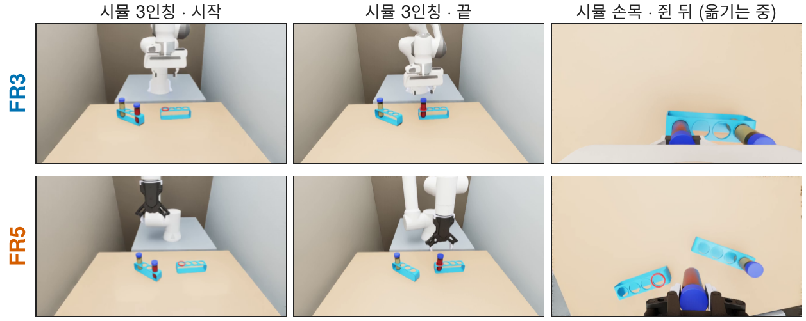
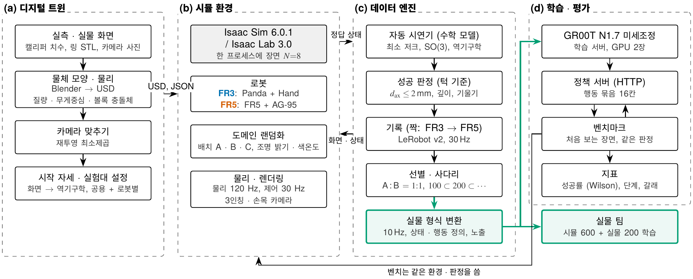
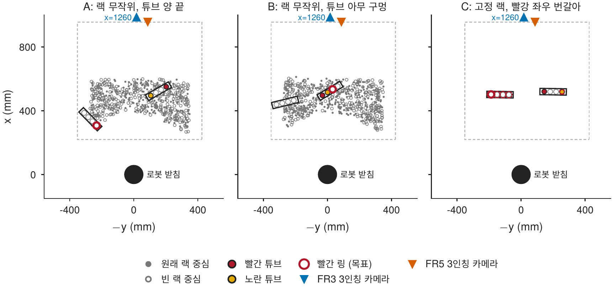
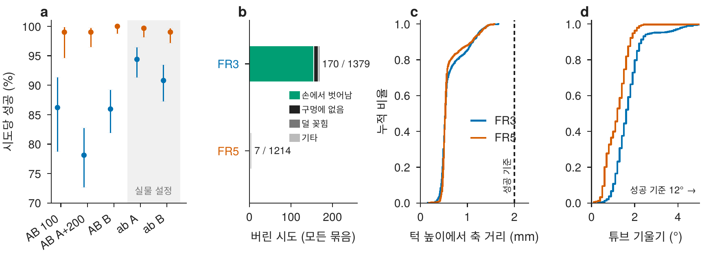
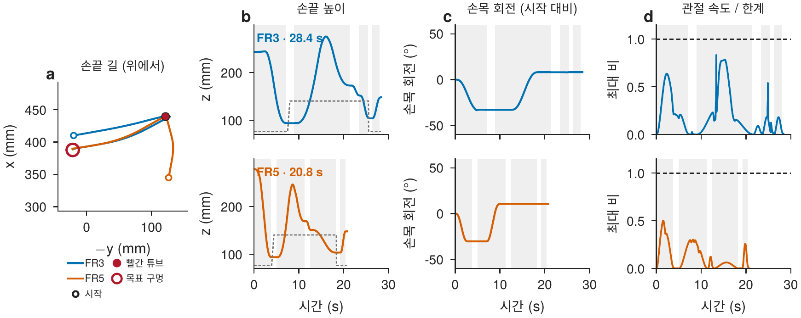
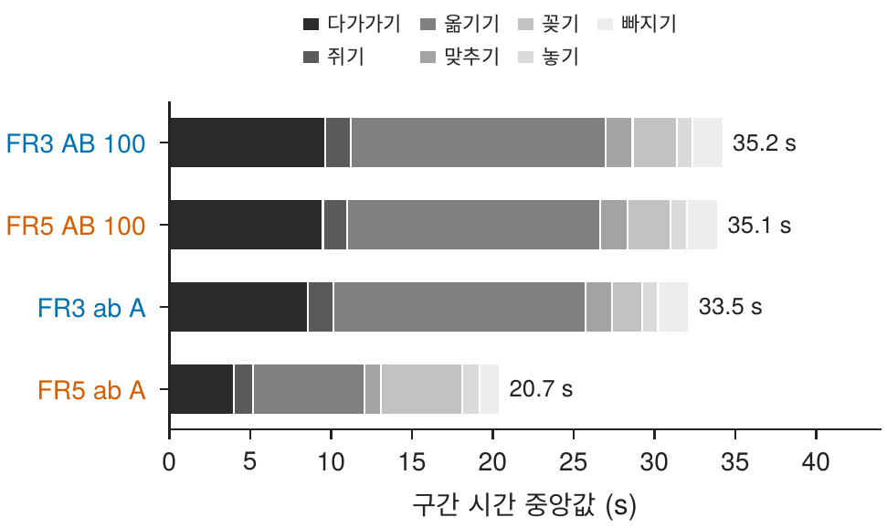
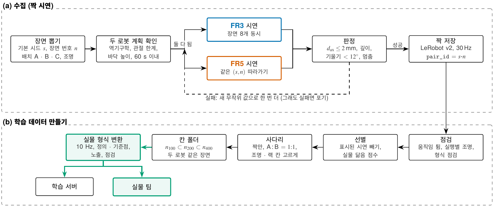
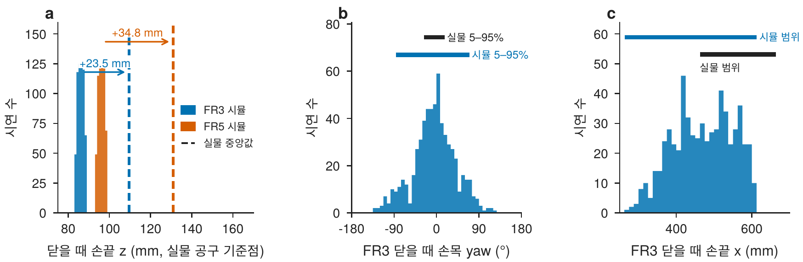

# 보고서 3 — 실물 설정으로 다시 모은 짝 시연: 수학 모델의 확률 · 정확성, 실물 형식 변환, 실물 데이터와 비교

2026-11-10 · Sim-to-Real Post-Training (시뮬레이션 파트) · Isaac Sim 6.0.1 · Isaac Lab 3.0 · GR00T N1.7 · [English](README_EN.md)



## 요약

- **수학 모델(자동 시연기)의 확률:** 다섯 수집 묶음 2,593번 시도에서 시도당 성공률이 FR3 78–94 %, FR5 99–100 %였다.
  - FR3 실패 170번 중 155번(91 %)은 옮기는 동안 손 안 튜브가 15 mm 넘게 밀린 경우다.
  - FR3가 실패한 109번을 같은 장면 · 같은 무작위 값으로 FR5에 시키면 109번 모두 성공했다. 다만 FR5에는 쥔 동안 붙이는 시뮬 보조가 있다.
- **정확성:** 저장된 시연의 턱 높이 축 거리는 두 로봇 모두 중앙값 0.53 mm, 95번째 백분위 1.23–1.33 mm로 기준(2 mm) 안에 여유가 있다.
- **기계별 차이:** 실물 설정에서 FR5 시연은 20.7 s, FR3는 33.5 s(중앙값)다. FR3는 7번 관절 한계(0.15 rad/s) 때문에 손목을 크게 돌리는 장면에서 길어진다.
- **실물 설정으로 다시 모음(ab):** 848×480, 실물 튜브 겉모습, FR5 실물 궤적 규칙으로 로봇마다 약 600개를 모았다(짝 596개). 장면 8개를 한 프로세스에서 돌려 짝을 시간당 23.4개 모은다(첫 수집의 2.2배).
- **실물 형식 변환:** 기록 주기 · 상태 · 행동 정의 · 공구 기준점 · 좌표계 · 노출을 로봇마다 실물 학습 형식으로 바꿔 실물 팀에 넘겼다.
- **실물 데이터와 비교:**
  - 손끝 높이가 실물보다 FR3 23.5 mm, FR5 34.8 mm 낮았다. 공구 길이가 아니라 받침–책상 높이 차이로 설명된다.
  - 손목 방향은 시뮬이 더 넓다. 넓어진 몫의 대부분은 배치 B에서 손가락이 옆 뚜껑을 피하려고 손목을 90° 돌린 시연이다.

벤치마크(정책 평가) 결과는 600판이 끝난 뒤 보고서 4에서 다룬다.

## 1. 전체 구성



보고서 1 · 2와 같은 디지털 트윈 · 수집기 위에서, 이번에는 (c)의 **실물 형식 변환**과 실물 팀으로 넘기는 경로(초록)를 더했다.

- **장면 복제:** 한 Isaac 프로세스에 장면 8개(20 m 간격)를 띄우고, 장면마다 다른 시드의 배치 · 조명을 넣는다.
- **주기:** 물리 120 Hz, 제어 30 Hz. 실물 10 Hz 데이터는 변환할 때 세 스텝마다 하나를 남겨 만든다.
- **같은 장면:** 시드를 배치 `rng[s, n]`, 조명 `[s, n, 1]`, 궤적 무작위 `[s, n, 시도, 23]`으로 나눠, 기본 시드 $`s`$와 장면 번호 $`n`$만 같으면 두 로봇이 같은 장면을 받는다.

## 2. 배치 A · B · C



| 배치 | 랙 | 튜브 · 링 |
|---|---|---|
| A | 두 랙 자리 · 방향 무작위 (3인칭 가로 ± 45°) | 튜브는 원래 랙 양 끝 구멍, 링은 빈 랙 |
| B | A와 같음 | 튜브는 원래 랙의 아무 두 구멍(사이 1 · 2 · 3칸), 링은 빈 랙 또는 원래 랙의 빈 구멍(반반) |
| C | 실물 FR5 화면에서 푼 자리에 나란히 고정 | 빨강이 왼쪽 · 오른쪽 끝을 번갈아, 조명 · 링 구멍 무작위 |

배치마다 두 로봇이 모두 닿고, 두 3인칭 화면에 모두 보이고, 로봇이 가리지 않는 경우만 쓴다(보고서 1의 5장).

## 3. 수학 모델 — 확률과 정확성

### 3-1. 성공률

| 묶음 | 배치 · 시드 | FR3 첫 시도 | FR3 시도당 | FR5 첫 시도 | FR5 시도당 |
|---|---|---|---|---|---|
| AB 100 | A · 1103 | 88/102 = 86.3 % | 100/116 = 86.2 % | 100/101 = 99.0 % | 100/101 = 99.0 % |
| AB A+200 | A · 1104 | 162/209 = 77.5 % | 200/256 = 78.1 % | 198/200 = 99.0 % | 200/202 = 99.0 % |
| AB B | B · 1105 | 274/313 = 87.5 % | 300/349 = 86.0 % | 300/300 = 100 % | 300/300 = 100 % |
| ab A | A · 1103 | 289/305 = 94.8 % | 303/321 = 94.4 % | 302/303 = 99.7 % | 303/304 = 99.7 % |
| ab B | B · 1105 | 288/313 = 92.0 % | 306/337 = 90.8 % | 303/306 = 99.0 % | 304/307 = 99.0 % |

- **첫 시도** = 첫 시도에 저장된 장면 ÷ 해 본 장면. VLA와 견줄 값이다(VLA도 한 번에 해내야 함).
- **시도당** = 저장 ÷ (저장 + 버림). 수집 효율을 나타낸다.
- AB는 첫 설정, ab는 실물 설정(5장)이다.



- **(a) 시도당 성공률과 95 % 범위:** 범위는 Wilson 구간이다.

  ```math
  \frac{\hat p + \frac{z^2}{2n} \pm z\sqrt{\frac{\hat p(1-\hat p)}{n} + \frac{z^2}{4n^2}}}{1 + \frac{z^2}{n}}, \qquad z = 1.96
  ```

- **(b) 버린 까닭:**
  - FR3는 1,379번 중 170번을 버렸고, 그중 155번이 손에서 벗어남이었다. 시뮬 FR3 손가락은 뚜껑(33 mm)을 쥘 때 폭이 25.4 mm로, 뚜껑에 파고드는 것으로 보인다(실물 31–34 mm).
  - FR5는 1,214번 중 7번만 버렸다. 쥔 동안 붙이는 보조가 있어 손에서 벗어나는 실패가 원래 없다.
- **FR3 실패 → FR5:** FR3가 버린 109번(장면 88개)을 같은 장면 · 같은 무작위 값으로 FR5에 시키자 109번 모두 저장되었다. 이 차이에는 보조의 몫이 섞여 있다.
- **원인 미확인:** FR3 성공률이 ab에서 오른 까닭(AB 78–86 % → ab 91–94 %)은 아직 확인하지 않았다.

### 3-2. 정확성 (저장된 시연)

판정은 턱 높이에서 튜브 축이 구멍 가운데를 지나는지로 한다(보고서 1의 6-9절).

```math
p_c = r + \hat a\,\frac{z_c - r_z}{a_z}, \qquad d_{ax} = \big\lVert p_{c,xy} - (x_h,\ 0) \big\rVert, \qquad z_c = 51\ \text{mm}
```

| | FR3 | FR5 |
|---|---|---|
| $`d_{ax}`$ 중앙값 · 95번째 백분위 · 최댓값 | 0.52–0.53 · 1.23–1.29 · 1.66 mm | 0.53 · 1.23–1.33 · 1.57 mm |
| 기울기 중앙값 · 95번째 백분위 | 1.5–1.7° · 2.5–3.8° | 1.0–1.3° · 1.9–2.1° |
| 바닥 깊이 중앙값 | 0.86–0.94 mm | 0.43–0.67 mm |

값은 다섯 묶음의 범위이고, 성공 기준은 $`d_{ax}`$ ≤ 2 mm · 기울기 < 12°다. 성공으로 저장된 시연의 분포이므로, 성공 확률이 아니라 꽂기 정밀도의 여유를 보여 준다.

## 4. 기계별 차이





- **손끝 길은 거의 같다:** 같은 계획기를 쓰기 때문이다. 시간 축에서는 다르다.
- **첫 설정(AB):** 두 로봇의 구간 시간을 느린 쪽에 맞춰 시연 길이가 35.2 · 35.1 s로 같았다.
- **실물 설정(ab):** 로봇마다 제 속도라 FR5 20.7 s, FR3 33.5 s다.
  - FR5는 다가가기 4.0 s · 옮기기 6.9 s로 빨라졌다.
  - FR5 꽂기는 실물 속도(10 mm/s)를 따라 5.0 s로, FR3(1.9 s)보다 길다.
- **FR3 7번 관절:** 계획 한계가 0.15 rad/s(8.6 °/s)다. 손목을 90° 가까이 돌리는 장면이 많은 배치 B에서 FR3 다가가기 중앙값이 8.6 s(ab A)에서 16.6 s(ab B)로 늘었다. FR5는 4.0 → 4.7 s였다.
- **역기구학:** FR3(7축)는 감쇠 최소제곱 + 영공간에서 시작 자세 쪽으로 당기고, FR5(6축)는 해석해(최대 8해) 가운데 앞 점에 가까운 해를 고른다.
- **계획 단계에서 건너뜀:** FR3는 시연이 60 s를 넘는 배치(손목 회전)가 다섯 묶음에서 37개였다. FR5는 닿지 못하거나 옮기는 튜브가 옆 뚜껑에 닿는 배치였다.

## 5. 바뀐 것과 개선한 것

### 5-1. 실물과 달랐던 설정 (첫 수집 AB)

| 항목 | 실물 (FR3 · FR5) | 첫 수집 AB | 지금 (ab, 변환 뒤) | 고친 방법 |
|---|---|---|---|---|
| 기록 주기 | 10 Hz | 30 Hz | 10 Hz | 변환 |
| 행동 묶음 시간 | 16 / 10 = 1.6 s | 16 / 30 = 0.53 s | 1.6 s | 변환 |
| 해상도 | 848×480 (FR5 학습 256×256) | 640×360 | 848×480 | 다시 모음 |
| 상태 정의 | FR3 xyz + rot6d(앞 두 열) + 손가락 폭 · FR5 xyz + rot6d(앞 두 행) + 반폭 ± | 두 로봇 같은 정의 + 관절 | 로봇마다 실물 정의 | 변환 |
| 좌표계 · 기준점 | FR3 link0, 플랜지 + 103.4 · FR5 작업 프레임(z 둘레 −77.2°), + 167.6 | 받침, 97.0 / 171.2 | 실물과 같음 | 변환 |
| 노출 | 판마다 첫 화면 밝기 맞춤 | 맞추지 않음 | 실물 목표로 | 변환 |
| 튜브 겉모습 | 불투명 색 액체 | 유리 속 물 | 실물 사진 색 | 다시 모음 |
| FR5 궤적 | 관절 45 °/s, 구간별 속도 | 15 °/s, 공통 시간 | 실물 자동 시연 규칙 | 다시 모음 |
| 돔 조명 | 하나 | 실행마다 들어가거나 빠짐 | 늘 들어감 | USD 고침 |

### 5-2. 개선한 것

- **실물 형식 변환기:** 시뮬 폴더는 읽기만 하고, 로봇마다 실물 학습 형식의 새 폴더를 만든다. 하는 일은 다음과 같다.
  - 10 Hz 솎기
  - 상태 · 행동 재계산(실물 공구 기준점, rot6d 열/행 규약, FR5 작업 프레임, 그리퍼 값의 뜻)
  - FR5 손목 영상 180° 회전과 영상 크기 맞추기
  - 판마다 첫 화면 밝기를 실물 목표(FR3 3인칭 127 · 손목 139, FR5 147)로 맞추기

  ab 600판(로봇마다)을 바꿔 넘겼고, 실물 FR3 쪽이 600판 · 220,948 프레임을 다시 읽어 확인했다.
- **실물 설정 묶음 `real_1105`:** FR5를 실물 제어판 한계(45 °/s · 120 °/s²)와 실물 자동 시연의 구간 평균 속도(가로 107 · 세로 46 · 맞추기 24 · 꽂기 10 mm/s)로 맞췄다. FR5 시연 중앙값이 35.1 s에서 20.7 s로 줄었다(실물 23.8 s).
- **장면 8개 수집기:** 같은 GPU에서 첫 수집(장면 1개, 640×360, 두 로봇 동시)은 로봇마다 시간당 10.8개였다.
  - 첫 수집의 한 스텝: FR3 257 · FR5 278 ms. 이 가운데 물리 84 · 102 ms, 카메라 98 · 96 ms.
  - 장면 8개 수집기(848×480)는 FR3 35.7 · FR5 67.9개다. 짝으로는 시간당 23.4개로 2.2배다.
- **조명 상태:** 물체 USD에 딸려 온 Blender 돔 조명 때문에 실행마다 우리 돔이 들어가거나 빠졌다(보고서 2의 4-4절). 그 조명을 꺼 ab부터는 한 가지 상태이고, 실행마다 첫 화면 밝기로 확인한다.
- **학습 묶음 사다리:** 짝만 남겨 A : B = 1 : 1로 번갈아 줄 세우고, 조명 · 랙 자리(3×3 칸) · 방향이 고르게 앞에 오게 했다. 앞에서부터 $`n_{100} \subset n_{200} \subset n_{400}`$로 자른다.

## 6. 데이터



| 묶음 | 배치 · 시드 | 해상도 | 튜브 겉모습 | 궤적 설정 | FR3 | FR5 |
|---|---|---|---|---|---|---|
| AB 100 | A · 1103 | 640×360 | 유리 속 물 | 공통 시간 | 100 | 100 |
| AB A+200 | A · 1104 | 640×360 | 유리 속 물 | 공통 시간 | 200 | 200 |
| AB B | B · 1105 | 640×360 | 유리 속 물 | 공통 시간 | 300 | 300 |
| ab A | A · 1103 | 848×480 | 실물 색 (불투명) | `real_1105` | 303 | 303 |
| ab B | B · 1105 | 848×480 | 실물 색 (불투명) | `real_1105` | 306 | 304 |

ab에서 두 로봇이 모두 저장한 짝은 596개(A 299 · B 297)다. 이 밖에 FR3 실패 시도를 FR5로 다시 한 109개가 따로 있다(학습에는 쓰지 않음).

## 7. 실물 데이터와 비교

실물 팀이 변환한 ab 600판을 실물 데이터(FR3 200판 · 69,409 프레임 · 10 Hz, FR5 200판)와 견주었다. 형식(상태 · 행동 10칸의 이름 · 순서, 영상 키, 848×480, 10 Hz, 지시문)은 모두 같았다.



### 7-1. 손끝 높이

| 그리퍼를 닫을 때 손끝 z (받침 기준, 실물 공구 기준점) | FR3 (플랜지 + 103.4) | FR5 (+ 167.6) |
|---|---|---|
| 실물 중앙값 | 109.6 mm | 131 mm |
| 시뮬 중앙값 (5–95 %) | 86.1 (83.9–88.3) mm | 96.2 (93.8–98.3) mm |
| 차이 | +23.5 mm | +34.8 mm |
| 맞춘 뒤 놓을 때 (실물 / 시뮬) | 117.4 / 120.1 mm | — |
| 뚜껑 윗면 − 랙 윗면 (실물 / 시뮬) | 57 / 59.5 mm | 미측정 |

- **시뮬 값은 모형과 맞다:** 쥐는 손끝은 튜브 바닥에서 99–104 mm, 튜브 바닥은 받침 기준 −9 mm다. 이를 실물 공구 기준점으로 옮기면 FR3 83.6–88.6 mm, FR5 93.6–98.6 mm다.
- **공구 길이 탓이 아니다:** 변환기가 이미 상태를 실물 공구 기준점으로 계산한다.
- **원인은 받침–책상 높이로 본다:** 시뮬은 로봇 받침이 책상보다 12 mm 높다고 두었는데, 사진에서 어림한 값이고 두 로봇에 같게 썼다. 실물은 랙 · 책상이 로봇 기준 FR3 약 26 mm, FR5 약 31 mm 높게 놓인 것으로 해석된다. FR5의 나머지 3–4 mm는 튜브 모양 차이로 추정한다.
- **맞추는 법:** 손이 거의 수직이라 상태 · 행동 z에 같은 값을 더하면 1 mm 안으로 맞는다(행동은 상대값이라 그대로). 쥘 때와 놓을 때를 함께 맞추지는 못한다. FR3에서 남는 2.7 mm는 튜브 · 랙 모양 차 2.5 mm와 같다.

### 7-2. 손목 방향과 남은 차이 (FR3)

| 항목 | 시뮬 | 실물 | 다음 수집에서 고칠 것 |
|---|---|---|---|
| 홈 손끝 (x, y, z) | (410, 20, 260) mm | (434, 17, 297) mm | 실물 홈 관절값으로 시작 |
| 처짐 (명령 − 상태) | 0 | x 약 8, z 약 7 mm | 실물 임피던스 제어 흉내 또는 행동 치우침 |
| 닫는 자리 x | 263–612 mm | 463–664 mm | 랙 배치 범위를 실물 분포로 |
| 손목 yaw (5–95 %) | −84° – +73° (A만 −38° – +37°) | −26° – +15° | 랙 방향 범위 좁힘, B의 가로 쥐기 비율 조절 |
| 닫을 때 yaw (5–95 %) | −86° – +70° | −27° – +17° | 가운데는 둘 다 약 −5° |
| 판 안 회전 폭 (중앙) | 40° | 23° | 원래 · 빈 랙 방향을 함께 좁힘 |
| 손 기울기 | 늘 수직 | 중앙 2.4°, 최대 4.5° | 원인 확인 뒤 0–4.5° 흔들기 |

- **가운데는 같다:** yaw의 가운데가 둘 다 약 −5°라 회전 정의 · 좌표계는 어긋나지 않았다. 넓은 것은 시뮬 분포다.
- **배치별로 나누면:** A만으로는 −38° – +37°이고, 넓어진 몫의 대부분은 B(−97° – +84°)에서 왔다.
- **B의 가로 쥐기:** B에서는 계획기가 손가락이 옆 뚜껑 · 링에 닿지 않게 랙 줄과 가로로(줄 방향에서 약 86°) 쥔다.
  - 튜브가 붙어 있는 장면: 82/82
  - 링이 원래 랙에 있는 장면: 128/161
  - 둘 다 아닌 장면: 7/110
- **|yaw| > 90°인 판:** 시뮬 61/609, 실물 2/200.

## 8. 한계와 다음 단계

**한계**

- **시뮬 전용 보조:** 깔때기 받침과 FR5 쥔 동안 붙이기는 실물에 없다. 3장의 FR3/FR5 차이에도 이 몫이 섞여 있다.
- **FR3 모델:** Panda 모델의 관절 한계를 쓰고, 시뮬 손가락이 뚜껑에 파고들어 쥔 튜브가 밀린다.
- **시연의 성격:** 수학 모델 시연은 늘 한 번에 성공해, 어긋난 상태에서 바로잡는 시연이 없다.
- **장면 차이:** 받침–책상 높이 · 홈 자세 · 랙 방향 분포 · 처짐 · 튜브 · 랙 모양이 아직 실물과 다르다. 예를 들어 실물 FR5는 코니컬 110 mm 튜브, 뚜껑 35×10, 2층 랙 60 mm를 쓴다.

**다음 단계**

1. 벤치 600판(모델 넷 × 배치 C · A · B × 50판)을 마무리한다 → 보고서 4.
2. 실물 팀의 공동 학습(실물 200 + 시뮬 600) 결과를 시뮬 벤치 경향과 견준다.
3. 다음 수집에 실물 값을 반영한다: 로봇마다 받침–책상 높이, FR3 홈 관절값, 실물 랙 배치 · 손목 방향 분포, FR3 처짐 흉내, 튜브 · 랙 모양.
4. 색 일반화를 본다: 빨강 · 노랑 자리만 바꾼 벤치, 노란 링에 노란 튜브를 옮기는 과제.
5. 회복 시연(헛잡음 뒤 다시 쥐기)과 노이즈 주입을 시험한다.

## 부록. 재현 정보와 수치 출처

| 항목 | 값 |
|---|---|
| 코드 판 | 수집기 2.19 · 장면 여러 개 수집기 1.2 · 환경 2.12 · 배치 뽑기 2.9 · 궤적 1.7 (ab 수집 때 1.6) · 변환기 1.6 |
| 시드 | 1103 (A) · 1104 (A+200) · 1105 (B) |
| 설정 | `common_scene.json` · `common_isaaclab_dr.json` · `common_auto.json` + `common_auto_profiles.json` (`real_1105`) · `fr3_env.json` · `fr5_env.json` · `common_to_real.json` |
| 수치 | 2026-11-10 14:35에 내보낸 수집 기록(`progress/history.jsonl` · `episodes.jsonl`)과 상태 · 행동에서 다시 계산 (`figures/src/analyze.py`) |
| 실물 값 | FR3 · FR5 담당 기록 (2026-11-10) |

그림은 `figures/src/`의 스크립트로 다시 만들 수 있다. 자세한 구현: [BioTube-Insertion-VLA-IsaacLab](https://github.com/bbiyak12e/BioTube-Insertion-VLA-IsaacLab)
