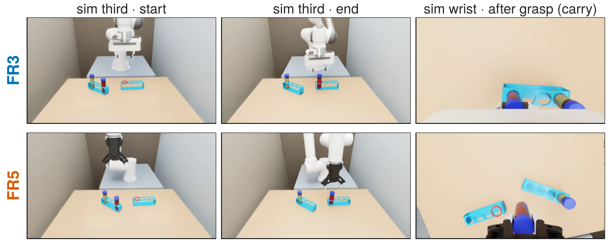
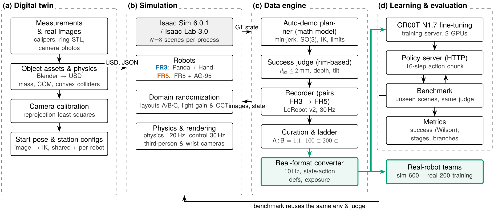
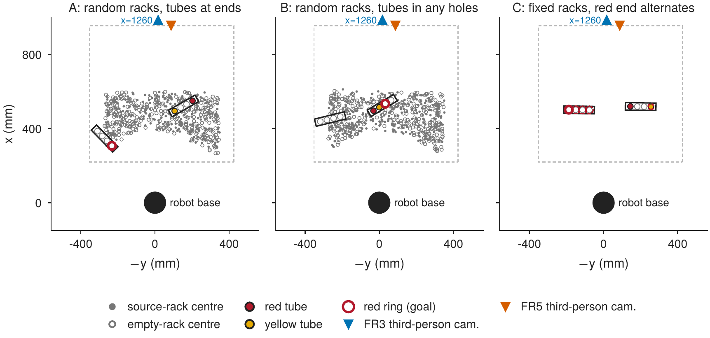
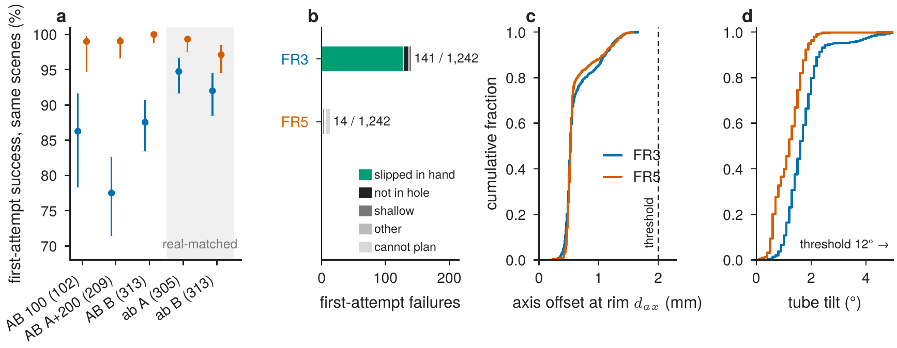
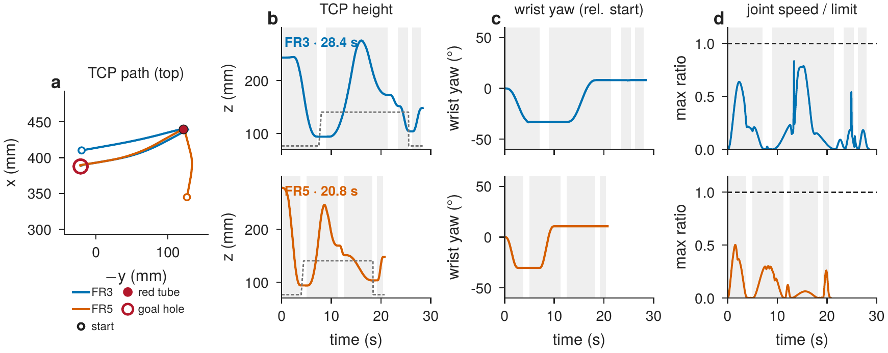
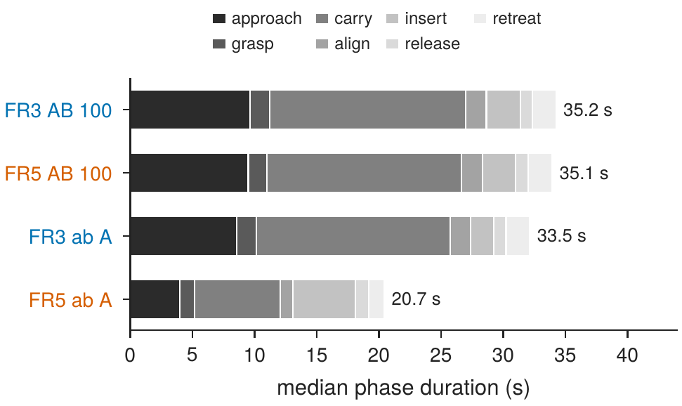
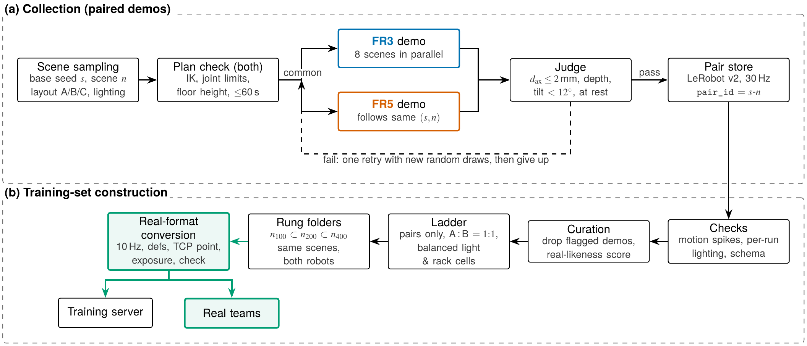
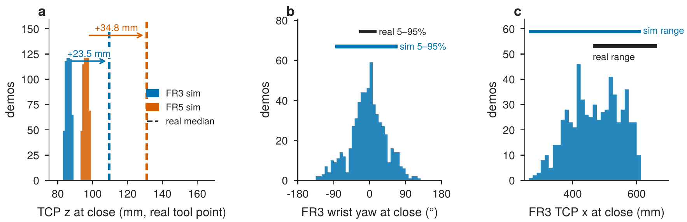

# Report 3 — Paired demonstrations re-collected with real-matched settings: math-model probability and precision, real-format conversion, and comparison with real data

2026-11-10 · Sim-to-Real Post-Training (simulation part) · Isaac Sim 6.0.1 · Isaac Lab 3.0 · GR00T N1.7 · [한국어](README.md)



## Summary

- **Probability of the math model (auto-demonstrator):** both robots were compared by their first attempt on the same 1,242 scenes (five collection sets). Success was 88.6 % for FR3 (77.5–94.8 % per set) and 98.9 % for FR5 (97.1–100 %).
  - 128 of FR3's 141 first-attempt failures (91 %) were the tube slipping more than 15 mm in the hand during carry.
  - When all 170 attempts that FR3 discarded were replayed by FR5 with the same scene and random draws, 169 were saved and 1 could not be planned. Note that FR5 has a simulation-only grasp-hold aid.
- **Precision:** the axis offset at the rim of saved demonstrations had a median of 0.53 mm and a 95th percentile of 1.23–1.33 mm for both robots, well inside the 2 mm threshold.
- **Differences between the robots:** with real-matched settings, the median FR5 demonstration lasts 20.7 s and FR3 33.5 s. FR3 is slowed by its joint-7 limit (0.15 rad/s) in scenes that need a large wrist turn.
- **Re-collection with real settings (ab):** about 600 demonstrations per robot (596 pairs) at 848×480, with the real tube appearance and FR5's real trajectory rules. Running eight scenes per process yields 23.4 pairs per hour, 2.2× the first collection.
- **Real-format conversion:** recording rate, state/action definitions, tool point, frame and exposure are converted to each robot's real training format, and the data were handed to the real-robot teams.
- **Comparison with real data:**
  - The TCP was 23.5 mm (FR3) and 34.8 mm (FR5) lower than in reality. This is explained by the base-to-desk height, not the tool length.
  - The simulated wrist-yaw distribution is wider, mostly because of layout-B demonstrations in which the wrist turns 90° to keep the fingers off a neighbouring cap.

Benchmark (policy evaluation) results will follow in Report 4 once all 600 trials are done.

## 1. System overview



This report builds on the digital twin and collector of Reports 1 and 2. New here are the **real-format conversion** in (c) and the path to the real-robot teams (green).

- **Scene replication:** one Isaac process hosts eight scenes, 20 m apart, each with its own seeded layout and lighting.
- **Rates:** physics 120 Hz, control 30 Hz. Real-format 10 Hz data are produced at conversion by keeping every third step.
- **Same scene for both robots:** the random streams are split as layout `rng[s, n]`, lighting `[s, n, 1]` and trajectory `[s, n, attempt, 23]`. Both robots therefore get the same scene whenever the base seed $`s`$ and scene number $`n`$ match.

## 2. Layouts A, B and C



| Layout | Racks | Tubes and ring |
|---|---|---|
| A | random positions and yaw (image-horizontal ± 45°) | tubes in the two end holes of the source rack; ring on the empty rack |
| B | as in A | tubes in any two holes of the source rack (spacing 1, 2 or 3); ring on the empty rack or on a free hole of the source rack (half each) |
| C | fixed side by side at the real FR5 positions | red alternates between left and right ends; lighting and ring hole random |

A layout is used only if both robots can reach it, both third-person cameras see it, and the robots do not occlude it (Report 1, Section 5).

## 3. Math model — probability and precision

### 3-1. Success rates (same scenes, equal counts)

The two robots are compared on the **same scenes**. In each set we take the n scenes on which FR3 made a first attempt, and score FR5 by its first attempt on the same scene with the same random draws. Attempts that FR5 had not run during paired collection were replayed on FR5 on 11-07 and 11-10, so none is missing.

| Set | Layout · seed | n | FR3 first attempt | FR5 first attempt | FR5 fail · no plan | Excluded at planning FR3 · FR5 | FR3 discard → FR5 saved |
|---|---|---|---|---|---|---|---|
| AB 100 | A · 1103 | 102 | 88 = 86.3 % (78.3–91.6) | 101 = 99.0 % (94.7–99.8) | 0 · 1 | 4 · 1 | 15/16 (1 no plan) |
| AB A+200 | A · 1104 | 209 | 162 = 77.5 % (71.4–82.6) | 207 = 99.0 % (96.6–99.7) | 2 · 0 | 10 · 0 | 56/56 |
| AB B | B · 1105 | 313 | 274 = 87.5 % (83.4–90.7) | 313 = 100 % (98.8–100) | 0 · 0 | 10 · 0 | 49/49 |
| ab A | A · 1103 | 305 | 289 = 94.8 % (91.6–96.7) | 303 = 99.3 % (97.6–99.8) | 1 · 1 | 9 · 1 | 18/18 |
| ab B | B · 1105 | 313 | 288 = 92.0 % (88.5–94.5) | 304 = 97.1 % (94.6–98.5) | 2 · 7 | 10 · 39 | 31/31 |
| **AB total** | | 624 | 524 = 84.0 % (80.9–86.6) | 621 = 99.5 % (98.6–99.8) | 2 · 1 | 24 · 1 | 120/121 |
| **ab total** | | 618 | 577 = 93.4 % (91.1–95.1) | 607 = 98.2 % (96.8–99.0) | 3 · 8 | 19 · 40 | 49/49 |
| **All** | | 1,242 | 1,101 = 88.6 % (86.8–90.3) | 1,228 = 98.9 % (98.1–99.3) | 5 · 9 | 43 · 41 | 169/170 |

- **First attempt** = saved on the first attempt ÷ n. This is the number to compare with a VLA, which must also succeed in one try. A scene that FR5 cannot plan counts as a failure.
- **Excluded at planning:** scenes dropped at planning are left out of n for both robots; the table lists which robot could not plan them.
- **Last column:** every attempt FR3 discarded (including non-first attempts), replayed on FR5 with the same scene and random draws.
- Per-attempt success including retries is not compared, because the two robots made different numbers of attempts (FR3 1,379; FR5 1,214).
- AB denotes the first settings and ab the real-matched settings (Section 5).



- **(a) First-attempt success on the same scenes with 95 % intervals (n in parentheses):** the intervals are Wilson intervals.

  ```math
  \frac{\hat p + \frac{z^2}{2n} \pm z\sqrt{\frac{\hat p(1-\hat p)}{n} + \frac{z^2}{4n^2}}}{1 + \frac{z^2}{n}}, \qquad z = 1.96
  ```

- **(b) First-attempt failure reasons on the same 1,242 scenes:**
  - FR3, 141: in-hand slip 128, not in the hole 9, shallow 4. When the simulated FR3 fingers grip the 33 mm cap they close to 25.4 mm, which suggests they penetrate the cap (real: 31–34 mm).
  - FR5, 5: shallow 3, not in the hole 1, other 1, all on scenes where FR3 succeeded. FR5 could not plan 9 scenes (7 in ab B). Its grasp-hold aid rules out in-hand slip by construction.
- **FR3 discards replayed on FR5:** of the 170 attempts FR3 discarded, FR5 saved 169 and could not plan 1. Part of this gap comes from the aid.
- **Reproducibility:** for the 96 replayed attempts that FR5 had already run during paired collection, every outcome was identical; a scene rebuilt from its seed reproduces its result.
- **Missing scenes:** in ab B, 39 scenes were dropped because FR5 could not plan them (10 because of FR3), so layouts that are hard for FR5 are missing from the comparison.
- **Not yet explained:** we have not identified why FR3's first-attempt success rose in the ab sets (AB 77.5–87.5 % → ab 92.0–94.8 %).

### 3-2. Precision (saved demonstrations)

Success is judged by whether the tube axis passes through the hole centre at the rim height (Report 1, Section 6-9):

```math
p_c = r + \hat a\,\frac{z_c - r_z}{a_z}, \qquad d_{ax} = \big\lVert p_{c,xy} - (x_h,\ 0) \big\rVert, \qquad z_c = 51\ \text{mm}
```

| | FR3 | FR5 |
|---|---|---|
| $`d_{ax}`$ median · 95th percentile · max | 0.52–0.53 · 1.23–1.29 · 1.66 mm | 0.53 · 1.23–1.33 · 1.57 mm |
| Tilt median · 95th percentile | 1.5–1.7° · 2.5–3.8° | 1.0–1.3° · 1.9–2.1° |
| Bottom depth, median | 0.86–0.94 mm | 0.43–0.67 mm |

Values are ranges over the five sets. The thresholds are $`d_{ax}`$ ≤ 2 mm and tilt < 12°. Since these are distributions of saved (successful) demonstrations, they describe the precision margin rather than the probability of success.

## 4. Differences between the robots





- **TCP paths almost coincide:** both robots use the same planner. In time, however, they differ.
- **First settings (AB):** each phase was matched to the slower robot, so both demonstrations lasted 35.2 / 35.1 s.
- **Real-matched settings (ab):** each robot moves at its own speed: FR5 20.7 s, FR3 33.5 s.
  - FR5's approach (4.0 s) and carry (6.9 s) became faster.
  - FR5's insertion follows the real speed of 10 mm/s and takes 5.0 s, longer than FR3's 1.9 s.
- **FR3 joint 7:** its planning limit is 0.15 rad/s (8.6 °/s). Layout B contains many near-90° wrist turns, and there the median FR3 approach grew from 8.6 s (ab A) to 16.6 s (ab B). FR5 grew only from 4.0 to 4.7 s.
- **IK:** FR3 (7-DoF) uses damped least squares with a null-space pull towards the start pose. FR5 (6-DoF) picks, among up to eight analytic solutions, the one closest to the previous point.
- **Skipped at planning:** FR3 skipped 37 layouts over five sets whose plan exceeded 60 s because of wrist turns. FR5 skipped layouts it could not reach, or where the carried tube would hit a neighbouring cap.

## 5. What changed and what improved

### 5-1. Settings that differed from the real data (first collection AB)

| Item | Real (FR3 · FR5) | First collection AB | Now (ab, after conversion) | Fix |
|---|---|---|---|---|
| Recording rate | 10 Hz | 30 Hz | 10 Hz | convert |
| Chunk horizon | 16 / 10 = 1.6 s | 16 / 30 = 0.53 s | 1.6 s | convert |
| Resolution | 848×480 (FR5 trained at 256×256) | 640×360 | 848×480 | re-collect |
| State definition | FR3 xyz + rot6d (first two columns) + finger width · FR5 xyz + rot6d (first two rows) + half-width ± | same for both + joints | per-robot real definition | convert |
| Frame · tool point | FR3 link0, flange + 103.4 · FR5 work frame (−77.2° about z), + 167.6 | base, 97.0 / 171.2 | as real | convert |
| Exposure | first-frame brightness matched per episode | not matched | real targets | convert |
| Tube appearance | opaque coloured liquid | water in glass | real photo colours | re-collect |
| FR5 trajectory | joints 45 °/s, per-phase speeds | 15 °/s, shared timing | real auto-demo rules | re-collect |
| Dome light | one | present or absent per launch | always present | USD fix |

### 5-2. Improvements

- **Real-format converter:** it reads simulation folders without changing them and writes a new folder in each robot's real training format. It:
  - subsamples to 10 Hz;
  - recomputes state and action with the real tool point, the rot6d column/row convention, the FR5 work frame and the gripper semantics;
  - rotates the FR5 wrist video by 180° and resizes the videos;
  - scales each episode's first-frame brightness to the real targets (FR3 third-person 127, wrist 139; FR5 147).

  600 ab episodes per robot were converted and handed over. The real FR3 team re-read all 600 episodes (220,948 frames) to verify them.
- **Real-matched profile `real_1105`:** FR5 uses the real controller limits (45 °/s, 120 °/s²) and the mean phase speeds of the real auto-demonstrator (lateral 107, vertical 46, align 24, insert 10 mm/s). The median FR5 demonstration fell from 35.1 s to 20.7 s (real: 23.8 s).
- **Eight-scene collector:** the first collection (one scene, 640×360, both robots at once on one GPU) yielded 10.8 demonstrations per hour per robot.
  - One step of the first collection took 257 ms (FR3) and 278 ms (FR5), including 84 / 102 ms of physics and 98 / 96 ms of camera work.
  - The eight-scene collector (848×480) yields 35.7 (FR3) and 67.9 (FR5) demonstrations per hour, i.e. 23.4 pairs per hour, 2.2× as many.
- **Lighting state:** a Blender dome light embedded in the object USD files made our dome light present in some launches and absent in others (Report 2, Section 4-4). With it disabled, ab has a single lighting state, verified per run from the first-frame brightness.
- **Training-set ladder:** only complete pairs are kept, A and B are interleaved 1 : 1, and lighting, rack cell (3×3 grid) and yaw are spread evenly at the front of the order. Prefixes give $`n_{100} \subset n_{200} \subset n_{400}`$.

## 6. Data



| Set | Layout · seed | Resolution | Tube appearance | Trajectory profile | FR3 | FR5 |
|---|---|---|---|---|---|---|
| AB 100 | A · 1103 | 640×360 | water in glass | shared timing | 100 | 100 |
| AB A+200 | A · 1104 | 640×360 | water in glass | shared timing | 200 | 200 |
| AB B | B · 1105 | 640×360 | water in glass | shared timing | 300 | 300 |
| ab A | A · 1103 | 848×480 | real colour (opaque) | `real_1105` | 303 | 303 |
| ab B | B · 1105 | 848×480 | real colour (opaque) | `real_1105` | 306 | 304 |

In ab, 596 pairs were saved by both robots (A 299, B 297). In addition, 158 FR5 replays of FR3-failed attempts are kept separately (all saved; not used for training).

## 7. Comparison with real data

The real teams compared the 600 converted ab episodes with their real data: FR3 200 episodes (69,409 frames at 10 Hz) and FR5 200 episodes. The formats matched: names and order of the 10 state/action entries, video keys, 848×480, 10 Hz and the instruction.



### 7-1. TCP height

| TCP z at gripper close (base frame, real tool point) | FR3 (flange + 103.4) | FR5 (+ 167.6) |
|---|---|---|
| Real median | 109.6 mm | 131 mm |
| Sim median (5–95 %) | 86.1 (83.9–88.3) mm | 96.2 (93.8–98.3) mm |
| Difference | +23.5 mm | +34.8 mm |
| At release after the shift (real / sim) | 117.4 / 120.1 mm | — |
| Cap top − rack top (real / sim) | 57 / 59.5 mm | not measured |

- **The simulated values match the model:** the grasping TCP sits 99–104 mm above the tube tip, and the tip is at −9 mm in the base frame. At the real tool points this gives 83.6–88.6 mm (FR3) and 93.6–98.6 mm (FR5).
- **Not the tool length:** the converter already computes the state at the real tool point.
- **We attribute the gap to the base-to-desk height:** the simulation assumes the robot base is 12 mm above the desk, a value estimated from a photo and used for both robots. In the real stations, the racks and desk appear to be about 26 mm (FR3) and 31 mm (FR5) higher relative to the robot. We attribute the remaining 3–4 mm for FR5 to the tube shape.
- **Fix:** because the hand is almost vertical, adding a constant to the state and action z aligns the data to within 1 mm (actions are relative and stay unchanged). Grasp and release cannot both be matched: FR3 keeps a 2.7 mm residual, the same as the 2.5 mm tube/rack shape difference.

### 7-2. Wrist yaw and other remaining differences (FR3)

| Item | Sim | Real | Fix in the next collection |
|---|---|---|---|
| Home TCP (x, y, z) | (410, 20, 260) mm | (434, 17, 297) mm | start from the real home joints |
| Sag (command − state) | 0 | x ≈ 8, z ≈ 7 mm | emulate real impedance control, or bias actions |
| Closing x | 263–612 mm | 463–664 mm | sample rack placement from the real distribution |
| Wrist yaw (5–95 %) | −84° to +73° (A only: −38° to +37°) | −26° to +15° | narrow the rack-yaw range; control across-row grasps in B |
| Yaw at close (5–95 %) | −86° to +70° | −27° to +17° | centres both near −5° |
| Median turn per episode | 40° | 23° | sample source and empty rack yaw jointly |
| Hand tilt | always vertical | median 2.4°, max 4.5° | identify cause, then jitter 0–4.5° |

- **Same centre:** the yaw centres agree (near −5°), so rotation conventions and frames match. The wider one is the simulated distribution.
- **Split by layout:** layout A alone spans −38° to +37°, and most of the extra width comes from layout B (−97° to +84°).
- **Across-row grasps in B:** in B, the planner grasps across the rack row (about 86° from the row direction) to keep the fingers off a neighbouring cap or the ring.
  - Scenes with adjacent tubes: 82 of 82.
  - Scenes with the ring on the source rack: 128 of 161.
  - Neither: 7 of 110.
- **|yaw| > 90°:** 61/609 sim episodes vs. 2/200 real.

## 8. Limitations and next steps

**Limitations**

- **Simulation-only aids:** the funnel seat and FR5's grasp hold do not exist in reality. They also contribute to the FR3/FR5 gap in Section 3.
- **FR3 model:** the Panda joint limits are used, and the simulated fingers penetrate the cap, which lets the grasped tube slip.
- **Nature of the demonstrations:** math-model demonstrations always succeed on the first try, so there are no recoveries from off-nominal states.
- **Scene gaps:** the base-to-desk height, home pose, rack-yaw distribution, sag, and tube/rack shapes still differ from reality. For example, the real FR5 setup uses a 110 mm conical tube, a 35×10 cap and a two-tier 60 mm rack.

**Next steps**

1. Finish the 600-trial benchmark (four models × layouts C, A, B × 50) → Report 4.
2. Compare models fine-tuned on 200 real demonstrations starting from the sim-600 models (FR5, FR3) with models trained on the 200 real demonstrations alone under the same settings.
3. Feed real values into the next collection: per-robot base-to-desk height, FR3 home joints, real rack-placement and wrist-yaw distributions, FR3 sag emulation, and tube/rack shapes.
4. Test colour generalization: a benchmark that swaps only the red and yellow positions, and a yellow-ring task that moves the yellow tube.
5. Test recovery demonstrations (re-grasp after a miss) and noise injection.

## Appendix. Reproducibility and sources of numbers

| Item | Value |
|---|---|
| Code versions | collector 2.19 · multi-scene collector 1.2 · env 2.12 · layout sampler 2.9 · planner 1.7 (1.6 during ab) · converter 1.6 |
| Seeds | 1103 (A) · 1104 (A+200) · 1105 (B) |
| Configs | `common_scene.json` · `common_isaaclab_dr.json` · `common_auto.json` + `common_auto_profiles.json` (`real_1105`) · `fr3_env.json` · `fr5_env.json` · `common_to_real.json` |
| Numbers | recomputed from collection records exported on 2026-11-10 14:35 (`progress/history.jsonl`, `episodes.jsonl`) and state/action (`figures/src/analyze.py`) |
| Real-side values | FR3 and FR5 team records (2026-11-10) |

Figures can be regenerated with the scripts in `figures/src/`. Implementation details: [BioTube-Insertion-VLA-IsaacLab](https://github.com/bbiyak12e/BioTube-Insertion-VLA-IsaacLab)
