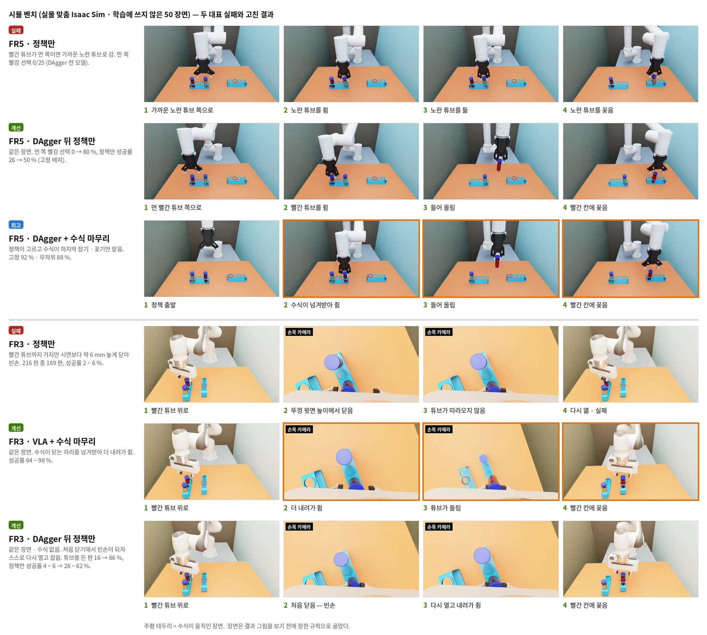
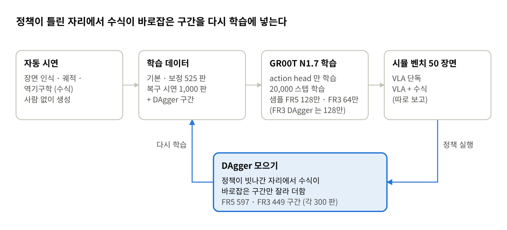
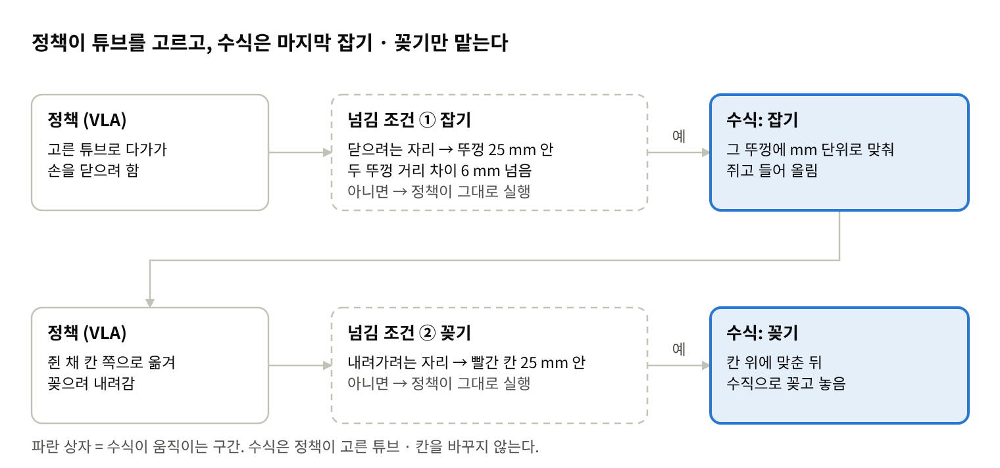
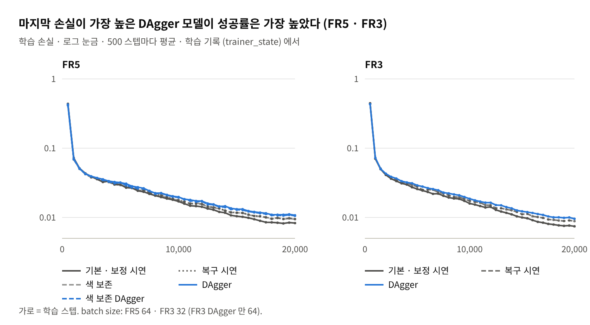

# 보고서 4 — 시뮬 벤치 결과: FR3 · FR5 VLA 단독 · DAgger · 수식 마무리

2026-11-16 · Sim-to-Real Post-Training (시뮬레이션 파트) · Isaac Sim 6.0.1 · Isaac Lab 3.0 · GR00T N1.7 · [English](README_EN.md)

이 보고서는 세 문서로 나뉜다. 절 번호와 그림 · 식 번호는 세 문서에 걸쳐 하나로 이어진다.

| 문서 | 내용 |
|---|---|
| **통합 (이 문서)** | 과제 · 시뮬 설정 · 이름 (1절), 두 로봇을 함께 봐야 하는 비교 (2 · 3절), VLA + 수식 (4절), 학습 분석 (5절), 실물과의 비교 (6절), 데이터 수집 원칙 (7절), 다음 단계 (8절), 참고문헌 · 부록 |
| [FR5 결과](fr5/README.md) | 2절 — 벤치 성공률, 대표 실패 「가까운 튜브로 감」, DAgger 와 그 부작용, 학습 데이터 구성, 색 보존, FR5 의 VLA + 수식, 실물 FR5 와의 차이 |
| [FR3 결과](fr3/README.md) | 3절 — 벤치 성공률, 대표 실패 「높게 닫아 빈손」, 학습량, DAgger 로 고친 결과, FR3 의 VLA + 수식, 실물 FR3 와의 차이 |



**요약 그림.** 두 대표 실패와 고친 결과 (실물 맞춤 시뮬). FR5 는 빨간 튜브가 먼 쪽이면 가까운 노란 튜브로 가고, DAgger 뒤에는 같은 장면에서 빨간 튜브를 꽂는다. FR3 는 빨간 튜브까지 가지만 높게 닫아 빈손이 되고, 수식이 마지막 잡기를 맡으면 더 내려가 쥔다. DAgger 뒤에는 같은 장면에서 수식 없이, 처음 닫기가 빈손이 되자 스스로 다시 열고 잡아 꽂는다. 주황 테두리는 수식이 움직인 장면이다.

## 요약

실물에 맞춘 시뮬 벤치 (학습에 쓰지 않은 50 장면) 에서 GR00T N1.7 정책만으로 끝까지 한 성공률은 FR3 2 ~ 6 %, FR5 16 ~ 26 % 였다. 정책이 실제로 틀린 자리에서 바로잡는 구간을 더해 다시 학습 (DAgger) 하자 FR5 는 정책만으로 25/50 (50 %), 마지막 잡기 · 꽂기를 수식에 맡기면 46/50 (92 %) 까지 올랐다. FR3 도 DAgger 뒤 정책만 28 ~ 62 %, 수식을 더하면 86 ~ 100 % 가 되었다. 실물 데이터가 들어간 비교 모델 둘 (실물 팀 혼합 · 실물만) 을 빼면 모든 모델은 시뮬 데이터로만 학습했고, 평가는 모두 시뮬에서 했다.

**벤치 성공률** — 실물 맞춤 시뮬 · 50 장면, 성공 수 (%, Wilson 95 % 구간):

| 로봇 · 모델 | 고정 · VLA 단독 | 무작위 · VLA 단독 | 고정 · VLA + 수식 | 무작위 · VLA + 수식 |
|---|---|---|---|---|
| FR5 · DAgger 전 다섯 모델 (범위) | 8 ~ 13 (16 ~ 26 %) | 7 ~ 20 (14 ~ 40 %) | 19 ~ 29 (38 ~ 58 %) | 29 ~ 32 (58 ~ 64 %) |
| FR5 · DAgger | 17 (34 %, 22 ~ 48) | 22 (44 %, 31 ~ 58) | 35 (70 %, 56 ~ 81) | 41 (82 %, 69 ~ 90) |
| **FR5 · 색 보존 DAgger** | **25 (50 %, 37 ~ 63)** | **28 (56 %, 42 ~ 69)** | **46 (92 %, 81 ~ 97)** | **44 (88 %, 76 ~ 94)** |
| FR3 · DAgger 전 두 모델 (범위) | 2 · 2 (각 4 %) | 2 (4 %, 1 ~ 13) | 41 · 49 (82 · 98 %) | 39 (78 %, 65 ~ 87) |
| **FR3 · DAgger** | **31 (62 %, 48 ~ 74)** | **17 (34 %, 22 ~ 48)** | **50 (100 %, 93 ~ 100)** | **45 (90 %, 79 ~ 96)** |

FR3 DAgger 전 두 모델은 배치 다섯 조건 (고정 · 무작위 · 실물 평가 배치 재현) 에서 VLA 단독 1 ~ 3/50 (2 ~ 6 %), VLA + 수식 32 ~ 49/50 (64 ~ 98 %) 이다. DAgger 모델은 실물 평가 배치 재현에서 VLA 단독 14/50 (28 %), VLA + 수식 43/50 (86 %) 이다.

| | FR3 | FR5 |
|---|---|---|
| 대표 실패 | 빨간 튜브까지 가서 쥐지 못함 | 빨간 튜브가 아닌 튜브로 감 |
| 직접 원인 | 시연보다 약 6 mm 높은 곳에서 손을 닫음 | 색 대신 「출발 손에서 가까운 튜브」 를 지름길 (shortcut) 로 배움 |
| 고친 방법 | DAgger · 수식 마무리 | DAgger · 수식 마무리 |

**핵심 결과 여섯 가지**

1. **판 수와 시연 종류만 바꿔서는 정책 성능이 확정적으로 오르지 않았다.** 100 ~ 1,000 판, 복구 시연 추가, 실물 팀 데이터 · 혼합 모두 p ≥ 0.05 였다.
2. **학습량은 효과가 컸다.** FR3 는 같은 200 판에서 학습 샘플 수를 4 배 (32 만 → 128 만) 로 늘리자 0 → 13/50 (p = 0.0001) 이었다.
3. **학습 영상의 색을 지키자 같은 방향으로 올랐다.** FR5 학습 영상을 색 압축 없이 저장하자 정책만의 성공이 네 비교 모두 5 ~ 8 판 높았다. 하나하나는 통계로 확정되지 않았다.
4. **DAgger 가 두 로봇의 대표 실패를 모두 고쳤다.** 빨간 튜브가 먼 쪽인 장면에서 빨간 튜브로 간 판이 0/25 → 18 ~ 20/25 (p ≤ 5 × 10⁻⁸) 였다 (FR5). FR3 는 빨간 튜브를 60 mm 넘게 든 판이 16 → 86/100 (p = 1 × 10⁻²⁴), 정책만의 성공이 4 ~ 6 → 28 ~ 62 % 였다 (학습량 2 배가 함께 바뀜).
5. **수식 마무리는 마지막 몇 mm 를 맡는다.** 정책만 대비 17 쌍 중 16 쌍에서 1.5 ~ 5 배 (p < 0.05) 였다. 정책이 고른 튜브는 바꾸지 않아 색 선택 실패는 고치지 못한다. 실물 FR3 스테이션과 같은 파이프라인 · 같은 넘김 조건이고, 수식은 마지막 잡기 · 꽂기 구간에만 들어간다 (4-1).
6. **실물 데이터만으로 학습한 모델은 시뮬에서 0 ~ 4 % 였다.** 그래서 시뮬 수치는 같은 시뮬 · 같은 물리 안에서 모델끼리 견주는 데만 쓴다.

**쓴 두 방법 — 무엇이고 왜 썼나 (자세히는 1-6)**

- **색 보존:** 학습 영상을 저장할 때 색 정보를 줄이지 않는 것이다. 보통의 영상 압축 (H.264 · 4:2:0) 은 색을 가로 · 세로 절반 해상도로만 남긴다 [19]. 재 보니 학습 영상의 빨강이 벤치 입력의 1/3 ~ 1/4 로 흐려져 있어, 4:4:4 (색 줄임 없음) 로 다시 저장했다.
- **DAgger (Dataset Aggregation):** 학습한 정책을 직접 돌려 정책이 실제로 가는 상태를 모으고, 그 상태에서 전문가가 할 행동을 붙여 데이터에 더해 다시 학습하는 방법이다 (Ross 외, 2011 [4]). 시연은 정답 경로만 지나므로 정책이 조금 빗나가면 처음 보는 상태가 되고, 두 대표 실패가 모두 그런 모양이라 썼다. 전문가는 사람 대신 시연을 만든 수식이 맡았다. GR00T N2 백서 [2] 도 DAgger 로 성공률을 올린 사례를 보고한다.



**그림 1.** 실험의 전체 흐름 (두 로봇 공통). 시연은 모두 수식으로 만들고, 학습한 정책을 같은 50 장면에서 잰다. DAgger 는 벤치와 다른 장면에서 정책을 돌려, 수식이 바로잡은 구간만 학습 데이터에 더한다.

## 1. 과제 · 시뮬 설정 · 이름

두 로봇 (FR3 · FR5) 에 같은 과제를 같은 방식으로 학습시키고, 모든 모델을 같은 50 장면 · 같은 기준으로 쟀다. 이 보고서의 이름은 모두 아래 표의 뜻으로 쓴다.

### 1-1. 과제와 성공

- **지시문:** `put the red tube in the red slot`. 빨간 튜브를 집어, 빨간 링으로 표시한 빈 받침 구멍에 꽂는다. 노란 튜브 하나가 방해물로 함께 놓인다.
- **성공:** 빨간 튜브가 빨간 링 구멍에 꽂힘. 시뮬 접촉 오류로 물체가 튀어 오른 판 (물리 튐) 은 실패로 센다.
- **로봇:** FR3 (7축 팔 · 손가락 두 개 그리퍼 0 ~ 80 mm), FR5 (6축 팔 · 링크식 그리퍼 0 ~ 95 mm).

### 1-2. 정책 (VLA)

- **모델:** GR00T N1.7 [1] [3] (매개변수 약 30 억). 언어 · 시각 백본은 고정하고, 행동을 만드는 부분 (DiT action head · projector · VL LayerNorm) 만 학습했다.
- **입력:** 3인칭 · 손목 카메라 영상 2 장, 손끝 상태, 지시문.
- **출력:** 손끝 자세 + 그리퍼 열기/닫기를 16 스텝 (1.6 초) 의 action chunk (한 번에 내는 행동 묶음) 로 낸다. 앞 8 스텝을 실행한 뒤 다시 묻는다.
- **학습 조건:** FR5 모델은 batch size 64 × 20,000 스텝 (학습 샘플 128 만 개), 실물 맞춤 FR3 모델은 batch size 32 × 20,000 스텝 (64 만 개), FR3 DAgger 모델은 batch size 64 × 20,000 스텝 (128 만 개). 학습률은 처음 1,000 스텝 동안 1 × 10⁻⁴ 까지 올리고 코사인으로 0 까지 줄였다. color jitter (밝기 · 대비 · 채도 · 색조) 를 켰다 (실물 팀 시뮬 모델만 끔).

### 1-3. 학습 데이터와 모델 이름

실물 팀 혼합 · 실물만 두 비교 모델 (실물 팀이 학습) 을 빼면 학습 데이터는 모두 시뮬에서 만들었고, 평가는 모든 모델을 시뮬에서 했다. 시연은 모두 사람 없이 만든 시뮬 자동 시연이다. 장면 인식 → 궤적 → 역기구학으로 잡고 꽂는다. 이 계산을 이 보고서에서는 「수식」 이라 부른다.

| 모델 이름 | 학습 데이터 |
|---|---|
| 기본 · 보정 시연 모델 | 525 판 — 기본 시연 150, 뚜껑 위에서 멈춰 1 ~ 8 mm 고친 뒤 잡는 위치 보정 시연 300, 덜 덮인 자리 채우기 75 |
| 복구 시연 모델 | 1,000 판 (조각으로 나눠 1,325 시연 · 190,532 프레임) — 위 셋 + 10 ~ 40 mm 빗나간 채 내려오다 고치는 시연 250, 헛잡음 · 걸림 뒤 다시 하는 시연 150, 채우기 150 |
| 색 보존 모델 | 복구 시연 모델과 같은 데이터. 학습 영상만 색 압축 없이 저장 ([FR5 2-5](fr5/README.md#2-5-학습-영상의-색--색-보존)) |
| DAgger 모델 | 복구 시연 데이터 + DAgger 구간 (FR5 597 개 · 48,716 프레임, 전체의 약 20 % / FR3 449 개, 합계 1,774 시연 · 307,598 프레임) |
| 색 보존 DAgger 모델 | DAgger 모델과 같은 데이터. 학습 영상만 색 보존 모델과 같은 방식 (FR5 만) |
| 실물 팀 시뮬 모델 | 실물 FR5 팀이 쓰는 시뮬 장면에서 모은 600 판 (같은 방식으로 우리가 학습) |
| 실물 팀 혼합 모델 | 실물 FR5 데이터 + 실물 팀 시뮬, 1,200 판 (실물 팀이 학습) |
| 실물만 모델 | 실물 FR5 데이터만 (실물 팀이 학습) |
| FR3 기본 시연 모델 | 초기 시뮬 설정의 FR3 기본 시연 100 · 200 · 600 판 (학습량 비교에만 씀) |

- **DAgger 구간:** 학습된 정책을 시뮬에서 돌리다가, 정책이 빗나간 자리에서 수식이 바로잡은 부분만 잘라 학습에 더한 것이다 (Ross 외의 DAgger [4]). FR5 는 복구 시연 모델로 300 판을 돌려 잡기 300 · 꽂기 297 구간을 모았다.
- FR3 는 복구 시연 모델과 기본 · 보정 시연 모델을 FR5 와 같은 방법으로 만들었고, FR3 DAgger 모델도 같은 방법으로 만들었다 ([FR3 3-4](fr3/README.md#3-4-dagger-fr3--빈손-실패를-고침)).

### 1-4. 시뮬 설정 · 배치 · 실행 조건

| 이름 | 뜻 |
|---|---|
| 실물 맞춤 시뮬 설정 | 카메라 자리 · 해상도 · 받침 높이 · 시작 자세를 실물에 맞춘 Isaac Sim · Isaac Lab [18] 장면. 본문 결과는 모두 이 설정이다 |
| 초기 시뮬 설정 | 처음 만든 장면. FR3 학습량 비교에만 쓴다 |
| FR5 물리 | 관절 풀이 반복을 위치 32 회 · 속도 4 회로 늘린 설정 (물리 튐을 줄임). FR5 표는 모두 이 물리이다 |
| 고정 배치 | 두 튜브를 앞 받침 양 끝 구멍 (111 mm 간격) 에 둔다. 빨간 튜브 왼쪽 25 · 오른쪽 25 장면, 링 구멍과 조명만 바뀐다. 사실상 배치 둘을 25 번씩 본 것이다 |
| 무작위 배치 | 받침의 자리와 방향이 장면마다 무작위다. 일반화는 이 배치로 본다 |
| 실물 평가 배치 재현 (FR3) | 실물 FR3 평가에 쓴 배치 10 개 (학습에서 뺀 것) × 5 장면 |
| 가까운 쪽 · 먼 쪽 | 시작 자세의 손끝에서 빨간 튜브가 노란 튜브보다 가까우면 「가까운 쪽」 장면이다 |
| VLA 단독 | 정책만으로 끝까지 실행한다 |
| VLA + 수식 (하이브리드) | 같은 모델 · 같은 입력이다. 정책이 뚜껑 25 mm 안에서 손을 닫으려 할 때와 빨간 칸 25 mm 안으로 꽂으려 내려갈 때만 수식이 마지막 잡기 · 꽂기를 넘겨받는다. 정책이 고른 튜브는 바꾸지 않는다 |

### 1-5. 평가와 통계

- 학습에 쓰지 않은 50 장면 (같은 난수 시드, 장면마다 한 판) 에서 모든 모델을 잰다.
- 성공은 k/50 과 Wilson 95 % 구간 [17] 으로 쓴다. 두 모델은 Fisher 정확 검정 (양쪽) p < 0.05 일 때만 「다르다」 고 쓴다.
- 비교와 판정 기준은 결과를 보기 전에 정해 적었다. 결과를 본 뒤 더 본 것은 「참고」 로 따로 표시한다.
- VLA 단독과 VLA + 수식은 항상 따로 보고하고, 물리가 같은 벤치끼리만 견준다.

```math
\frac{\hat p + \frac{z^2}{2n} \pm z\sqrt{\frac{\hat p(1-\hat p)}{n} + \frac{z^2}{4n^2}}}{1 + \frac{z^2}{n}}, \qquad \hat p = k/n, \quad z = 1.96
```

**식 1-1.** Wilson 95 % 구간 [17]. k/n 은 성공 수 / 장면 수다. Fisher 정확 검정은 두 모델의 2 × 2 표 (성공 · 실패) 에서 초기하 분포로 양쪽 p 를 구한다.

**괄호 안 숫자 (95 % 신뢰구간) 읽는 법:**

- 「50 (37 ~ 63)」 은 50 장면 중 25 장면 성공 (50 %) 이고, 실제 성공률이 있을 만한 범위가 37 ~ 63 % 라는 뜻이다. 같은 방법으로 만든 구간의 95 % 가 실제 성공률을 포함한다.
- 장면이 50 개뿐이라 운에 따른 흔들림이 크다. 성공률 50 % 근처에서 범위는 약 ±13 %p 다.
- Wilson 방법은 판 수가 적거나 성공률이 0 · 100 % 에 가까워도 범위가 0 ~ 100 % 밖으로 나가지 않는다 (예: 0/50 → 0 ~ 7 %).
- 두 모델이 다른지는 범위가 겹치는지가 아니라 Fisher 검정으로 판정한다. 예를 들어 26 % (16 ~ 40) 와 50 % (37 ~ 63) 는 범위가 겹치지만 p = 0.023 으로 「다르다」 이다.

### 1-6. 두 방법 — 색 보존과 DAgger

두 방법은 모두 「학습에서 본 것」 과 「실행에서 만나는 것」 의 차이를 줄이려고 썼다. 색 보존은 화면의 차이를, DAgger 는 상태의 차이를 줄인다.

| | 색 보존 | DAgger (Dataset Aggregation) |
|---|---|---|
| 무엇 | 학습 영상을 H.264 로 저장할 때 크로마 서브샘플링 (색을 줄여 저장) 을 하지 않음 (4:4:4). 해상도 256×256 · 압축 품질 CRF 18 · 데이터 · 학습은 그대로 | 학습한 정책을 돌려, 정책이 간 상태에서 전문가의 행동을 라벨로 받아 데이터에 더하고 다시 학습 |
| 왜 | 보통의 4:2:0 은 색을 가로 · 세로 절반 (샘플 수 1/4) 로만 저장해 작은 빨간 링 · 몸통이 흐려짐. 학습 영상의 빨강이 벤치 입력의 1/3 ~ 1/4 ([FR5 2-5](fr5/README.md#2-5-학습-영상의-색--색-보존)) | 모방 학습은 시연이 지나간 상태만 배움. 정책이 조금 빗나간 상태는 처음 보는 상태가 되어 오류가 쌓임 (covariate shift — 학습 상태 분포와 실행 상태 분포의 차이). FR5 먼 쪽 실패 · FR3 높게 멈춤이 이 모양 |
| 이 실험에서 | FR5 복구 시연 데이터와 DAgger 데이터를 4:4:4 로 다시 저장 | 전문가 = 수식 (자동 시연과 같은 계산). 벤치와 다른 장면 300 판에서 정책을 돌려, 수식이 넘겨받아 바로잡은 구간만 더함. 1 회 |
| 참고 | 영상 압축 표준 [19], 이 실험의 빨간 화소 측정 ([FR5 2-5](fr5/README.md#2-5-학습-영상의-색--색-보존)) | DAgger [4], 사람이 바로잡는 HG-DAgger [5], 배치 중 바로잡기 Sirius [6], GR00T N2 백서 [2] |
| 결과 | 정책만 성공률 +10 ~ 16 %p, 네 번 같은 방향 (확정 아님) | FR5 먼 쪽 빨강 선택 0 → 72 ~ 80 %, 정책만 성공률 26 → 50 % (p = 0.023). FR3 빨간 튜브를 든 판 16 → 86 %, 정책만 성공률 4 ~ 6 → 28 ~ 62 % |

### 1-7. 자동 시연 (데이터 수집) 의 수식

시뮬 자동 시연은 실물 FR3 수집 스테이션의 자동 시연과 같은 계산 (최소 저크 · 둥글린 꺾은선 · DLS (damped least squares) 역기구학) 을 시뮬으로 옮긴 것이다. 학습된 모델은 쓰지 않는다.

1. **장면 재기:** 튜브 · 받침 · 빨간 링의 시뮬 실제 자리를 쓴다.
2. **목표:** 잡는 자리는 빨간 뚜껑 가운데, 손끝 높이는 뚜껑 윗면 아래 4 ~ 9 mm 다. 손목 각도는 받침 줄 방향 규칙을 따르고, 벌린 손가락이 옆 뚜껑에 닿으면 90° 돌린 줄을 쓴다. 꽂는 자리는 빨간 링 구멍 가운데이고, 쥔 뒤 · 구멍 위에서 손 안 튜브 자리를 다시 재어 고친다.
3. **길:** 꺾은선 (출발 → 뚜껑 위 6 ~ 10 cm → 수직 하강 → 13 ~ 17 cm 들기 → 구멍 위 → 튜브 축을 따라 꽂기 → 놓기 → 빠지기) 의 꼭짓점을 2차 베지어로 둥글린다 (식 1-3).
4. **시간:** 구간마다 최소 저크 (식 1-2) 로 움직이고, 관절 속도 · 가속도 한계를 지키는 가장 짧은 시간을 고른다 (식 1-5).
5. **관절:** FR3 는 DLS 역기구학 (식 1-4), FR5 는 6축 해석적 역기구학으로 푼다. FR5 는 직전 관절값에 가장 가까운 해를 고르고, 20° 넘게 뒤집히면 그 배치를 버린다.
6. **기록:** 1/30 초마다 관절 목표와 그리퍼를 보내고, 학습 데이터는 실물 데이터 형식으로 바꾼다 (아래 표).

```math
s(\tau) = 10\,\tau^3 - 15\,\tau^4 + 6\,\tau^5, \qquad \tau = t/T \in [0, 1]
```

**식 1-2.** 최소 저크 시간 법칙 [20]. 길 위 진행 비율 s 가 시작 · 끝에서 속도 · 가속도 0 으로 움직인다.

```math
\mathbf{B}(u) = (1-u)^2\,\mathbf{p}_1 + 2u(1-u)\,\mathbf{b} + u^2\,\mathbf{p}_2, \qquad \mathbf{p}_1 = \mathbf{b} + r\,\frac{\mathbf{a}-\mathbf{b}}{\lVert \mathbf{a}-\mathbf{b} \rVert}, \quad \mathbf{p}_2 = \mathbf{b} + r\,\frac{\mathbf{c}-\mathbf{b}}{\lVert \mathbf{c}-\mathbf{b} \rVert}
```

**식 1-3.** 꼭짓점 둥글리기 (2차 베지어). a · b · c 는 꺾은선의 이웃한 세 점, r = min(r₀, 0.45‖a − b‖, 0.45‖c − b‖), r₀ = 3 ~ 6 cm 다. 멈추는 곳은 쥐기 · 놓기 · 꽂기 직전뿐이다.

```math
\Delta\mathbf{q} = J^\top \left(JJ^\top + \lambda^2 I\right)^{-1}\mathbf{e} + \left(I - J^{+}J\right) k \left(\mathbf{q}_{\mathrm{ref}} - \mathbf{q}\right), \qquad \mathbf{e} = \left[\, \mathbf{p}^* - \mathbf{p}\ ;\ \log\!\left(R^* R^\top\right) \right]
```

**식 1-4.** FR3 역기구학 (DLS + null-space) [21]. λ² = 10⁻⁴, k = 0.02, J⁺ = Jᵀ(JJᵀ + 10⁻⁶ I)⁻¹, q_ref 는 시작 자세다. 위치 1 mm · 자세 0.5° 안으로 풀리지 않으면 버린다. 실물 스테이션과 같은 식이다.

```math
T = 1.05 \cdot \max\left( \max_{\tau,\,j} \frac{\lvert Q'_j(s)\,\dot s(\tau) \rvert}{v_j},\ \sqrt{\max_{\tau,\,j} \frac{\lvert Q''_j(s)\,\dot s^2 + Q'_j(s)\,\ddot s \rvert}{a_j}} \right), \qquad \mathbf{q}(t) = Q\big(s(t/T)\big)
```

**식 1-5.** 구간 시간. Q(s) 는 길 위 관절값, ṡ · s̈ 은 최소 저크의 미분, vⱼ · aⱼ 는 관절 속도 · 가속도 한계다 (FR3 0.8 rad/s, 7번 관절 0.15 rad/s; FR5 15 °/s · 120 °/s²). 실제 시간은 이 값과 「길이 ÷ 정한 속도」 중 큰 쪽이며, 0.6 초보다 짧지 않다.

```math
\mathbf{p}(s) = \mathbf{p}_0(s) + \mathbf{v}\, e_{\mathrm{in}}(s)\, e_z\big(z(s)\big), \qquad e_{\mathrm{in}},\ e_z \in [0, 1]\ (\text{min jerk}), \qquad \mathbf{p}(1) = \mathbf{p}_0(1)
```

**식 1-6.** 빗나갔다 바로잡는 시연 (복구 시연의 일부, DART [7] 와 같은 생각). v 는 무작위 방향 · 크기 8 ~ 30 mm, e_in 은 들어가는 몫, e_z 는 높이 몫이다. 뚜껑 윗면 + 10 mm 에서 0 이 되어 잡는 자리는 본 길과 같다. 학습에는 바로잡는 구간만 넣었다.

복구 시연의 나머지 두 가지는 식을 바꾸지 않고 길만 바꾼다. 위치 보정 시연은 어림 자리 (정답 + 1 ~ 8 mm) 위에서 0.3 ~ 0.8 초 멈춘 뒤 옆으로 고치고 곧게 내려간다. 다시 하기 시연은 헛잡으면 다시 벌려 잡고, 꽂다 걸리면 10 ~ 20 mm 들어 다시 맞춰 꽂는다. 학습에는 실패한 순간부터만 넣었다.

**학습 데이터 형식 (실물 데이터와 같게 바꿈):**

| 항목 | 내용 |
|---|---|
| 주기 | 시뮬 30 Hz → 10 Hz (3 스텝마다) |
| 상태 | 손끝 위치 x · y · z + 자세 rot6d (FR3 회전 행렬 앞 두 열, FR5 앞 두 행) + 그리퍼 폭 |
| 행동 | FR3 는 그 스텝에 보낸 손끝 명령, FR5 는 다음 프레임 상태 (각 로봇 실물 데이터의 약속) |
| 영상 | FR3 848×480, FR5 256×256 (FR5 손목 180° 돌림), 첫 화면 밝기를 실물 목표로 맞춤, H.264 |
| 빼는 구간 | 일부러 빗나가는 길, 일부러 실패하는 길, DAgger 에서 정책이 움직인 구간 |

**실물 자동 시연과 같은 것 · 다른 것:**

| 항목 | 실물 FR3 자동 시연 | 시뮬 자동 시연 |
|---|---|---|
| 시간 법칙 · 길 · FR3 역기구학 | 최소 저크 · 2차 베지어 · DLS | 같음 (FR5 는 해석적 역기구학) |
| 장면 재기 | 손목 카메라 색 분할 + 화면 → 로봇 보정 | 시뮬의 실제 자리 (검출 오차 없음), 쥔 뒤 · 구멍 위에서 다시 잼 |
| 손목 각도 | 거의 돌리지 않음, 30° 넘게 돌려야 하면 버림 | 받침 줄 방향 규칙 |
| 처짐 보정 · 정착 기다림 | 있음 (관절 임피던스 제어) | 없음 (시뮬은 명령을 그대로 따름) |
| 구간 시간 | 속도가 넘으면 시간을 1.1 배씩 늘려 다시 풂 | 촘촘한 점에서 한 번 풀고 식 1-5 로 바로 구함 |

## 2 · 3. 두 로봇의 결과와 비교

로봇별 자세한 결과는 따로 나눴다: **[2절 FR5 결과](fr5/README.md)** · **[3절 FR3 결과](fr3/README.md)**. 여기에는 두 로봇을 함께 봐야 하는 비교만 둔다.

### 대표 실패와 고친 방법

| | FR5 ([2-2](fr5/README.md#2-2-대표-실패-잘못된-색-선택--가까운-튜브-로-감)) | FR3 ([3-2](fr3/README.md#3-2-대표-실패-파지-실패--약-6-mm-높은-곳에서-닫음)) |
|---|---|---|
| 정책만의 성공 (DAgger 전) | 고정 16 ~ 26 % · 무작위 14 ~ 40 % | 2 ~ 6 % |
| 어디서 막히나 | 목표 고르기 — 빨간 튜브가 먼 쪽이면 빨간 튜브 위로 간 판 0 ~ 3/25 | 쥐기 — 빨간 튜브를 처음 닫은 216 판 중 169 판이 빈손 |
| 직접 원인 | 색 대신 「출발 손에서 가까운 튜브」 를 지름길로 배움 (학습 데이터는 빨강 가까운 쪽 53 % 로 고름) | 정책이 보낸 닫는 높이 −1.3 mm 대 시연이 쥔 높이 −7.2 mm (뚜껑 윗면 기준) |
| 원인에서 뺀 것 (미리 정한 기준) | 벤치 자리의 시연 부족 · 학습 영상 색 압축 · 데이터 치우침 | 좌표 변환 · 행동 해석 · 역기구학 · 벤치 실행 · 학습 시연 높이 |
| 수식 마무리로 고쳐지나 | 아니오 — 수식은 정책이 고른 튜브를 바꾸지 않음 | 예 — 수식이 닫는 자리를 넘겨받아 더 내려가 쥠 (64 ~ 98 %) |
| DAgger 로 고쳐지나 | 예 — 먼 쪽 빨강 선택 0 → 72 ~ 80 % | 예 — 빨간 튜브를 든 판 16 → 86 % |

두 실패 모두 **정책 자신이 만든 상태가 시연에 없는 문제** 다. 시연은 늘 정답 경로를 지나므로, FR3 의 「높게 멈춘 뒤 더 내려가 닫기」 도, FR5 의 「먼 쪽 장면에서 가운데로 간 뒤 빨간 튜브로 가기」 도 학습 데이터에 없다.

### DAgger — 두 로봇에서 고친 것과 부작용

| | FR5 | FR3 |
|---|---|---|
| 모은 것 | 복구 시연 모델로 벤치와 다른 장면 300 판 → 잡기 300 · 꽂기 297 구간 (48,716 프레임, 전체의 약 20 %) | 복구 시연 모델로 300 판 → 449 구간 (학습 데이터 1,774 시연 · 307,598 프레임) |
| 주 판정 (미리 정함) | 먼 쪽 25 장면에서 빨간 튜브 위로 감: 0 → 18 (p = 5.3 × 10⁻⁸) · 0 → 20 (p = 2.3 × 10⁻⁹) | 빨간 튜브를 60 mm 넘게 든 판 (고정 + 재현): 16/100 → 86/100 (p = 1.4 × 10⁻²⁴) |
| 정책만 성공 | 고정 26 → 50 % (색 보존 → 색 보존 DAgger, p = 0.023) · 무작위 40 → 56 % (p = 0.16) | 고정 4 → 62 % · 재현 6 → 28 % · 무작위 4 → 34 % (모두 p < 0.01) |
| 수식이 잡기를 넘겨받은 자리 (모을 때, 300 번) | 빨간 뚜껑 25 mm 안 38 % · 노란 뚜껑 쪽 27 % · 그 밖 34 % — 빨간 뚜껑까지 중앙값 34 mm | 빨간 뚜껑 25 mm 안 71 % · 노란 뚜껑 쪽 11 % · 그 밖 19 % — 중앙값 10 mm |
| 부작용 | 가까운 쪽에서 빨간 튜브 위로 간 판 24 → 14 (p = 0.002) · 25 → 17 | 없음 — 목표를 잘못 골라 실패한 판 C · T · A 4 · 15 · 5 → 0 · 2 · 0 |
| 남은 실패 | 먼 쪽 · 가까운 쪽 모두 목표 고르기가 일부 남음 | 꽂기로 옮겨 감 — 빨간 칸 위까지 옮긴 뒤 막힘 C 9 · T 29 · A 26 판 |
| 학습량 | DAgger 전과 같음 (128 만 개) | DAgger 모델만 2 배 (64 만 → 128 만 개) — DAgger 데이터 효과와 학습량 효과가 섞임 |

(C = 고정 배치, T = 실물 평가 배치 재현, A = 무작위 배치.)

- **같은 방법, 다른 실패를 고침:** DAgger 가 FR5 에서는 색 선택을, FR3 에서는 빈손을 고쳤다. 둘 다 정책 자신이 만든 잘못된 상태에서의 바로잡기를 배운 결과다 [4]. DAgger 는 두 로봇 모두 한 번만 돌렸다.
- **FR5 에만 부작용이 생긴 까닭 (원인 후보):** DAgger 를 모을 때 수식은 늘 빨간 튜브로 간다. FR5 정책은 DAgger 전에 노란 튜브 쪽으로 자주 갔으므로, 수식이 「손 아래 튜브를 떠나 다른 튜브로 옮겨 가는」 구간이 많이 더해졌다 (노란 뚜껑 쪽 27 %). 그래서 빨강이 가까운 장면에서도 먼 튜브로 가는 판이 생긴 것으로 본다. FR3 정책은 DAgger 전에도 대부분 빨간 튜브로 갔으므로 (처음 쥐러 간 튜브가 빨강 70 ~ 92 %), 그 자리에서 높이만 바로잡는 구간이 대부분이었다.
- **확정은 아니다:** 미리 정한 기준 (FR5 노랑 쪽 30 % 이상 · FR3 10 % 이하) 에는 못 미쳤다 (27 % · 11 %). 빨강 위에서 넘겨받은 비율 FR5 38 % 대 FR3 71 % 는 p = 2 × 10⁻¹⁵ 이지만, 결과를 본 뒤의 비교다.
- **한계:** FR5 의 DAgger 구간은 복구 시연 모델의 실패에서 모았고, 색 보존 모델 자신의 실패에서 모은 것은 아니다 (두 모델의 먼 쪽 실패는 같은 0/25).

### 두 로봇의 시뮬 쥐기 — 너그러움과 엄격함

| | FR5 ([2-7](fr5/README.md#2-7-실물-fr5-와의-차이)) | FR3 ([3-6](fr3/README.md#3-6-실물-fr3-와의-차이)) |
|---|---|---|
| 시뮬 쥐기 | 「쥔 동안 붙이기」 보조 (25 mm) 가 있음. 벌림 방향으로 5 ~ 25 mm 빗나가도 71/76 이 들림 → 실물보다 **너그러울 수 있음** | 손가락을 위치 제어로 닫고 마찰로만 쥠. 뚜껑 윗면 아래 약 7 mm 에서 닫아야 쥠 → 실물보다 **엄격할 수 있음** |
| 확인한 것 | 보조를 끄면 들기는 45/50 으로 같았지만 옮기는 중에 놓쳐 성공 0/50 (켜면 43/50) | 수식이 닫은 판은 195/216 (90 %) 이 튜브를 60 mm 넘게 들었음 |

그래서 로봇끼리 성공률을 직접 견주지 않는다 (6-1).

## 4. 두 로봇 공통 — VLA + 수식은 정책만의 1.5 ~ 5 배

수식 마무리는 두 로봇 17 쌍의 비교 중 16 쌍에서 성공률을 확정적으로 올렸다 (FR3 2/2 쌍 · FR5 14/15 쌍, p < 0.05). 정책이 목표 근처까지 오면 마지막 몇 mm 를 맡기 때문이다.



**그림 8.** VLA + 수식의 구조 (두 로봇 공통). 정책이 닫거나 꽂으려는 자리가 목표 25 mm 안일 때만 수식이 넘겨받는다. 그 밖에서는 정책이 그대로 실행한다.

- **하는 일:** 정책이 고른 뚜껑 25 mm 안에서 손을 닫으려 하면, 수식이 그 뚜껑에 mm 단위로 맞춰 잡는다. 빨간 칸 25 mm 안으로 내려가려 하면 칸 위에 맞춰 꽂는다. 두 뚜껑이 비슷하게 가까우면 (차이 6 mm 아래) 넘겨받지 않는다.
- **정밀도:** 수식이 닫은 판의 닫기 거리는 0 ~ 2 mm, 정책만은 6 ~ 28 mm 다 (두 로봇 모두). 17 쌍의 표는 부록 A 에 둔다.
- **FR5 성공률:** DAgger 전 다섯 모델에서 고정 38 ~ 58 % · 무작위 58 ~ 64 %, 색 보존 DAgger 모델에서 고정 92 % · 무작위 88 % 다 ([2-1](fr5/README.md#2-1-벤치-성공률-실물-맞춤-시뮬)).
- **FR3 성공률:** 실물 맞춤 시뮬에서 64 ~ 98 % 로, 정책만 (2 ~ 6 %) 의 10 배를 넘는다 ([3-1](fr3/README.md#3-1-벤치-성공률-실물-맞춤-시뮬)). DAgger 모델에서는 86 ~ 100 % 다 (정책만 28 ~ 62 %, [3-4](fr3/README.md#3-4-dagger-fr3--빈손-실패를-고침)). 정책이 빨간 튜브 근처까지 가는 비율이 70 ~ 92 % 라 수식이 넘겨받을 판이 많고, 수식이 닫은 판의 90 % 가 튜브를 들었다. 초기 시뮬 설정에서도 고정 26 → 52 % (p = 0.013), 무작위 12 → 60 % (p < 0.0001) 로 올랐다.
- **DAgger 와 더해짐:** 색 보존 DAgger 모델의 VLA + 수식은 색 보존 모델보다 높다 (고정 56 → 92 %, p = 0.0001 · 무작위 62 → 88 %, p = 0.005). FR3 도 DAgger 모델의 VLA + 수식이 복구 시연 모델보다 높다 (실물 평가 배치 재현 64 → 86 %, p = 0.020). 영상 방식만 다른 DAgger 모델끼리는 고정 70 대 92 % (p = 0.0095) 로 4:4:4 가 높았고 (무작위 82 대 88 %, p = 0.58), DAgger 없이는 차이가 없었다 (고정 58 대 56 %). DAgger 는 「무엇을 잡나」 를, 수식은 「마지막 mm」 를 고친다.
- **한계:**
  1. 정책이 고른 튜브를 바꾸지 않는다. FR5 의 색 선택 실패는 그대로 남는다 ([그림 3](fr5/README.md#2-2-대표-실패-잘못된-색-선택--가까운-튜브-로-감)).
  2. 정책이 목표 25 mm 안까지 와야 넘겨받는다.
  3. 시뮬에서는 수식이 물체 자리를 정확히 안다. 실물에서는 카메라 인식 오차가 더해진다.

### 4-1. 실물과 같은 파이프라인 · 수식이 맡는 구간

시뮬의 VLA + 수식은 실물 FR3 스테이션의 VLA + 수식 (실물 평가에 쓴 판) 을 시뮬 벤치로 옮긴 것이고, 두 로봇에 같은 코드를 썼다. 수식은 마지막 잡기와 마지막 꽂기, 두 구간에만 들어간다.

**파이프라인 (실물과 같음):** 정책 서버 (같은 체크포인트 · 같은 입력) → 16 스텝 action chunk → 앞 8 스텝 실행 → chunk 마다 넘김 판단 → 수식 (자동 시연과 같은 함수) → 다시 정책. 수식이 움직이는 동안에는 정책에 묻지 않는다.

| 구간 | 누가 | 시작 조건 | 끝 |
|---|---|---|---|
| 출발 → 튜브 고르기 → 다가가기 | 정책 | — | 정책이 손을 닫으려 함 |
| 마지막 잡기 (정렬 · 수직 하강 · 쥐기 · 들기) | 수식 | 닫으려는 자리 c 가 뚜껑 25 mm 안, 두 번째 뚜껑과 6 mm 넘게 차이 (식 4-1 앞) | 수직으로 들어 올리고 정책에 돌려줌 |
| 옮기기 (칸 쪽으로) | 정책 | — | 쥔 채 칸으로 내려가려 함 |
| 마지막 꽂기 (칸 위 맞춤 · 꽂기 · 놓기 · 빠지기) | 수식 | 쥔 튜브 바닥이 받침 윗면 + 25 mm 아래로 내려가려 하거나 열려 하고, 그 자리 c′ 이 빨간 칸 25 mm 안 (식 4-1 뒤) | 놓고 빠진 뒤 판정 |
| 조건이 안 맞는 chunk | 정책 그대로 | — | 까닭만 기록 |

```math
d_1 = \min_i \lVert \mathbf{c} - \mathbf{p}_i \rVert \le 25\ \text{mm}, \quad d_2 - d_1 \ge 6\ \text{mm} \qquad\qquad \lVert \mathbf{c}' - \mathbf{h} \rVert \le 25\ \text{mm}
```

**식 4-1.** 넘김 조건. 앞은 잡기, 뒤는 꽂기다. c 는 정책이 닫으려던 스텝의 손끝 x · y, pᵢ 는 뚜껑 자리 (d₁ · d₂ 는 가장 가까운 · 두 번째 거리), c′ 은 내려가려던 자리, h 는 빨간 칸이다. 「닫으려 함 · 열려 함」 은 그리퍼 열림 비율이 0.4 아래 · 0.6 위로 두 스텝 연속인 첫 스텝이다. 수식 잡기 · 꽂기는 식 1-2 ~ 1-5 를 그대로 쓴다.

| 항목 | 실물 FR3 (평가 판) | 시뮬 벤치 |
|---|---|---|
| 원칙 (정책이 목표를 정함 · 모델 그대로 · 따로 보고) | 있음 | 같음 |
| 넘김 조건 (25 mm · 6 mm · 25 mm, 0.4 / 0.6 두 스텝) | 있음 | 같음 |
| 수식 | 실물 자동 시연 함수 | 시뮬 자동 시연 함수 (1-7) |
| 시작 장면 | 손목 카메라 5 장 과반 검출 | 시뮬의 실제 자리 (검출 오차 없음) |
| 꽂기 넘김 높이 | 놓는 높이 + 75 mm | 받침 윗면 + 25 mm |
| 30° 넘게 돌려야 하면 넘기지 않음 | 켬 | 끔 (시뮬 시연이 더 돌려 잡음) |
| 처짐 보정 · 정착 기다림 · 첫 6 cm 천천히 들기 · 그리퍼 폭 늦게 읽힘 처리 | 있음 | 없음 (시뮬은 명령을 그대로 따름) |
| 손 안 튜브 자리 다시 재기 | 없음 | 있음 (시뮬 자동 시연과 같은 함수) |

**DAgger 데이터 모드 (평가가 아님):** 수식이 「전문가」 다. 정책이 빨간 뚜껑에서 20 mm 넘게 떨어진 채 뚜껑 윗면 + 40 mm 아래로 내려가거나, 손을 닫으려 하거나, 정한 시간 (FR5 9 초, FR3 21 초) 이 지나면 넘겨받는다. 이때는 정책이 고른 튜브가 아니라 늘 빨간 튜브 · 빨간 칸으로 간다. 학습에는 이 수식 구간만 썼다.

## 5. 학습 분석 — 손실 함수 · 학습량 · 데이터 분포 · 지표

GR00T 는 시연의 action chunk 를 flow matching 손실로 배운다. 이 손실은 「시연이 지나간 상태에서의 평균 행동 오차」 라, 정책이 스스로 만든 상태에서의 실패를 재지 못한다. 그래서 이 보고서는 벤치 성공을 주 지표로 쓰고, 손실은 학습이 덜 되었는지 보는 데 쓴다.

### 5-1. 손실 함수

GR00T 의 action head 는 아래 손실을 줄이도록 학습한다 (GR00T N1 [1] 의 식 1, flow matching [15]).

```math
\mathcal{L}_{fm}(\theta) = \mathbb{E}_{\tau}\Big[\, \big\lVert V_\theta\big(\phi_t,\ A_t^{\tau},\ q_t\big) - \big(\epsilon - A_t\big) \big\rVert^2 \,\Big], \qquad A_t^{\tau} = \tau A_t + (1-\tau)\,\epsilon
```

**식 5-1.** flow matching 손실 (GR00T action head).

- Aₜ 는 시연의 action chunk (16 스텝), φₜ 는 영상 · 지시문을 바꾼 특징, qₜ 는 손끝 상태, ε 는 가우시안 노이즈다. τ 는 노이즈와 행동을 섞는 비율로, 베타 분포에서 뽑는다 [1] [14].
- 모델 V_θ 는 「노이즈가 섞인 행동 → 시연 행동」 으로 가는 방향을 배운다. 실행 때는 노이즈에서 시작해 몇 스텝 만에 action chunk 를 만든다 (N1 논문은 4 스텝).
- **손실이 재지 못하는 것:**
  1. 정책이 스스로 만든, 시연에 없던 상태에서의 행동 — FR3 가 높게 멈춘 뒤, FR5 가 먼 쪽 장면에서 가운데로 간 뒤. 학습 상태 분포와 실행 상태 분포의 차이 (covariate shift) 로, DAgger 가 겨누는 문제다.
  2. 프레임 수가 적은 정밀 구간의 오차 — 평균 손실은 프레임이 많은 옮기기 구간이 좌우한다 (5-2).

### 5-2. 학습량 — 학습 샘플 수와 에폭

| 로봇 · 모델 | 학습 프레임 | 학습 샘플 수 (batch size × 스텝) | 에폭 (프레임당 반복 수) | 마지막 손실 |
|---|---|---|---|---|
| FR5 · 기본 · 보정 시연 | — | 128 만 (64 × 20,000) | — | 0.0085 |
| FR5 · 복구 시연 | 190,532 | 128 만 | 6.7 | 0.0093 |
| FR5 · 색 보존 | 190,532 | 128 만 | 6.7 | 0.0092 |
| FR5 · DAgger | 239,248 | 128 만 | 5.3 | 0.0113 |
| FR5 · 색 보존 DAgger | 239,248 | 128 만 | 5.3 | 0.0111 |
| FR3 · 기본 · 보정 시연 | — | 64 만 (32 × 20,000) | — | 0.0076 |
| FR3 · 복구 시연 | — | 64 만 | — | 0.0092 |
| FR3 · DAgger | 307,598 | 128 만 (64 × 20,000) | 4.2 | 0.0100 |
| FR3 · 기본 시연 200 판 (초기 설정) | — | 32 만 → 128 만 | 약 4.5 → 약 18 | — → 0.0073 |

마지막 손실 = 마지막 100 스텝 (기록 10 개) 의 평균 학습 손실이다. 검증 손실이 아니다.

- **덜 배운 흔적 (초기 설정, 학습 샘플 32 만 개):** 마지막 손실이 600 판 모델에서 100 판 모델보다 FR3 34 % · FR5 35 % 높았다. 모든 모델의 손실이 20,000 스텝째에도 내려가는 중이었다. 학습 샘플 수를 4 배로 늘리자 성공률이 0 → 26 % 로 올랐다 ([3-3](fr3/README.md#3-3-학습량과-판-수-초기-시뮬-설정)).
- **읽기:** 학습 샘플 수를 고정하고 판 수를 늘리면 에폭 (프레임당 반복) 이 줄어든다. 그래서 3-3 의 판 수 비교에는 학습량 효과가 섞여 있다.
- DAgger 모델은 복구 시연 모델보다 반복이 적은데도 (6.7 → 5.3) 성공률이 올랐다 (FR5 고정 16 → 34 %). 효과는 학습량이 아니라 더한 데이터의 종류에서 왔다.
- **손실과 성공률은 같은 순서가 아니다.** FR5 에서 마지막 손실은 DAgger 두 모델이 가장 높았지만 (0.0111 ~ 0.0113) 정책만의 성공률도 가장 높았다 (고정 34 · 50 %). 손실이 가장 낮은 기본 · 보정 시연 모델 (0.0085) 은 22 % 였다. FR3 도 DAgger 모델의 마지막 손실 (0.0100) 이 복구 시연 (0.0092) · 기본 · 보정 시연 (0.0076) 보다 높았지만 정책만의 성공률은 가장 높았다 (DAgger 모델만 batch size 64 라 학습량이 다름). 5-1 의 두 까닭과 맞는 모양이다.
- **학습률 · 수렴:** 학습률은 처음 1,000 스텝 (5 %) 동안 1 × 10⁻⁴ 까지 오르고 코사인으로 0 까지 줄었다. 손실은 모두 약 1.3 에서 시작해 20,000 스텝까지 줄었다 (예: FR5 복구 시연 1,000 · 10,000 · 20,000 스텝에서 0.062 · 0.018 · 0.009).
- **손실이 쏠리는 구간 (초기 설정 데이터):** 학습 프레임의 11 % 만 잡기 직전 정밀 구간이고 42 ~ 53 % 는 옮기기 구간이다. 그래서 평균 손실은 쉬운 옮기기 구간이 좌우한다. 다른 분포는 각 절에 있다: 장면 분포 53 % (FR5 2-2), 닫는 높이 (FR3 3-2), DAgger 비중 20 % (FR5 2-3), 학습 영상의 색 (FR5 2-5).



**그림 9.** 학습 손실 곡선 (학습 기록 `trainer_state.json`, 500 스텝 평균). 모든 모델의 손실이 같은 모양으로 줄었고, 두 로봇 모두 DAgger 모델 (파랑) 이 끝까지 조금 높았다. 바로잡기 구간이 더해져 따라 하기 어려운 데이터가 늘었지만, 벤치 성공률은 DAgger 모델이 가장 높았다.

### 5-3. 지표 — 쓴 것과 아직 안 잰 것

| 지표 | 무엇을 재나 | 이 보고서 |
|---|---|---|
| 성공률 (k/50 · Wilson 95 % 구간) | 과제를 끝까지 했나 | 주 지표 |
| Fisher 정확 검정 p | 두 모델의 차이가 우연인가 | 모든 비교 |
| 목표 선택 (빨간 튜브 위로 간 비율) | 색 · 지시문을 따르나 | FR5 2-2 · 2-3 |
| 닫기 거리 · 닫는 높이 (mm) | 위치 정밀도 | FR3 3-2 · 4절 |
| 실패 나눔 (빈손 · 미끄러짐 · 들렸다 빠짐) | 어디서 막히나 | FR3 3-2 |
| 물리 튐 비율 | 시뮬 접촉 오류 | FR5 2-5 · 부록 |
| 학습 손실 (flow matching) | 시연 행동을 따라 하는 정도 | 5-2 |
| 학습 곡선 (손실 · gradient norm · 학습률) | 수렴 · 안정성 | 5-2 · 그림 9 |
| 검증 손실 (학습에서 뺀 시연의 손실) | 과적합 | 아직 — 모든 시연을 학습에 씀 |
| open-loop 행동 오차 (MSE) | 시연 상태에서 예측 행동 ↔ 시연 행동 | 아직 |

로봇 정책에서는 5-1 의 두 까닭으로 손실과 open-loop 오차가 낮아도 성공이 낮을 수 있다. 그래서 closed-loop 벤치 (정책이 스스로 움직이는 시뮬) 의 성공을 주 지표로 두고, 나머지는 원인을 찾는 데 쓴다.

## 6. 실물과의 비교 · real-to-sim 한계

실물 데이터만으로 학습한 FR5 모델은 시뮬 벤치에서 성공률 0 ~ 4 % 였다. 그래서 시뮬 벤치는 실물 모델을 평가하는 도구가 아니고, 같은 시뮬 · 같은 물리 안에서 모델끼리 견주는 도구로 쓴다. 실물 결과 자체는 실물 팀 보고서를 따른다. 로봇별 내용은 [FR5 2-7](fr5/README.md#2-7-실물-fr5-와의-차이) · [FR3 3-6](fr3/README.md#3-6-실물-fr3-와의-차이) 에 있다.

### 6-1. 시뮬 수치를 읽는 범위

- 같은 시뮬 설정 · 같은 물리끼리만 견준다. 시뮬 성공률의 절댓값은 실물 성공률의 예측이 아니다.
- 고정 배치는 배치 둘 × 25 장면이다. 일반화는 무작위 배치로 읽는다.
- FR5 의 반복 계산을 늘린 물리는 기본 물리의 튐을 본 뒤 정한 설정이다. 모든 FR5 비교는 이 물리 안에서 했다.
- 두 로봇의 시뮬 쥐기는 너그러움 (FR5) · 엄격함 (FR3) 이 달라, 로봇끼리 성공률을 직접 견주지 않는다.

## 7. 데이터 수집에서 얻은 원칙

판 수를 늘리는 것보다 「정책이 실제로 틀리는 상태」 에서의 바로잡기를 모으는 것이 정책만의 성공률을 올렸다 (FR5 고정 26 → 50 %, FR3 고정 4 → 62 % — FR3 는 학습량 2 배가 함께 바뀜). 아래 원칙은 이 실험의 결과와 문헌을 함께 근거로 한다.

| 원칙 | 이 실험의 근거 (성공률) | 문헌 |
|---|---|---|
| 1. 실패 모양부터 잰다 | 두 로봇의 대표 실패가 달랐고 (색 선택 · 닫는 높이), 고치는 방법도 달랐다 (FR5 2-2 · FR3 3-2) | — |
| 2. 정책 자신의 상태에서 모은다 (on-policy) | 스크립트로 만든 복구 시연 추가는 확정 차이 없음 (고정 22 → 16 %, p = 0.61). DAgger 는 FR5 먼 쪽 빨강 0 → 72 ~ 80 %, 성공 26 → 50 % (p = 0.023) · FR3 빨간 튜브를 든 판 16 → 86 % (p = 1 × 10⁻²⁴) | [4] [6] |
| 3. 바로잡은 구간만 라벨로 쓴다 | 정책이 움직인 구간은 틀린 행동이라 뺀다. 더한 구간은 전체 프레임의 20 % | [5] |
| 4. 데이터를 늘리면 학습량도 늘린다 | FR3 학습 샘플 32 만 → 128 만 개: 0 → 26 % (p = 0.0001). 판 수만 늘리면 에폭이 줄어 효과가 없었다 (0 ~ 6 %) | — |
| 5. 학습 입력을 평가 입력과 같게 둔다 | 영상 색 보존: 네 비교 모두 +10 ~ 16 %p (하나하나는 확정 아님) | — |
| 6. 다양성은 장면에, 행동은 일관되게 | 장면 분포는 고르게 (빨강 가까운 쪽 53 %), 수식은 같은 규칙으로 잡고 꽂음 | [8] [9] |
| 7. 부작용을 함께 잰다 | DAgger 뒤 가까운 쪽 빨강 선택 96 → 56 % (p = 0.002) | — |

- 두 로봇에서 처음 만든 데이터는 사람 없이 수식으로 만든 자동 시연이다. 시뮬에서 시연을 자동으로 불리는 방식은 MimicGen [10] 과 같은 계열이다. 복구 시연 (일부러 10 ~ 40 mm 빗나가게 한 뒤 고침) 은 노이즈 주입 (DART [7]) 과 같은 생각이지만, 정책이 실제로 틀리는 상태와 달라 효과가 확정되지 않았다.
- 수식이 있으면 DAgger 의 「전문가」 를 사람 대신 수식이 맡을 수 있다. 이 실험의 DAgger 도 그렇게 했다.

## 8. 다음 단계

| 할 일 | 무엇을 가르나 | 언제 |
|---|---|---|
| FR3 DAgger 벤치 | FR3 파지 실패도 DAgger 로 고쳐지나 (3-4) — 끝, 고쳐짐 (들어 올린 판 16 → 86 %) | 11-16 새벽 |
| FR5 그리퍼 연동을 PhysX 연동으로 바꾼 벤치 | 그리퍼 설정이 쥐기 · 튐을 바꾸나 — 끝, 연동은 성공을 바꾸지 않음 · 붙이기 보조를 끄면 0/50 (2-7) | 11-16 아침 |
| 학습 곡선 · 검증 손실 · open-loop 오차 정리 | 5-3 의 아직 안 잰 지표 | 11-16 |
| DAgger 반복 (2 회 이상) | 반복마다 오르나, 가까운 쪽 부작용을 줄이나 [6] | FR3 2 회차 진행 중 (11-17 판정) |
| 강화학습 미세조정 (시뮬 성공을 보상으로) | 마지막 mm 를 정책이 스스로 배우나 [12] [13] | 이후 |
| GR00T N2 | 월드 액션 모델이 같은 벤치에서 나은가 [2] | 코드 공개 (12 월 예정) 뒤 |

- GR00T N2 백서 [2] 도 DAgger 로 성공률을 올린 사례를 보고한다 (예: 장난감 자동차 과제 23 → 78 %).
- 시뮬 · 실물 데이터를 함께 학습하면 실물 성공이 오른다는 보고가 있다 [11]. 실물 VLA + 수식 실행 기록은 그대로 실물 DAgger 데이터가 될 수 있다.

## 참고문헌

1. NVIDIA (2025). [GR00T N1: An Open Foundation Model for Generalist Humanoid Robots](https://arxiv.org/abs/2503.14734). arXiv:2503.14734.
2. NVIDIA GEAR (2026). [GR00T 2 백서 (whitepaper)](https://research.nvidia.com/labs/gear/gr00t-2/assets/gr00t2_whitepaper.pdf).
3. NVIDIA. [GR00T N1.7-3B 모델 카드](https://huggingface.co/nvidia/GR00T-N1.7-3B). Hugging Face.
4. Ross, S., Gordon, G., Bagnell, J. A. (2011). [A Reduction of Imitation Learning and Structured Prediction to No-Regret Online Learning](https://arxiv.org/abs/1011.0686). AISTATS.
5. Kelly, M. 외 (2019). [HG-DAgger: Interactive Imitation Learning with Human Experts](https://arxiv.org/abs/1810.02890). ICRA.
6. Liu, H. 외 (2023). [Robot Learning on the Job: Human-in-the-Loop Autonomy and Learning During Deployment](https://arxiv.org/abs/2211.08416). RSS.
7. Laskey, M. 외 (2017). [DART: Noise Injection for Robust Imitation Learning](https://arxiv.org/abs/1703.09327). CoRL.
8. Belkhale, S., Cui, Y., Sadigh, D. (2023). [Data Quality in Imitation Learning](https://arxiv.org/abs/2306.02437). NeurIPS.
9. Lin, F. 외 (2025). [Data Scaling Laws in Imitation Learning for Robotic Manipulation](https://arxiv.org/abs/2410.18647). ICLR.
10. Mandlekar, A. 외 (2023). [MimicGen: A Data Generation System for Scalable Robot Learning using Human Demonstrations](https://arxiv.org/abs/2310.17596). CoRL.
11. Maddukuri, A. 외 (2025). [Sim-and-Real Co-Training: A Simple Recipe for Vision-Based Robotic Manipulation](https://arxiv.org/abs/2503.24361). arXiv:2503.24361.
12. Li, H. 외 (2025). [SimpleVLA-RL: Scaling VLA Training via Reinforcement Learning](https://arxiv.org/abs/2509.09674). arXiv:2509.09674.
13. Liu, J. 외 (2025). [What Can RL Bring to VLA Generalization? An Empirical Study](https://arxiv.org/abs/2505.19789). arXiv:2505.19789.
14. Black, K. 외 (2024). [π₀: A Vision-Language-Action Flow Model for General Robot Control](https://arxiv.org/abs/2410.24164). arXiv:2410.24164.
15. Lipman, Y. 외 (2023). [Flow Matching for Generative Modeling](https://arxiv.org/abs/2210.02747). ICLR.
16. Geirhos, R. 외 (2020). [Shortcut Learning in Deep Neural Networks](https://arxiv.org/abs/2004.07780). Nature Machine Intelligence.
17. Wilson, E. B. (1927). [Probable Inference, the Law of Succession, and Statistical Inference](https://doi.org/10.1080/01621459.1927.10502953). Journal of the American Statistical Association.
18. NVIDIA. [Isaac Lab](https://github.com/isaac-sim/IsaacLab). GitHub.
19. ITU-T. [Recommendation H.264: Advanced Video Coding for Generic Audiovisual Services](https://www.itu.int/rec/T-REC-H.264). 크로마 서브샘플링 (4:2:0 · 4:4:4) 규격.
20. Flash, T., Hogan, N. (1985). [The Coordination of Arm Movements: An Experimentally Confirmed Mathematical Model](https://pmc.ncbi.nlm.nih.gov/articles/PMC6565116). Journal of Neuroscience 5(7), 1688–1703.
21. Buss, S. R. [Introduction to Inverse Kinematics with Jacobian Transpose, Pseudoinverse and Damped Least Squares Methods](https://mathweb.ucsd.edu/~sbuss/ResearchWeb/ikmethods/iksurvey.pdf). UC San Diego.

## 부록

### 부록 A. VLA 단독 대 VLA + 수식 — 17 쌍

모두 같은 모델 · 같은 50 장면이다. 성공 수 /50, Fisher 정확 검정. 「실물 팀 시뮬 설정」 은 실물 FR5 팀이 쓰는 시뮬 장면이다.

**A-1. FR3 (2 쌍)**

| 시뮬 설정 · 모델 | 배치 | VLA 단독 | VLA + 수식 | p |
|---|---|---|---|---|
| 초기 · 기본 시연 200 판 (학습 샘플 128 만 개) | 고정 | 13 | 26 | 0.013 |
| | 무작위 | 6 | 30 | < 0.0001 |

**A-2. FR5 (15 쌍)**

| 시뮬 설정 · 물리 · 모델 | 배치 | VLA 단독 | VLA + 수식 | p |
|---|---|---|---|---|
| 실물 팀 · 기본 · 실물 팀 혼합 | 고정 | 8 | 20 | 0.013 |
| | 무작위 | 15 | 33 | 0.0006 |
| 실물 팀 · 기본 · 실물 팀 시뮬 | 고정 | 13 | 28 | 0.004 |
| | 무작위 | 18 | 29 | 0.045 |
| 실물 맞춤 · 기본 · 기본 · 보정 시연 | 고정 | 5 | 24 | < 0.0001 |
| | 무작위 | 7 | 23 | 0.0009 |
| 실물 맞춤 · 반복 늘림 · 기본 · 보정 시연 | 고정 | 11 | 21 | 0.053 |
| 실물 맞춤 · 반복 늘림 · 복구 시연 | 고정 | 8 | 29 | < 0.0001 |
| | 무작위 | 13 | 29 | 0.002 |
| 실물 맞춤 · 반복 늘림 · 색 보존 | 고정 | 13 | 28 | 0.004 |
| | 무작위 | 20 | 31 | 0.045 |
| 실물 맞춤 · 반복 늘림 · 실물 팀 혼합 | 고정 | 8 | 19 | 0.023 |
| | 무작위 | 12 | 32 | 0.0001 |
| 실물 맞춤 · 반복 늘림 · 실물 팀 시뮬 | 고정 | 12 | 23 | 0.035 |
| | 무작위 | 9 | 29 | < 0.0001 |

### 부록 B. 미리 정한 판정 (결과를 보기 전에 적음)

| 비교 | 주 판정 | 결과 |
|---|---|---|
| FR5 DAgger 대 복구 시연 | 고정 · VLA 단독 · 먼 쪽 25 장면에서 빨간 튜브 위로 간 비율, p < 0.05 | 다름 (0 → 18) |
| FR5 색 보존 DAgger 대 색 보존 | 같은 기준 | 다름 (0 → 20) |
| FR5 색 보존 대 복구 시연 | 같은 기준 | 다르다고 못 함 (0 · 0) |
| FR3 닫는 높이의 원인 | 좌표 변환 1 mm · 행동 해석 2 mm 초과 / 벤치 실행 +4 mm / 정책 +4 mm / 높은 시연 20 % | 정책 행동 (−1.3 대 −7.2 mm) |
| FR3 DAgger 대 복구 시연 | 고정 + 실물 평가 배치 재현 · VLA 단독 · 60 mm 들림, p < 0.05 | 다름 (16 → 86/100, p = 1.4 × 10⁻²⁴) |
| VLA + 수식 넘김 조건 | 뚜껑 25 mm · 두 번째 뚜껑과 6 mm · 칸 25 mm (실험 중 고정) | — |

이전 보고서: [보고서 3 — 실물 설정으로 다시 모은 짝 시연](https://github.com/SungjinDavidLee/BioRoboticsIsaacSim/tree/main/sim_isaac_tube/reports/03_realmatched_data) · 개발 기록: [BioTube-Insertion-VLA-IsaacLab](https://github.com/bbiyak12e/BioTube-Insertion-VLA-IsaacLab)
