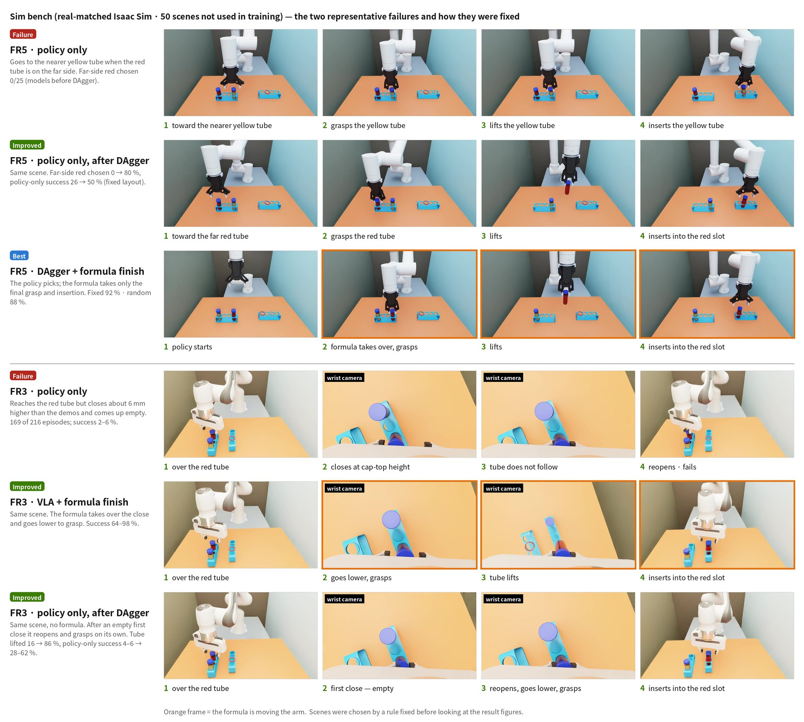
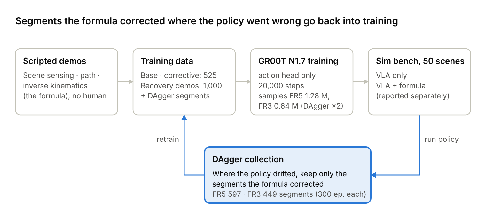
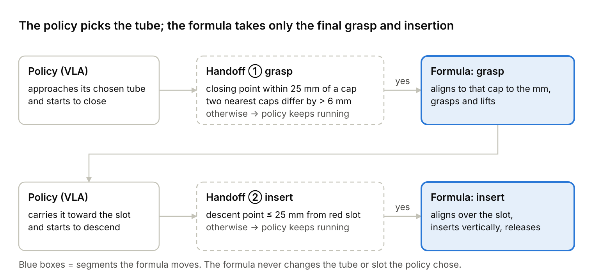
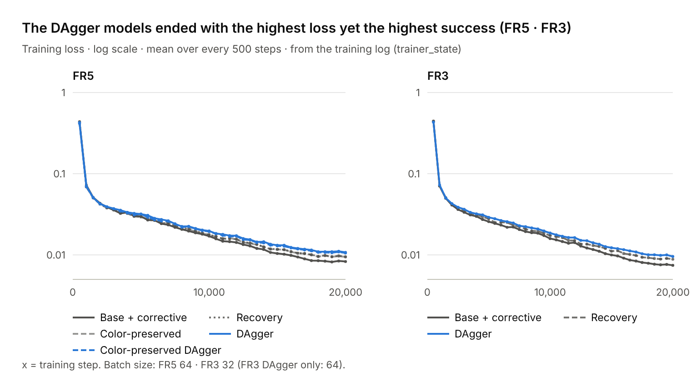

# Report 4 — Sim Benchmark Results: FR3 · FR5 VLA Only · DAgger · Formula Finish

2026-11-16 · Sim-to-Real Post-Training (simulation part) · Isaac Sim 6.0.1 · Isaac Lab 3.0 · GR00T N1.7 · [한국어](README.md)

This report is split into three documents. Section, figure and equation numbers run across all three.

| Document | Contents |
|---|---|
| **Overview (this document)** | Task · sim setup · names (Section 1), the comparisons that need both robots side by side (Sections 2 · 3), VLA + formula (Section 4), training analysis (Section 5), comparison with the real robots (Section 6), data-collection principles (Section 7), next steps (Section 8), references · appendices |
| [FR5 results](fr5/README_EN.md) | Section 2 — bench success, the representative failure "goes to the nearer tube", DAgger and its side effect, training-data composition, color preservation, FR5 VLA + formula, differences from the real FR5 |
| [FR3 results](fr3/README_EN.md) | Section 3 — bench success, the representative failure "closes too high and comes up empty", training amount, what DAgger fixed, FR3 VLA + formula, differences from the real FR3 |



**Summary figure.** The two representative failures and how they were fixed (real-matched sim). When the red tube is on the far side, FR5 goes to the nearer yellow tube; after DAgger it inserts the red tube in the same scene. FR3 reaches the red tube but closes too high and comes up empty; when the formula takes over the final grasp it goes lower and holds the tube. After DAgger, in the same scene and without the formula, its first close comes up empty, and it reopens, grasps and inserts on its own. An orange frame marks frames where the formula is moving the arm.

## Summary

On the real-matched sim bench (50 scenes not used in training), the GR00T N1.7 policy alone completed the task in 2–6 % of episodes on FR3 and 16–26 % on FR5. After retraining with segments that correct the policy exactly where it went wrong (DAgger), FR5 reached 25/50 (50 %) with the policy alone and 46/50 (92 %) when the final grasp and insertion were handed to the formula. FR3 reached 28–62 % with the policy alone after DAgger, and 86–100 % with the formula. Apart from two comparison models that include real data (real-team mixed · real only), every model was trained on sim data only, and every evaluation was run in sim.

Here the **"formula"** is the scripted computation that generated all the demonstrations — scene sensing → path → inverse kinematics, with no learned model (1-7).

**Bench success** — real-matched sim · 50 scenes, successes (%, Wilson 95 % interval):

| Robot · model | Fixed · VLA only | Random · VLA only | Fixed · VLA + formula | Random · VLA + formula |
|---|---|---|---|---|
| FR5 · five models before DAgger (range) | 8–13 (16–26 %) | 7–20 (14–40 %) | 19–29 (38–58 %) | 29–32 (58–64 %) |
| FR5 · DAgger | 17 (34 %, 22–48) | 22 (44 %, 31–58) | 35 (70 %, 56–81) | 41 (82 %, 69–90) |
| **FR5 · color-preserved DAgger** | **25 (50 %, 37–63)** | **28 (56 %, 42–69)** | **46 (92 %, 81–97)** | **44 (88 %, 76–94)** |
| FR3 · two models before DAgger (range) | 2 · 2 (4 % each) | 2 (4 %, 1–13) | 41 · 49 (82 · 98 %) | 39 (78 %, 65–87) |
| **FR3 · DAgger** | **31 (62 %, 48–74)** | **17 (34 %, 22–48)** | **50 (100 %, 93–100)** | **45 (90 %, 79–96)** |

Across five layout conditions (fixed · random · real-eval layouts), the two FR3 models before DAgger scored 1–3/50 (2–6 %) with VLA only and 32–49/50 (64–98 %) with VLA + formula. On the real-eval layouts the DAgger model scored 14/50 (28 %) with VLA only and 43/50 (86 %) with VLA + formula.

| | FR3 | FR5 |
|---|---|---|
| Representative failure | Reaches the red tube but does not hold it | Goes to a tube that is not red |
| Direct cause | Closes the hand about 6 mm higher than the demos | Learned "the tube nearer the starting hand" as a shortcut instead of color |
| Fixed by | DAgger · formula finish | DAgger · formula finish |

**Six key results**

1. **Changing only the number of episodes or the kind of demos did not raise policy performance in a confirmed way.** 100–1,000 episodes, added recovery demos, and real-team data or mixes all gave p ≥ 0.05.
2. **Training amount mattered a lot.** On the same 200 FR3 episodes, 4× more training samples (0.32 M → 1.28 M) took success from 0 to 13/50 (p = 0.0001).
3. **Preserving color in the training video helped in the same direction every time.** Storing FR5 training video without chroma reduction raised policy-only success by 5–8 episodes in all four comparisons. None of them is statistically confirmed on its own.
4. **DAgger fixed the representative failure of both robots.** In scenes where the red tube is on the far side, episodes that went to the red tube rose from 0/25 to 18–20/25 (p ≤ 5 × 10⁻⁸) on FR5. On FR3, episodes that lifted the red tube more than 60 mm rose from 16 to 86/100 (p = 1 × 10⁻²⁴), and policy-only success from 4–6 to 28–62 % (training amount doubled at the same time).
5. **The formula finish takes care of the last few millimeters.** It gave 1.5–5× the policy-only success in 16 of 17 pairs (p < 0.05). It never changes the tube the policy picked, so it cannot fix color-choice failures. It is the same pipeline and the same handoff conditions as the real FR3 station, and the formula only enters the final grasp and the final insertion (4-1).
6. **A model trained on real data only scored 0–4 % in sim.** So the sim numbers are used only to compare models within the same sim and the same physics.

**The two methods used — what they are and why (details in 1-6)**

- **Color preservation:** storing the training video without reducing color information. Ordinary video compression (H.264 · 4:2:0) keeps color at half resolution horizontally and vertically [19]. Measured, the red in the training video was faded to 1/3–1/4 of the bench input, so the video was re-saved as 4:4:4 (no chroma reduction).
- **DAgger (Dataset Aggregation):** run the trained policy, collect the states it actually visits, label those states with what an expert would do, add them to the data and retrain (Ross et al., 2011 [4]). Demos only pass along the correct path, so a policy that drifts a little lands in states it has never seen; both representative failures had that shape. The scripted formula that made the demos served as the expert instead of a person. The GR00T N2 whitepaper [2] also reports raising success with DAgger.



**Figure 1.** Overall experiment flow (same for both robots). All demos are made by the formula, and every trained policy is measured on the same 50 scenes. DAgger runs the policy on scenes different from the bench and adds only the segments the formula corrected to the training data.

## 1. Task · Sim Setup · Names

Both robots (FR3 · FR5) were trained on the same task in the same way, and every model was measured on the same 50 scenes with the same criteria. Names in this report always carry the meanings in the tables below.

### 1-1. Task and success

- **Instruction:** `put the red tube in the red slot`. Pick up the red tube and insert it into the empty rack hole marked with a red ring. One yellow tube stands next to it as a distractor.
- **Success:** the red tube is inserted in the red-ring hole. Episodes in which an object pops up because of a sim contact error (a physics pop) count as failures.
- **Robots:** FR3 (7-axis arm · two-finger gripper 0–80 mm), FR5 (6-axis arm · linkage gripper 0–95 mm).

### 1-2. Policy (VLA)

- **Model:** GR00T N1.7 [1] [3] (about 3 B parameters). The language and vision backbone is frozen; only the action-generating parts (DiT action head · projector · VL LayerNorm) are trained.
- **Inputs:** two camera images (third-person · wrist), end-effector state, instruction.
- **Outputs:** end-effector pose + gripper open/close as an action chunk (a block of actions emitted at once) of 16 steps (1.6 s). The first 8 steps are executed before querying again.
- **Training:** FR5 models use batch size 64 × 20,000 steps (1.28 M training samples); real-matched FR3 models batch size 32 × 20,000 steps (0.64 M); the FR3 DAgger model batch size 64 × 20,000 steps (1.28 M). The learning rate warms up to 1 × 10⁻⁴ over the first 1,000 steps and decays to 0 with a cosine schedule. Color jitter (brightness · contrast · saturation · hue) is on (off only for the real-team sim model).

### 1-3. Training data and model names

Apart from the two comparison models trained by the real-robot team (real-team mixed · real only), all training data was made in sim, and every model was evaluated in sim. All demos are scripted sim demos made with no person in the loop: they grasp and insert through scene sensing → path → inverse kinematics. This report calls that computation the **"formula"**.

| Model name | Training data |
|---|---|
| Base + corrective demo model | 525 episodes — 150 base demos, 300 position-correction demos (stop above the cap, correct by 1–8 mm, then grasp), 75 fill-ins for under-covered placements |
| Recovery-demo model | 1,000 episodes (split into 1,325 demos · 190,532 frames) — the three above + 250 demos that come down 10–40 mm off and correct, 150 retry demos after a missed grasp or a jam, 150 fill-ins |
| Color-preserved model | Same data as the recovery-demo model; only the training video is stored without chroma reduction ([FR5 2-5](fr5/README_EN.md#2-5-color-in-the-training-video--color-preservation)) |
| DAgger model | Recovery-demo data + DAgger segments (FR5: 597 · 48,716 frames, about 20 % of the total / FR3: 449, 1,774 demos · 307,598 frames in total) |
| Color-preserved DAgger model | Same data as the DAgger model; training video stored the same way as the color-preserved model (FR5 only) |
| Real-team sim model | 600 episodes collected in the sim scene the real FR5 team uses (trained by us the same way) |
| Real-team mixed model | Real FR5 data + real-team sim, 1,200 episodes (trained by the real-robot team) |
| Real-only model | Real FR5 data only (trained by the real-robot team) |
| FR3 base-demo models | FR3 base demos in the initial sim setup, 100 · 200 · 600 episodes (used only for the training-amount comparison) |

- **DAgger segments:** while the trained policy runs in sim, only the parts where the formula corrected the policy after it drifted are cut out and added to training (DAgger by Ross et al. [4]). On FR5 the recovery-demo model was run for 300 episodes, giving 300 grasp and 297 insertion segments.
- On FR3 the recovery-demo and base + corrective demo models were built the same way as on FR5, and so was the FR3 DAgger model ([FR3 3-4](fr3/README_EN.md#3-4-dagger-fr3--fixing-the-empty-grasp-failure)).

### 1-4. Sim setup · layouts · run conditions

| Name | Meaning |
|---|---|
| Real-matched sim setup | Isaac Sim · Isaac Lab [18] scene with camera poses, resolution, rack height and start pose matched to the real robots. All main results use this setup |
| Initial sim setup | The scene built first. Used only for the FR3 training-amount comparison |
| FR5 physics | Joint solver iterations raised to 32 position · 4 velocity (fewer physics pops). All FR5 tables use this physics |
| Fixed layout | The two tubes sit in the end holes of the front rack (111 mm apart). Red on the left in 25 scenes and on the right in 25; only the ring hole and lighting change. In effect two layouts seen 25 times each |
| Random layout | Rack positions and orientations are random in every scene. Generalization is read from this layout |
| Real-eval layouts (FR3) | The 10 layouts used for the real FR3 evaluation (held out of training) × 5 scenes |
| Near side · far side | A scene is "near side" when the red tube is closer than the yellow one to the end effector at the start pose |
| VLA only | The policy runs alone to the end |
| VLA + formula (hybrid) | Same model, same inputs. Only when the policy is about to close its hand within 25 mm of a cap, or to descend for insertion within 25 mm of the red slot, does the formula take over the final grasp or insertion. The tube the policy chose is never changed |

### 1-5. Evaluation and statistics

- Every model is measured on the same 50 scenes not used in training (same random seed, one episode per scene).
- Success is reported as k/50 with a Wilson 95 % interval [17]. Two models are called "different" only when a two-sided Fisher exact test gives p < 0.05.
- Comparisons and test criteria were written down before seeing the results. Anything examined after seeing results is marked "post hoc".
- VLA only and VLA + formula are always reported separately, and benches are compared only under the same physics.

```math
\frac{\hat p + \frac{z^2}{2n} \pm z\sqrt{\frac{\hat p(1-\hat p)}{n} + \frac{z^2}{4n^2}}}{1 + \frac{z^2}{n}}, \qquad \hat p = k/n, \quad z = 1.96
```

**Equation 1-1.** Wilson 95 % interval [17]. k/n is successes / scenes. The Fisher exact test takes the 2 × 2 table (success · failure) of two models and computes a two-sided p from the hypergeometric distribution.

**How to read the numbers in parentheses (95 % confidence interval):**

- "50 (37–63)" means 25 of 50 scenes succeeded (50 %) and the true success rate plausibly lies between 37 and 63 %. Intervals built this way contain the true rate 95 % of the time.
- With only 50 scenes, chance alone moves the number a lot: near 50 % the interval is about ±13 percentage points.
- The Wilson method never leaves 0–100 %, even with few episodes or rates near 0 or 100 % (e.g. 0/50 → 0–7 %).
- Whether two models differ is decided by the Fisher test, not by whether their intervals overlap. For example, 26 % (16–40) and 50 % (37–63) overlap but are "different" at p = 0.023.

### 1-6. The two methods — color preservation and DAgger

Both methods target the gap between "what was seen in training" and "what is met at run time". Color preservation narrows the gap in the image; DAgger narrows the gap in the state.

| | Color preservation | DAgger (Dataset Aggregation) |
|---|---|---|
| What | Store training video in H.264 without chroma subsampling (4:4:4). Resolution 256×256 · quality CRF 18 · data and training unchanged | Run the trained policy, label the states it reached with the expert's actions, add them to the data and retrain |
| Why | Ordinary 4:2:0 stores color at half resolution horizontally and vertically (1/4 of the samples), blurring the small red ring and tube body. Red in the training video was 1/3–1/4 of the bench input ([FR5 2-5](fr5/README_EN.md#2-5-color-in-the-training-video--color-preservation)) | Imitation learning only learns the states the demos pass through. Once the policy drifts a little it is in unseen states and errors pile up (covariate shift — the mismatch between training-state and run-time-state distributions). The FR5 far-side failure and the FR3 "stops too high" failure have this shape |
| In this experiment | FR5 recovery-demo data and DAgger data re-saved as 4:4:4 | Expert = the formula (same computation as the scripted demos). The policy was run on 300 scenes different from the bench, and only the segments the formula took over and corrected were added. One round |
| References | Video coding standard [19], red-pixel measurement in this experiment ([FR5 2-5](fr5/README_EN.md#2-5-color-in-the-training-video--color-preservation)) | DAgger [4], HG-DAgger with human correction [5], correction during deployment (Sirius) [6], GR00T N2 whitepaper [2] |
| Result | Policy-only success +10–16 percentage points, same direction four times (not confirmed) | FR5 far-side red choice 0 → 72–80 %, policy-only success 26 → 50 % (p = 0.023). FR3 red tube lifted 16 → 86 %, policy-only success 4–6 → 28–62 % |

### 1-7. The formula behind the scripted demos (data collection)

The scripted sim demos port the computation of the real FR3 collection station's scripted demos (minimum jerk · rounded polyline · DLS (damped least squares) inverse kinematics) into sim. No learned model is used.

1. **Sensing the scene:** use the true sim positions of the tubes, racks and red ring.
2. **Targets:** grasp at the center of the red cap, with the fingertip 4–9 mm below the cap top. The wrist angle follows the rack-row rule; if the open fingers would touch a neighboring cap, the row rotated by 90° is used. Insert at the center of the red-ring hole; the tube's pose in the hand is re-measured after grasping and above the hole, and corrected.
3. **Path:** a polyline (start → 6–10 cm above the cap → vertical descent → lift 13–17 cm → above the hole → insert along the tube axis → release → retract) whose corners are rounded with quadratic Béziers (Eq. 1-3).
4. **Timing:** each segment moves with minimum jerk (Eq. 1-2), using the shortest time that respects joint velocity and acceleration limits (Eq. 1-5).
5. **Joints:** FR3 uses DLS inverse kinematics (Eq. 1-4); FR5 uses a 6-axis analytic inverse kinematics, picks the solution closest to the previous joint values, and drops the layout if the solution flips by more than 20°.
6. **Recording:** joint targets and the gripper are sent every 1/30 s, and the training data is converted to the real-robot data format (table below).

```math
s(\tau) = 10\,\tau^3 - 15\,\tau^4 + 6\,\tau^5, \qquad \tau = t/T \in [0, 1]
```

**Equation 1-2.** Minimum-jerk time law [20]. The path fraction s starts and ends with zero velocity and acceleration.

```math
\mathbf{B}(u) = (1-u)^2\,\mathbf{p}_1 + 2u(1-u)\,\mathbf{b} + u^2\,\mathbf{p}_2, \qquad \mathbf{p}_1 = \mathbf{b} + r\,\frac{\mathbf{a}-\mathbf{b}}{\lVert \mathbf{a}-\mathbf{b} \rVert}, \quad \mathbf{p}_2 = \mathbf{b} + r\,\frac{\mathbf{c}-\mathbf{b}}{\lVert \mathbf{c}-\mathbf{b} \rVert}
```

**Equation 1-3.** Corner rounding (quadratic Bézier). a · b · c are three consecutive polyline points, r = min(r₀, 0.45‖a − b‖, 0.45‖c − b‖), r₀ = 3–6 cm. The arm stops only right before grasping, releasing and inserting.

```math
\Delta\mathbf{q} = J^\top \left(JJ^\top + \lambda^2 I\right)^{-1}\mathbf{e} + \left(I - J^{+}J\right) k \left(\mathbf{q}_{\mathrm{ref}} - \mathbf{q}\right), \qquad \mathbf{e} = \left[\, \mathbf{p}^* - \mathbf{p}\ ;\ \log\!\left(R^* R^\top\right) \right]
```

**Equation 1-4.** FR3 inverse kinematics (DLS + null space) [21]. λ² = 10⁻⁴, k = 0.02, J⁺ = Jᵀ(JJᵀ + 10⁻⁶ I)⁻¹, q_ref is the start pose. Solutions not within 1 mm and 0.5° are dropped. Same equation as the real station.

```math
T = 1.05 \cdot \max\left( \max_{\tau,\,j} \frac{\lvert Q'_j(s)\,\dot s(\tau) \rvert}{v_j},\ \sqrt{\max_{\tau,\,j} \frac{\lvert Q''_j(s)\,\dot s^2 + Q'_j(s)\,\ddot s \rvert}{a_j}} \right), \qquad \mathbf{q}(t) = Q\big(s(t/T)\big)
```

**Equation 1-5.** Segment time. Q(s) is the joint path, ṡ · s̈ the derivatives of the minimum-jerk law, vⱼ · aⱼ the joint velocity and acceleration limits (FR3 0.8 rad/s, joint 7 0.15 rad/s; FR5 15 °/s · 120 °/s²). The actual time is the larger of this and "length ÷ set speed", and never shorter than 0.6 s.

```math
\mathbf{p}(s) = \mathbf{p}_0(s) + \mathbf{v}\, e_{\mathrm{in}}(s)\, e_z\big(z(s)\big), \qquad e_{\mathrm{in}},\ e_z \in [0, 1]\ (\text{min jerk}), \qquad \mathbf{p}(1) = \mathbf{p}_0(1)
```

**Equation 1-6.** Drift-then-correct demos (part of the recovery demos; the same idea as DART [7]). v has a random direction and a size of 8–30 mm, e_in is the entry share and e_z the height share. It reaches 0 at cap top + 10 mm, so the grasp point equals the nominal path. Only the correcting segment is used for training.

The other two kinds of recovery demo change the path, not the equations. Position-correction demos pause 0.3–0.8 s above a rough point (truth + 1–8 mm), correct sideways and descend straight. Retry demos reopen and grasp again after a miss, and lift 10–20 mm, realign and insert again after a jam. Only the part from the moment of failure is used for training.

**Training-data format (converted to match the real data):**

| Item | Contents |
|---|---|
| Rate | sim 30 Hz → 10 Hz (every third step) |
| State | end-effector position x · y · z + orientation rot6d (FR3: first two columns of the rotation matrix, FR5: first two rows) + gripper width |
| Action | FR3: the end-effector command sent at that step; FR5: the next frame's state (each robot's real-data convention) |
| Video | FR3 848×480, FR5 256×256 (FR5 wrist rotated 180°), first-frame brightness matched to the real target, H.264 |
| Excluded | Deliberately drifting paths, deliberately failing paths, the policy-driven part of DAgger episodes |

**Same as and different from the real scripted demos:**

| Item | Real FR3 scripted demo | Sim scripted demo |
|---|---|---|
| Time law · path · FR3 inverse kinematics | Minimum jerk · quadratic Bézier · DLS | Same (FR5 uses analytic inverse kinematics) |
| Scene sensing | Wrist-camera color segmentation + image-to-robot calibration | True sim positions (no detection error), re-measured after grasping and above the hole |
| Wrist angle | Barely rotated; dropped if more than 30° is needed | Rack-row rule |
| Sag compensation · settling wait | Yes (joint impedance control) | No (sim follows commands exactly) |
| Segment time | If a speed limit is exceeded, time is stretched by 1.1× and re-solved | Solved once on dense points and computed directly with Eq. 1-5 |

## 2 · 3. Results of the Two Robots, Compared

Detailed per-robot results are in separate documents: **[Section 2 FR5 results](fr5/README_EN.md)** · **[Section 3 FR3 results](fr3/README_EN.md)**. Only the comparisons that need both robots side by side are kept here.

### Representative failures and how they were fixed

| | FR5 ([2-2](fr5/README_EN.md#2-2-representative-failure-wrong-color--goes-to-the-nearer-tube)) | FR3 ([3-2](fr3/README_EN.md#3-2-representative-failure-empty-grasp--closes-about-6-mm-too-high)) |
|---|---|---|
| Policy-only success (before DAgger) | Fixed 16–26 % · random 14–40 % | 2–6 % |
| Where it gets stuck | Choosing the target — with the red tube on the far side, it went over the red tube in 0–3/25 | Grasping — 169 of the 216 episodes that first closed on the red tube came up empty |
| Direct cause | Learned "the tube nearer the starting hand" as a shortcut instead of color (training data is balanced: red nearer in 53 %) | Commanded closing height −1.3 mm vs demo grasp height −7.2 mm (relative to the cap top) |
| Ruled out (pre-registered criteria) | Too few demos at the bench positions · chroma compression of the training video · data imbalance | Coordinate conversion · action decoding · inverse kinematics · bench execution · demo heights |
| Fixed by the formula finish? | No — the formula never changes the tube the policy chose | Yes — the formula takes over the close and goes lower (64–98 %) |
| Fixed by DAgger? | Yes — far-side red choice 0 → 72–80 % | Yes — red tube lifted 16 → 86 % |

Both failures are the same kind of problem: **the policy reaches states of its own making that never appear in the demos.** Demos always follow the correct path, so neither FR3's "stopped too high, go lower and close" nor FR5's "went to the middle in a far-side scene, now head for the red tube" is in the training data.

### DAgger — what it fixed on each robot, and the side effect

| | FR5 | FR3 |
|---|---|---|
| Collected | Recovery-demo model on 300 scenes different from the bench → 300 grasp · 297 insertion segments (48,716 frames, about 20 % of the total) | Recovery-demo model on 300 episodes → 449 segments (training data 1,774 demos · 307,598 frames) |
| Primary test (pre-registered) | Went over the red tube in the 25 far-side scenes: 0 → 18 (p = 5.3 × 10⁻⁸) · 0 → 20 (p = 2.3 × 10⁻⁹) | Red tube lifted more than 60 mm (fixed + real-eval): 16/100 → 86/100 (p = 1.4 × 10⁻²⁴) |
| Policy-only success | Fixed 26 → 50 % (color-preserved → color-preserved DAgger, p = 0.023) · random 40 → 56 % (p = 0.16) | Fixed 4 → 62 % · real-eval 6 → 28 % · random 4 → 34 % (all p < 0.01) |
| Where the formula took over the grasp (during collection, 300 times) | Within 25 mm of the red cap 38 % · on the yellow-cap side 27 % · elsewhere 34 % — median distance to the red cap 34 mm | Within 25 mm of the red cap 71 % · yellow-cap side 11 % · elsewhere 19 % — median 10 mm |
| Side effect | Near-side episodes that went over the red tube 24 → 14 (p = 0.002) · 25 → 17 | None — target-choice failures C · T · A 4 · 15 · 5 → 0 · 2 · 0 |
| Remaining failures | Some target-choice failures remain on both the near and far side | Moved to insertion — stuck after carrying the tube over the red slot: C 9 · T 29 · A 26 episodes |
| Training amount | Same as before DAgger (1.28 M samples) | Doubled for the DAgger model only (0.64 M → 1.28 M) — the DAgger-data effect and the training-amount effect are mixed |

(C = fixed layout, T = real-eval layouts, A = random layout.)

- **Same method, different failure fixed:** DAgger fixed color choice on FR5 and empty grasps on FR3. In both cases the policy learned to correct itself from wrong states of its own making [4]. DAgger was run only once on each robot.
- **Why only FR5 got a side effect (candidate cause):** during DAgger collection the formula always goes to the red tube. Before DAgger the FR5 policy often headed for the yellow tube, so many added segments "leave the tube under the hand and move to another tube" (yellow-cap side 27 %). That plausibly made the policy go to the far tube even in scenes where red is the nearer one. The FR3 policy already went to the red tube most of the time before DAgger (first grasp attempt on red in 70–92 %), so most of its segments only corrected the height on the spot.
- **Not confirmed:** the pre-registered criteria (FR5 yellow side ≥ 30 % · FR3 ≤ 10 %) were not met (27 % · 11 %). The share of takeovers over the red cap, FR5 38 % vs FR3 71 %, gives p = 2 × 10⁻¹⁵, but that comparison was made after seeing the results.
- **Limit:** FR5's DAgger segments came from the failures of the recovery-demo model, not from the color-preserved model's own failures (both models failed 0/25 on the far side).

### Grasping in sim — lenient on FR5, strict on FR3

| | FR5 ([2-7](fr5/README_EN.md#2-7-differences-from-the-real-fr5)) | FR3 ([3-6](fr3/README_EN.md#3-6-differences-from-the-real-fr3)) |
|---|---|---|
| Sim grasp | Has an "attach while grasped" assist (25 mm). Even 5–25 mm off along the opening direction, 71/76 lifted → may be **more lenient** than the real robot | Fingers close under position control and hold by friction only. Grasps only when closing about 7 mm below the cap top → may be **stricter** than the real robot |
| Checked | With the assist off, lifting stayed at 45/50 but the tube was dropped while carrying: success 0/50 (43/50 with it on) | 195/216 (90 %) of formula closes lifted the tube more than 60 mm |

So success rates are not compared directly between the robots (6-1).

## 4. Both Robots — VLA + Formula Is 1.5–5× the Policy Alone

The formula finish raised success in a confirmed way in 16 of the 17 comparison pairs across both robots (FR3 2/2 · FR5 14/15, p < 0.05), because it takes over the last few millimeters once the policy gets close to the target.



**Figure 8.** Structure of VLA + formula (same for both robots). The formula takes over only when the point where the policy is about to close or insert is within 25 mm of a target. Otherwise the policy keeps running.

- **What it does:** if the policy is about to close within 25 mm of the cap it chose, the formula aligns to that cap to the millimeter and grasps it. If the policy is about to descend within 25 mm of the red slot, the formula aligns over the slot and inserts. If two caps are about equally close (difference under 6 mm), it does not take over.
- **Precision:** closing distance is 0–2 mm when the formula closes and 6–28 mm with the policy alone (on both robots). The table of 17 pairs is in Appendix A.
- **FR5 success:** fixed 38–58 % · random 58–64 % for the five models before DAgger; fixed 92 % · random 88 % for the color-preserved DAgger model ([2-1](fr5/README_EN.md#2-1-bench-success-real-matched-sim)).
- **FR3 success:** 64–98 % in the real-matched sim, more than 10× the policy alone (2–6 %) ([3-1](fr3/README_EN.md#3-1-bench-success-real-matched-sim)). With the DAgger model, 86–100 % (policy alone 28–62 %, [3-4](fr3/README_EN.md#3-4-dagger-fr3--fixing-the-empty-grasp-failure)). The policy gets near the red tube in 70–92 % of episodes, so there are many episodes for the formula to take over, and 90 % of formula closes lifted the tube. In the initial sim setup it also rose: fixed 26 → 52 % (p = 0.013), random 12 → 60 % (p < 0.0001).
- **Adds up with DAgger:** VLA + formula on the color-preserved DAgger model beats the color-preserved model (fixed 56 → 92 %, p = 0.0001 · random 62 → 88 %, p = 0.005). On FR3 too, VLA + formula with the DAgger model beats the recovery-demo model (real-eval 64 → 86 %, p = 0.020). Between the two DAgger models that differ only in video format, 4:4:4 was higher on fixed, 70 vs 92 % (p = 0.0095; random 82 vs 88 %, p = 0.58); without DAgger there was no difference (fixed 58 vs 56 %). DAgger fixes "what to grasp"; the formula fixes "the last millimeters".
- **Limits:**
  1. It never changes the tube the policy chose. FR5's color-choice failure remains ([Figure 3](fr5/README_EN.md#2-2-representative-failure-wrong-color--goes-to-the-nearer-tube)).
  2. It takes over only once the policy is within 25 mm of the target.
  3. In sim the formula knows object positions exactly. On the real robot, camera detection error is added.

### 4-1. Same pipeline as the real robot · which segments the formula takes

The sim VLA + formula ports the real FR3 station's VLA + formula (the version used in the real evaluation) to the sim bench, with the same code for both robots. The formula enters only two segments: the final grasp and the final insertion.

**Pipeline (same as the real robot):** policy server (same checkpoint · same inputs) → 16-step action chunk → execute the first 8 steps → handoff check on every chunk → formula (the same functions as the scripted demos) → back to the policy. The policy is not queried while the formula is moving.

| Segment | Who | Start condition | End |
|---|---|---|---|
| Start → choose a tube → approach | Policy | — | Policy is about to close the hand |
| Final grasp (align · vertical descent · grasp · lift) | Formula | Closing point c within 25 mm of a cap and more than 6 mm closer than the second cap (Eq. 4-1, left) | Lift vertically and hand back to the policy |
| Carry (toward the slot) | Policy | — | About to descend into the slot while holding |
| Final insertion (align over the slot · insert · release · retract) | Formula | The held tube's bottom is about to go below rack top + 25 mm, or the gripper is about to open, and that point c′ is within 25 mm of the red slot (Eq. 4-1, right) | Judged after release and retract |
| Chunks that meet no condition | Policy as is | — | Only the reason is logged |

```math
d_1 = \min_i \lVert \mathbf{c} - \mathbf{p}_i \rVert \le 25\ \text{mm}, \quad d_2 - d_1 \ge 6\ \text{mm} \qquad\qquad \lVert \mathbf{c}' - \mathbf{h} \rVert \le 25\ \text{mm}
```

**Equation 4-1.** Handoff conditions; left for the grasp, right for the insertion. c is the end-effector x · y at the step where the policy was about to close, pᵢ are the cap positions (d₁ · d₂ the nearest and second-nearest distances), c′ is where it was about to descend, h is the red slot. "About to close · about to open" means the first of two consecutive steps with gripper opening below 0.4 · above 0.6. The formula's grasp and insertion use Eqs. 1-2 to 1-5 unchanged.

| Item | Real FR3 (evaluation version) | Sim bench |
|---|---|---|
| Principles (policy chooses the target · model unchanged · reported separately) | Yes | Same |
| Handoff conditions (25 mm · 6 mm · 25 mm, 0.4 / 0.6 for two steps) | Yes | Same |
| Formula | Real scripted-demo functions | Sim scripted-demo functions (1-7) |
| Starting scene | Majority detection over 5 wrist-camera frames | True sim positions (no detection error) |
| Insertion handoff height | Release height + 75 mm | Rack top + 25 mm |
| No handoff if more than 30° of wrist rotation is needed | On | Off (sim demos rotate more when grasping) |
| Sag compensation · settling wait · slow first 6 cm of lift · handling the gripper's late width readings | Yes | No (sim follows commands exactly) |
| Re-measuring the tube in the hand | No | Yes (same function as the sim scripted demos) |

**DAgger data mode (not an evaluation):** the formula is the "expert". It takes over when the policy, still more than 20 mm from the red cap, descends below cap top + 40 mm, starts to close its hand, or runs past a time limit (FR5 9 s, FR3 21 s). In this mode it always goes to the red tube and the red slot, not to the tube the policy chose. Only these formula segments were used for training.

## 5. Training Analysis — Loss Function · Training Amount · Data Distribution · Metrics

GR00T learns the demo action chunks with a flow-matching loss. This loss is "the mean action error in the states the demos pass through", so it cannot measure failures in states the policy creates itself. This report therefore uses bench success as the primary metric and uses the loss only to check for under-training.

### 5-1. Loss function

The GR00T action head is trained to minimize the loss below (Eq. 1 of GR00T N1 [1], flow matching [15]).

```math
\mathcal{L}_{fm}(\theta) = \mathbb{E}_{\tau}\Big[\, \big\lVert V_\theta\big(\phi_t,\ A_t^{\tau},\ q_t\big) - \big(\epsilon - A_t\big) \big\rVert^2 \,\Big], \qquad A_t^{\tau} = \tau A_t + (1-\tau)\,\epsilon
```

**Equation 5-1.** Flow-matching loss (GR00T action head).

- Aₜ is the demo action chunk (16 steps), φₜ the features from the images and instruction, qₜ the end-effector state, ε Gaussian noise. τ mixes noise and action and is drawn from a beta distribution [1] [14].
- The model V_θ learns the direction from "noisy action" to "demo action". At run time it starts from noise and produces an action chunk in a few steps (4 in the N1 paper).
- **What the loss cannot measure:**
  1. Actions in states the policy created itself and the demos never contain — after FR3 stops too high, after FR5 drifts to the middle in a far-side scene. This is the mismatch between training-state and run-time-state distributions (covariate shift), the problem DAgger targets.
  2. Errors in precise segments with few frames — the mean loss is dominated by the frame-rich carrying segment (5-2).

### 5-2. Training amount — training samples and epochs

| Robot · model | Training frames | Training samples (batch size × steps) | Epochs (passes per frame) | Final loss |
|---|---|---|---|---|
| FR5 · base + corrective | — | 1.28 M (64 × 20,000) | — | 0.0085 |
| FR5 · recovery | 190,532 | 1.28 M | 6.7 | 0.0093 |
| FR5 · color-preserved | 190,532 | 1.28 M | 6.7 | 0.0092 |
| FR5 · DAgger | 239,248 | 1.28 M | 5.3 | 0.0113 |
| FR5 · color-preserved DAgger | 239,248 | 1.28 M | 5.3 | 0.0111 |
| FR3 · base + corrective | — | 0.64 M (32 × 20,000) | — | 0.0076 |
| FR3 · recovery | — | 0.64 M | — | 0.0092 |
| FR3 · DAgger | 307,598 | 1.28 M (64 × 20,000) | 4.2 | 0.0100 |
| FR3 · base demos, 200 episodes (initial setup) | — | 0.32 M → 1.28 M | about 4.5 → about 18 | — → 0.0073 |

Final loss = mean training loss over the last 100 steps (10 log entries). It is not a validation loss.

- **Signs of under-training (initial setup, 0.32 M training samples):** the final loss of the 600-episode model was 34 % (FR3) · 35 % (FR5) higher than that of the 100-episode model, and every model's loss was still falling at step 20,000. With 4× more training samples, success rose from 0 to 26 % ([3-3](fr3/README_EN.md#3-3-training-amount-and-episode-count-initial-sim-setup)).
- **Reading:** with the number of training samples fixed, adding episodes reduces the epochs (passes per frame). So the episode-count comparison in 3-3 is mixed with a training-amount effect.
- The DAgger models made fewer passes than the recovery-demo model (6.7 → 5.3) yet succeeded more (FR5 fixed 16 → 34 %). The gain came from the kind of data added, not from more training.
- **Loss and success do not rank the same way.** On FR5 the two DAgger models had the highest final loss (0.0111–0.0113) and also the highest policy-only success (fixed 34 · 50 %). The base + corrective model with the lowest loss (0.0085) scored 22 %. On FR3 too, the DAgger model's final loss (0.0100) was above the recovery (0.0092) and base + corrective (0.0076) models, yet its policy-only success was the highest (only the DAgger model used batch size 64, so its training amount differs). This matches the two reasons in 5-1.
- **Learning rate · convergence:** the learning rate rose to 1 × 10⁻⁴ over the first 1,000 steps (5 %) and decayed to 0 with a cosine schedule. Every loss started near 1.3 and kept falling to step 20,000 (e.g. FR5 recovery at steps 1,000 · 10,000 · 20,000: 0.062 · 0.018 · 0.009).
- **Where the loss concentrates (initial-setup data):** only 11 % of training frames are the precise segment just before grasping, while 42–53 % are carrying. The mean loss is therefore dominated by the easy carrying segment. Other distributions are in their own sections: scene distribution 53 % (FR5 2-2), closing height (FR3 3-2), DAgger share 20 % (FR5 2-3), color in the training video (FR5 2-5).



**Figure 9.** Training loss curves (training log `trainer_state.json`, mean over 500 steps). All losses fall in the same shape, and on both robots the DAgger models (blue) stay slightly higher to the end. Adding correction segments made the data harder to imitate, yet the DAgger models had the highest bench success.

### 5-3. Metrics — used and not yet measured

| Metric | What it measures | In this report |
|---|---|---|
| Success rate (k/50 · Wilson 95 % interval) | Did it finish the task | Primary metric |
| Fisher exact test p | Is the difference between two models chance | Every comparison |
| Target choice (share that went over the red tube) | Does it follow color · instruction | FR5 2-2 · 2-3 |
| Closing distance · closing height (mm) | Positional precision | FR3 3-2 · Section 4 |
| Failure breakdown (empty · slipped · lifted then dropped) | Where it gets stuck | FR3 3-2 |
| Physics-pop rate | Sim contact errors | FR5 2-5 · appendix |
| Training loss (flow matching) | How well it imitates demo actions | 5-2 |
| Training curves (loss · gradient norm · learning rate) | Convergence · stability | 5-2 · Figure 9 |
| Validation loss (loss on held-out demos) | Overfitting | Not yet — all demos were used for training |
| Open-loop action error (MSE) | Predicted vs demo action in demo states | Not yet |

For robot policies, the two reasons in 5-1 mean that success can be low even when the loss and the open-loop error are low. So success on the closed-loop bench (the policy moving on its own in sim) is the primary metric, and the rest are used to find causes.

## 6. Comparison with the Real Robots · Real-to-Sim Limits

An FR5 model trained on real data only scored 0–4 % on the sim bench. So the sim bench is not a tool for evaluating real-robot models; it is used to compare models within the same sim and the same physics. Real-robot results themselves follow the real-robot team's report. Per-robot details are in [FR5 2-7](fr5/README_EN.md#2-7-differences-from-the-real-fr5) · [FR3 3-6](fr3/README_EN.md#3-6-differences-from-the-real-fr3).

### 6-1. How far the sim numbers can be read

- Compare only within the same sim setup and the same physics. Absolute sim success rates do not predict real success rates.
- The fixed layout is two layouts × 25 scenes. Generalization is read from the random layout.
- FR5's higher-iteration physics was chosen after seeing pops with the default physics. All FR5 comparisons were made within this physics.
- Sim grasping is lenient on FR5 and strict on FR3, so success rates are not compared directly between the robots.

## 7. Principles Learned from Data Collection

Collecting corrections in the states where the policy actually goes wrong raised policy-only success more than adding episodes (FR5 fixed 26 → 50 %, FR3 fixed 4 → 62 % — on FR3 the training amount doubled at the same time). The principles below rest on both the results of this experiment and the literature.

| Principle | Evidence from this experiment (success) | Literature |
|---|---|---|
| 1. Measure the shape of the failure first | The two robots' representative failures differed (color choice · closing height), and so did the fixes (FR5 2-2 · FR3 3-2) | — |
| 2. Collect in the policy's own states (on-policy) | Adding scripted recovery demos made no confirmed difference (fixed 22 → 16 %, p = 0.61). DAgger: FR5 far-side red 0 → 72–80 %, success 26 → 50 % (p = 0.023) · FR3 red tube lifted 16 → 86 % (p = 1 × 10⁻²⁴) | [4] [6] |
| 3. Label only the corrected segments | The policy-driven segments are wrong actions and are left out. The added segments are 20 % of all frames | [5] |
| 4. When the data grows, train more | FR3 training samples 0.32 M → 1.28 M: 0 → 26 % (p = 0.0001). Adding episodes alone cut epochs and did not help (0–6 %) | — |
| 5. Keep training inputs the same as evaluation inputs | Color-preserved video: +10–16 percentage points in all four comparisons (none confirmed alone) | — |
| 6. Diversity in the scenes, consistency in the actions | Balanced scene distribution (red nearer in 53 %); the formula grasps and inserts with the same rules | [8] [9] |
| 7. Measure side effects together | After DAgger, near-side red choice 96 → 56 % (p = 0.002) | — |

- On both robots the first data was scripted demos made by the formula with no person. Multiplying demos automatically in sim belongs to the same family as MimicGen [10]. Recovery demos (deliberately 10–40 mm off, then corrected) share the idea of noise injection (DART [7]), but they differ from the states where the policy actually goes wrong, and their effect was not confirmed.
- When a formula exists, it can play DAgger's "expert" instead of a person. That is what this experiment's DAgger did.

## 8. Next Steps

| Task | What it decides | When |
|---|---|---|
| FR3 DAgger bench | Does DAgger also fix FR3's grasp failure (3-4) — done, yes (tube lifted 16 → 86 %) | 11-16 early morning |
| FR5 bench with the gripper linkage changed to a PhysX linkage | Does the gripper setup change grasping · pops — done; the linkage does not change success · turning off the attach assist gives 0/50 (2-7) | 11-16 morning |
| Training curves · validation loss · open-loop error | The not-yet-measured metrics in 5-3 | 11-16 |
| Repeated DAgger (2+ rounds) | Does each round help, does it reduce the near-side side effect [6] | FR3 round 2 running (judged 11-17) |
| Reinforcement-learning fine-tuning (sim success as reward) | Can the policy learn the last millimeters itself [12] [13] | Later |
| GR00T N2 | Is a world-action model better on the same bench [2] | After the code release (expected in December) |

- The GR00T N2 whitepaper [2] also reports raising success with DAgger (e.g. a toy-car task 23 → 78 %).
- Training on sim and real data together is reported to raise real success [11]. The run logs of the real VLA + formula can serve directly as real DAgger data.

## References

1. NVIDIA (2025). [GR00T N1: An Open Foundation Model for Generalist Humanoid Robots](https://arxiv.org/abs/2503.14734). arXiv:2503.14734.
2. NVIDIA GEAR (2026). [GR00T 2 whitepaper](https://research.nvidia.com/labs/gear/gr00t-2/assets/gr00t2_whitepaper.pdf).
3. NVIDIA. [GR00T N1.7-3B model card](https://huggingface.co/nvidia/GR00T-N1.7-3B). Hugging Face.
4. Ross, S., Gordon, G., Bagnell, J. A. (2011). [A Reduction of Imitation Learning and Structured Prediction to No-Regret Online Learning](https://arxiv.org/abs/1011.0686). AISTATS.
5. Kelly, M. et al. (2019). [HG-DAgger: Interactive Imitation Learning with Human Experts](https://arxiv.org/abs/1810.02890). ICRA.
6. Liu, H. et al. (2023). [Robot Learning on the Job: Human-in-the-Loop Autonomy and Learning During Deployment](https://arxiv.org/abs/2211.08416). RSS.
7. Laskey, M. et al. (2017). [DART: Noise Injection for Robust Imitation Learning](https://arxiv.org/abs/1703.09327). CoRL.
8. Belkhale, S., Cui, Y., Sadigh, D. (2023). [Data Quality in Imitation Learning](https://arxiv.org/abs/2306.02437). NeurIPS.
9. Lin, F. et al. (2025). [Data Scaling Laws in Imitation Learning for Robotic Manipulation](https://arxiv.org/abs/2410.18647). ICLR.
10. Mandlekar, A. et al. (2023). [MimicGen: A Data Generation System for Scalable Robot Learning using Human Demonstrations](https://arxiv.org/abs/2310.17596). CoRL.
11. Maddukuri, A. et al. (2025). [Sim-and-Real Co-Training: A Simple Recipe for Vision-Based Robotic Manipulation](https://arxiv.org/abs/2503.24361). arXiv:2503.24361.
12. Li, H. et al. (2025). [SimpleVLA-RL: Scaling VLA Training via Reinforcement Learning](https://arxiv.org/abs/2509.09674). arXiv:2509.09674.
13. Liu, J. et al. (2025). [What Can RL Bring to VLA Generalization? An Empirical Study](https://arxiv.org/abs/2505.19789). arXiv:2505.19789.
14. Black, K. et al. (2024). [π₀: A Vision-Language-Action Flow Model for General Robot Control](https://arxiv.org/abs/2410.24164). arXiv:2410.24164.
15. Lipman, Y. et al. (2023). [Flow Matching for Generative Modeling](https://arxiv.org/abs/2210.02747). ICLR.
16. Geirhos, R. et al. (2020). [Shortcut Learning in Deep Neural Networks](https://arxiv.org/abs/2004.07780). Nature Machine Intelligence.
17. Wilson, E. B. (1927). [Probable Inference, the Law of Succession, and Statistical Inference](https://doi.org/10.1080/01621459.1927.10502953). Journal of the American Statistical Association.
18. NVIDIA. [Isaac Lab](https://github.com/isaac-sim/IsaacLab). GitHub.
19. ITU-T. [Recommendation H.264: Advanced Video Coding for Generic Audiovisual Services](https://www.itu.int/rec/T-REC-H.264). Chroma subsampling (4:2:0 · 4:4:4).
20. Flash, T., Hogan, N. (1985). [The Coordination of Arm Movements: An Experimentally Confirmed Mathematical Model](https://pmc.ncbi.nlm.nih.gov/articles/PMC6565116). Journal of Neuroscience 5(7), 1688–1703.
21. Buss, S. R. [Introduction to Inverse Kinematics with Jacobian Transpose, Pseudoinverse and Damped Least Squares Methods](https://mathweb.ucsd.edu/~sbuss/ResearchWeb/ikmethods/iksurvey.pdf). UC San Diego.

## Appendix

### Appendix A. VLA only vs VLA + formula — 17 pairs

Same model and same 50 scenes in every row. Successes /50, Fisher exact test. "Real-team sim setup" is the sim scene used by the real FR5 team.

**A-1. FR3 (2 pairs)**

| Sim setup · model | Layout | VLA only | VLA + formula | p |
|---|---|---|---|---|
| Initial · base demos, 200 episodes (1.28 M training samples) | Fixed | 13 | 26 | 0.013 |
| | Random | 6 | 30 | < 0.0001 |

**A-2. FR5 (15 pairs)**

| Sim setup · physics · model | Layout | VLA only | VLA + formula | p |
|---|---|---|---|---|
| Real-team · default · real-team mixed | Fixed | 8 | 20 | 0.013 |
| | Random | 15 | 33 | 0.0006 |
| Real-team · default · real-team sim | Fixed | 13 | 28 | 0.004 |
| | Random | 18 | 29 | 0.045 |
| Real-matched · default · base + corrective | Fixed | 5 | 24 | < 0.0001 |
| | Random | 7 | 23 | 0.0009 |
| Real-matched · more iterations · base + corrective | Fixed | 11 | 21 | 0.053 |
| Real-matched · more iterations · recovery | Fixed | 8 | 29 | < 0.0001 |
| | Random | 13 | 29 | 0.002 |
| Real-matched · more iterations · color-preserved | Fixed | 13 | 28 | 0.004 |
| | Random | 20 | 31 | 0.045 |
| Real-matched · more iterations · real-team mixed | Fixed | 8 | 19 | 0.023 |
| | Random | 12 | 32 | 0.0001 |
| Real-matched · more iterations · real-team sim | Fixed | 12 | 23 | 0.035 |
| | Random | 9 | 29 | < 0.0001 |

### Appendix B. Pre-registered tests (written before seeing results)

| Comparison | Primary test | Result |
|---|---|---|
| FR5 DAgger vs recovery | Fixed · VLA only · share that went over the red tube in the 25 far-side scenes, p < 0.05 | Different (0 → 18) |
| FR5 color-preserved DAgger vs color-preserved | Same criterion | Different (0 → 20) |
| FR5 color-preserved vs recovery | Same criterion | Not shown to differ (0 · 0) |
| Cause of FR3's closing height | Coordinate conversion > 1 mm · action decoding > 2 mm / bench execution +4 mm / policy +4 mm / high demos 20 % | Policy actions (−1.3 vs −7.2 mm) |
| FR3 DAgger vs recovery | Fixed + real-eval · VLA only · lifted 60 mm, p < 0.05 | Different (16 → 86/100, p = 1.4 × 10⁻²⁴) |
| VLA + formula handoff conditions | Cap 25 mm · 6 mm to the second cap · slot 25 mm (fixed during the experiment) | — |

Previous report: [Report 3 — paired demos re-collected with real-robot settings](https://github.com/SungjinDavidLee/BioRoboticsIsaacSim/tree/main/sim_isaac/reports/03_realmatched_data) · development log: [BioTube-Insertion-VLA-IsaacLab](https://github.com/bbiyak12e/BioTube-Insertion-VLA-IsaacLab)
