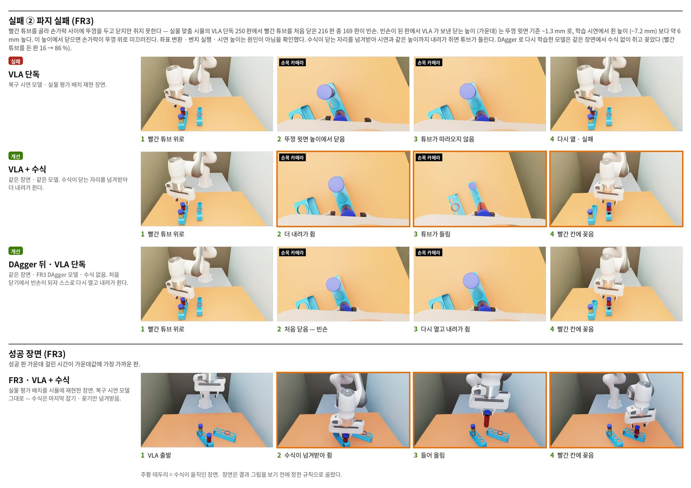
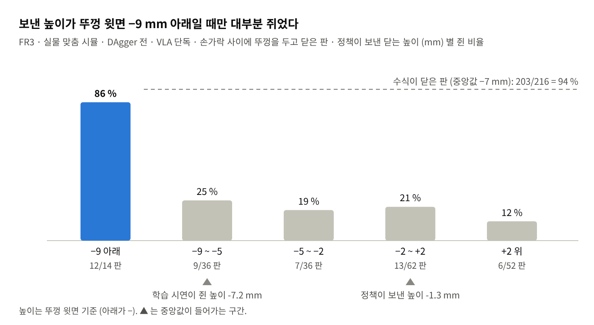
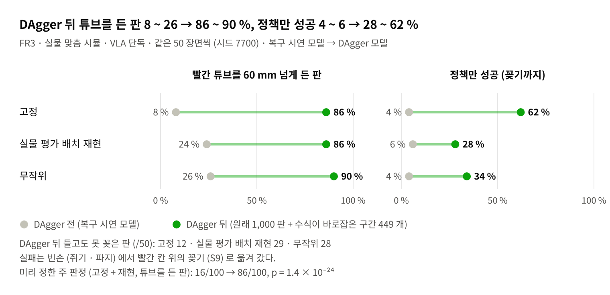

# 보고서 4 · 3절 — FR3 결과: VLA 단독 · DAgger · 수식 마무리

2026-11-16 · Franka Research 3 (7축 팔 · 손가락 두 개 그리퍼 0 ~ 80 mm) · [통합 문서](../README.md) · [FR5 결과](../fr5/README.md) · [English](README_EN.md)

과제 · 시뮬 설정 · 모델 이름 · 통계 방법은 [통합 문서 1절](../README.md#1-과제--시뮬-설정--이름) 을 따른다. 두 로봇을 함께 본 비교는 [통합 문서 2 · 3절](../README.md#2--3-두-로봇의-결과와-비교) 에 있다.

FR3 정책만의 성공은 2 ~ 6 % 였다. 정책은 빨간 튜브까지 가지만 시연보다 약 6 mm 높은 곳에서 손을 닫아 쥐지 못했고, 수식이 마지막 잡기 · 꽂기를 맡으면 64 ~ 98 % 였다. DAgger 뒤에는 빨간 튜브를 60 mm 넘게 든 판이 16 → 86 % 가 되어, 정책만 28 ~ 62 % · VLA + 수식 86 ~ 100 % 다 (3-4).

- **대표 실패:** 빨간 튜브를 처음 닫은 216 판 중 169 판 (78 %) 이 빈손이었다. 정책이 보낸 닫는 높이는 뚜껑 윗면 기준 −1.3 mm, 시연이 쥔 높이는 −7.2 mm 다 (3-2).
- **학습량:** 같은 200 판에서 학습 샘플 수만 4 배로 늘리자 0 → 26 % (p = 0.0001) 였다 (3-3, 초기 시뮬 설정).
- **DAgger:** 빨간 튜브를 든 판 16 → 86 % (p = 1.4 × 10⁻²⁴). 실패는 빈손에서 마지막 꽂기로 옮겨 갔고, FR5 와 달리 색 선택 부작용은 없었다 (3-4).
- **VLA + 수식:** DAgger 전 64 ~ 98 %, DAgger 뒤 86 ~ 100 % (3-5).
- **시뮬 쥐기는 실물보다 엄격할 수 있다:** 시뮬 손가락은 뚜껑 윗면 아래 약 7 mm 에서 닫아야 쥐었다 (3-6).

## 3-1. 벤치 성공률 (실물 맞춤 시뮬)

| 배치 | 모델 | VLA 단독 | VLA + 수식 |
|---|---|---|---|
| 고정 | 기본 · 보정 시연, 복구 시연 | 2 · 2 (각 4 %) | 41 · 49 (82 · 98 %) |
| 무작위 | 복구 시연 | 2 (4 %, 1 ~ 13) | 39 (78 %, 65 ~ 87) |
| 실물 평가 배치 재현 | 기본 · 보정 시연, 복구 시연 | 1 · 3 (2 · 6 %) | 33 · 32 (66 · 64 %) |
| 고정 | **DAgger** | **31 (62 %, 48 ~ 74)** | **50 (100 %, 93 ~ 100)** |
| 무작위 | **DAgger** | **17 (34 %, 22 ~ 48)** | **45 (90 %, 79 ~ 96)** |
| 실물 평가 배치 재현 | **DAgger** | **14 (28 %, 17 ~ 42)** | **43 (86 %, 74 ~ 93)** |

- 성공 수 /50. 두 값이 있는 칸은 DAgger 전 두 모델의 값이다. DAgger 줄의 자세한 비교는 3-4 에 있다. 물리는 시뮬 기본 값이다.
- 처음 쥐러 간 튜브는 35 ~ 46/50 (70 ~ 92 %) 이 빨간 튜브였다. FR3 는 색 선택보다 쥐기에서 막혔다.

## 3-2. 대표 실패: 파지 실패 — 약 6 mm 높은 곳에서 닫음

FR3 정책은 빨간 튜브까지는 가지만, 시연보다 높은 곳에서 손을 닫아 쥐지 못했다 (VLA 단독 250 판).

- 빨간 튜브를 처음 닫은 216 판 중 169 판 (78 %) 이 빈손이었다. 손가락 사이에 뚜껑을 두고 닫고도 빈손인 판이 140 판, 그중 123 판은 손가락이 뚜껑 윗면을 타고 미끄러졌다.
- **닫는 높이 (뚜껑 윗면 기준, 중앙값):** 정책이 보낸 높이 −1.3 mm (사분위 −5 ~ +2) 대 학습 시연이 쥔 높이 −7.2 mm (−8 ~ −6).
- 정책이 −9 mm 아래에서 닫은 판은 12/14 (86 %) 가 쥐었다. 같은 물리에서 수식이 닫은 판은 195/216 (90 %) 이 튜브를 60 mm 넘게 들었다.
- 원인에서 뺀 것 (미리 정한 기준): 좌표 변환 (시연 3,572 스텝 오차 0.000 mm), 행동 해석 · 역기구학 (99 % 0.48 mm · 실패 0), 벤치 실행 (잰 높이 − 보낸 높이 +0.1 mm), 학습 시연 (윗면 −3 mm 위에서 쥔 시연 0 %).
- **읽기:** 시연은 늘 정확한 높이까지 내려가므로, 「높게 멈췄으면 더 내려가서 닫는다」 는 장면이 학습에 없다. 정책 자신이 만드는 상태가 시연에 없는 문제다 (그림 5 · 6).

**그림 5.** FR3 주요 장면 (실물 맞춤 시뮬 · 실물 평가 배치 재현). 위: 정책만으로는 뚜껑 윗면 높이에서 닫아 튜브가 따라오지 않는다. 같은 장면에서 수식이 닫는 자리를 넘겨받아 더 내려가 쥐면 튜브가 들린다. 셋째 줄: 같은 장면에서 FR3 DAgger 모델은 수식 없이, 처음 닫기가 빈손이 되자 스스로 다시 열고 내려가 쥐어 꽂는다. 아래: VLA + 수식의 성공 장면. 주황 테두리는 수식이 움직인 장면이다.

**그림 6.** FR3 닫는 높이별 쥔 비율 (VLA 단독 200 판 · 수식 216 판). 정책이 보낸 닫는 높이의 중앙값은 −1.3 mm 로, 그 구간에서 쥔 비율은 21 % 다. 같은 물리에서 수식이 닫으면 94 % 가 쥔다.

## 3-3. 학습량과 판 수 (초기 시뮬 설정)

**같은 200 판에서 학습 샘플 수만 4 배로 늘리자 성공률이 0 → 26 % (p = 0.0001) 로 올랐다.** 판 수만 늘린 것은 효과가 없었다.

| 학습 데이터 | 학습 샘플 수 | 고정 · VLA 단독 | 무작위 · VLA 단독 | 고정 · VLA + 수식 | 무작위 · VLA + 수식 |
|---|---|---|---|---|---|
| 기본 시연 100 판 | 32 만 | 3 (6 %, 2 ~ 16) | 0 | — | — |
| 기본 시연 200 판 | 32 만 | 0 (0 %, 0 ~ 7) | 0 | — | — |
| 기본 시연 600 판 | 32 만 | 1 (2 %, 0 ~ 10) | — | — | — |
| **기본 시연 200 판** | **128 만** | **13 (26 %, 16 ~ 40)** | **6 (12 %, 6 ~ 24)** | **26 (52 %, 39 ~ 65)** | **30 (60 %, 46 ~ 72)** |

- 손을 닫는 순간 손끝 ~ 빨간 뚜껑 가운데 거리 (중앙값) 는 28 → 12 mm 로 줄었다.
- 이 설정은 장면 · 카메라가 실물 맞춤 설정과 달라 3-1 과 직접 견주지 않는다. 학습량이 왜 효과가 있었는지는 [통합 5-2](../README.md#5-2-학습량--학습-샘플-수와-에폭) 에서 본다.

## 3-4. DAgger (FR3) — 빈손 실패를 고침

**DAgger 로 빨간 튜브를 60 mm 넘게 든 판이 16 → 86 % (C + T, p = 1 × 10⁻²⁴) 가 되었고, 정책만의 성공률은 세 배치 모두 올랐다 (C 4 → 62 % · T 6 → 28 % · A 4 → 34 %).** (C = 고정 배치, T = 실물 평가 배치 재현, A = 무작위 배치.)

- FR5 와 같은 방법을 FR3 복구 시연 모델에 썼다. 수식이 뚜껑 높이까지 마저 내려가 쥔 구간을 더해, 학습 데이터는 1,774 시연 · 307,598 프레임이다.
- 미리 정한 판정: VLA 단독, 고정 배치 + 실물 평가 배치 재현에서 튜브를 60 mm 넘게 든 판 — DAgger 대 복구 시연, Fisher p < 0.05. 성공률도 같이 본다.
- **주 판정 결과 — 다름: 빨간 튜브를 60 mm 넘게 든 판 (VLA 단독 C + T) 이 복구 시연 16/100 (16 %, 10 ~ 24) 대 DAgger 86/100 (86 %, 78 ~ 91), p = 1.4 × 10⁻²⁴ 이다.**

| 배치 | VLA 단독: 복구 시연 → DAgger | p | VLA + 수식: 복구 시연 → DAgger | p |
|---|---|---|---|---|
| 고정 (C) | 2 → **31 (62 %, 48 ~ 74)** | 2.6 × 10⁻¹⁰ | 49 → **50 (100 %, 93 ~ 100)** | 1.0 |
| 실물 평가 배치 재현 (T) | 3 → **14 (28 %, 17 ~ 42)** | 0.0064 | 32 → **43 (86 %, 74 ~ 93)** | 0.020 |
| 무작위 (A) | 2 → **17 (34 %, 22 ~ 48)** | 0.0002 | 39 → **45 (90 %, 79 ~ 96)** | 0.17 |

성공 수 /50 (%, Wilson 95 % 구간). 학습에 쓰지 않은 같은 50 장면 (시드 7700). 빨간 튜브를 60 mm 넘게 든 판 (VLA 단독) 은 C 4 → 43 · T 12 → 43 · A 13 → 45 다.

**그림 7.** FR3 DAgger 전후의 튜브 들기와 정책만 성공 (3-4 의 값). DAgger 는 FR3 의 빈손 실패를 고쳐, 세 배치 모두 정책만으로 빨간 튜브를 든 판이 86 ~ 90 % 가 되었다. 성공은 28 ~ 62 % 로 그보다 낮아, 남은 실패는 마지막 꽂기에 몰려 있다.

**처음 막힌 단계 — VLA 단독으로 실패한 판:**

| 처음 막힌 단계 | 복구 시연 C · T · A | DAgger C · T · A |
|---|---|---|
| 목표 고르기 | 4 · 15 · 5 | 0 · 2 · 0 |
| 정렬 | 2 · 3 · 1 | 0 · 3 · 1 |
| 접촉 · 파지 (빈손) | 38 · 18 · 31 | 5 · 2 · 3 |
| 들기 · 옮기기 | 2 · 3 · 1 | 5 · 0 · 3 |
| 꽂기 | 2 · 8 · 10 | 9 · 29 · 26 |
| 실패 합 | 48 · 47 · 48 | 19 · 36 · 33 |

단계는 실물 평가와 같은 정의 (S1 ~ S9) 로 셌다. 「꽂기」 는 빨간 칸 20 mm 안까지 들고 간 뒤 꽂지 못한 판이다.

- **VLA + 수식:** DAgger 모델에서도 정책만보다 높다 (C 62 → 100 % · T 28 → 86 % · A 34 → 90 %, 모두 p < 10⁻⁶).
- **실패가 꽂기로 옮겨 갔다:** 복구 시연 모델은 주로 접촉 · 파지에서 빈손이 되었고 (C 38 · T 18 · A 31 판), DAgger 모델은 빨간 칸 위까지 옮긴 뒤 꽂기에서 막혔다 (C 9 · T 29 · A 26 판).
- **색 선택 부작용은 없었다:** 목표를 잘못 골라 실패한 판이 C · T · A 4 · 15 · 5 → 0 · 2 · 0 으로 오히려 줄었다. FR3 정책은 DAgger 전에도 대부분 빨간 튜브로 갔기 때문에, 수식이 잡기를 넘겨받은 300 번 가운데 212 번 (71 %) 이 빨간 뚜껑 25 mm 안이었다 (중앙값 10 mm). 노란 뚜껑 쪽에서 넘겨받은 것은 32 번 (11 %) 이다. FR5 (빨강 위 38 % · 노랑 쪽 27 %) 와 달리 그 자리에서 높이만 바로잡는 구간이 대부분이라, 다른 튜브로 옮겨 가는 버릇이 덜 생긴 것으로 본다. 빨강 위에서 넘겨받은 비율은 FR3 71 % 대 FR5 38 % 다 (p = 2 × 10⁻¹⁵, 결과를 본 뒤의 비교). 두 로봇의 비교는 [통합 문서 2 · 3절](../README.md#dagger--두-로봇에서-고친-것과-부작용) 에 있다.
- **주의 (학습량):** FR3 DAgger 모델은 batch size 64 로 학습해 (학습 샘플 128 만 개) 복구 시연 모델 (batch size 32, 64 만 개) 의 2 배를 봤다. 초기 설정에서는 학습 샘플 수만 늘려도 0 → 26 % 였으므로 (3-3), 이 차이에는 DAgger 데이터 효과와 학습량 효과가 섞여 있다.
- **두 로봇의 공통점:** DAgger 가 FR5 에서는 색 선택을, FR3 에서는 빈손을 고쳤다. 둘 다 정책 자신이 만든 잘못된 상태에서의 바로잡기를 배운 결과다 [4]. DAgger 는 두 로봇 모두 한 번만 돌렸다.

## 3-5. VLA + 수식 (FR3)

수식의 구조 · 넘김 조건은 [통합 문서 4절](../README.md#4-두-로봇-공통--vla--수식은-정책만의-15--5-배) 에 있다.

- **실물 맞춤 시뮬:** 64 ~ 98 % 로, 정책만 (2 ~ 6 %) 의 10 배를 넘는다 (3-1). DAgger 모델에서는 86 ~ 100 % 다 (정책만 28 ~ 62 %, 3-4). 정책이 빨간 튜브 근처까지 가는 비율이 70 ~ 92 % 라 수식이 넘겨받을 판이 많고, 수식이 닫은 판의 90 % 가 튜브를 들었다.
- **DAgger 와 더해짐:** DAgger 모델의 VLA + 수식이 복구 시연 모델보다 높다 (실물 평가 배치 재현 64 → 86 %, p = 0.020).
- **초기 시뮬 설정:** 고정 26 → 52 % (p = 0.013), 무작위 12 → 60 % (p < 0.0001) 로 올랐다 (부록 A-1).

## 3-6. 실물 FR3 와의 차이

- **로봇 모델:** 시뮬 FR3 는 Isaac Sim 의 Franka Panda 모델을 쓴다. FR3 와 기구학 (관절 축 · 길이) 은 같고, 관절 범위 · 질량이 다르다 (예: 링크 6 · 7 질량 1.35 → 1.82 kg, 0.36 → 0.63 kg).
- **제어:** 시뮬 팔은 관절 강성 400 · 감쇠 80 · 중력 끔이고, 실물은 관절 임피던스 (강성 120 ~ 10 N·m/rad) · 중력 보상이다. 시뮬 팔이 관절 1 ~ 4 에서 약 3 배, 5 ~ 7 에서 8 ~ 40 배 단단하다.
- **쥐기:** 시뮬 손가락은 위치 제어 (힘 한계 200 N) 로 닫고 마찰로만 쥔다. 실물은 70 N 으로 쥔다. 시뮬 FR3 는 뚜껑 윗면 아래 약 7 mm 에서 닫아야 쥐었다 (3-2) — FR5 와 반대로 실물보다 엄격할 수 있다.
- **실물과의 실패 모양:** 실물 FR3 평가에서도 정책은 목표를 맞게 고르고 1 ~ 3 cm 빗나가 닫는 실패가 많았다. 수식 마무리가 성공률을 올린 방향도 같다 (실물 30 → 53 %, 모델 · 데이터가 달라 수준 비교일 뿐).

참고문헌 번호 [ ] 는 [통합 문서의 참고문헌](../README.md#참고문헌) 을 따른다.
