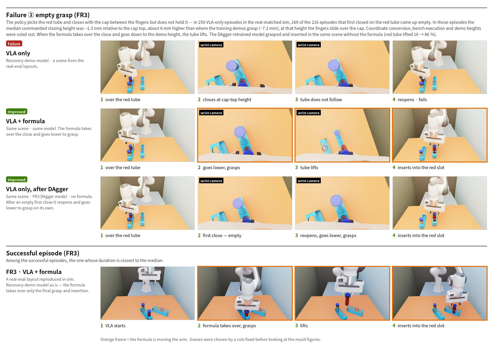
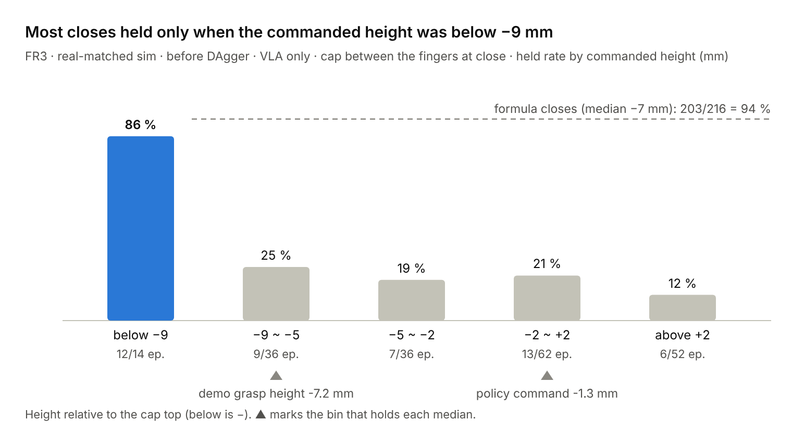
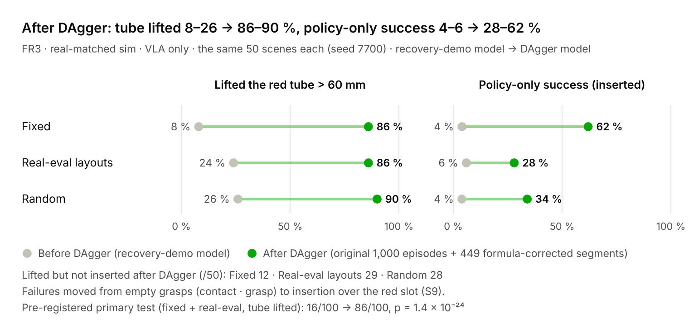

# Report 4 · Section 3 — FR3 Results: VLA Only · DAgger · Formula Finish

2026-11-16 · Franka Research 3 (7-axis arm · two-finger gripper 0–80 mm) · [Overview](../README_EN.md) · [FR5 results](../fr5/README_EN.md) · [한국어](README.md)

The task, sim setup, model names and statistics follow [Overview Section 1](../README_EN.md#1-task--sim-setup--names). The comparisons that need both robots side by side are in [Overview Sections 2 · 3](../README_EN.md#2--3-results-of-the-two-robots-compared). The **"formula"** is the scripted computation (scene sensing → path → inverse kinematics) that generated the demos; in VLA + formula it takes over only the final grasp and insertion.

FR3 policy-only success was 2–6 %. The policy reached the red tube but closed its hand about 6 mm higher than the demos and did not hold it; with the formula taking the final grasp and insertion, success was 64–98 %. After DAgger, episodes that lifted the red tube more than 60 mm went from 16 to 86 %, giving 28–62 % with the policy alone and 86–100 % with the formula (3-4).

- **Representative failure:** 169 of the 216 episodes (78 %) that first closed on the red tube came up empty. The commanded closing height was −1.3 mm relative to the cap top; the demos grasp at −7.2 mm (3-2).
- **Training amount:** on the same 200 episodes, 4× more training samples took success from 0 to 26 % (p = 0.0001) (3-3, initial sim setup).
- **DAgger:** red tube lifted 16 → 86 % (p = 1.4 × 10⁻²⁴). Failures moved from empty grasps to the final insertion, and unlike FR5 there was no color-choice side effect (3-4).
- **VLA + formula:** 64–98 % before DAgger, 86–100 % after (3-5).
- **Sim grasping may be stricter than the real robot:** the sim fingers held the tube only when closing about 7 mm below the cap top (3-6).

## 3-1. Bench success (real-matched sim)

| Layout | Model | VLA only | VLA + formula |
|---|---|---|---|
| Fixed | Base + corrective, recovery | 2 · 2 (4 % each) | 41 · 49 (82 · 98 %) |
| Random | Recovery | 2 (4 %, 1–13) | 39 (78 %, 65–87) |
| Real-eval layouts | Base + corrective, recovery | 1 · 3 (2 · 6 %) | 33 · 32 (66 · 64 %) |
| Fixed | **DAgger** | **31 (62 %, 48–74)** | **50 (100 %, 93–100)** |
| Random | **DAgger** | **17 (34 %, 22–48)** | **45 (90 %, 79–96)** |
| Real-eval layouts | **DAgger** | **14 (28 %, 17–42)** | **43 (86 %, 74–93)** |

- Successes /50. Cells with two values give the two models before DAgger. The DAgger rows are compared in detail in 3-4. Physics is the sim default.
- The first tube the policy went to grasp was red in 35–46/50 (70–92 %). FR3 got stuck at grasping rather than at choosing the color.

## 3-2. Representative failure: empty grasp — closes about 6 mm too high

The FR3 policy reaches the red tube but closes its hand higher than the demos and does not hold it (VLA only, 250 episodes).

- 169 of the 216 episodes (78 %) that first closed on the red tube came up empty. In 140 episodes the hand closed with the cap between the fingers and still came up empty; in 123 of those the fingers slid up over the top of the cap.
- **Closing height (relative to the cap top, median):** commanded by the policy −1.3 mm (quartiles −5 to +2) vs grasped in the training demos −7.2 mm (−8 to −6).
- When the policy closed below −9 mm, 12/14 (86 %) held. Under the same physics, 195/216 (90 %) of formula closes lifted the tube more than 60 mm.
- Ruled out (pre-registered criteria): coordinate conversion (0.000 mm error over 3,572 demo steps), action decoding · inverse kinematics (99 % within 0.48 mm · 0 failures), bench execution (measured − commanded height +0.1 mm), training demos (0 % grasped above −3 mm).
- **Reading:** the demos always go down to the exact height, so "stopped too high, go lower and close" never appears in training. The policy reaches states of its own making that are not in the demos (Figures 5 · 6).

**Figure 5.** FR3 key scenes (real-matched sim · real-eval layouts). Top: with the policy alone the hand closes at cap-top height and the tube does not follow. In the same scene, when the formula takes over the close and goes lower, the tube lifts. Third row: in the same scene, the FR3 DAgger model, with no formula, comes up empty on its first close, then reopens, goes lower, grasps and inserts on its own. Bottom: a successful VLA + formula episode. An orange frame marks frames where the formula is moving the arm.

**Figure 6.** FR3 held rate by closing height (VLA only, 200 episodes · formula, 216 episodes). The median commanded closing height is −1.3 mm, where the held rate is 21 %. Under the same physics, 94 % hold when the formula closes.

## 3-3. Training amount and episode count (initial sim setup)

**On the same 200 episodes, only 4× more training samples took success from 0 to 26 % (p = 0.0001).** Adding episodes alone did nothing.

| Training data | Training samples | Fixed · VLA only | Random · VLA only | Fixed · VLA + formula | Random · VLA + formula |
|---|---|---|---|---|---|
| Base demos, 100 episodes | 0.32 M | 3 (6 %, 2–16) | 0 | — | — |
| Base demos, 200 episodes | 0.32 M | 0 (0 %, 0–7) | 0 | — | — |
| Base demos, 600 episodes | 0.32 M | 1 (2 %, 0–10) | — | — | — |
| **Base demos, 200 episodes** | **1.28 M** | **13 (26 %, 16–40)** | **6 (12 %, 6–24)** | **26 (52 %, 39–65)** | **30 (60 %, 46–72)** |

- The median distance from fingertip to red-cap center at the moment of closing fell from 28 to 12 mm.
- This setup differs from the real-matched one in scene and cameras, so it is not compared directly with 3-1. Why training amount mattered is discussed in [Overview 5-2](../README_EN.md#5-2-training-amount--training-samples-and-epochs).

## 3-4. DAgger (FR3) — fixing the empty-grasp failure

**With DAgger, episodes that lifted the red tube more than 60 mm went from 16 to 86 % (C + T, p = 1 × 10⁻²⁴), and policy-only success rose on all three layouts (C 4 → 62 % · T 6 → 28 % · A 4 → 34 %).** (C = fixed layout, T = real-eval layouts, A = random layout.)

- The FR5 method was applied to the FR3 recovery-demo model. Adding the segments in which the formula went on down to cap height and grasped gave training data of 1,774 demos · 307,598 frames.
- Pre-registered test: VLA only, episodes that lifted the tube more than 60 mm on the fixed layout + real-eval layouts — DAgger vs recovery, Fisher p < 0.05. Success is reported alongside.
- **Primary result — different: red tube lifted more than 60 mm (VLA only, C + T) was 16/100 (16 %, 10–24) for recovery vs 86/100 (86 %, 78–91) for DAgger, p = 1.4 × 10⁻²⁴.**

| Layout | VLA only: recovery → DAgger | p | VLA + formula: recovery → DAgger | p |
|---|---|---|---|---|
| Fixed (C) | 2 → **31 (62 %, 48–74)** | 2.6 × 10⁻¹⁰ | 49 → **50 (100 %, 93–100)** | 1.0 |
| Real-eval layouts (T) | 3 → **14 (28 %, 17–42)** | 0.0064 | 32 → **43 (86 %, 74–93)** | 0.020 |
| Random (A) | 2 → **17 (34 %, 22–48)** | 0.0002 | 39 → **45 (90 %, 79–96)** | 0.17 |

Successes /50 (%, Wilson 95 % interval). The same 50 scenes not used in training (seed 7700). Red tube lifted more than 60 mm (VLA only): C 4 → 43 · T 12 → 43 · A 13 → 45.

**Figure 7.** FR3 tube lifting and policy-only success before and after DAgger (values from 3-4). DAgger fixed FR3's empty grasps: on all three layouts the policy alone lifted the red tube in 86–90 % of episodes. Success is lower, 28–62 %, so the remaining failures are concentrated in the final insertion.

**First stage where it got stuck — VLA-only failures:**

| First failed stage | Recovery C · T · A | DAgger C · T · A |
|---|---|---|
| Choosing the target | 4 · 15 · 5 | 0 · 2 · 0 |
| Alignment | 2 · 3 · 1 | 0 · 3 · 1 |
| Contact · grasp (empty) | 38 · 18 · 31 | 5 · 2 · 3 |
| Lift · carry | 2 · 3 · 1 | 5 · 0 · 3 |
| Insertion | 2 · 8 · 10 | 9 · 29 · 26 |
| Total failures | 48 · 47 · 48 | 19 · 36 · 33 |

Stages follow the same definitions as the real-robot evaluation (S1–S9). "Insertion" means the tube was carried to within 20 mm of the red slot but not inserted.

- **VLA + formula:** still higher than the policy alone with the DAgger model (C 62 → 100 % · T 28 → 86 % · A 34 → 90 %, all p < 10⁻⁶).
- **Failures moved to insertion:** the recovery-demo model mostly came up empty at contact · grasp (C 38 · T 18 · A 31 episodes); the DAgger model carried the tube over the red slot and got stuck inserting (C 9 · T 29 · A 26 episodes).
- **No color-choice side effect:** failures from choosing the wrong target actually fell, C · T · A 4 · 15 · 5 → 0 · 2 · 0. The FR3 policy already went to the red tube most of the time before DAgger, so 212 of the 300 grasp takeovers (71 %) were within 25 mm of the red cap (median 10 mm), and only 32 (11 %) happened on the yellow-cap side. Unlike FR5 (over red 38 % · yellow side 27 %), most segments only corrected the height on the spot, which plausibly kept the habit of moving to another tube from forming. The share of takeovers over the red cap is FR3 71 % vs FR5 38 % (p = 2 × 10⁻¹⁵, a comparison made after seeing the results). The two robots are compared in [Overview Sections 2 · 3](../README_EN.md#dagger--what-it-fixed-on-each-robot-and-the-side-effect).
- **Caution (training amount):** the FR3 DAgger model was trained with batch size 64 (1.28 M training samples), twice the recovery-demo model (batch size 32, 0.64 M). In the initial setup, more training samples alone took success from 0 to 26 % (3-3), so this difference mixes the DAgger-data effect with the training-amount effect.
- **What the two robots share:** DAgger fixed color choice on FR5 and empty grasps on FR3. In both cases the policy learned to correct itself from wrong states of its own making [4]. DAgger was run only once on each robot.

## 3-5. VLA + formula (FR3)

The structure and handoff conditions of the formula are in [Overview Section 4](../README_EN.md#4-both-robots--vla--formula-is-155-the-policy-alone).

- **Real-matched sim:** 64–98 %, more than 10× the policy alone (2–6 %) (3-1). With the DAgger model, 86–100 % (policy alone 28–62 %, 3-4). The policy gets near the red tube in 70–92 % of episodes, so there are many episodes for the formula to take over, and 90 % of formula closes lifted the tube.
- **Adds up with DAgger:** VLA + formula with the DAgger model beats the recovery-demo model (real-eval layouts 64 → 86 %, p = 0.020).
- **Initial sim setup:** fixed 26 → 52 % (p = 0.013), random 12 → 60 % (p < 0.0001) (Appendix A-1).

## 3-6. Differences from the real FR3

- **Robot model:** the sim FR3 uses the Franka Panda model from Isaac Sim. Its kinematics (joint axes · lengths) match FR3; joint ranges and masses differ (e.g. link 6 · 7 masses 1.35 → 1.82 kg, 0.36 → 0.63 kg).
- **Control:** the sim arm uses joint stiffness 400 · damping 80 with gravity off; the real arm uses joint impedance (stiffness 120 down to 10 N·m/rad) with gravity compensation. The sim arm is about 3× stiffer at joints 1–4 and 8–40× at joints 5–7.
- **Grasping:** the sim fingers close under position control (force limit 200 N) and hold by friction only; the real gripper grasps with 70 N. The sim FR3 held the tube only when closing about 7 mm below the cap top (3-2) — the opposite of FR5, possibly stricter than the real robot.
- **Failure shape on the real robot:** in the real FR3 evaluation, too, the policy often chose the right target and closed 1–3 cm off. The formula finish raised success in the same direction (real 30 → 53 %; models and data differ, so this compares levels only).

Reference numbers [ ] follow the [Overview reference list](../README_EN.md#references).
