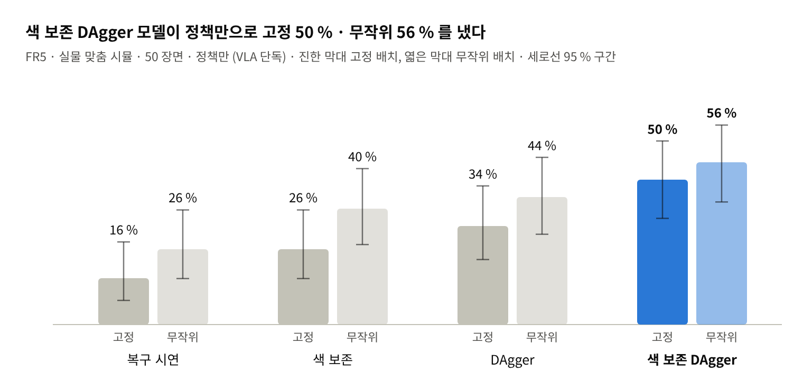
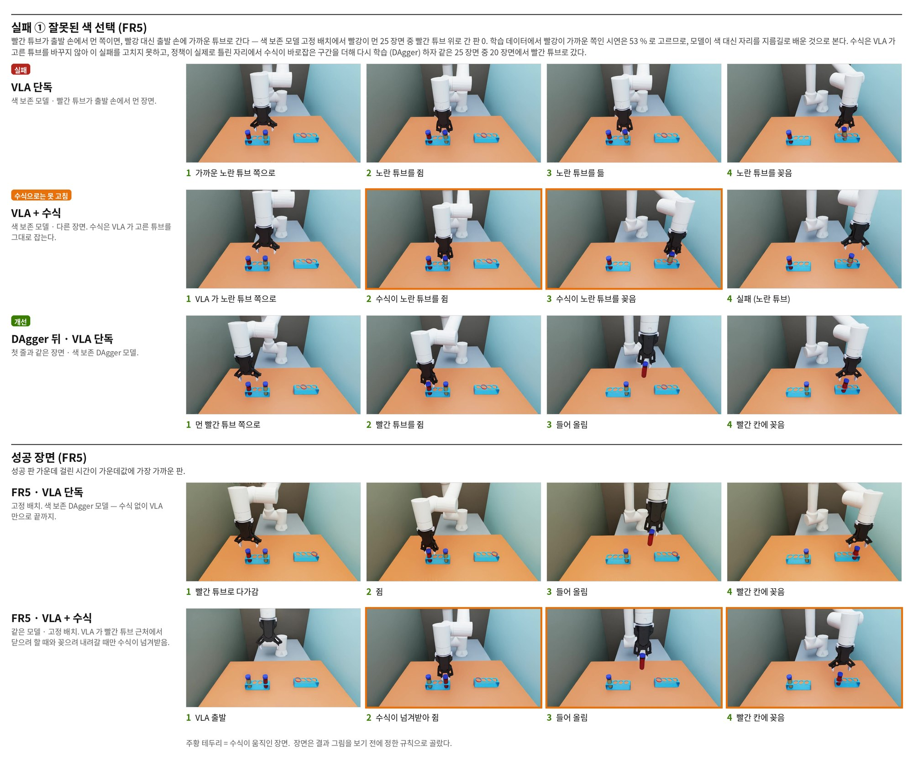
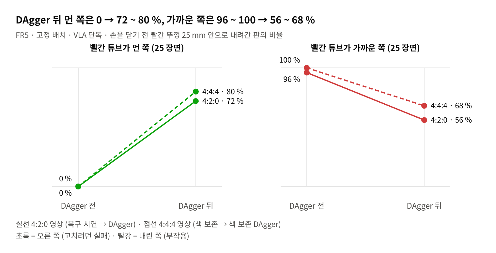

# 보고서 4 · 2절 — FR5 결과: VLA 단독 · DAgger · 수식 마무리

2026-11-16 · FAIRINO FR5 (6축 팔 · 링크식 그리퍼 0 ~ 95 mm) · [통합 문서](../README.md) · [FR3 결과](../fr3/README.md) · [English](README_EN.md)

과제 · 시뮬 설정 · 모델 이름 · 통계 방법은 [통합 문서 1절](../README.md#1-과제--시뮬-설정--이름) 을 따른다. 두 로봇을 함께 본 비교는 [통합 문서 2 · 3절](../README.md#2--3-두-로봇의-결과와-비교) 에 있다.

FR5 정책만의 성공은 DAgger 전 고정 배치 16 ~ 26 % · 무작위 14 ~ 40 % 였고, 색 보존 DAgger 모델에서 50 % · 56 % 로 올랐다. 가장 큰 실패는 빨간 튜브가 출발 손에서 먼 쪽일 때 다른 튜브로 가는 것이었다.

- **대표 실패:** 빨간 튜브가 먼 쪽이면 DAgger 전 다섯 모델이 모두 거의 빨간 튜브로 가지 않았다 (0 ~ 3/25). 색 대신 「출발 손에서 가까운 튜브」 를 지름길로 배운 것으로 본다 (2-2).
- **DAgger:** 먼 쪽 빨강 선택이 0 → 72 ~ 80 % (p ≤ 5 × 10⁻⁸), 정책만 성공률이 고정 26 → 50 % (p = 0.023) 가 되었다. 대신 가까운 쪽 빨강 선택이 96 ~ 100 → 56 ~ 68 % 로 줄었다 (2-3).
- **색 보존:** 학습 영상의 빨강이 벤치 입력의 1/3 ~ 1/4 로 흐려져 있었다. 색 줄임 없이 다시 저장하자 정책만 성공률이 네 비교 모두 10 ~ 16 %p 높았다 (하나하나는 확정 아님, 2-5).
- **VLA + 수식:** 색 보존 DAgger 모델에서 고정 92 % · 무작위 88 % 다 (2-6).
- **시뮬 쥐기는 실물보다 너그러울 수 있다:** 「쥔 동안 붙이기」 보조를 끄면 성공 0/50 이었다 (2-7).

## 2-1. 벤치 성공률 (실물 맞춤 시뮬)

| 모델 | 고정 · VLA 단독 | 무작위 · VLA 단독 | 고정 · VLA + 수식 | 무작위 · VLA + 수식 |
|---|---|---|---|---|
| 기본 · 보정 시연 | 11 (22 %, 13 ~ 35) | 7 (14 %, 7 ~ 26) | 21 (42 %, 29 ~ 56) | — |
| 복구 시연 | 8 (16 %, 8 ~ 29) | 13 (26 %, 16 ~ 40) | 29 (58 %, 44 ~ 71) | 29 (58 %, 44 ~ 71) |
| 색 보존 | 13 (26 %, 16 ~ 40) | 20 (40 %, 28 ~ 54) | 28 (56 %, 42 ~ 69) | 31 (62 %, 48 ~ 74) |
| 실물 팀 혼합 | 8 (16 %, 8 ~ 29) | 12 (24 %, 14 ~ 37) | 19 (38 %, 26 ~ 52) | 32 (64 %, 50 ~ 76) |
| 실물 팀 시뮬 | 12 (24 %, 14 ~ 37) | 9 (18 %, 10 ~ 31) | 23 (46 %, 33 ~ 60) | 29 (58 %, 44 ~ 71) |
| DAgger | 17 (34 %, 22 ~ 48) | 22 (44 %, 31 ~ 58) | 35 (70 %, 56 ~ 81) | 41 (82 %, 69 ~ 90) |
| **색 보존 DAgger** | **25 (50 %, 37 ~ 63)** | **28 (56 %, 42 ~ 69)** | **46 (92 %, 81 ~ 97)** | **44 (88 %, 76 ~ 94)** |

성공 수 /50 (%, Wilson 95 % 구간). — 는 이 보고서 시점에 벤치가 끝나지 않은 칸이다. 물리는 모두 반복 계산을 늘린 FR5 물리 ([통합 1-4](../README.md#1-4-시뮬-설정--배치--실행-조건)) 다. 2-2 ~ 2-5 는 이 표의 줄을 견준다.

**그림 2.** FR5 정책만의 벤치 성공률 (표 2-1 에서). 데이터를 바꿀 때마다 정책만의 성공률이 올랐고, 고정 배치에서는 복구 시연 모델의 약 3 배가 되었다. 확정된 차이는 색 보존 → 색 보존 DAgger (고정, p = 0.023) 다.

## 2-2. 대표 실패: 잘못된 색 선택 — 「가까운 튜브」 로 감

빨간 튜브가 출발 손에서 먼 쪽이면, DAgger 전 다섯 모델이 모두 거의 빨간 튜브로 가지 않았다 (고정 배치 · VLA 단독).

| 모델 | 먼 쪽 25 장면: 빨간 튜브 위로 감 | 가까운 쪽 25 장면: 빨간 튜브 위로 감 |
|---|---|---|
| 기본 · 보정 시연 | 1 | 19 |
| 복구 시연 | 0 | 24 |
| 색 보존 | 0 | 25 |
| 실물 팀 혼합 | 3 | 16 |
| 실물 팀 시뮬 | 0 | 23 |

- 「빨간 튜브 위」 는 손을 닫기 전 가장 낮게 내려간 자리가 빨간 뚜껑 25 mm 안인 판이다.
- 먼 쪽에서는 두 뚜껑 가운데에서 멈추거나 (18 ~ 20 판), 가까운 노란 튜브로 갔다 (복구 시연 17 · 색 보존 15 판).
- **성공률도 갈렸다.** 고정 배치 VLA 단독 성공은 다섯 모델 합쳐 가까운 쪽 48/125 (38 %) 대 먼 쪽 4/125 (3 %) 이다 (p < 0.0001).
- **학습 데이터는 고르다.** 빨간 튜브가 가까운 쪽인 시연이 53 % (배치별 48 ~ 55 %) 다.
- 원인에서 뺀 것 (미리 정한 기준): 벤치 자리의 시연 부족 (0/25 대 0/25, p = 1.0), 학습 영상 색 압축 (색 보존도 0/25), 데이터 치우침 (53 %).
- **읽기:** 데이터는 고른데 정책은 색 대신 「출발 손에서 가까운 튜브」 를 지름길 (shortcut [16]) 로 배웠다. 수식은 정책이 빨간 튜브 근처로 올 때만 넘겨받으므로, 이 실패는 VLA + 수식으로도 고쳐지지 않는다 (그림 3).

**그림 3.** FR5 주요 장면 (실물 맞춤 시뮬 · 고정 배치). 위: 빨간 튜브가 먼 쪽인 장면에서 색 보존 모델이 가까운 노란 튜브를 꽂고, 수식을 더해도 같은 튜브를 꽂는다. 같은 장면에서 색 보존 DAgger 모델은 정책만으로 빨간 튜브를 꽂는다. 아래: 성공 장면 (정책만 · VLA + 수식). 주황 테두리는 수식이 움직인 장면이다.

## 2-3. DAgger — 정책이 틀린 자리에서 바로잡은 구간을 더해 다시 학습

**DAgger 로 정책만의 성공률이 고정 26 → 50 % (p = 0.023) 로 올랐다 (색 보존 모델 → 색 보존 DAgger 모델).**

- **모으기:** 복구 시연 모델을 벤치와 다른 장면 300 판 (고정 계열 150 · 무작위 150) 에서 돌렸다. 수식이 넘겨받아 바로잡은 구간만 잘라 (잡기 300 · 꽂기 297) 원래 데이터에 더했다. 정책이 움직인 구간은 틀린 행동이라 넣지 않았다.
- **학습:** 복구 시연 모델과 같은 조건. 더한 구간은 48,716 프레임 (전체의 약 20 %) 이다.

| 비교 (미리 정함) | 지표 | 앞 → 뒤 | p |
|---|---|---|---|
| DAgger 대 복구 시연 | 먼 쪽 25 장면에서 빨간 튜브 위로 감 (주 판정) | 0 → 18 (0 → 72 %) | 5.3 × 10⁻⁸ |
| 색 보존 DAgger 대 색 보존 | 같은 지표 (주 판정) | 0 → 20 (0 → 80 %) | 2.3 × 10⁻⁹ |
| DAgger 대 복구 시연 | VLA 단독 성공률 · 고정 / 무작위 | 16 → 34 % / 26 → 44 % | 0.063 / 0.057 |
| 색 보존 DAgger 대 색 보존 | 같은 지표 | 26 → 50 % / 40 → 56 % | **0.023** / 0.16 |

- **참고 (결과를 본 뒤 합산):** 고정 + 무작위 100 장면으로 보면 21 → 39 % (p = 0.0084), 33 → 53 % (p = 0.0065) 다.
- **성공이 나는 자리가 바뀌었다.** 색 보존 DAgger 모델의 고정 배치 성공은 먼 쪽 16 · 가까운 쪽 9 판이다 (색 보존 모델은 1 · 12 판).
- **부작용:** 가까운 쪽에서 빨간 튜브 위로 간 판이 줄었다. 24 → 14 (p = 0.002), 25 → 17 이다.
- **부작용의 까닭 (원인 후보):** DAgger 를 모을 때 수식은 늘 빨간 튜브로 간다. 수식이 잡기를 넘겨받은 300 번 가운데 손이 빨간 뚜껑 25 mm 안에 있던 것은 115 번 (38 %) 뿐이고, 82 번 (27 %) 은 노란 뚜껑에 더 가까운 자리 (빨강에서 40 mm 넘게) 에서 넘겨받아 빨간 튜브로 옮겨 갔다. 넘겨받은 자리에서 빨간 뚜껑까지 거리의 중앙값은 34 mm 다. 이렇게 「손 아래 튜브를 떠나 다른 튜브로 가는」 구간이 많이 더해져, 빨강이 가까운 장면에서도 먼 튜브로 가는 판이 생긴 것으로 본다. 미리 정한 기준 (FR5 노랑 쪽 30 % 이상 · FR3 10 % 이하) 에는 못 미쳤으므로 (27 % · 11 %) 확정하지 않는다. FR3 와의 비교는 [통합 문서 2 · 3절](../README.md#dagger--두-로봇에서-고친-것과-부작용) 에 있다.
- **한계:** DAgger 는 한 번만 돌렸다. 구간은 복구 시연 모델의 실패에서 모았고, 색 보존 모델 자신의 실패에서 모은 것은 아니다 (두 모델의 먼 쪽 실패는 같은 0/25).

**그림 4.** FR5 DAgger 전후의 목표 선택 (2-2 · 2-3 의 값). DAgger 는 먼 쪽에서의 「가까운 튜브」 지름길을 고쳤고, 대신 가까운 쪽에서 빨간 튜브로 가는 비율이 줄었다. 영상 방식 (4:2:0 · 4:4:4) 과 상관없이 같은 모양이다.

## 2-4. 학습 데이터 구성 — 확정 차이 없음

| 바꾼 것 | 견준 모델 | p (고정 · 무작위, VLA 단독) |
|---|---|---|
| 복구 시연 추가 (참고) | 복구 시연 대 기본 · 보정 시연 | 0.61 · 0.21 |
| 실물 팀이 모은 시뮬 데이터 | 실물 팀 시뮬 대 기본 · 보정 시연 | 1.0 · 0.79 |
| 실물 영상 섞기 | 실물 팀 혼합 대 기본 · 보정 시연 | 0.61 · 0.31 |

데이터 구성을 바꿔도 FR5 정책만의 성공률은 고정 16 ~ 26 % · 무작위 14 ~ 40 % 안에서 서로 다르다고 못 했다 (2-1).

## 2-5. 학습 영상의 색 — 색 보존

FR5 학습 데이터는 실물 FR5 데이터와 같은 형식으로 바꿨다. 848×480 영상을 256×256 으로 줄이고 H.264 (CRF 18) [19] 로 저장한다. 이때 크로마 서브샘플링 4:2:0 은 색 정보를 가로 · 세로 절반 해상도로만 남긴다. 벤치에서 모델에 넣는 화면은 압축하지 않는다.

**잰 것 — 출발 화면의 뚜렷한 빨간 화소 수** (256×256, 고정 배치 빨간 튜브 왼쪽 · 오른쪽; 뚜렷한 빨강 = R ≥ 100 이고 G · B 가 R 의 0.55 배 아래):

| 화면 | 3인칭 | 손목 |
|---|---|---|
| 벤치 입력 (압축 없음) | 60 · 57 | 87 · 79 |
| 학습 영상 4:2:0 | 19 · 27 | 21 · 21 |
| 학습 영상 4:4:4 (색 보존) | 37 · 49 | 69 · 73 |

4:2:0 학습 영상의 빨강은 벤치 입력의 1/3 ~ 1/4 이었다. 크로마 서브샘플링을 하지 않는 4:4:4 로 저장하자 벤치 입력에 가까워졌다. 두 모델은 이것 말고는 데이터 · 학습이 같다.

**결과 — VLA 단독 성공률, 영상 방식만 다름:**

| 모델 · 배치 | 4:2:0 | 4:4:4 (색 보존) | p |
|---|---|---|---|
| DAgger 없음 · 고정 | 16 % | 26 % | 0.33 |
| DAgger 없음 · 무작위 | 26 % | 40 % | 0.20 |
| DAgger · 고정 | 34 % | 50 % | 0.16 |
| DAgger · 무작위 | 44 % | 56 % | 0.32 |

- **읽기:** 네 비교 모두 4:4:4 가 10 ~ 16 %p (5 ~ 8 판) 높다. 하나하나는 p ≥ 0.05 라 통계로 확정되지 않았고, 「같은 방향으로 네 번 나왔다」 까지 말할 수 있다.
- **같이 볼 것 — 물리 튐:** VLA 단독 물리 튐도 4:4:4 쪽이 적었다 (위 네 줄 차례 9 → 2, 9 → 1, 9 → 5, 4 → 1 판). 튐은 실패로 세므로, 성공 차이의 일부는 튐 차이일 수 있다.
- **고치지 못한 것:** 먼 쪽에서 빨간 튜브로 간 판은 4:4:4 도 0/25 였다. 색을 더 뚜렷하게 보여 줘도 「가까운 튜브」 지름길은 남았고, 이것은 DAgger 가 고쳤다 (2-3).

## 2-6. VLA + 수식 (FR5)

수식의 구조 · 넘김 조건은 [통합 문서 4절](../README.md#4-두-로봇-공통--vla--수식은-정책만의-15--5-배) 에 있다. FR5 는 15 쌍 중 14 쌍에서 VLA + 수식이 정책만보다 확정적으로 높았다 (부록 A-2).

- **성공률:** DAgger 전 다섯 모델에서 고정 38 ~ 58 % · 무작위 58 ~ 64 %, 색 보존 DAgger 모델에서 고정 92 % · 무작위 88 % 다 (2-1).
- **DAgger 와 더해짐:** 색 보존 DAgger 모델의 VLA + 수식은 색 보존 모델보다 높다 (고정 56 → 92 %, p = 0.0001 · 무작위 62 → 88 %, p = 0.005). 영상 방식만 다른 DAgger 모델끼리는 고정 70 대 92 % (p = 0.0095) 로 4:4:4 가 높았고 (무작위 82 대 88 %, p = 0.58), DAgger 없이는 차이가 없었다 (고정 58 대 56 %).
- **한계:** 수식은 정책이 고른 튜브를 바꾸지 않는다. 정책이 노란 튜브로 가면 수식도 노란 튜브를 잡아 꽂는다 (그림 3 둘째 줄). DAgger 는 「무엇을 잡나」 를, 수식은 「마지막 mm」 를 고친다.

## 2-7. 실물 FR5 와의 차이

실물 데이터만으로 학습한 FR5 모델은 시뮬 벤치에서 성공률 0 ~ 4 % 였다. 시뮬 벤치는 실물 모델을 평가하는 도구가 아니고, 같은 시뮬 · 같은 물리 안에서 모델끼리 견주는 도구로 쓴다 ([통합 6절](../README.md#6-실물과의-비교--real-to-sim-한계)).

- **실물만 모델의 시뮬 성공률:** 어느 시뮬 설정에서도 VLA 단독 0 ~ 1/50 (0 ~ 2 %), VLA + 수식 0 ~ 4/50 (0 ~ 8 %) 이다. 닫기 거리는 43 ~ 64 mm 로, 튜브 근처에 가지 못한다.
- **목표 선택:** 처음 간 튜브가 빨강인 비율이 76/150 (51 %) 로 반반 수준이다 (복구 시연 모델 95/150, 63 %). 실물 영상을 섞은 실물 팀 혼합 모델은 74 ~ 96 % 다.
- **자리 어긋남:** 고정 배치에서 실물만 모델이 내려간 자리는 뚜껑에서 일정하게 (+46, +11) mm, 약 47 mm 어긋났다. 실물 화면 · 좌표로 배운 것이 시뮬 화면에서 그대로 옮겨지지 않는다.
- **시뮬 그리퍼와 실물의 차이:**
  - 팔과 그리퍼의 기하는 제조사 값과 맞는다 (관절 치수 0.1 mm 안, 패드 벌림 95.07 대 95 mm).
  - 제조사 모델의 그리퍼 링크 연동은 Newton 물리 형식으로만 적혀 있어, PhysX 기반의 이 시뮬에서는 작동하지 않는다. 그래서 바깥 너클만 구동하고 나머지는 따라가게 두었다. 실물은 모터 하나가 링크 기구를 움직인다. PhysX 가 지키는 연동으로 바꿔 돌려도 (색 보존 DAgger · 고정 배치 · VLA + 수식) 성공은 41/50 대 43/50 (p = 0.79) 으로 다르지 않았고, 원래 방식의 연동 어긋남도 0.01° 였다.
  - 시뮬에는 「쥔 동안 붙이기」 보조 (25 mm) 가 있다. 벌림 방향으로 5 ~ 25 mm 빗나가도 71/76 이 들렸다. 시뮬 쥐기는 실물보다 너그러울 수 있다. 이 보조를 끄고 돌리면 (색 보존 DAgger · 고정 배치 · VLA + 수식) 튜브를 60 mm 넘게 든 판은 45/50 으로 같았지만, 옮기는 중에 튜브를 놓쳐 성공은 0/50 이었다 (켜면 43/50). 시뮬 FR5 성공률은 이 보조에 기대고 있다.
  - 접촉 계산 오류로 물체가 튀는 일이 있어, 관절 풀이 반복을 늘린 물리를 썼다 (튐은 실패로 셈).

참고문헌 번호 [ ] 는 [통합 문서의 참고문헌](../README.md#참고문헌) 을 따른다.
