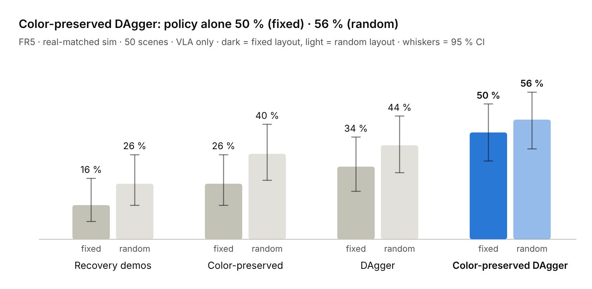
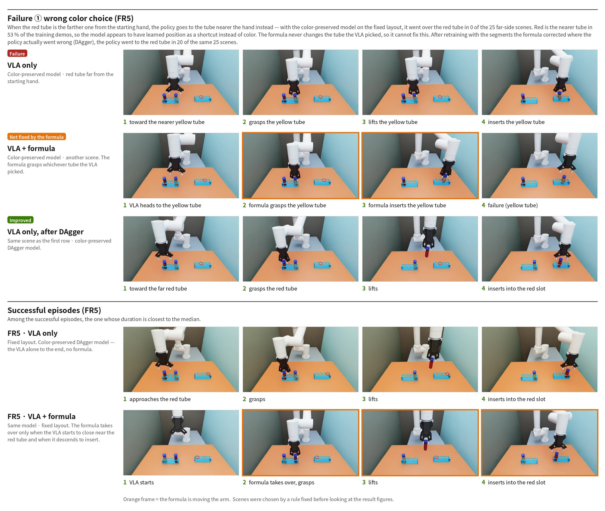
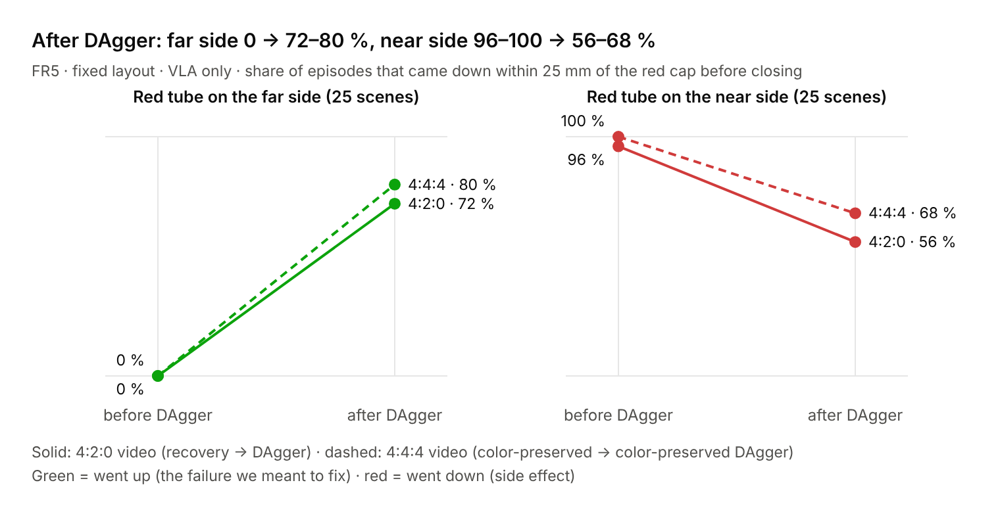

# Report 4 · Section 2 — FR5 Results: VLA Only · DAgger · Formula Finish

2026-11-16 · FAIRINO FR5 (6-axis arm · linkage gripper 0–95 mm) · [Overview](../README_EN.md) · [FR3 results](../fr3/README_EN.md) · [한국어](README.md)

The task, sim setup, model names and statistics follow [Overview Section 1](../README_EN.md#1-task--sim-setup--names). The comparisons that need both robots side by side are in [Overview Sections 2 · 3](../README_EN.md#2--3-results-of-the-two-robots-compared). The **"formula"** is the scripted computation (scene sensing → path → inverse kinematics) that generated the demos; in VLA + formula it takes over only the final grasp and insertion.

FR5 policy-only success was 16–26 % on the fixed layout and 14–40 % on the random layout before DAgger, and rose to 50 % and 56 % with the color-preserved DAgger model. The biggest failure was going to the other tube when the red tube was the farther one from the starting hand.

- **Representative failure:** with the red tube on the far side, all five models before DAgger almost never went to it (0–3/25). They appear to have learned "the tube nearer the starting hand" as a shortcut instead of color (2-2).
- **DAgger:** far-side red choice rose 0 → 72–80 % (p ≤ 5 × 10⁻⁸), and policy-only success on the fixed layout 26 → 50 % (p = 0.023). In exchange, near-side red choice fell 96–100 → 56–68 % (2-3).
- **Color preservation:** red in the training video was faded to 1/3–1/4 of the bench input. Re-saving without chroma reduction raised policy-only success by 10–16 percentage points in all four comparisons (none confirmed alone, 2-5).
- **VLA + formula:** fixed 92 % · random 88 % with the color-preserved DAgger model (2-6).
- **Sim grasping may be more lenient than the real robot:** with the "attach while grasped" assist off, success was 0/50 (2-7).

## 2-1. Bench success (real-matched sim)

| Model | Fixed · VLA only | Random · VLA only | Fixed · VLA + formula | Random · VLA + formula |
|---|---|---|---|---|
| Base + corrective | 11 (22 %, 13–35) | 7 (14 %, 7–26) | 21 (42 %, 29–56) | — |
| Recovery | 8 (16 %, 8–29) | 13 (26 %, 16–40) | 29 (58 %, 44–71) | 29 (58 %, 44–71) |
| Color-preserved | 13 (26 %, 16–40) | 20 (40 %, 28–54) | 28 (56 %, 42–69) | 31 (62 %, 48–74) |
| Real-team mixed | 8 (16 %, 8–29) | 12 (24 %, 14–37) | 19 (38 %, 26–52) | 32 (64 %, 50–76) |
| Real-team sim | 12 (24 %, 14–37) | 9 (18 %, 10–31) | 23 (46 %, 33–60) | 29 (58 %, 44–71) |
| DAgger | 17 (34 %, 22–48) | 22 (44 %, 31–58) | 35 (70 %, 56–81) | 41 (82 %, 69–90) |
| **Color-preserved DAgger** | **25 (50 %, 37–63)** | **28 (56 %, 42–69)** | **46 (92 %, 81–97)** | **44 (88 %, 76–94)** |

Successes /50 (%, Wilson 95 % interval). — marks a bench that had not finished when this report was written. All rows use the higher-iteration FR5 physics ([Overview 1-4](../README_EN.md#1-4-sim-setup--layouts--run-conditions)). Sections 2-2 to 2-5 compare rows of this table.

**Figure 2.** FR5 policy-only bench success (from table 2-1). Each data change raised policy-only success, reaching about 3× the recovery-demo model on the fixed layout. The confirmed difference is color-preserved → color-preserved DAgger (fixed, p = 0.023).

## 2-2. Representative failure: wrong color — goes to the "nearer tube"

With the red tube on the far side from the starting hand, all five models before DAgger almost never went to the red tube (fixed layout · VLA only).

| Model | 25 far-side scenes: went over the red tube | 25 near-side scenes: went over the red tube |
|---|---|---|
| Base + corrective | 1 | 19 |
| Recovery | 0 | 24 |
| Color-preserved | 0 | 25 |
| Real-team mixed | 3 | 16 |
| Real-team sim | 0 | 23 |

- "Over the red tube" means the lowest point reached before closing the hand was within 25 mm of the red cap.
- On the far side the policy either stopped between the two caps (18–20 episodes) or went to the nearer yellow tube (recovery 17 · color-preserved 15 episodes).
- **Success split the same way.** Fixed-layout VLA-only success over the five models was 48/125 (38 %) on the near side vs 4/125 (3 %) on the far side (p < 0.0001).
- **The training data is balanced.** Red is the nearer tube in 53 % of demos (48–55 % per layout).
- Ruled out (pre-registered criteria): too few demos at the bench positions (0/25 vs 0/25, p = 1.0), chroma compression of the training video (color-preserved is also 0/25), data imbalance (53 %).
- **Reading:** the data is balanced, but the policy learned "the tube nearer the starting hand" as a shortcut [16] instead of color. The formula takes over only when the policy comes near the red tube, so VLA + formula does not fix this failure either (Figure 3).

**Figure 3.** FR5 key scenes (real-matched sim · fixed layout). Top: in a far-side scene the color-preserved model inserts the nearer yellow tube, and with the formula it inserts the same tube. In the same scene the color-preserved DAgger model inserts the red tube with the policy alone. Bottom: successful episodes (policy only · VLA + formula). An orange frame marks frames where the formula is moving the arm.

## 2-3. DAgger — retraining with segments corrected where the policy went wrong

**DAgger raised policy-only success on the fixed layout from 26 to 50 % (p = 0.023) (color-preserved model → color-preserved DAgger model).**

- **Collection:** the recovery-demo model was run on 300 scenes different from the bench (150 fixed-type · 150 random). Only the segments the formula took over and corrected (300 grasp · 297 insertion) were cut out and added to the original data. The policy-driven segments are wrong actions and were left out.
- **Training:** same settings as the recovery-demo model. The added segments are 48,716 frames (about 20 % of the total).

| Comparison (pre-registered) | Metric | Before → after | p |
|---|---|---|---|
| DAgger vs recovery | Went over the red tube in the 25 far-side scenes (primary) | 0 → 18 (0 → 72 %) | 5.3 × 10⁻⁸ |
| Color-preserved DAgger vs color-preserved | Same metric (primary) | 0 → 20 (0 → 80 %) | 2.3 × 10⁻⁹ |
| DAgger vs recovery | VLA-only success · fixed / random | 16 → 34 % / 26 → 44 % | 0.063 / 0.057 |
| Color-preserved DAgger vs color-preserved | Same metric | 26 → 50 % / 40 → 56 % | **0.023** / 0.16 |

- **Post hoc (pooled after seeing the results):** over fixed + random, 100 scenes, 21 → 39 % (p = 0.0084) and 33 → 53 % (p = 0.0065).
- **Where success happens moved.** Fixed-layout successes of the color-preserved DAgger model are 16 far-side · 9 near-side (color-preserved model: 1 · 12).
- **Side effect:** near-side episodes that went over the red tube fell, 24 → 14 (p = 0.002) and 25 → 17.
- **Why the side effect (candidate cause):** during DAgger collection the formula always goes to the red tube. Of the 300 grasp takeovers, only 115 (38 %) happened with the hand within 25 mm of the red cap; 82 (27 %) happened closer to the yellow cap (more than 40 mm from red) and moved over to the red tube. The median distance from the takeover point to the red cap was 34 mm. Many added segments therefore "leave the tube under the hand and move to another tube", which plausibly made the policy go to the far tube even in scenes where red is nearer. The pre-registered criteria (FR5 yellow side ≥ 30 % · FR3 ≤ 10 %) were not met (27 % · 11 %), so this is not confirmed. The comparison with FR3 is in [Overview Sections 2 · 3](../README_EN.md#dagger--what-it-fixed-on-each-robot-and-the-side-effect).
- **Limit:** DAgger was run once. The segments came from the failures of the recovery-demo model, not from the color-preserved model's own failures (both failed 0/25 on the far side).

**Figure 4.** FR5 target choice before and after DAgger (values from 2-2 · 2-3). DAgger fixed the "nearer tube" shortcut on the far side and, in exchange, lowered the share that went to the red tube on the near side. The shape is the same for both video formats (4:2:0 · 4:4:4).

## 2-4. Training-data composition — no confirmed difference

| What changed | Models compared | p (fixed · random, VLA only) |
|---|---|---|
| Added recovery demos (post hoc) | Recovery vs base + corrective | 0.61 · 0.21 |
| Sim data collected by the real-robot team | Real-team sim vs base + corrective | 1.0 · 0.79 |
| Mixing in real video | Real-team mixed vs base + corrective | 0.61 · 0.31 |

Whatever the data composition, FR5 policy-only success stayed within fixed 16–26 % · random 14–40 % and could not be shown to differ (2-1).

## 2-5. Color in the training video — color preservation

FR5 training data was converted to the same format as the real FR5 data: 848×480 video is resized to 256×256 and stored as H.264 (CRF 18) [19]. Chroma subsampling 4:2:0 keeps color at half resolution horizontally and vertically. The images fed to the model on the bench are not compressed.

**Measured — number of clearly red pixels in the first frame** (256×256, fixed layout with the red tube on the left · right; clearly red = R ≥ 100 and G, B below 0.55 × R):

| Image | Third-person | Wrist |
|---|---|---|
| Bench input (uncompressed) | 60 · 57 | 87 · 79 |
| Training video 4:2:0 | 19 · 27 | 21 · 21 |
| Training video 4:4:4 (color-preserved) | 37 · 49 | 69 · 73 |

Red in the 4:2:0 training video was 1/3–1/4 of the bench input. Saving as 4:4:4, with no chroma subsampling, brought it close to the bench input. Apart from this the two models share the same data and training.

**Result — VLA-only success, only the video format differs:**

| Model · layout | 4:2:0 | 4:4:4 (color-preserved) | p |
|---|---|---|---|
| No DAgger · fixed | 16 % | 26 % | 0.33 |
| No DAgger · random | 26 % | 40 % | 0.20 |
| DAgger · fixed | 34 % | 50 % | 0.16 |
| DAgger · random | 44 % | 56 % | 0.32 |

- **Reading:** 4:4:4 is 10–16 percentage points (5–8 episodes) higher in all four comparisons. Each is p ≥ 0.05 and not statistically confirmed; what can be said is "the same direction four times".
- **Also note — physics pops:** VLA-only physics pops were also fewer with 4:4:4 (in the four rows above: 9 → 2, 9 → 1, 9 → 5, 4 → 1 episodes). Pops count as failures, so part of the success difference may be a pop difference.
- **Not fixed:** episodes that went to the red tube on the far side were still 0/25 with 4:4:4. Showing color more clearly did not remove the "nearer tube" shortcut; DAgger did (2-3).

## 2-6. VLA + formula (FR5)

The structure and handoff conditions of the formula are in [Overview Section 4](../README_EN.md#4-both-robots--vla--formula-is-155-the-policy-alone). On FR5, VLA + formula beat the policy alone in a confirmed way in 14 of 15 pairs (Appendix A-2).

- **Success:** fixed 38–58 % · random 58–64 % for the five models before DAgger; fixed 92 % · random 88 % for the color-preserved DAgger model (2-1).
- **Adds up with DAgger:** VLA + formula on the color-preserved DAgger model beats the color-preserved model (fixed 56 → 92 %, p = 0.0001 · random 62 → 88 %, p = 0.005). Between the two DAgger models that differ only in video format, 4:4:4 was higher on fixed, 70 vs 92 % (p = 0.0095; random 82 vs 88 %, p = 0.58); without DAgger there was no difference (fixed 58 vs 56 %).
- **Limit:** the formula never changes the tube the policy chose. If the policy goes to the yellow tube, the formula grasps and inserts the yellow tube (Figure 3, second row). DAgger fixes "what to grasp"; the formula fixes "the last millimeters".

## 2-7. Differences from the real FR5

An FR5 model trained on real data only scored 0–4 % on the sim bench. The sim bench is not a tool for evaluating real-robot models; it is used to compare models within the same sim and the same physics ([Overview Section 6](../README_EN.md#6-comparison-with-the-real-robots--real-to-sim-limits)).

- **Sim success of the real-only model:** in every sim setup, VLA only 0–1/50 (0–2 %), VLA + formula 0–4/50 (0–8 %). Closing distance was 43–64 mm; it never got near a tube.
- **Target choice:** the first tube it went to was red in 76/150 (51 %), about a coin flip (recovery-demo model 95/150, 63 %). The real-team mixed model, which mixes in real video, scored 74–96 %.
- **Position offset:** on the fixed layout, the real-only model came down at a consistent (+46, +11) mm from the cap, about 47 mm off. What it learned from real images and coordinates does not carry over unchanged to sim images.
- **Sim gripper vs the real one:**
  - The arm and gripper geometry match the manufacturer's values (joint dimensions within 0.1 mm, pad opening 95.07 vs 95 mm).
  - The manufacturer model's gripper linkage coupling is written only in the Newton physics format, so it does not work in this PhysX-based sim. Only the outer knuckles are driven and the rest follow. On the real robot a single motor drives the linkage. Running with a PhysX-enforced coupling instead (color-preserved DAgger · fixed layout · VLA + formula) gave 41/50 vs 43/50 (p = 0.79), no difference, and the original setup's coupling error was 0.01°.
  - The sim has an "attach while grasped" assist (25 mm). Even 5–25 mm off along the opening direction, 71/76 lifted, so sim grasping may be more lenient than the real robot. With the assist off (color-preserved DAgger · fixed layout · VLA + formula), episodes that lifted the tube more than 60 mm stayed at 45/50, but the tube was dropped while carrying and success was 0/50 (43/50 with it on). Sim FR5 success depends on this assist.
  - Contact errors sometimes make objects pop, so higher solver-iteration physics was used (pops count as failures).

Reference numbers [ ] follow the [Overview reference list](../README_EN.md#references).
