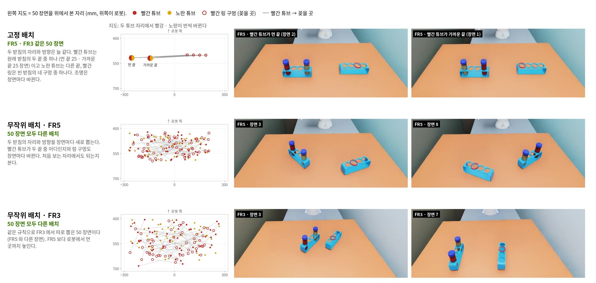
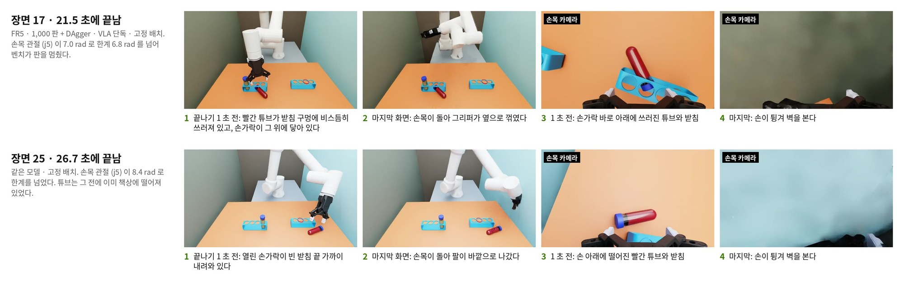
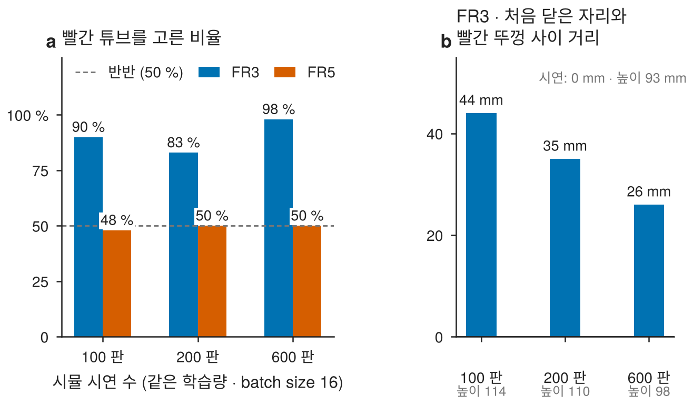
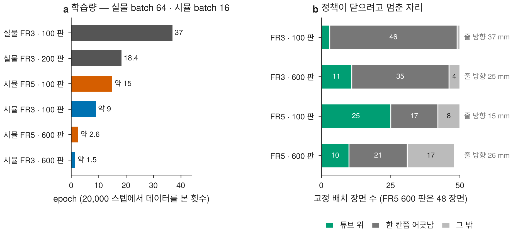

# 보고서 5 — 진행 기록 11-10 \~ 11-12: 본 벤치와 중단 — 물리 튐 규칙, 단계별 진단, 학습량, 워크스테이션 속도

2026-11-10 (화) \~ 11-12 (목) 저녁 · Sim-to-Real Post-Training (시뮬레이션 파트) · Isaac Sim 6.0.1 · Isaac Lab 3.0 · GR00T N1.7 · [English](README_EN.md)

이 문서는 [보고서 3](../report03_realmatched_data/README.md) 뒤부터 [보고서 4](../report04_sim_bench/README.md) 의 결과가 나오기까지 사이에 있었던 일을 날짜 순서로 적은 기록입니다. 보고서 4 가 최종 숫자를 모은 결과 보고서라면, 이 기록은 **그 숫자에 이르는 동안 무엇을 보고, 무엇을 의심하고, 어떻게 확인해 무엇을 바꿨는지**를 남깁니다.

## 요약

- **본 벤치를 돌렸다.** 시뮬 시연으로 학습한 모델 6 개 (FR3 · FR5 × 100 · 200 · 600 판) 와 실물 데이터로 이어 학습한 모델 2 개를, 학습에 없던 같은 50 장면에서 쟀다. 고정 배치 성공은 FR5 0 \~ 12/50, FR3 0 \~ 3/50 으로 낮았고, **데이터를 늘릴수록 오히려 내려갔다.**
- **「물리 튐」 규칙을 정했다 (11-10).** FR5 에서 시뮬 물리가 깨져 관절 값이 숫자가 아니게 되는 판이 있었다. 이런 판을 세지 않고 다시 하던 것을 고쳐, **튄 판은 실패로 세고 장면마다 첫 판만 센다.**
- **단계별로 나눠 보니 두 로봇의 병목이 달랐다 (11-11).** FR5 는 어느 튜브로 갈지 고르는 단계 (빨강을 고른 비율 약 50 % — 동전 던지기 수준), FR3 는 마지막 내려가기 · 쥐기 단계 (빨강은 83 \~ 98 % 고르지만 뚜껑에서 26 \~ 44 mm 옆 · 높은 곳에서 닫음).
- **가장 큰 원인은 학습량이었다 (11-12).** 학습 방식은 실물 팀과 같았지만 batch size 가 16 (실물 64) 이라, 같은 20,000 스텝에서 데이터를 보는 횟수 (epoch) 가 실물의 1/4 \~ 1/12 였다. 큰 데이터일수록 덜 배운 모습과 맞는다.
- **정책은 랙은 찾지만 구멍 한 칸을 틀렸다.** 멈춘 자리를 랙 줄 방향 · 가로 방향으로 나누면 가로는 맞고 줄 방향으로 약 한 칸 (37 mm) 어긋났다. 학습 데이터 배치 · 변환 · 벤치 연결의 오류는 아니었다.
- **본 벤치를 멈추고 개선 실험으로 바꿨다 (11-12 16:10).** 남은 칸은 낮게 나올 것이 뻔해, 남은 시간을 개선점을 찾는 데 쓰기로 했다.
- **벤치가 느렸던 까닭은 워크스테이션 상태였다.** CPU 시계가 느린 예비 시계로 바뀌고 큰 메모리 쓰기가 초당 0.7 GB 로 묶여 있었다. 다시 켜자 정상이 됐다. 벤치 쪽에서는 기록 영상 넘기기를 고쳐 주 스레드 시간을 줄였다.

## 0. 이 기록에서 쓰는 말

| 말 | 뜻 |
|---|---|
| 본 벤치 | 모델 8 개 × 배치 셋 (고정 · 무작위 · 튜브 자리도 무작위) 을 50 장면씩 차례로 재던 벤치 |
| 고정 배치 (C) | 두 랙 자리를 고정하고 빨간 튜브가 랙의 한쪽 끝 또는 반대쪽 끝에 놓이는 50 장면 |
| 무작위 배치 (A) | 두 랙의 자리 · 방향이 장면마다 바뀌는 50 장면 (튜브는 랙 양 끝) |
| 튜브 자리도 무작위 (B) | 무작위 배치에 더해 튜브도 랙의 아무 구멍에 놓이는 장면 |
| 100 판 모델 · 200 판 모델 · 600 판 모델 | 시뮬 자동 시연 100 · 200 · 600 판으로 학습한 모델 (보고서 3 의 실물 설정 데이터) |
| 실물 이어 학습 모델 | 시뮬 600 판 모델에서 실물 200 판으로 이어 학습한 모델 |
| 물리 튐 | 시뮬 접촉 계산이 깨져 관절 값이 갑자기 커지고 숫자가 아니게 (NaN) 되는 판 |
| batch size | 학습 한 번에 넣는 표본 수 |
| epoch | 학습 데이터 전체를 몇 번 보았는지 = 스텝 × batch size ÷ 데이터 프레임 수 |
| action chunk | 정책이 한 번에 내놓는 행동 16 칸 (10 Hz 로 1.6 초) |

**그림 1.** 벤치의 두 배치. 위 = 고정 배치 (두 받침의 자리 · 방향이 늘 같고, 빨간 튜브는 한쪽 끝 또는 반대쪽 끝), 아래 둘 = 무작위 배치 (받침의 자리 · 방향이 장면마다 바뀜). 왼쪽 지도는 50 장면을 위에서 본 자리다. 사진 · 지도는 뒤 기간 ([보고서 7](../report07_sim2real_1000/README.md) 이후) 의 실물 맞춤 시뮬 장면이라 이 기간 벤치와 카메라 · 작업 영역이 조금 다르지만, 두 배치를 만드는 규칙은 같다.

## 1. 11-10 (화) — 물리 튐을 실패로 세기로

**현상.** 오후 점검에서 FR5 정책 서버 둘이 「입력 오류」 를 27 번 보고했다. 시뮬이 숫자가 아닌 상태를 보낸 것이다. 그때의 벤치 프로그램 (장면 여러 개 수집기 1.2) 은 이를 서버 오류로 보고 그 판을 세지 않은 채 같은 장면을 다시 했다.

| 벤치 | 센 판 | 세지 않고 다시 한 판 |
|---|---|---|
| FR3 (11-03 \~ 05, 전부) | 66 | 0 |
| FR5 100 판 모델 · 고정 배치 | 50 | 26 |
| FR5 200 판 모델 · 고정 배치 (도는 중) | 32 | 29 |

**확인.** 버린 판 55 개의 기록을 열어 보았다.

- 관절 명령은 부드러웠다. 마지막 2 초 동안 스텝마다 0.001 \~ 0.005 rad 씩만 바뀌었다.
- 그런데 실제 관절이 1 \~ 3 스텝 만에 명령에서 벗어나 튀었고, 다음 스텝에 수십 rad 가 된 뒤 숫자가 아니게 됐다.
- 먼저 튄 관절은 손목 (j5 42 번 · j4 7 · j1 5 · j6 1) 이고, 튀기 직전 손끝 높이는 가운데 27 mm 였다 (쥐는 높이 약 93 mm).
- 정책이 손을 책상 · 랙 높이까지 눌러 내리는 실수는 두 로봇 모두 흔했다. FR3 는 물리가 버티고, FR5 (AG-95 그리퍼 모델) 는 가끔 튀었다.
- 성공한 판은 손끝이 65 mm 아래로 내려간 적이 없다. 실물이었다면 책상이나 랙에 부딪혀 보호 정지가 걸렸을 판이다.

**결정 (사용자 11-10 17:37).** 물리가 튄 판은 실패로 센다 (끝난 까닭 「물리 튐」). 장면마다 첫 판만 센다. 예전 규칙은 FR5 에만 부딪힌 뒤 한 번 더 기회를 준 셈이었다. 이 규칙으로 그날 낮에 끝난 FR5 100 판 모델 고정 배치 벤치를 다시 세면 12/50 이 6/50 (첫 판: 성공 6 · 실패 25 · 물리 튐 19) 이 된다.

**그림 2.** 물리 튐의 예. 손가락이 받침 · 튜브에 닿은 채 손목 관절 (j5) 이 한계 6.8 rad 를 넘어 벤치가 판을 멈춘 두 장면이다. 사진은 뒤 기간의 FR5 벤치 (1,000 판 + DAgger 모델) 에서 찍었지만, 이 기간에 본 것과 같은 현상이다.

**고친 것.** 벤치가 스텝마다 관절이 모두 숫자인지, |q| ≤ 6.8 rad 인지, |q̇| ≤ 25 rad/s 인지 본다 (정상 벤치 · 시연은 2.9 rad · 2.4 rad/s 까지). 넘으면 그 장면은 그 스텝부터 정책에 묻지 않고 「물리 튐」 실패로 저장한다. 이 판정은 그날 저녁 벤치부터 들어갔고, 이미 돈 벤치는 같은 규칙으로 다시 세는 도구를 따로 두었다.

- 파일: 장면 여러 개 수집기 1.3 (`lab/common_collect_multi.py`), 다시 세기 `tools/common_bench_recount.py` 1.0 (읽기만). 결과 줄의 `nan` 에 튄 시각 · 먼저 튄 관절 · 바로 앞 손끝 높이를 남김.
- 그날 아침 서버의 「SVD did not converge」 오류도 같은 NaN 이 모델에 들어간 것이었다. 서버 1.3 부터 정상 입력에서 다시 물은 횟수는 0.
- 같은 밤: 실물 FR3 200 판을 실물 팀의 변환 스크립트로 GR00T 형식 (v2.1) 으로 바꿔 학습 서버로 보내고, 시뮬 600 판 모델에서 이어 학습 (FR5 · FR3) 했다. 벤치 · 학습 · 터널은 화면 세션과 떼어 두어 화면이 죽어도 꺼지지 않게 했다.

## 2. 11-11 (수) — 단계별 진단: 두 로봇의 병목이 다르다

고정 배치 50 장면의 결과를 정책이 일하는 단계 (입력 → 어느 튜브로 갈지 → 어디로 내려갈지 → 제어 → 물리, 그리고 학습) 로 나눠 쟀다.

| 단계 | FR3 (100 / 200 / 600 판 모델) | FR5 (100 / 200 / 600 판 모델) |
|---|---|---|
| 입력 (화면 · 지시문 · 상태) | 정상 | 정상 |
| 어느 튜브로 (빨강을 고른 비율) | 90 / 83 / 98 % | **48 / 50 / 50 %** — 색을 쓰지 않고 늘 같은 쪽 끝으로 감 (98 \~ 100 %) |
| 어디로 내려가나 (처음 닫은 자리 · 높이) | **빨강에서 44 / 35 / 26 mm 옆, 높이 114 / 110 / 98 mm** (시연 0 mm · 93 mm). 어긋남에 방향이 없음 | 끝을 잘못 골라 판단 못 함 |
| 제어 (명령 → 실제 관절) | 정상 (손끝 차 1 \~ 2 mm) | 정상 |
| 물리 | 정상 | 쥔 뒤 들다가 놓침, 600 판 모델은 물리 튐 33 판 |
| 학습 (마지막 손실) | 0.0131 / 0.0170 / 0.0175 | 0.0140 / 0.0164 / 0.0189 |

**그림 3.** 단계별 진단 (고정 배치 50 장면). (a) FR5 는 빨간 튜브를 반쯤만 골랐다 — 색을 쓰지 않고 늘 같은 쪽 끝으로 갔다. (b) FR3 는 빨강을 고르지만, 처음 닫은 자리가 빨간 뚜껑에서 26 \~ 44 mm 옆이고 시연 (93 mm) 보다 높은 곳이었다.

- **판이 많을수록 성공이 낮다** (고정 배치 FR3 3 → 0 → 1/50, FR5 12 → 6 → 1/50 — FR5 앞 둘은 물리 튐을 세기 전 값). 모두 20,000 스텝 × batch size 16 이라, 600 판 모델은 시연 하나를 100 판 모델의 약 1/6 만 보았다. 마지막 손실도 600 판 모델이 100 판 모델보다 약 35 % 높았고, 20,000 스텝에서도 내려가는 중이었다.
- **데이터 쪽은 정상이었다.** 시연에서 빨강이 한쪽 끝 · 화면 왼쪽 · 로봇 가까이에 있는 비율이 모두 50 % 근처였다.

밤에 원인을 로봇별로 순위를 매겨 정리했다.

| | 1 순위 | 그다음 | 원인이 아닌 것 (확인함) |
|---|---|---|---|
| FR5 | 모델이 받는 색 신호가 약함 — 실물 FR5 형식대로 848×480 을 256×256 으로 눌러 줄이고 색을 반 해상도로 저장해, 모델 입력에서 빨간 뚜껑이 49 화소 (FR3 210 화소) 뿐이고 노란 뚜껑은 색이 빠짐 | 시각 인코더를 얼려 둠 · 시연이 짧고 빨라 방향을 정하는 장면이 적음 | 데이터 배치 치우침 · 지시문 · 제어 · 카메라 자리 |
| FR3 | 뚜껑 자리를 화면에서 정밀하게 못 잡음 — 닫기 전 1 초 동안 손이 멈춰 있고 (흔들림 0.2 \~ 0.4 mm) 옆에서 닫음 | 정밀 구간 학습 데이터가 적음 (11 %, 옮기기 42 %) · 빈손으로 닫힌 뒤 회복하는 시연이 없음 | 제어 · 역기구학 · 변환 좌표 · 색 인식 |
| 공통 | 같은 학습량이라 큰 데이터일수록 덜 배움 | 손실이 쉬운 옮기기 구간에 쏠림 | |

- 이때 「모든 모델이 색 흔들기 (hue 포함) 로 학습됐다」 고 적었는데 틀렸다. GR00T 기본값은 흔들기 없음이고, 학습 스크립트의 「켤 때 쓸 값」 을 실제 설정으로 잘못 읽었다. 11-13 에 바로잡았다 ([보고서 6](../report06_improve_1112_1113/README.md)).
- 일요일 (11-15) 까지의 계획으로 개선 실험 후보 여섯 가지를 세웠다: FR5 시각 인코더 학습, 쥐기 보조 끄기 대조, 정밀 구간 더 뽑기, 회복 시연, 오래 학습, 정답 자리 실험.

- 같이 해 본 것: 카메라를 3 스텝마다 읽기 (K = 3) 로 벤치가 초당 0.40 → 1.05 스텝 (2.6 배), 정책이 받는 화면은 같음. 그리퍼를 0 / 1 로만 주는 시험 (FR5 100 판 모델 16 장면) 은 성공 5 → 0 · 물리 튐 0 → 4 라 쓰지 않음.
- 학습 서버: nvidia-smi 만 안 되고 (10-10 드라이버 자동 업데이트 뒤 커널 595.84 · 라이브러리 595.99) 새 CUDA 프로그램은 GPU 두 장을 잡음 → 다시 켜지 않고 씀. 디스크 98 % (44 GB 남음) 라 새 학습 전에 비울 것을 정해야 했음.
- 대시보드 「시뮬 벤치 단별 진단」 을 만들어 그림 · 표를 모음.

## 3. 11-12 (목) 낮 — 실물과 무엇이 달랐나: 학습량

「실물과 시뮬 성적이 크게 다른 것이 학습 설정이나 데이터 변환을 잘못해서인가」 를 실물 팀 (FR3 · FR5 담당) 의 답과 맞대어 보았다.

| 항목 | 시뮬 (FR3 · FR5) | 실물 FR3 | 실물 FR5 |
|---|---|---|---|
| 시작 모델 · 학습하는 부분 · 상대 행동 · action chunk 16 칸 · 10 Hz | 같음 | 같음 | 같음 |
| **batch size × 스텝** | **16 × 20,000** | 64 (32 × 2) × 20,000 | 64 × 20,000 (11-03 에는 16) |

| 데이터 | epoch |
|---|---|
| 실물 FR3 100 판 (34,209 프레임) | 37 |
| 실물 FR3 200 판 (69,409 프레임) | 18.4 |
| 시뮬 FR3 100 판 · 600 판 | 약 9 · 약 1.5 |
| 시뮬 FR5 100 판 · 600 판 | 약 15 · 약 2.6 |

- batch size 16 은 11-03 에 그때의 실물 FR5 학습에 맞춘 값이었는데, 그 뒤 실물 쪽이 64 로 올렸다.
- 같은 데이터 양 · 처음 보는 배치끼리 견주면, 100 판에서는 시뮬이 실물보다 나쁘지 않았다 (FR3 6 % 대 실물 5 %). 갈리는 것은 데이터를 늘렸을 때다 — 실물은 오르고 (200 판 30 %) 시뮬은 내려갔다 (0 %). 학습량 차이로 설명된다.

**멈춘 자리를 랙 기준으로 나눠 보았다.** 정책이 닫으려고 멈춘 자리를 「랙 줄 방향」 과 「랙 가로 방향」 으로 나눴다.

| 벤치 (고정 배치) | 튜브 위 | 한 칸쯤 어긋남 | 그 밖 | 줄 방향 어긋남 (가운데) | 가로 어긋남 (가운데) |
|---|---|---|---|---|---|
| FR3 100 판 모델 (50) | 3 | 46 | 1 | 37 mm | 8 mm |
| FR3 600 판 모델 (50) | 11 | 35 | 4 | 25 mm | 5 mm |
| FR5 100 판 모델 (50) | 25 | 17 | 8 | 15 mm | 5 mm |
| FR5 600 판 모델 (48) | 10 | 21 | 17 | 26 mm | 9 mm |

「튜브 위」 = 줄 · 가로 모두 15 mm 안, 「한 칸쯤 어긋남」 = 랙 줄 위 (가로 20 mm 안) 에서 줄 방향으로 15 \~ 60 mm. 시연은 줄 · 가로 모두 0 mm 다.

- **가로는 맞고 줄 방향이 틀렸다.** 정책이 랙 (큰 물체) 은 찾지만, 랙을 따라 어느 구멍에 튜브가 있는지는 화면에서 못 읽는 모습이다.
- **원인 후보를 지웠다.** 튜브 자리를 무작위로 둔 데이터 (B) 없이, 예전 형식 (30 Hz) 으로 학습한 예전 모델 (11-04) 도 똑같이 어긋났다 (FR3 49 장면 중 한 칸쯤 어긋남 22). 따라서 원인은 배치 B 도, 실물 형식 변환도, 벤치 연결도 아니다.
- **FR3 · FR5 의 「쥠」 차이는 그리퍼 폭으로 설명된다.** 같은 20 \~ 35 mm 어긋남에서 FR3 (벌린 폭 80 mm) 는 손가락이 뚜껑 위에 얹혀 113 \~ 116 mm 에서 막히고, FR5 (95 mm + 시뮬 쥐기 보조) 는 81 \~ 96 mm 까지 내려가 쥔다.
- **실물 데이터로 마지막 학습을 한 모델은 시뮬에서 튜브 근처에도 못 갔다.** 실물 FR5 모델과 실물 이어 학습 모델 모두 50 장면 전부 「그 밖」 이었다. 시뮬과 실물의 좌표 · 화면이 맞지 않기 때문이다.

**그림 4.** 학습량과 멈춘 자리. (a) 같은 20,000 스텝에서 학습 데이터를 본 횟수 (epoch). 시뮬은 batch size 16 이라 실물 (64) 보다 적게 보고, 판이 많을수록 더 적게 본다. (b) 정책이 닫으려고 멈춘 자리. 「한 칸쯤 어긋남」 이 많고, 오른쪽 숫자는 랙 줄 방향 어긋남의 가운데값이다. 가로 어긋남은 5 \~ 9 mm 였다.

- 바로잡은 것: 처음에 「실물 학습은 양 끝 배치 (A) 만 썼다」 고 적고 「배치 B 가 원인」 이라고 추정했는데, 실물 데이터는 처음 100 판만 양 끝 배치이고 뒤 100 판은 배치를 무작위로 모은 것이었다 (사용자 확인). 추정을 철회했다.
- 「멈춘 자리가 학습 때 본 튜브 자리에 더 가깝다」 는 수치는 증거로 쓰지 않았다. 학습 판이 책상에 촘촘해 (100 판 약 17 mm, 600 판 약 7 mm 간격) 어느 자리든 학습 자리가 가깝기 때문이다.

## 4. 11-12 (목) 16:10 — 본 벤치를 멈춤

**결정 (사용자 11-12 16:10 \~ 16:29).**

1. 본 벤치를 멈춘다. 남은 칸은 지금 모델로는 낮게 나올 것이 뻔해 결과를 바꾸지 못한다.
2. 남은 시간은 개선점을 찾아 최종 결과를 내는 데 쓴다.
3. 환경과 수집 방식은 실물과 맞췄으므로, **학습 설정은 실물과 똑같이 두지 않고 시뮬에 맞게** 정한다.
4. 벤치가 너무 느린 것이 가장 큰 문제다. 고친다.

멈춘 시점의 본 벤치 (고정 배치, 학습에 없던 50 장면, 장면마다 첫 판 · 물리 튐 = 실패):

| 모델 | FR3 · 고정 | FR5 · 고정 | FR3 · 무작위 | FR5 · 무작위 |
|---|---|---|---|---|
| 100 판 모델 | 3/50 | 12/50 \* | 0/50 | 2/50 |
| 200 판 모델 | 0/50 | 6/50 \* | 0/50 | 0/50 |
| 600 판 모델 | 1/50 | 1/50 | 재지 않음 | 1/39 (멈춤) |
| 실물 이어 학습 모델 | 0/50 | 0/50 | 재지 않음 | 재지 않음 |
| 실물 FR5 모델 (실물 200 판만) | — | 0/50 | — | 재지 않음 |

\* 물리 튐 판정이 들어가기 전 (11-10 낮) 에 돈 벤치라, 튄 판을 세지 않고 다시 한 값이다. 뒤 벤치와 바로 견주지 않는다 (100 판 모델을 새 규칙으로 다시 세면 6/50).

- 튜브 자리도 무작위 (B) 는 하나도 재지 않았다. 빈 칸은 「재지 않음」 으로 두고 채우지 않는다.
- FR5 의 물리 튐은 판정이 들어간 벤치에서 고정 배치 26 \~ 33/50, 무작위 배치 19 \~ 27/50 이었다. FR3 는 0 \~ 1/50 이었다.

**바꾼 첫 실험 — batch size 하나만 바꿈.** 같은 데이터 · 같은 20,000 스텝에서 batch size 를 16 → 64 로 올려 한 프레임을 보는 횟수를 4 배로 했다 (FR5 200 판 기준 약 7.7 → 약 31 회). 학습이 끝나면 학습 서버가 정책 서버를 켜고, 워크스테이션이 고정 배치 50 장면을 스스로 재게 했다. 결과는 [보고서 6](../report06_improve_1112_1113/README.md).

## 5. 11-12 (목) 저녁 — 벤치가 느린 까닭

**현상.** 50 장면 벤치 하나에 FR3 는 묶음 (장면 8 개) 하나가 2,000 초 넘게 걸렸다. 시뮬 60 초를 실제 약 34 분에 도는 셈이다.

**의심과 확인.** 묶음 하나의 시간을 나누면 Isaac 계산은 약 11 %, 기록 영상 쓰기 기다림이 약 50 %, 나머지 대부분은 가르지 못한 시간이었다. 정책 물음은 4 \~ 7 % 였다. 그래서 Isaac 이 아니라 컴퓨터 쪽을 의심하고 쟀다.

| 항목 | 다시 켜기 전 | 다시 켠 뒤 |
|---|---|---|
| CPU 시계 | 느린 예비 시계 (acpi_pm) | 빠른 시계 (tsc) |
| 큰 메모리 복사 (64 MB) | 0.7 GB/s | 11.8 GB/s |
| 영상 16 개 · 45 장씩 쓰기 | 16.0 초 | 1.4 초 |
| 메모리 모듈 (DIMM) 온도 | 71 \~ 79 도 (한도 66 도 넘음) | 51 \~ 54 도 |

- 11-11 10:12 에 커널이 CPU 의 빠른 시계를 「불안정」 으로 보고 느린 예비 시계로 바꾼 기록이 있었다. 캐시보다 큰 메모리에 쓰는 일만 느렸고, 계산 · 캐시 안 복사는 정상이었다.
- 11-12 19:41 에 워크스테이션을 다시 켜자 시계와 메모리 속도가 정상으로 돌아왔다.
- 과열이 원인이었는지, 다시 켜서 풀린 다른 상태였는지는 가르지 못했다. 그래서 1 분마다 메모리 온도 · 복사 속도 · 시계를 적는 기록을 남기기 시작했다.

**벤치 쪽에서 고친 것.** 기록 영상 16 개 (장면 8 × 카메라 2) 에 화면을 넘길 때 주 스레드가 화면을 복사하던 것을, 복사 없이 넘기고 쓰는 스레드가 그대로 쓰게 바꿨다. 영상 파일은 바이트까지 같고, 주 스레드의 한 스텝 몫이 다시 켜기 전 기준 321.7 → 2.1 ms 로 줄었다.

**하지 않기로 한 것.** Isaac Lab 을 Isaac Sim 으로 옮기지 않는다. 카메라를 정책이 볼 때만 읽기 · 물리를 CPU 로 · 장면 16 개 같은 Isaac 쪽 손질도 하지 않는다 — 바꾸면 앞 결과와 따로 적어야 하고, 물리를 CPU 로 바꾸면 쥐는 힘이 달라진다.

- 파일: 수집기 1.6 · `lab/common_bench_video.py` 1.0 (`--bench-video fast`, 기본 `same` 은 예전과 같음). 실패하면 예전 방식으로 같은 폴더를 이어 하는 예비 일 `<이름>_same` 을 두었다.
- 로그인 세션을 Wayland 에서 Xorg 로 바꿈 (`/etc/gdm3/custom.conf`, 사본 남김).
- 정한 것 (같은 날): 벤치는 고정 · 무작위 배치만 (B 는 하지 않음). 판정은 실물과 같은 S0 \~ S9 단계표로, 다시 돌리지 않고 벤치 기록으로 채점 — 채점 도구는 그날 밤에 만듦 (보고서 6).
- 실물 팀이 실물 FR5 에 맞춘 시뮬 설정으로 다시 모은 FR5 시뮬 데이터 (330 판 + 420 판) 가 있다는 것을 알게 됨. 그 모델은 같은 시뮬 설정으로 벤치해야 해서, 설정 폴더 · 기록을 받아 벤치 전용 폴더를 따로 만들기로 함.

## 6. 이 기간의 판단 (11-12 저녁 기준)

- 학습 방식 (동결 범위 · 상대 행동 · action chunk · 시작 모델) 은 실물과 같아 잘못된 것은 아니다. **학습량이 실물의 1/4 \~ 1/12 인 것**이 가장 큰 차이다.
- 정책의 실패는 「랙은 찾지만 구멍 한 칸을 틀림」 이다. 시뮬이 실물보다 불리한 점도 있다: 시연이 늘 완벽해 어긋난 뒤 바로잡는 장면이 없고, 배치가 넓게 무작위라 자리를 외워 맞힐 수 없고, 뚜껑과 손가락이 단단해 얹히면 그대로 막힌다 (실물은 순응 제어가 수 mm 를 흡수).
- 다음: batch size 64 결과 → S0 \~ S9 채점 → 실물 FR3 와 같은 VLA + 수식 벤치 ([보고서 6](../report06_improve_1112_1113/README.md)).

## 부록. 이 기간의 기록 문서

개발 문서 18 (물리 튐 판정) · 19 (단별 진단) · 20 (일요일까지 실행 계획) · 21 (원인 순위) · 22 (실물 ↔ 시뮬 학습 설정 · 데이터 비교) · 23 (본 벤치 중단) · 24 (벤치 속도). 숫자는 각 문서를 쓸 때의 벤치 기록 (`progress/bench_results.jsonl`) 에서 다시 센 값이다.
