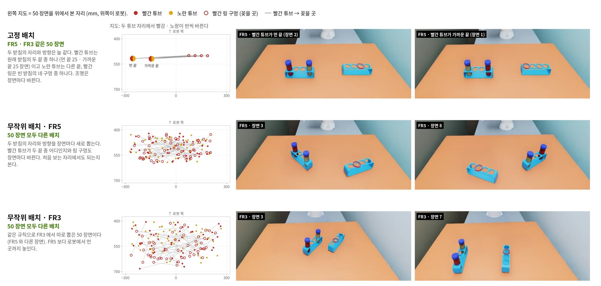
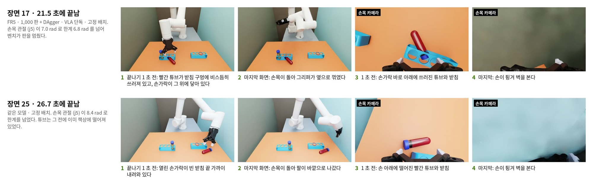
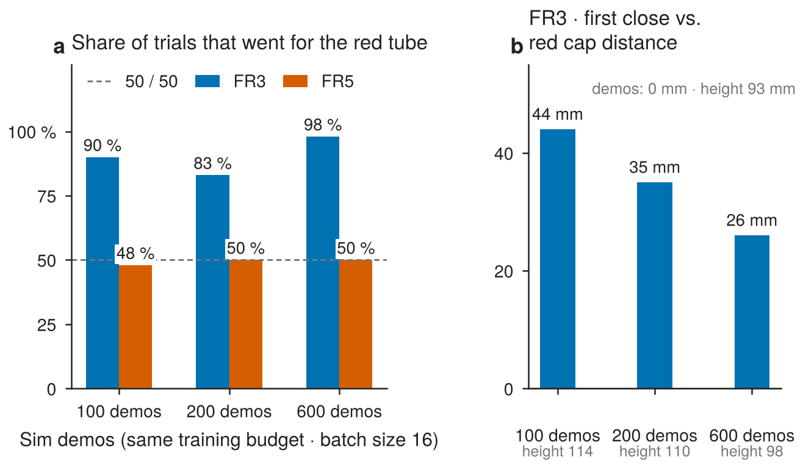
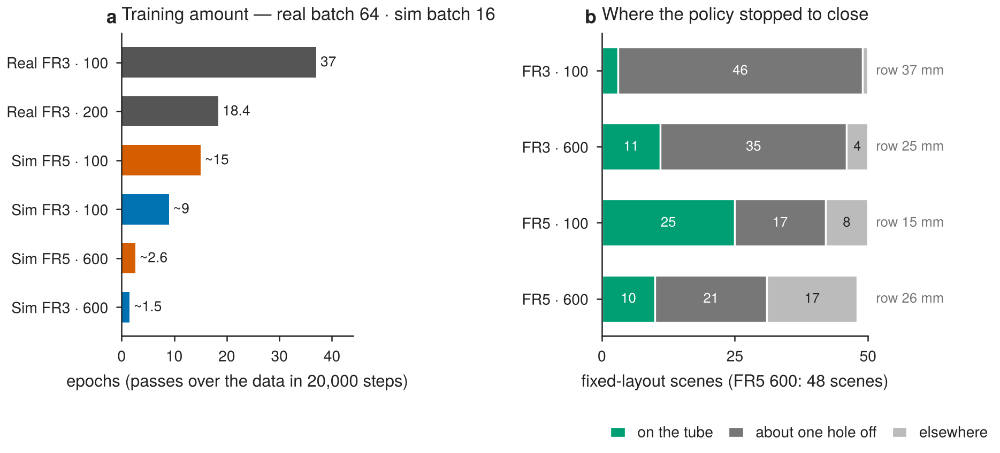

# Report 5 — Progress log 11-10 – 11-12: The main bench and why we stopped it — physics-jump rule, stage-by-stage diagnosis, training amount, workstation speed

2026-11-10 (Tue) – 11-12 (Thu) evening · Sim-to-Real Post-Training (simulation part) · Isaac Sim 6.0.1 · Isaac Lab 3.0 · GR00T N1.7 · [한국어](README.md)

This log covers what happened between [Report 3](../report03_realmatched_data/README_EN.md) and the results of [Report 4](../report04_sim_bench/README_EN.md), in date order. Report 4 collects the final numbers; this log records **what we saw on the way to those numbers, what we suspected, how we checked it, and what we changed**.

## Summary

- **We ran the main bench.** Six models trained on scripted sim demos (FR3 · FR5 × 100 · 200 · 600 demos) and two models fine-tuned further on real data were measured on the same 50 scenes, none of which were in training. Fixed-layout success was low — FR5 0–12/50, FR3 0–3/50 — and **it went down as we added data.**
- **We set the "physics jump" rule (11-10).** On FR5, the sim contact solver sometimes broke and joint values turned into NaN. Such trials used to be discarded and rerun; we changed this so that **a trial that jumps counts as a failure, and only the first try of each scene counts.**
- **Split by stage, the two robots failed in different places (11-11).** FR5 failed at choosing which tube to go to (it picked red about 50 % of the time — a coin flip). FR3 failed in the final descent and grasp (it picked red 83–98 % of the time, but closed 26–44 mm to the side of the cap and too high).
- **The largest cause was training amount (11-12).** The training recipe matched the real team's, but our batch size was 16 (real: 64), so in the same 20,000 steps the number of passes over the data (epochs) was 1/4 – 1/12 of the real runs. This fits the pattern that the bigger the dataset, the less the model learned.
- **The policy found the rack but missed by one hole.** Splitting the stopping point into the along-row and across-row directions of the rack, the across-row position was right and the along-row position was off by about one hole (37 mm). It was not a bug in the training layouts, the conversion or the bench connection.
- **We stopped the main bench and switched to improvement experiments (11-12 16:10).** The remaining cells were bound to come out low, so we spent the time on finding improvements.
- **The bench was slow because of the workstation's state.** The CPU clock had fallen back to a slow backup clock and large memory writes were capped at 0.7 GB/s. A reboot fixed it. On the bench side we changed how recording frames are handed over, cutting main-thread time.

## 0. Terms used in this log

| Term | Meaning |
|---|---|
| Main bench | The bench that measured 8 models × three layout sets (fixed · random · random tube holes too), 50 scenes each, one after another |
| Fixed layout (C) | 50 scenes where the two racks stay in place and the red tube sits at one end or the other end of its rack |
| Random layout (A) | 50 scenes where the position and orientation of both racks change every scene (tubes at the rack ends) |
| Random tube holes too (B) | Random layout where the tubes may also sit in any hole of the rack |
| 100 · 200 · 600-demo model | Models trained on 100 · 200 · 600 scripted sim demos (the real-setting data of Report 3) |
| Real fine-tuned model | The 600-demo sim model fine-tuned further on 200 real demos |
| Physics jump | A trial where the sim contact computation breaks and joint values suddenly blow up and become NaN |
| batch size | Number of samples per training update |
| epoch | How many times the whole training set was seen = steps × batch size ÷ number of frames |
| action chunk | The 16 actions the policy outputs at once (1.6 s at 10 Hz) |

**Figure 1.** The two bench layouts (labels in Korean). Top = fixed layout (the two racks always in the same place and orientation; the red tube at one end or the other), bottom two = random layout (rack position and orientation change every scene). The map on the left shows the 50 scenes from above. The photos and maps are scenes from the later real-matched sim ([Report 7](../report07_sim2real_1000/README_EN.md) onward), so camera and workspace differ slightly from the bench in this period, but the rules that build the two layouts are the same.

## 1. 11-10 (Tue) — Counting physics jumps as failures

**What we saw.** In an afternoon check, the two FR5 policy servers had reported an "input error" 27 times — the sim had sent a state that was not a number. The bench program at the time (multi-scene collector 1.2) treated this as a server error, did not count the trial, and reran the same scene.

| Bench | Counted trials | Reruns that were not counted |
|---|---|---|
| FR3 (11-03 – 05, all) | 66 | 0 |
| FR5 100-demo model · fixed layout | 50 | 26 |
| FR5 200-demo model · fixed layout (running) | 32 | 29 |

**What we checked.** We opened the records of the 55 discarded trials.

- The joint commands were smooth: in the last 2 s they changed by only 0.001–0.005 rad per step.
- The actual joints, however, left the command within 1–3 steps, reached tens of rad on the next step, and then became NaN.
- The first joint to jump was the wrist (j5 42 times · j4 7 · j1 5 · j6 1), and the fingertip height just before was 27 mm in the median (grasp height about 93 mm).
- The policy pushing the hand down to table or rack height was common on both robots. FR3 physics held up; FR5 (the AG-95 gripper model) sometimes blew up.
- Successful trials never had the fingertip below 65 mm. On the real robot these trials would have hit the table or rack and triggered a protective stop.

**Decision (user, 11-10 17:37).** A trial where the physics jumps counts as a failure (end reason "physics jump"). Only the first try of each scene counts. The old rule had in effect given FR5 a second chance after a crash. Recounting that day's FR5 100-demo fixed-layout bench under this rule turns 12/50 into 6/50 (first tries: 6 successes · 25 failures · 19 physics jumps).

**Figure 2.** Examples of a physics jump (labels in Korean). Two scenes where the fingers were touching a rack or tube and the wrist joint (j5) passed the 6.8 rad limit, so the bench stopped the trial. The photos are from a later FR5 bench (1,000 + DAgger model), but it is the same phenomenon we saw in this period.

**What we changed.** The bench checks every step that all joints are numbers, |q| ≤ 6.8 rad and |q̇| ≤ 25 rad/s (normal benches and demos stay within 2.9 rad and 2.4 rad/s). If a check fails, the scene stops asking the policy from that step and is saved as a "physics jump" failure. This went into the bench from that evening, and a separate tool recounts benches that had already run under the same rule.

- Files: multi-scene collector 1.3 (`lab/common_collect_multi.py`), recount tool `tools/common_bench_recount.py` 1.0 (read-only). The `nan` field in each result line stores when it jumped, which joint jumped first and the fingertip height just before.
- The "SVD did not converge" error on the server that morning was the same NaN reaching the model. From server 1.3 on, the number of re-asks on normal input is 0.
- Same night: converted the real FR3 200 demos to GR00T format (v2.1) with the real team's conversion script, sent them to the training server, and fine-tuned from the 600-demo sim models (FR5 · FR3). Bench, training and tunnels were detached from the desktop session so that they keep running if the desktop dies.

## 2. 11-11 (Wed) — Stage-by-stage diagnosis: the two robots have different bottlenecks

We split the fixed-layout results over 50 scenes by the stages in which the policy works (input → which tube → where to descend → control → physics, plus training).

| Stage | FR3 (100 / 200 / 600-demo model) | FR5 (100 / 200 / 600-demo model) |
|---|---|---|
| Input (images · instruction · state) | Normal | Normal |
| Which tube (share that went for red) | 90 / 83 / 98 % | **48 / 50 / 50 %** — ignores color and always goes to the same end (98–100 %) |
| Where it descends (first close: position · height) | **44 / 35 / 26 mm beside red, height 114 / 110 / 98 mm** (demos 0 mm · 93 mm). No preferred direction | Cannot judge — wrong end chosen |
| Control (command → actual joints) | Normal (fingertip difference 1–2 mm) | Normal |
| Physics | Normal | Drops the tube while lifting; 600-demo model had 33 physics jumps |
| Training (final loss) | 0.0131 / 0.0170 / 0.0175 | 0.0140 / 0.0164 / 0.0189 |

**Figure 3.** Stage-by-stage diagnosis (fixed layout, 50 scenes). (a) FR5 picked the red tube only half the time — it ignored color and always went to the same end. (b) FR3 picked red, but its first close was 26–44 mm beside the red cap and higher than in the demos (93 mm).

- **More demos, lower success** (fixed layout FR3 3 → 0 → 1/50, FR5 12 → 6 → 1/50 — the first two FR5 values are from before physics jumps were counted). All models used 20,000 steps × batch size 16, so the 600-demo model saw each demo only about 1/6 as often as the 100-demo model. Its final loss was also about 35 % higher than the 100-demo model's and was still falling at 20,000 steps.
- **The data side was fine.** In the demos, red was at one end · on the left of the image · near the robot about 50 % of the time in each case.

That night we ranked the causes per robot.

| | Rank 1 | Next | Not the cause (checked) |
|---|---|---|---|
| FR5 | Weak color signal reaching the model — following the real FR5 format, 848×480 was squashed to 256×256 and color was stored at half resolution, so the red cap is only 49 pixels in the model input (FR3: 210) and the yellow cap loses its color | Frozen vision encoder · short, fast demos with few frames where the direction is decided | Layout bias in the data · instruction · control · camera position |
| FR3 | Cannot locate the cap precisely in the image — the hand is still for 1 s before closing (jitter 0.2–0.4 mm) and closes beside the cap | Little training data in the precise phase (11 %, transport 42 %) · no demos of recovering after an empty close | Control · inverse kinematics · conversion frames · color detection |
| Both | Same training amount, so the bigger dataset is learned less | Loss dominated by the easy transport phase | |

- At this point we wrote that "all models were trained with color jitter (including hue)", which was wrong. GR00T's default is no jitter; we had read the training script's "values to use when enabled" as the actual setting. Corrected on 11-13 ([Report 6](../report06_improve_1112_1113/README_EN.md)).
- As the plan up to Sunday (11-15) we listed six candidate experiments: train the FR5 vision encoder, a control run without the grasp assist, sample more of the precise phase, recovery demos, longer training, a ground-truth-position experiment.

- Also tried: reading the cameras every 3 steps (K = 3) raised the bench from 0.40 to 1.05 steps per second (2.6×) with the same images reaching the policy. A test giving the gripper only 0 / 1 (FR5 100-demo model, 16 scenes) went from 5 successes to 0 and from 0 to 4 physics jumps, so we did not use it.
- Training server: only nvidia-smi failed (after the 10-10 automatic driver update: kernel module 595.84 · library 595.99), while new CUDA programs saw both GPUs → used it without rebooting. The disk was at 98 % (44 GB free), so we had to decide what to clear before new training.
- Built a dashboard "sim bench stage diagnosis" collecting the figures and tables.

## 3. 11-12 (Thu) daytime — What differed from the real robots: training amount

We checked whether the large gap between real and sim results came from a wrong training setup or data conversion, against the answers from the real-robot team (FR3 · FR5).

| Item | Sim (FR3 · FR5) | Real FR3 | Real FR5 |
|---|---|---|---|
| Base model · trained parts · relative actions · action chunk 16 · 10 Hz | Same | Same | Same |
| **batch size × steps** | **16 × 20,000** | 64 (32 × 2) × 20,000 | 64 × 20,000 (16 on 11-03) |

| Data | epochs |
|---|---|
| Real FR3 100 demos (34,209 frames) | 37 |
| Real FR3 200 demos (69,409 frames) | 18.4 |
| Sim FR3 100 · 600 demos | about 9 · about 1.5 |
| Sim FR5 100 · 600 demos | about 15 · about 2.6 |

- Batch size 16 had been chosen on 11-03 to match the real FR5 training of the time; the real side later moved to 64.
- With the same amount of data and unseen layouts, sim was no worse than real at 100 demos (FR3 6 % vs. real 5 %). They part ways when data is added — real goes up (200 demos: 30 %) and sim goes down (0 %). The difference in training amount explains this.

**Stopping points split by rack direction.** We split the point where the policy stopped to close into the "along-row" and "across-row" directions of the rack.

| Bench (fixed layout) | On the tube | About one hole off | Elsewhere | Along-row offset (median) | Across-row offset (median) |
|---|---|---|---|---|---|
| FR3 100-demo model (50) | 3 | 46 | 1 | 37 mm | 8 mm |
| FR3 600-demo model (50) | 11 | 35 | 4 | 25 mm | 5 mm |
| FR5 100-demo model (50) | 25 | 17 | 8 | 15 mm | 5 mm |
| FR5 600-demo model (48) | 10 | 21 | 17 | 26 mm | 9 mm |

"On the tube" = within 15 mm both along and across the row; "about one hole off" = on the rack row (within 20 mm across) and 15–60 mm along it. The demos are at 0 mm in both directions.

- **Across the row it was right; along the row it was wrong.** The policy finds the rack (a large object) but cannot read from the image which hole along the rack holds the tube.
- **We ruled out candidate causes.** An old model (11-04) trained without random tube holes (B) and in the old format (30 Hz) was off in the same way (FR3: 22 of 49 scenes about one hole off). So the cause is neither layout B, nor the real-format conversion, nor the bench connection.
- **The FR3 · FR5 difference in "holding" is explained by the gripper width.** With the same 20–35 mm offset, FR3 (opening 80 mm) rests its fingers on top of the cap and is blocked at 113–116 mm, while FR5 (95 mm + sim grasp assist) goes down to 81–96 mm and holds.
- **Models whose last training was on real data did not even get near the tubes in sim.** Both the real FR5 model and the real fine-tuned model were "elsewhere" in all 50 scenes, because sim and real coordinates and images do not match.

**Figure 4.** Training amount and stopping points. (a) How many times the training data was seen in the same 20,000 steps (epochs). Sim used batch size 16, so it saw less than real (64), and less again the more demos it had. (b) Where the policy stopped to close. Most trials are "about one hole off"; the numbers on the right are the median along-row offset. The across-row offset was 5–9 mm.

- Corrected: we first wrote that "real training used only end-of-rack layouts (A)" and guessed that "layout B is the cause", but only the first 100 real demos used end-of-rack layouts; the last 100 were collected with random layouts (confirmed by the user). We withdrew the guess.
- We did not use as evidence the number "the stopping point is closer to a tube position seen in training". Training demos cover the table densely (100 demos about 17 mm apart, 600 demos about 7 mm), so any position is close to some training position.

## 4. 11-12 (Thu) 16:10 — Stopping the main bench

**Decision (user, 11-12 16:10 – 16:29).**

1. Stop the main bench. The remaining cells would clearly come out low with the current models and would not change the result.
2. Use the remaining time to find improvements and produce the final results.
3. The environment and collection method already match the real robots, so **the training setup is chosen to suit the sim rather than copied exactly from the real side.**
4. The bench being too slow is the biggest problem. Fix it.

The main bench at the time it was stopped (fixed layout, 50 scenes not in training, first try per scene · physics jump = failure):

| Model | FR3 · fixed | FR5 · fixed | FR3 · random | FR5 · random |
|---|---|---|---|---|
| 100-demo model | 3/50 | 12/50 \* | 0/50 | 2/50 |
| 200-demo model | 0/50 | 6/50 \* | 0/50 | 0/50 |
| 600-demo model | 1/50 | 1/50 | not run | 1/39 (stopped) |
| Real fine-tuned model | 0/50 | 0/50 | not run | not run |
| Real FR5 model (200 real demos only) | — | 0/50 | — | not run |

\* Benches run before the physics-jump rule (11-10 daytime), so jumped trials were rerun instead of counted. Do not compare them directly with later benches (recounted under the new rule, the 100-demo model is 6/50).

- Random tube holes (B) was never run. Empty cells stay "not run" and are not filled in.
- FR5 physics jumps on benches with the rule were 26–33/50 on the fixed layout and 19–27/50 on the random layout. FR3 had 0–1/50.

**First experiment — changing only the batch size.** Same data, same 20,000 steps, batch size 16 → 64, so each frame is seen four times as often (for FR5 200 demos, about 7.7 → about 31 times). When training finishes, the training server starts the policy server and the workstation runs the fixed-layout 50-scene bench by itself. Results are in [Report 6](../report06_improve_1112_1113/README_EN.md).

## 5. 11-12 (Thu) evening — Why the bench was slow

**What we saw.** On the 50-scene bench, one FR3 batch (8 scenes) took more than 2,000 s — 60 s of sim time took about 34 minutes of real time.

**What we suspected and checked.** Splitting the time of one batch, Isaac computation was about 11 %, waiting for recording-video writes about 50 %, and most of the rest could not be attributed. Policy queries were 4–7 %. So we suspected the computer rather than Isaac and measured it.

| Item | Before reboot | After reboot |
|---|---|---|
| CPU clock source | slow backup clock (acpi_pm) | fast clock (tsc) |
| Large memory copy (64 MB) | 0.7 GB/s | 11.8 GB/s |
| Writing 16 videos · 45 frames each | 16.0 s | 1.4 s |
| Memory module (DIMM) temperature | 71–79 °C (above the 66 °C limit) | 51–54 °C |

- There was a log entry at 11-11 10:12 where the kernel marked the CPU's fast clock "unstable" and switched to the slow backup clock. Only writes to memory larger than the cache were slow; computation and in-cache copies were normal.
- When the workstation was rebooted at 11-12 19:41, clock and memory speed returned to normal.
- We could not tell whether overheating was the cause or some other state cleared by the reboot. So we started a log that records memory temperature, copy speed and clock every minute.

**What we changed on the bench side.** When handing frames to the 16 recording videos (8 scenes × 2 cameras), the main thread used to copy each frame; now it hands them over without copying and the writer thread uses them directly. The video files are byte-identical, and the main thread's share per step dropped from 321.7 to 2.1 ms (measured before the reboot).

**What we decided not to do.** We do not move from Isaac Lab to Isaac Sim. We also do not change Isaac-side settings such as reading cameras only when the policy looks, CPU physics or 16 scenes — any change would have to be reported separately from earlier results, and CPU physics changes grasp forces.

- Files: collector 1.6 · `lab/common_bench_video.py` 1.0 (`--bench-video fast`; the default `same` behaves as before). If it fails, a fallback job `<name>_same` continues in the same folder the old way.
- Switched the login session from Wayland to Xorg (`/etc/gdm3/custom.conf`, copy kept).
- Decided the same day: benches use only the fixed and random layouts (no B). Scoring uses the same S0–S9 stage table as the real robots, from bench records without rerunning — the scoring tool was written that night (Report 6).
- Learned that FR5 sim data re-collected by the real team with sim settings matched to the real FR5 exists (330 + 420 demos). Those models must be benched in the same sim settings, so we decided to take the settings folder and records and set up a separate bench folder.

## 6. Where we stood (11-12 evening)

- The training recipe (frozen parts · relative actions · action chunk · base model) matches the real side and is not wrong. **Training amount at 1/4 – 1/12 of the real runs** is the largest difference.
- The policy's failure is "finds the rack but misses by one hole". The sim is also harder than real in some ways: the demos are always perfect, so there are no scenes of recovering from an offset; layouts are widely random, so positions cannot be memorized; caps and fingers are rigid, so a finger resting on a cap stays blocked (on the real robot, compliant control absorbs a few mm).
- Next: batch size 64 results → S0–S9 scoring → a VLA + formula bench like the real FR3 ([Report 6](../report06_improve_1112_1113/README_EN.md)).

## Appendix. Development notes for this period

Development notes 18 (physics-jump rule) · 19 (stage diagnosis) · 20 (plan to Sunday) · 21 (cause ranking) · 22 (real ↔ sim training setup · data comparison) · 23 (stopping the main bench) · 24 (bench speed). Numbers are recounted from the bench records (`progress/bench_results.jsonl`) at the time each note was written.
