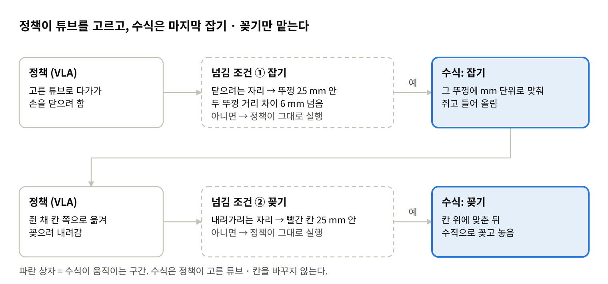
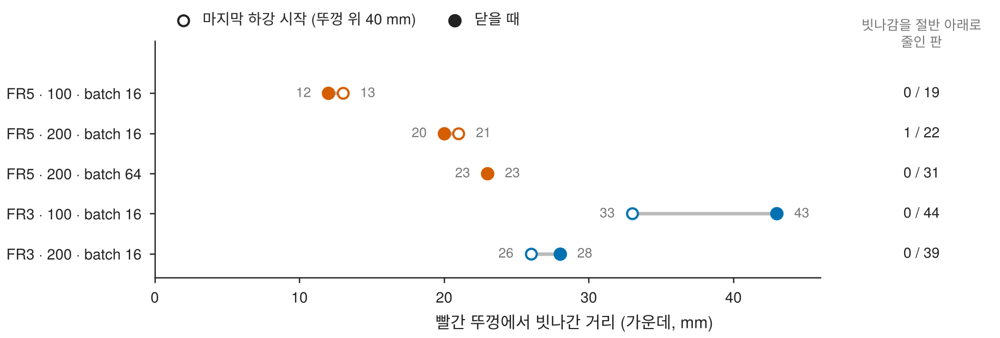
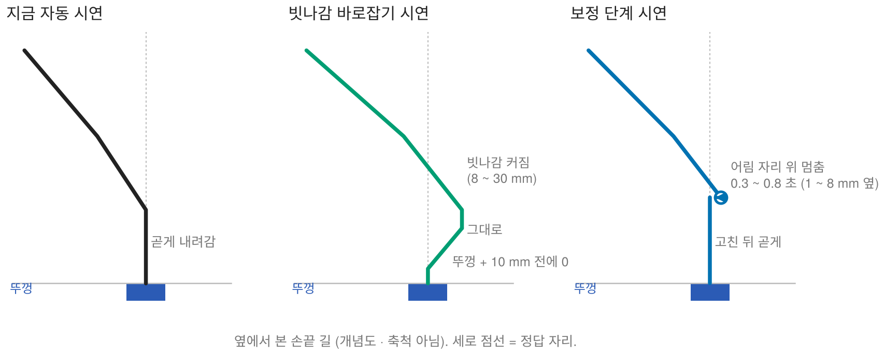
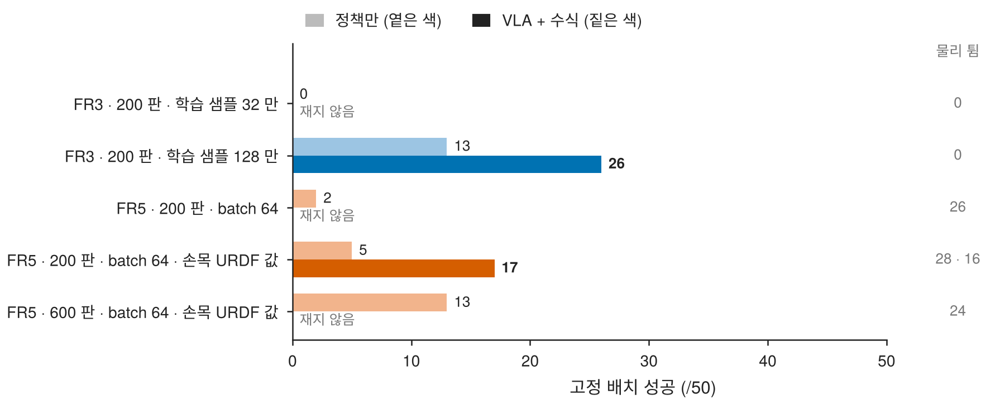
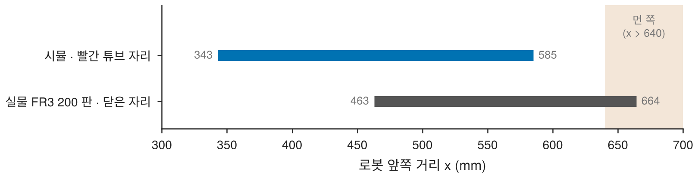

# 보고서 6 — 진행 기록 11-12 밤 \~ 11-13 낮: 개선 실험 — VLA + 수식 벤치, 학습량, 물리 튐, 빗나감을 고치는 시연

2026-11-12 (목) 밤 \~ 11-13 (금) 15:40 · Sim-to-Real Post-Training (시뮬레이션 파트) · Isaac Sim 6.0.1 · Isaac Lab 3.0 · GR00T N1.7

[보고서 5](../report05_main_bench_stop/README.md) 에서 본 벤치를 멈추고 개선 실험으로 바꾼 뒤, 하루 동안 한 일입니다. 실물 평가에서 쓰는 두 가지 (VLA + 수식 · S0 \~ S9 단계표) 를 시뮬 벤치로 옮기고, 학습량을 늘리고, 실패가 「마지막 하강에서 빗나감을 고치지 않는 것」 임을 확인한 뒤, 그 장면을 담은 시연을 새로 설계했습니다.

## 요약

- **실물 평가와 같은 두 도구를 시뮬 벤치에 옮겼다 (11-12 밤).** VLA + 수식 (정책이 목표를 고르고 마지막 잡기 · 꽂기만 수식이 맡음) 과 S0 \~ S9 단계 채점이다. 채점 기준은 결과를 보기 전에 고정했다.
- **학습량을 늘리자 FR3 가 처음 올랐다 (11-13 아침).** 같은 200 판에서 학습 샘플을 4 배로 늘리자 고정 배치 정책만 0/50 → 13/50, VLA + 수식은 26/50 이었다.
- **FR5 물리 튐은 손목 힘 탓이 아니었다.** 손목 힘 한계를 낮춰도 튐이 그대로라 (26 → 28/50) 가설을 버렸다. 남은 후보는 그리퍼 · 접촉 모델이다.
- **실패의 모양을 숫자로 확인했다.** 정책은 마지막 하강을 시작할 때 빗나가 있던 만큼 그대로 닫았다. 하강 중에 빗나감을 절반 아래로 줄인 판은 155 판 가운데 1 판이었다.
- **그 장면을 담은 시연을 두 가지 만들었다.** 일부러 빗나가게 다가갔다가 내려가며 바로잡는 시연 (DART 같은 방법), 그리고 실물 자동 수집기처럼 「멈춰 재고 고친 뒤 내려가는」 보정 단계 시연이다.
- **바로잡은 것 하나.** 「모든 모델을 색 흔들기 (hue 포함) 로 학습했다」 는 앞의 기록이 틀렸다. GR00T 기본값은 흔들기 없음이었다. 이때부터 비교 묶음은 흔들기를 켜고 학습한다.

## 0. 이 기록에서 쓰는 말

| 말 | 뜻 |
|---|---|
| VLA + 수식 | 정책이 목표를 고르고, 정책이 뚜껑 25 mm 안에서 닫으려 하면 마지막 잡기를, 빨간 칸 25 mm 안으로 내려가려 하면 마지막 꽂기를 자동 시연 수식이 넘겨받는 실행 (실물 FR3 스테이션과 같은 구조) |
| S0 \~ S9 | 실물과 같은 단계표. S1 목표 고르기 · S2 접근 · S3 정렬 · S4 접촉 · S5 쥠 · S6 들기 · S7 빼냄 · S8 옮김 · S9 꽂기. 판마다 처음 막힌 단계 하나를 정함 |
| 마지막 하강 | 손끝이 뚜껑 윗면 40 mm 위에서 닫을 때까지 내려가는 구간 |
| 빗나감 바로잡기 시연 | 다가갈 때 일부러 8 \~ 30 mm 빗나가게 했다가 내려가며 정답 자리로 바로잡는 시연 |
| 보정 단계 시연 | 어림 자리 (정답 + 1 \~ 8 mm) 위로 가서 멈추고, 고친 뒤 곧게 내려가는 시연 |
| 색 흔들기 | 학습할 때 영상의 밝기 · 대비 · 채도 · 색조를 조금씩 바꿔 넣는 것 |

## 1. 11-12 (목) 밤 — 실물 평가와 같은 도구를 시뮬 벤치에

**VLA + 수식.** 실물 FR3 스테이션과 같은 규칙을 썼다.

1. 시작할 때 장면을 한 번 잰다 (두 뚜껑 자리 · 빨간 칸 · 랙 윗면 높이).
2. 정책이 action chunk 를 낼 때마다 넘길지 본다.
   - 잡기: 정책이 「닫기」 를 두 칸 이어 냈고, 그 자리에서 가장 가까운 뚜껑이 25 mm 안이며 다른 뚜껑이 6 mm 넘게 더 멀면 넘겨받는다.
   - 꽂기: 쥔 튜브 바닥을 랙 윗면 + 25 mm 아래로 내리려 하거나 「열기」 를 두 칸 냈을 때, 그 자리가 빨간 칸 25 mm 안이면 넘겨받는다.
3. 조건이 안 맞으면 그 chunk 는 정책 그대로 실행하고 까닭을 남긴다.

**그림 1.** VLA + 수식의 구조. 정책이 튜브 · 칸을 고르고, 넘김 조건을 만족할 때만 수식이 마지막 잡기 · 꽂기를 맡는다.

지킨 원칙도 실물과 같다. 정책이 목표를 정하고, 수식은 다른 튜브나 다른 칸을 고르지 않는다 (정책이 노란 튜브로 가면 수식도 노란 튜브를 잡는다). 모델과 모델 입력은 그대로이고, 결과는 정책만 벤치와 섞지 않는다.

| 실물과 다른 점 | 실물 FR3 | 시뮬 |
|---|---|---|
| 시작 장면 | 손목 사진에서 검출 (오차 있음) | 시뮬에서 잰 정답 자리 |
| 손 안 튜브 자리 | 모름 | 쥔 뒤 · 구멍 위에서 다시 잼 |
| 처짐 보정 · 정착 · 천천히 들기 | 있음 | 없음 (시뮬은 명령을 그대로 따라감) |

위 두 줄 때문에 시뮬의 수식은 실물보다 유리하다. 시뮬 VLA + 수식 숫자를 실물 숫자와 바로 견주지 않는다 (실물과 같은 조건의 수식은 [보고서 9](../report09_final_1116_1119/README.md) 에서 따로 점검).

**S0 \~ S9 채점.** 벤치를 다시 돌리지 않고 벤치 기록 (시작 장면 · 스텝마다 손끝과 그리퍼 · 빨간 튜브의 실제 움직임 · 성공 판정) 으로 채점한다. 25 · 60 · 40 · 20 mm 기준은 실물과 같게 두고, S2 높이와 S3 · S4 범위는 시뮬 자동 시연 데이터에서 구해 결과를 보기 전에 고정했다. 물리 튐 판은 실패로 두고 수를 따로 적는다.

**그날 밤 자동으로 돈 것.** batch size 64 로 다시 학습한 모델 5 개를 학습이 끝나는 대로 고정 배치에서 쟀다. 실물 팀이 실물 FR5 에 맞춘 시뮬 설정으로 모은 데이터의 모델은 그 설정을 그대로 옮긴 벤치 전용 폴더에서 따로 쟀다.

- 파일: `lab/common_bench_hybrid.py` 1.0 (`--bench-hybrid` 를 줄 때만 읽힘) · 장면 여러 개 수집기 1.7 (벤치 궤적 기록 `progress/bench_track/`) · `tools/common_bench_stage.py` 1.0. 옵션 없이 돌린 벤치는 1.6 과 같은 결과임을 확인함.
- 시간 한계는 정책만 벤치와 같은 60 초. 수식이 움직이는 중에 한계가 오면 끝낼 때까지 최대 20 초 더 줌 (`hybrid.over_limit`).

## 2. 11-12 (목) 밤 — FR5 물리 튐: 손목 힘 가설을 세우고 버림

**현상.** FR5 200 판 모델 (batch size 64) 의 고정 배치 50 판 가운데 26 판이 물리 튐으로 끝났다.

**확인 (벤치 기록을 읽기만).**

| 확인 | 결과 |
|---|---|
| 명령이 먼저 튀었나 | 아님 — 튀기 0.2 초 전에 실제가 명령에서 5° 넘게 벗어난 판 0/26 |
| 어느 관절 | 손목 (j5 19 · j4 6 · j6 1) |
| 손목 특이 자세인가 | 아님 — j5 는 거의 90° |
| 튀기 직전 자리 | 원래 랙 위, 그리퍼가 열린 채 뚜껑 높이 근처 14 판 · 책상 가까이 6 판 · 빈 랙 위 3 판 · 들던 중 2 판 |

**가설.** 손가락이 뚜껑 · 랙 · 책상에 닿은 채 팔이 누르면 튄다. 시뮬 FR3 는 손목 힘 한계가 실물 값 (12 N·m) 이라 부딪히면 밀리지만, 시뮬 FR5 는 손목도 어깨와 같은 150 N·m 라 큰 힘으로 누른다.

**시험 (기준을 먼저 정함).** 같은 모델 · 같은 50 장면에서 손목 힘 한계만 URDF 값 28 N·m 로 바꾼다. 튐 5/50 이하이고 정상 움직임 (실제 − 명령) 이 그대로면 고친 것으로 본다.

**결과 (11-13 08:43).** 튐 28/50 (예전 26/50), 무작위 배치 13/50 (예전 11/50). **손목 힘 한계는 원인이 아니었다.** 같은 모델이라도 VLA + 수식에서는 튐이 16/50 으로 줄고, FR3 시뮬은 튐이 0 이었다. 정책이 손가락을 뚜껑 · 랙에 대고 누르는 움직임에서 튀는 것으로 보고, 다음 후보를 그리퍼 (AG-95) 모델로 옮겼다 — 닫힌 고리 링크를 열린 사슬 + 소프트웨어로 따라가게 한 관절로 둔 모델이라, 손가락 끝이 눌리면 따라가는 관절과 구동 관절이 서로 다툴 수 있다.

- 바로잡은 것: 첫 조사에서 「20 판은 공중에서 튐」 이라고 했는데 틀렸다. 벤치가 관절 값 6.8 rad 를 넘어야 튐으로 잡아서, 그때는 이미 j5 가 수백 도 돈 뒤였고 그 자세로 손끝 높이를 계산했다.
- 채점 도구 1.1: 물리 튐 판은 튐이 시작된 칸 (실제가 명령에서 10° 넘게 벗어난 첫 칸) 앞까지의 기록만 씀 — 튀면서 튜브가 날아가 「들림 · 옮김」 이 거짓으로 통과됐기 때문 (433 mm 「들림」 등).

## 3. 11-12 (목) 밤 — 실패의 모양: 마지막 하강에서 빗나감을 고치지 않는다

빨강 쪽으로 닫은 판만 골라, 마지막 하강 (뚜껑 윗면 40 mm 위 → 닫을 때) 동안 빗나감이 줄었는지 쟀다 (고정 배치).

| 벤치 | 빨강 쪽으로 닫은 판 | 하강 시작 → 닫을 때 빗나감 (가운데) | 8 mm 넘게 빗나간 판 가운데 절반 아래로 줄인 판 |
|---|---|---|---|
| FR5 100 판 · batch size 16 | 24 | 13 → 12 mm | 0 / 19 |
| FR5 200 판 · batch size 16 | 25 | 21 → 20 mm | 1 / 22 |
| FR5 200 판 · batch size 64 | 34 | 23 → 23 mm | 0 / 31 |
| FR3 100 판 · batch size 16 | 45 | 33 → 43 mm | 0 / 44 |
| FR3 200 판 · batch size 16 | 42 | 26 → 28 mm | 0 / 39 |

**그림 2.** 마지막 하강에서 빗나감이 줄지 않는다. 빨강 쪽으로 닫은 판의 빗나감 가운데값 — 하강 시작 (흰 점) 과 닫을 때 (찬 점). 오른쪽은 8 mm 넘게 빗나간 판 가운데 하강 중에 빗나감을 절반 아래로 줄인 판이다.

**155 판 가운데 1 판만 하강 중에 빗나감을 절반 아래로 줄였다.**

- 원인이 아닌 것: 처음 보는 배치 (학습과 같은 방식의 무작위 배치가 고정 배치보다 낫지 않음), 데이터가 덮지 못한 자리 (벤치 자리마다 1 cm 안팎에 학습 시연이 있음), 옆 구멍에 꽂음 (250 판 가운데 1 판).
- 나아진 것: batch size 64 는 빨강을 고르는 비율을 올렸다 (닫은 판 가운데 빨강 쪽 25/50 → 34/48, 「다름」).
- 해석: 자동 시연은 언제나 뚜껑 · 칸 바로 위로 정확히 와서 곧게 내려간다. 정책은 「빗나간 채 내려가면 옆으로 고친다」 는 장면을 본 적이 없다. 그래서 화면에서 목표를 1 \~ 3 cm 로만 어림한 채 내려가고, 그 빗나감이 남는다.

**빗나감 바로잡기 시연 (DART 같은 방법).** 이 장면을 데이터에 넣으려고 자동 시연 계획기에 선택 사항을 더했다. 시연마다 무작위 방향 · 8 \~ 30 mm 의 빗나감을 넣는다.

| 단계 | 빗나감이 커지는 곳 | 그대로인 곳 | 0 이 되는 곳 |
|---|---|---|---|
| 집기 | 홈 → 튜브 위로 가는 동안 | 뚜껑 윗면 약 45 mm 위까지 | 손가락 끝이 주변 뚜껑 윗면 + 10 mm 에 닿기 전 |
| 옮기기 | 들어 올린 뒤 옮기는 동안 | 튜브 바닥이 멈출 높이 약 36 mm 위까지 | 튜브 바닥이 주변 튜브 윗면 + 8 mm 에 닿기 전 |

**그림 3.** 새로 만든 두 시연 (개념도). 가운데 = 빗나감 바로잡기 시연 (다가갈 때 8 \~ 30 mm 빗나갔다가 내려가며 0 으로), 오른쪽 = 보정 단계 시연 (어림 자리 위에서 멈춰 고친 뒤 곧게 내려감, 5 절). 잡는 자리 · 꽂는 자리는 지금 자동 시연 (왼쪽) 과 같다.

잡는 자리 · 맞추기 · 꽂기는 그대로라 시연의 성공 여부도 같다. 빗나감 방향은 시연마다 무작위라 평균은 0 이다. 그날 밤 FR5 · FR3 각 200 판 (무작위 배치 100 · 튜브 자리도 무작위 100) 을 모아 기존 200 판과 합친 400 판 데이터를 만들었다. 미리 정한 판정은 「하강 시작 때 8 mm 넘게 빗나간 판 가운데 닫을 때 절반 아래로 줄인 비율이 30 % 이상이면 바로잡기를 배웠다」 였다.

이 400 판 모델은 학습까지 했지만, 다음 날 오후 실물에 맞춘 설정으로 데이터를 처음부터 다시 모으기로 하면서 ([보고서 7](../report07_sim2real_1000/README.md)) 벤치하지 않았다. 바로잡기 시연은 새 1,000 판 데이터의 한 갈래로 들어갔다.

## 4. 11-13 (금) 아침 — 밤사이 결과: 학습량을 늘리자 FR3 가 올랐다

| 고정 배치 · 50 장면 | 정책만 | VLA + 수식 | 물리 튐 |
|---|---|---|---|
| FR3 200 판 · 학습 샘플 32 만 (11-12 낮 기준) | 0/50 | — | 0 |
| **FR3 200 판 · 학습 샘플 128 만** | **13/50** | **26/50** | 0 |
| FR5 200 판 · batch size 64 | 2/50 | — | 26 |
| FR5 200 판 · batch size 64 · 손목 URDF 값 | 5/50 | 17/50 | 28 · 16 |
| FR5 600 판 · batch size 64 · 손목 URDF 값 | 13/50 | 18/31 (덜 끝남) | 24 · 10 |

**그림 4.** 밤사이 벤치 (고정 배치 50 장면). 옅은 막대 = 정책만, 짙은 막대 = VLA + 수식. 오른쪽은 물리 튐 판 수 (정책만 · VLA + 수식). FR5 600 판의 VLA + 수식은 31 판까지만 돌아 그림에서 뺐다 (18/31).

- **FR3 는 학습량이 크게 효과가 있었다.** 같은 200 판에서 학습 샘플을 4 배로 늘리자 0/50 → 13/50 (다름), 빨강을 닫은 거리 가운데 28 → 12 mm 였다. 무작위 배치는 정책만 6/50 · VLA + 수식 30/50 이었다.
- **VLA + 수식은 정책만의 약 2 \~ 5 배였다.** 수식이 넘겨받은 판의 닫는 자리는 뚜껑에서 1 mm 였다. 정책만일 때 처음 막히는 곳은 S3 정렬 · S4 접촉 · S5 쥠 (마지막 몇 cm) 이었다.
- **FR5 는 물리 튐이 결과를 가렸다.** 튐이 FR3 0/180 판, FR5 238/750 판 (32 %) 이었다. 튀지 않은 판만 보면 두 로봇이 비슷했지만, 결과를 본 뒤 나눈 것이라 본 결과로 쓰지 않았다.

**결정 (사용자 11-13 11:31).** 학습은 FR5 · FR3 모두 batch size 64 × 20,000 번 고침 (표본 128 만) 으로 맞춘다. FR3 는 GPU 하나에 64 가 겨우 들어가 32 개씩 두 번 계산한 기울기를 더해 한 번 고친다 (gradient accumulation — 64 개를 한 번에 계산한 것과 같은 고침).

- FR3 200 판 「batch size 64」 폴더는 실제로 32 × 40,000 번 학습한 것 (표본 수는 같음). 이 모델은 본 표에서 빼고 「같은 표본 수, batch size 만 다름」 보조 비교로만 씀.
- 운영 사고 (08:01 \~ 09:00): 학습 줄이 서버를 켤 때 남긴 bash 프로세스가 줄 스크립트와 같은 이름이라, 다음 줄과 지킴이가 「앞 줄이 아직 돎」 으로 봄 → 그 bash 만 끄고 서버는 그대로 둠.
- 13:26 에 FR3 를 「64 × 모으기 2 = 128」 로 잘못 시작함 (GR00T 의 global batch size 는 모으기 전 수인데 판단식이 거꾸로 읽음) → 13:33 에 32 × 2 로 다시. 잘못된 폴더는 이름을 바꿔 남김.

## 5. 11-13 (금) 13:26 — 보정 단계 시연: 실물 수집기처럼 「멈춰 재고 고친 뒤 내려가기」

**왜 (사용자).** 실물 자동 수집기에는 집기 직전 · 꽂기 직전에 보정 동작이 있었고, 그 동작이 실물 학습 데이터에 그대로 남았다. 시뮬 시연에는 그 단계가 없다.

| 로봇 | 집기 직전 | 꽂기 직전 |
|---|---|---|
| 실물 FR3 | 0.5 초 정착 보정, 쥔 뒤 약 4 초 정지 | 칸 위에서 1 초 정착, 순응 제어로 미끄러져 들어감 |
| 실물 FR5 | 팔이 0.8° 안으로 올 때까지 기다림 (최대 2.5 초) | 구멍 위 0.3 초 멈춤 + 3인칭 한 장으로 좌우 어긋남을 재서 0.2 \~ 9 mm 옮김, 천천히 꽂으며 좌우 최대 3 mm 고침 |

**시뮬에서 하는 것.** 집기는 어림 자리 (정답 + 무작위 1 \~ 8 mm) 의 뚜껑 위로 가서 0.3 \~ 0.8 초 멈춘 뒤, 정답 위로 옆으로 고치고 곧게 내려가 쥔다. 꽂기는 어림 구멍 위에서 멈춘 뒤 구멍 맞추기로 고치고 실물 속도로 천천히 꽂는다 (FR5 10 mm/s · FR3 30 mm/s). 끝 자리 (쥐는 자리 · 꽂는 자리) 는 그대로라, 보정을 끄면 계획이 예전과 똑같다.

손끝이 움직이는 모양은 그림 3 의 오른쪽이다.

**모을 것 (사용자 결정 13:35).** 로봇마다 보정 단계 300 판 + 「빗나감 + 보정」 300 판 = 600 판 (고정 · 무작위 · 튜브 자리도 무작위 각 100 판씩). FR3 를 먼저 모으고, 그동안 FR5 물리 튐을 찾는다.

**미리 정한 비교.** 보정 단계 600 판 대 지금 방식 600 판, 같은 학습 조건 · 같은 50 장면. 두 데이터가 모두 담은 무작위 배치를 주 비교로 쓴다. 목표 (사용자) 는 실물 60 % 보다 높은 시뮬 70 \~ 80 % 였다.

## 6. 11-13 (금) 14:24 \~ 14:50 — 수집 속도, 색 흔들기 바로잡음, 물리 튐 다음 단계, 실물 분포의 빈틈

**수집 속도.** FR3 600 판은 17:30 \~ 18:00 에 끝날 것으로 보였다. 이때 메모리 모듈 온도가 69 \~ 75 도 (넷 다 한도 넘음) 라 **Isaac 을 셋으로 늘리지 않기로** 했다. 데이터는 그대로 두고 일만 줄였다 — 카메라는 변환기가 고르는 기록 장 (10 Hz) 에만 읽고, 기록 영상은 복사 없이 넘긴다 (영상 파일은 바이트까지 같음). 하지 않기로 한 것: 물리를 CPU 로 (움직임이 달라짐), 렌더 품질 낮춤, 동작 빠르게 (VLA 학습에 나쁜 데이터), 장면 16 개 (조명 종류가 반으로 줆).

**색 흔들기 바로잡음.** 11-11 에 「모든 모델이 밝기 0.3 · 대비 0.4 · 채도 0.5 · hue 0.08 로 흔들며 학습됐다」 고 적었는데 틀렸다. GR00T 기본값은 흔들기 없음이고, 우리 기본 학습과 실물 팀 FR5 학습 모두 저장된 설정이 「없음」 이었다. 학습 스크립트의 「켤 때 쓸 값」 을 실제 설정으로 잘못 읽은 것이다. 그래서 FR5 원인 순위의 「hue 흔들기」 는 원인에서 뺐고, 14:48 부터 FR3 전부와 FR5 비교 묶음은 흔들기를 켜고 학습한다.

**FR5 물리 튐 — 다음 단계.** 최근 3 일 FR5 벤치 920 판을 다시 보았다. 튄 판 385 개에서 명령이 먼저 튄 판은 없었고 (튀기 1 초 전 명령은 오히려 느림), 먼저 10° 넘게 벗어난 관절은 손목이었다. 손목 힘 결과와 합치면 「팔 명령」 이 아니라 「손가락 · 접촉 물리」 쪽이다.

- 결정 (사용자 14:50): **FR5 보정 600 판은 지금 물리로 모은다.** 비교 기준인 600 판 데이터와 같은 물리여야 비교가 깨끗하다. 물리 고침은 시험 벤치로 따로 찾고, 고쳐지면 벤치에만 쓴다.
- 미리 정한 물리 시험: 관절 반복 계산을 늘림 (solv) · 그리퍼 관절 힘을 낮춤 (fsoft) · 쥔 동안 붙이기 끔 (원인 가리기만). 「튐 5/50 이하이고 정상 움직임이 그대로」 면 고친 것으로 본다. 결과는 [보고서 8](../report08_dagger_1114_1116/README.md).

**실물 분포의 빈틈 (사용자 제안).** 시뮬 배치와 실물 FR3 200 판의 자리를 견줬다.

| 항목 | 시뮬 (무작위 · 튜브 자리도 무작위) | 실물 FR3 200 판 |
|---|---|---|
| 빨간 튜브 x (로봇 앞쪽) | 343 \~ 585 mm | 닫은 자리 463 \~ 664 mm |
| x > 640 mm (먼 쪽) | 0 % | 있음 (헛잡음이 몰림) |
| 같은 랙에 꽂기 | 0 % · 50 % | (실물 FR5 47 %) |

**그림 5.** 빨간 튜브가 놓이는 범위 — 시뮬 대 실물 FR3. 시뮬은 로봇 쪽으로 약 10 cm 가까운 곳을 덮고, 실물에 있는 먼 쪽 (x > 640 mm) 은 시뮬에 없다.

- 시뮬은 실물보다 로봇 쪽으로 약 10 cm 가까운 곳을 덮었다. 실물이 빈 먼 쪽은 시뮬도 비어, 지금 시뮬 데이터로는 실물 빈틈을 채우지 못한다.
- 실물 수집 규칙이 만든 빈틈도 있다 (실물 팀 답): 해 본 범위 밖 · 조금만 어긋나도 실패할 배치는 실행 전에 거부했고, 30° 넘게 돌려 잡기를 금지했다. 그래서 실물 데이터에는 손목을 많이 돌리는 배치 · 이웃 튜브에 바짝 붙은 배치 · 작업 영역 가장자리가 없다.
- 이 빈틈을 채우면 효과가 나는 곳은 실물 + 시뮬 섞음 학습 (실물 로봇 성능) 이다. 시뮬 벤치 점수에는 바로 효과가 없다.

## 7. 11-13 (금) 15:00 \~ 15:40 — 사람 손 없이 이어지게

- **수집 → 보내기 → 학습.** 수집이 끝나면 실물 형식으로 바꿔 학습 서버로 보내고, 시연 수가 맞을 때만 학습 차례에 넣게 했다.
- **학습 서버 정리 (사용자 결정).** batch size 16 으로 학습한 옛 모델을 모두 지웠다 (11-10 의 600 판 모델 4 개 포함 — 작은 기록은 남김). 빈 공간이 60 → 341 GB 가 되었다.
- **실물 팀에 GPU 를 비워 줌 (사용자).** 실물 팀이 학습 서버 GPU 하나에서 2 \~ 3 시간 실물 FR5 평가를 했다. 우리 학습이 그 GPU 계산과 CPU 를 쓰면 실물 정책의 응답이 느려져 실물 결과가 흔들리므로, 그동안 우리 학습을 멈췄다가 실물 정책이 내려간 뒤 저절로 다시 돌게 했다.
- **벤치 자동 줄.** 모델이 서버에 뜨는 대로 벤치하되 GPU 빈 메모리 10 GB 위 · Isaac 4 개 아래일 때만 켜게 했다 (보정 600 비교 → 바로잡기 비교 → 실물 팀 설정 모델 순).

이 계획은 한 시간쯤 뒤 「시뮬을 실물 설정으로 처음부터 다시 맞추자」 는 결정으로 바뀌었다 ([보고서 7](../report07_sim2real_1000/README.md)).

## 부록. 이 기간의 기록 문서

개발 문서 25 (VLA + 수식 · 단계 채점) · 26 (밤사이 예약) · 27 (물리 튐 · 손목 힘 시험) · 28 (성공률이 낮은 원인) · 29 (빗나감 바로잡기 시연) · 30 (밤사이 순서) · 31 (밤사이 벤치 결과) · 32 (보정 단계 시연) · 33 (수집 속도 · 색 흔들기 · 물리 튐 · 분포). 숫자는 처음 우리 시뮬 설정 · 학습에 없던 같은 50 장면 (장면마다 첫 판 · 물리 튐 = 실패) 이다.
