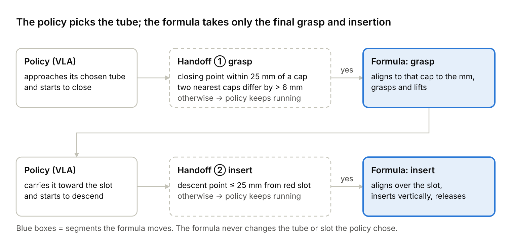
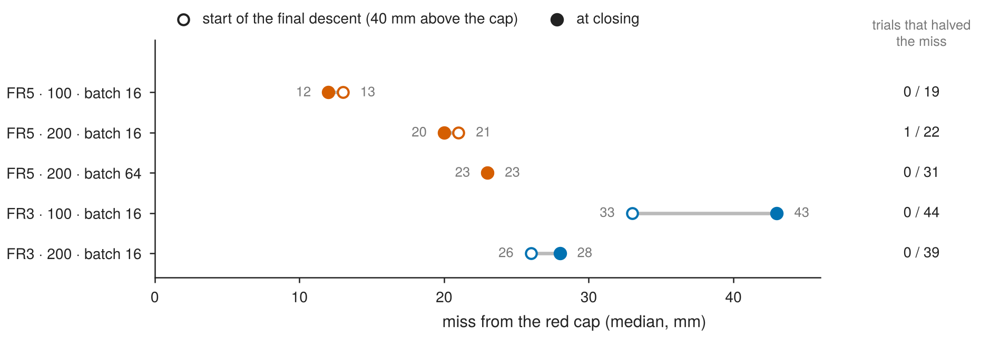
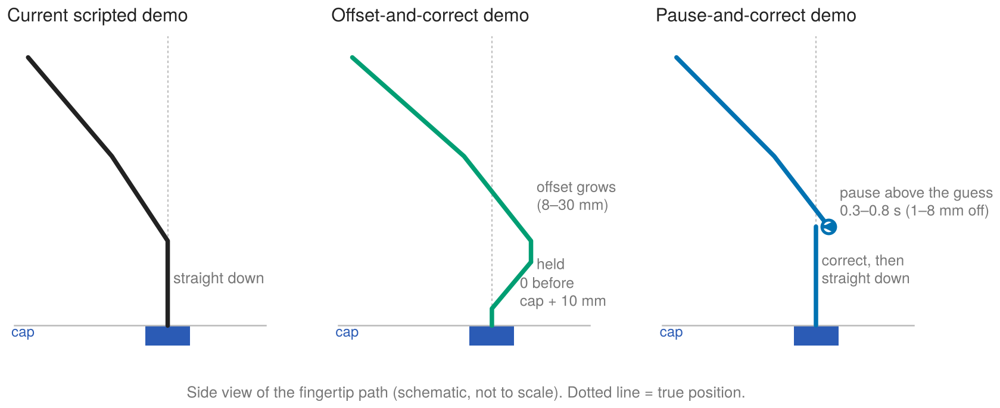
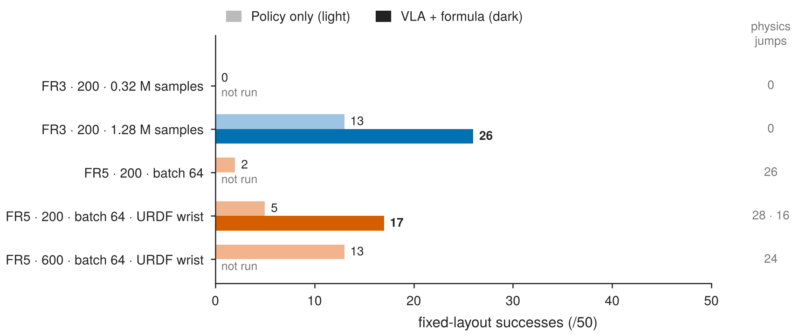
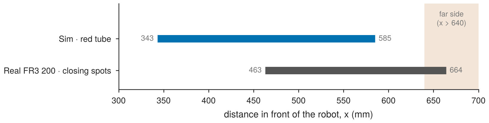

# Report 6 — Progress log 11-12 night – 11-13 daytime: Improvement experiments — VLA + formula bench, training amount, physics jumps, demos that correct an offset

2026-11-12 (Thu) night – 11-13 (Fri) 15:40 · Sim-to-Real Post-Training (simulation part) · Isaac Sim 6.0.1 · Isaac Lab 3.0 · GR00T N1.7 · [한국어](README.md)

What we did in the day after stopping the main bench and switching to improvement experiments in [Report 5](../report05_main_bench_stop/README_EN.md). We moved the two tools used in real-robot evaluation (VLA + formula · the S0–S9 stage table) to the sim bench, increased the training amount, confirmed that the failure is "the offset is not corrected during the final descent", and then designed new demos that contain exactly that scene.

## Summary

- **The two tools from real-robot evaluation moved to the sim bench (11-12 night).** VLA + formula (the policy chooses the target; only the final grasp and insertion are handed to the formula) and S0–S9 stage scoring. The scoring thresholds were fixed before looking at results.
- **More training lifted FR3 for the first time (11-13 morning).** On the same 200 demos, 4× the training samples took fixed-layout policy-only success from 0/50 to 13/50; VLA + formula reached 26/50.
- **FR5 physics jumps were not caused by wrist torque.** Lowering the wrist torque limit left the jumps unchanged (26 → 28/50), so we dropped the hypothesis. The remaining candidates are the gripper and contact model.
- **We put a number on the shape of the failure.** The policy closed with whatever offset it had at the start of the final descent. Only 1 of 155 trials cut the offset by half or more during the descent.
- **We built two kinds of demos that contain that scene.** Demos that approach with a deliberate offset and correct it on the way down (a DART-like method), and pause-and-correct demos that, like the real scripted collector, "stop, measure, correct, then descend".
- **One correction.** The earlier note "all models were trained with color jitter (including hue)" was wrong; GR00T's default is no jitter. From here on, comparison runs are trained with jitter on.

## 0. Terms used in this log

| Term | Meaning |
|---|---|
| VLA + formula | Execution where the policy chooses the target, and the scripted-demo formula takes over the final grasp when the policy tries to close within 25 mm of a cap, and the final insertion when it tries to descend within 25 mm of the red slot (same structure as the real FR3 station) |
| S0–S9 | The same stage table as on the real robots. S1 target choice · S2 approach · S3 alignment · S4 contact · S5 hold · S6 lift · S7 extract · S8 transport · S9 insert. Each trial gets the single stage where it first failed |
| Final descent | From 40 mm above the cap top down to the moment of closing |
| Offset-and-correct demo | A demo that deliberately misses by 8–30 mm on the approach and corrects to the true position on the way down |
| Pause-and-correct demo | A demo that goes above a guessed position (truth + 1–8 mm), stops, corrects, then descends straight |
| Color jitter | Randomly varying brightness · contrast · saturation · hue of the training images |

## 1. 11-12 (Thu) night — The real-robot evaluation tools on the sim bench

**VLA + formula.** We used the same rules as the real FR3 station.

1. Measure the scene once at the start (both cap positions · red slot · rack top height).
2. Each time the policy outputs an action chunk, decide whether to hand over.
   - Grasp: hand over when the policy outputs "close" in two consecutive steps, the nearest cap to that point is within 25 mm, and the other cap is more than 6 mm farther.
   - Insert: hand over when the policy tries to lower the bottom of the held tube below rack top + 25 mm, or outputs "open" in two steps, and that point is within 25 mm of the red slot.
3. If the condition is not met, that chunk runs as the policy gave it and the reason is logged.

**Figure 1.** Structure of VLA + formula. The policy chooses the tube and slot; the formula takes over the final grasp and insertion only when the handover condition holds.

The principles are also the same as on the real robot. The policy decides the target, and the formula never picks a different tube or slot (if the policy goes to the yellow tube, the formula grasps the yellow tube). The model and its inputs are unchanged, and the results are not mixed with the policy-only bench.

| Differences from the real robot | Real FR3 | Sim |
|---|---|---|
| Start scene | Detected from the wrist image (with error) | Ground-truth positions measured in sim |
| Tube pose in the hand | Unknown | Re-measured after grasping and above the hole |
| Sag compensation · settling · slow lift | Yes | No (the sim follows commands exactly) |

Because of the first two rows, the sim formula is better off than the real one. Sim VLA + formula numbers are not compared directly with real numbers (a formula under real-robot conditions was checked separately in [Report 9](../report09_final_1116_1119/README_EN.md)).

**S0–S9 scoring.** Scored from bench records (start scene · fingertip and gripper at every step · actual motion of the red tube · success verdict) without rerunning the bench. The 25 · 60 · 40 · 20 mm thresholds are the same as on the real robot; the S2 height and the S3 · S4 ranges were taken from the scripted sim demo data and fixed before looking at results. Physics-jump trials are failures and their count is reported separately.

**What ran automatically that night.** Five models retrained with batch size 64 were benched on the fixed layout as soon as each finished training. Models trained on data that the real team collected with sim settings matched to the real FR5 were benched separately, in a dedicated bench folder that copies those settings.

- Files: `lab/common_bench_hybrid.py` 1.0 (loaded only with `--bench-hybrid`) · multi-scene collector 1.7 (bench trajectory log `progress/bench_track/`) · `tools/common_bench_stage.py` 1.0. Confirmed that a bench run without the option gives the same results as 1.6.
- The time limit is 60 s, same as the policy-only bench. If the limit is reached while the formula is moving, it gets up to 20 s more to finish (`hybrid.over_limit`).

## 2. 11-12 (Thu) night — FR5 physics jumps: a wrist-torque hypothesis, tested and dropped

**What we saw.** On the FR5 200-demo model (batch size 64), 26 of 50 fixed-layout trials ended in a physics jump.

**What we checked (reading bench records only).**

| Check | Result |
|---|---|
| Did the command jump first? | No — trials where the actual joint was more than 5° from the command 0.2 s before the jump: 0/26 |
| Which joint | Wrist (j5 19 · j4 6 · j6 1) |
| Wrist singularity? | No — j5 is close to 90° |
| Position just before the jump | Above the original rack with the gripper open near cap height 14 · near the table 6 · above the empty rack 3 · while lifting 2 |

**Hypothesis.** It jumps when the arm pushes while the fingers are touching a cap, rack or table. In sim FR3 the wrist torque limit is the real value (12 N·m), so it yields on contact, but in sim FR5 the wrist has the same 150 N·m as the shoulder and pushes hard.

**Test (criterion set first).** Same model, same 50 scenes, only the wrist torque limit changed to the URDF value of 28 N·m. Fixed if jumps ≤ 5/50 and normal motion (actual − command) is unchanged.

**Result (11-13 08:43).** Jumps 28/50 (before 26/50), random layout 13/50 (before 11/50). **The wrist torque limit was not the cause.** With the same model, VLA + formula reduced jumps to 16/50, and sim FR3 had 0 jumps. We read this as jumps happening when the policy presses the fingers against caps and racks, and moved the next candidate to the gripper (AG-95) model — it models a closed linkage as an open chain plus software-mimicked joints, so when the fingertips are pressed, the mimic joints and the driven joint can fight each other.

- Corrected: the first look said "20 trials jumped in mid-air", which was wrong. The bench only flagged a jump once a joint exceeded 6.8 rad, by which point j5 had already turned hundreds of degrees, and the fingertip height had been computed from that pose.
- Scoring tool 1.1: for physics-jump trials, only the record before the jump began (the first step where the actual joint is more than 10° from the command) is used — while jumping the tube was flung away and "lift · transport" passed falsely (e.g. a 433 mm "lift").

## 3. 11-12 (Thu) night — The shape of the failure: the offset is not corrected in the final descent

Taking only trials that closed on the red side, we measured whether the offset shrank during the final descent (40 mm above the cap top → closing), fixed layout.

| Bench | Trials closed on the red side | Offset at descent start → at closing (median) | Of trials more than 8 mm off, those that halved the offset |
|---|---|---|---|
| FR5 100 demos · batch size 16 | 24 | 13 → 12 mm | 0 / 19 |
| FR5 200 demos · batch size 16 | 25 | 21 → 20 mm | 1 / 22 |
| FR5 200 demos · batch size 64 | 34 | 23 → 23 mm | 0 / 31 |
| FR3 100 demos · batch size 16 | 45 | 33 → 43 mm | 0 / 44 |
| FR3 200 demos · batch size 16 | 42 | 26 → 28 mm | 0 / 39 |

**Figure 2.** The offset does not shrink in the final descent. Median offset of trials closed on the red side — at the start of the descent (open dot) and at closing (filled dot). The right column is the number of trials more than 8 mm off that cut the offset by half or more during the descent.

**Only 1 of 155 trials cut the offset by half or more during the descent.**

- Not the cause: unseen layouts (random layouts built like the training layouts were not better than the fixed layout), positions not covered by data (every bench position has a training demo within about 1 cm), inserting into the neighbouring hole (1 of 250 trials).
- What improved: batch size 64 raised the share that chose red (of trials that closed, red side 25/50 → 34/48, "different").
- Interpretation: the scripted demos always arrive exactly above the cap or slot and descend straight. The policy has never seen "descending with an offset and correcting sideways". So it estimates the target from the image only to within 1–3 cm, descends, and the offset remains.

**Offset-and-correct demos (a DART-like method).** To put this scene into the data, we added an option to the scripted-demo planner that gives each demo an offset of 8–30 mm in a random direction.

| Phase | Where the offset grows | Where it is held | Where it returns to 0 |
|---|---|---|---|
| Pick | Home → above the tube | Until about 45 mm above the cap top | Before the fingertips reach the top of the surrounding caps + 10 mm |
| Transport | While moving after lifting | Until about 36 mm above the height where the tube bottom stops | Before the tube bottom reaches the top of the surrounding tubes + 8 mm |

**Figure 3.** The two new demo types (schematic). Middle = offset-and-correct demo (8–30 mm off on the approach, back to 0 on the way down); right = pause-and-correct demo (stop above the guessed position, correct, then descend straight; Section 5). The grasp and insertion positions are the same as in the current scripted demo (left).

Grasp position, alignment and insertion are unchanged, so whether a demo succeeds is also unchanged. The offset direction is random per demo, so its mean is 0. That night we collected 200 such demos for each of FR5 and FR3 (random layout 100 · random tube holes too 100) and combined them with the existing 200 into 400-demo datasets. The pre-registered criterion was "the policy has learned to correct if at least 30 % of trials that were more than 8 mm off at the start of the descent halve the offset by the time they close".

These 400-demo models were trained but not benched, because the next afternoon we decided to re-collect all data in settings matched to the real robots ([Report 7](../report07_sim2real_1000/README_EN.md)). The offset-and-correct demos became one branch of the new 1,000-demo dataset.

## 4. 11-13 (Fri) morning — Overnight results: more training lifted FR3

| Fixed layout · 50 scenes | Policy only | VLA + formula | Physics jumps |
|---|---|---|---|
| FR3 200 demos · 0.32 M training samples (as of 11-12 daytime) | 0/50 | — | 0 |
| **FR3 200 demos · 1.28 M training samples** | **13/50** | **26/50** | 0 |
| FR5 200 demos · batch size 64 | 2/50 | — | 26 |
| FR5 200 demos · batch size 64 · URDF wrist value | 5/50 | 17/50 | 28 · 16 |
| FR5 600 demos · batch size 64 · URDF wrist value | 13/50 | 18/31 (unfinished) | 24 · 10 |

**Figure 4.** Overnight bench (fixed layout, 50 scenes). Light bars = policy only, dark bars = VLA + formula. The right column is the number of physics-jump trials (policy only · VLA + formula). The FR5 600-demo VLA + formula run reached only 31 trials and is left out of the figure (18/31).

- **Training amount had a large effect on FR3.** On the same 200 demos, 4× the training samples took success from 0/50 to 13/50 ("different"), and the median distance from the red cap at closing went from 28 to 12 mm. On the random layout: policy only 6/50 · VLA + formula 30/50.
- **VLA + formula was about 2–5× policy only.** Where the formula took over, the closing position was 1 mm from the cap. With the policy alone, the first failing stage was S3 alignment · S4 contact · S5 hold (the last few cm).
- **On FR5, physics jumps masked the results.** Jumps were 0/180 trials on FR3 and 238/750 (32 %) on FR5. Looking only at trials without a jump, the two robots were similar, but that split was made after seeing the results, so we do not use it as a main result.

**Decision (user, 11-13 11:31).** Both FR5 and FR3 train with batch size 64 × 20,000 updates (1.28 M samples). On FR3 a batch of 64 barely fits on one GPU, so gradients from two passes of 32 are summed before each update (gradient accumulation — the same update as computing 64 at once).

- The FR3 200-demo folder named "batch size 64" was actually trained as 32 × 40,000 updates (same number of samples). That model is left out of the main table and used only as a side comparison of "same samples, different batch size".
- Incident (08:01 – 09:00): the bash process left behind when a queue job started the server had the same name as the queue script, so the next job and the watchdog thought "the previous job is still running" → stopped only that bash and left the server running.
- At 13:26 FR3 was mistakenly started as "64 × accumulation 2 = 128" (GR00T's global batch size is the size before accumulation, and the check read it the other way round) → restarted as 32 × 2 at 13:33. The wrong folder was renamed and kept.

## 5. 11-13 (Fri) 13:26 — Pause-and-correct demos: "stop, measure, correct, then descend" like the real collector

**Why (user).** The real scripted collectors have a correction move right before grasping and right before inserting, and that move stays in the real training data. The sim demos have no such step.

| Robot | Right before grasping | Right before inserting |
|---|---|---|
| Real FR3 | 0.5 s settling correction, about 4 s still after grasping | 1 s settling above the slot, slides in under compliant control |
| Real FR5 | Waits until the arm is within 0.8° (up to 2.5 s) | 0.3 s stop above the hole + one third-person image to measure the sideways offset and move 0.2–9 mm, inserts slowly correcting up to 3 mm sideways |

**What the sim does.** For the pick, it goes above the cap at a guessed position (truth + random 1–8 mm), stops for 0.3–0.8 s, corrects sideways to above the truth, and descends straight to grasp. For insertion, it stops above the guessed hole, corrects with hole alignment and inserts slowly at real-robot speed (FR5 10 mm/s · FR3 30 mm/s). The end positions (grasp · insertion) are unchanged, so with the correction off the plan is exactly as before.

The fingertip path is the right panel of Figure 3.

**What to collect (user decision, 13:35).** Per robot, 300 pause-and-correct demos + 300 "offset + correction" demos = 600 (100 each of fixed · random · random tube holes too). Collect FR3 first, and look for the FR5 physics jumps in the meantime.

**Pre-registered comparison.** 600 pause-and-correct demos vs. 600 demos of the current kind, same training setup, same 50 scenes. The random layout, covered by both datasets, is the main comparison. The target (user) was 70–80 % in sim, above the real 60 %.

## 6. 11-13 (Fri) 14:24 – 14:50 — Collection speed, the color-jitter correction, next step on physics jumps, gaps in the real distribution

**Collection speed.** The FR3 600 demos were expected to finish between 17:30 and 18:00. The memory modules were at 69–75 °C (all four above the limit), so **we did not raise Isaac to three instances**. We kept the data unchanged and only cut work — cameras are read only at the recorded frames the converter uses (10 Hz), and recording frames are handed over without copying (video files byte-identical). What we decided not to do: CPU physics (changes motion), lower render quality, faster motion (bad data for VLA training), 16 scenes (halves the number of lighting variants).

**Color jitter corrected.** On 11-11 we wrote that "all models were trained with brightness 0.3 · contrast 0.4 · saturation 0.5 · hue 0.08 jitter", which was wrong. GR00T's default is no jitter, and the saved settings for both our default training and the real team's FR5 training were "none". We had read the training script's "values to use when enabled" as the actual setting. So "hue jitter" was removed from the FR5 cause ranking, and from 14:48 all FR3 runs and the FR5 comparison runs train with jitter on.

**FR5 physics jumps — next step.** We went back over 920 FR5 bench trials from the last three days. In the 385 trials that jumped, the command never jumped first (if anything the command was slower 1 s before the jump), and the first joint to deviate by more than 10° was the wrist. Together with the wrist-torque result, this points to "finger · contact physics" rather than "arm commands".

- Decision (user, 14:50): **the FR5 600 pause-and-correct demos are collected with the current physics.** They must use the same physics as the 600-demo baseline for a clean comparison. A physics fix is searched for separately with test benches and, if found, applied to benches only.
- Pre-registered physics tests: more joint solver iterations (solv) · lower gripper joint force (fsoft) · grasp attachment off while held (only to isolate the cause). Fixed if "jumps ≤ 5/50 and normal motion unchanged". Results in [Report 8](../report08_dagger_1114_1116/README_EN.md).

**Gaps in the real distribution (user suggestion).** We compared the sim layouts with the positions in the 200 real FR3 demos.

| Item | Sim (random · random tube holes too) | Real FR3 200 demos |
|---|---|---|
| Red tube x (in front of the robot) | 343–585 mm | closing positions 463–664 mm |
| x > 640 mm (far side) | 0 % | present (empty grasps concentrated there) |
| Insert into the same rack | 0 % · 50 % | (real FR5 47 %) |

**Figure 5.** Where the red tube is placed — sim vs. real FR3. The sim covers an area about 10 cm closer to the robot, and the far side present in the real data (x > 640 mm) is missing from the sim.

- The sim covered an area about 10 cm closer to the robot than the real data. The far side that is empty in the real data is also empty in the sim, so the current sim data cannot fill the real gaps.
- Some gaps come from the real collection rules (real team's answer): layouts outside the tried range or likely to fail with a small error were rejected before running, and grasps that needed more than 30° of wrist rotation were forbidden. So the real data has no layouts with large wrist rotation, none packed tightly against a neighbouring tube, and nothing at the edge of the workspace.
- Filling these gaps would pay off in mixed real + sim training (real-robot performance), not directly in the sim bench score.

## 7. 11-13 (Fri) 15:00 – 15:40 — Running without hands-on steps

- **Collect → send → train.** When a collection finishes, it is converted to the real format and sent to the training server, and it enters the training queue only if the demo count is right.
- **Training server cleanup (user decision).** Deleted all old models trained with batch size 16 (including the four 600-demo models from 11-10 — small records kept). Free space went from 60 to 341 GB.
- **GPU yielded to the real team (user).** The real team ran a 2–3 hour real FR5 evaluation on one training-server GPU. If our training used that GPU and the CPU, the real policy would answer more slowly and the real results would wobble, so our training was paused during that time and resumed automatically once the real policy was taken down.
- **Automatic bench queue.** Models are benched as soon as they appear on the server, but only when the GPU has more than 10 GB free and fewer than 4 Isaac instances are running (pause-and-correct 600 comparison → offset-correction comparison → real-team-settings models).

About an hour later this plan was replaced by the decision to "match the sim to the real settings from scratch" ([Report 7](../report07_sim2real_1000/README_EN.md)).

## Appendix. Development notes for this period

Development notes 25 (VLA + formula · stage scoring) · 26 (overnight schedule) · 27 (physics jumps · wrist-torque test) · 28 (why success is low) · 29 (offset-and-correct demos) · 30 (overnight order) · 31 (overnight bench results) · 32 (pause-and-correct demos) · 33 (collection speed · color jitter · physics jumps · distribution). Numbers are from our first sim settings on the same 50 scenes not in training (first try per scene · physics jump = failure).
