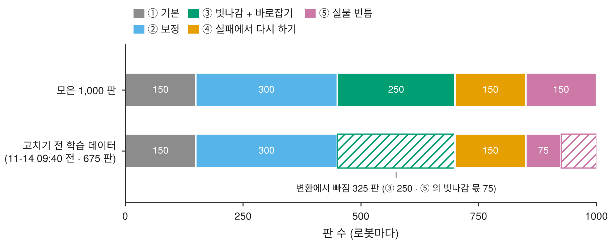
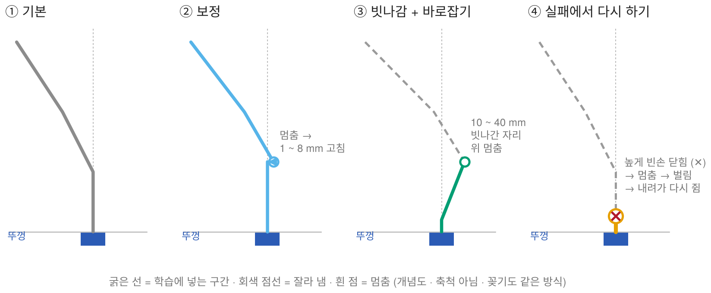
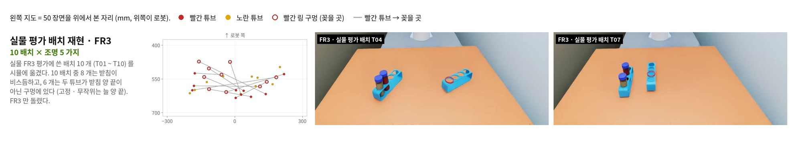
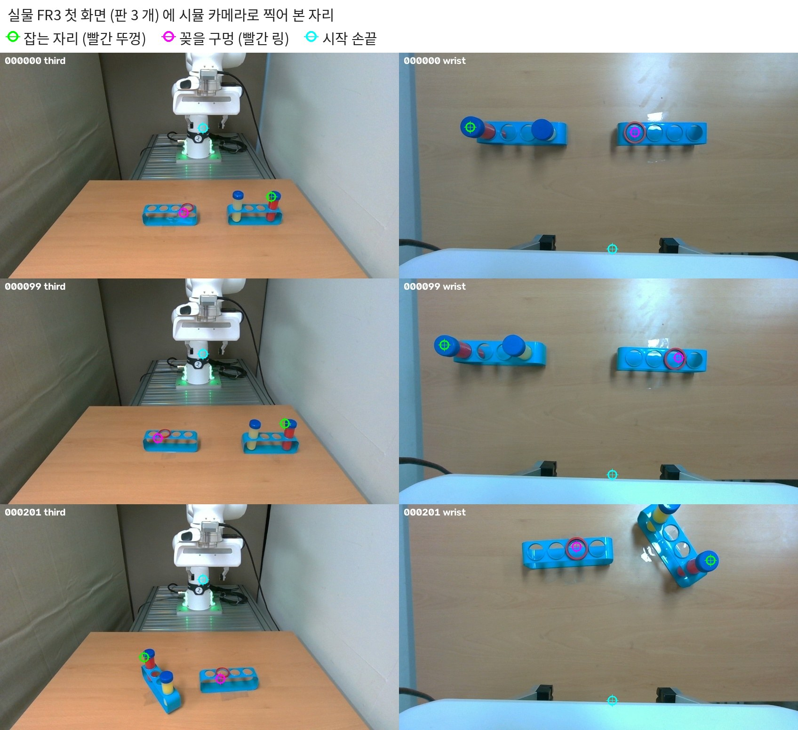

# 보고서 7 — 진행 기록 11-13 오후 \~ 11-14 오전: sim-to-real 로 방향 전환과 1,000 판 데이터

2026-11-13 (금) 15:50 \~ 11-14 (토) 10:50 · Sim-to-Real Post-Training (시뮬레이션 파트) · Isaac Sim 6.0.1 · Isaac Lab 3.0 · GR00T N1.7 · [English](README_EN.md)

[보고서 6](../report06_improve_1112_1113/README.md) 의 개선 실험을 하던 중, 「시뮬 안에서만 맞는 설정은 실물로 옮길 때 쓸모가 없다」 는 판단으로 방향을 바꿨습니다. 시뮬을 실물 설정 (카메라 · 받침 높이 · 시작 자세 · 색) 에 다시 맞추고, 연구 결과에 비추어 데이터 구성을 정한 뒤 로봇마다 1,000 판을 새로 모은 기록입니다.

## 요약

- **어떤 데이터가 VLA 학습에 좋은지 먼저 정리했다 (11-13 15:50).** 가장 강한 것은 정책 자신의 실수에서 시작하는 바로잡기 (DAgger 계열), 그다음이 빗나간 상태에 「바로잡는 행동」 을 정답으로 붙이는 것 (DART) 이었다. 판 수를 늘리는 것은 효과가 적었다.
- **sim-to-real 로 방향을 바꿨다 (16:27).** 사진에서 어림한 우리 설정으로는 더 모으지 않고, FR5 는 실물 팀이 맞춘 설정, FR3 는 로봇 PC 자료로 새로 맞춘 설정에서만 모은다.
- **FR3 실물 설정을 만들었다.** 실물 카메라 보정값으로 3인칭 카메라를 다시 풀어 실물 모형과 평균 0.52 px 로 맞췄고, 받침을 23.5 mm 낮춰 잡는 높이를 실물 실측과 0.3 mm 로 맞췄다.
- **색을 실물에 맞췄다.** 실물 · 시뮬 첫 화면을 학습 데이터 형식으로 바꾼 뒤 책상 · 벽 색을 재서 장면 색과 카메라별 흰색 균형을 고쳤다.
- **로봇마다 1,000 판을 같은 규칙으로 모았다.** 기본 150 · 보정 300 · 빗나감 + 바로잡기 250 · 실패에서 다시 하기 150 · 실물 빈틈 150 판이다. 곧장 가는 깨끗한 시연은 150 판뿐이다.
- **실수 하나를 잡았다 (11-14 09:40).** 변환에서 빗나감 + 바로잡기 시연이 통째로 빠져, 「850 판」 이 실제로는 525 판이었다. 변환기를 고치고 다시 학습했다.
- **모델이 받는 학습 영상의 색이 흐렸다 (11-14 10:23).** 서버 · 벤치의 입력 · 행동 처리는 학습과 맞았지만, FR5 학습 영상의 압축이 작은 빨간 뚜껑의 빨강을 약 80 % 지우고 있었다. 이것이 [보고서 8](../report08_dagger_1114_1116/README.md) 의 「색 보존」 실험으로 이어졌다.

## 0. 이 기록에서 쓰는 말

| 말 | 뜻 |
|---|---|
| 우리 설정 | 받침 높이 · 시작 자세 · 3인칭 카메라를 사진에서 어림해 만든 처음 시뮬 설정 |
| 실물 맞춤 시뮬 | 실물 로봇 PC 자료 · 실물 팀 설정값으로 다시 맞춘 시뮬 설정 |
| ① \~ ⑤ | 1,000 판 데이터의 다섯 갈래 (1 절 표) |
| 고정 계열 배치 (CJ) | 벤치 고정 배치처럼 두 랙이 한 줄로 같은 방향 — 학습용은 통째로 ±20° 돌리고 ±40 mm 옮김 |
| 실물 평가 배치 재현 (T) | 실물 FR3 평가에 쓴 배치 10 개 (T01 \~ T10) 를 시뮬에 그대로 놓은 벤치 장면. 학습 장면에서는 뺌 |
| 흰색 균형 | 카메라가 색을 어떻게 찍는지 맞추는 R · G · B 곱 |
| 열린 고리 시험 | 로봇을 움직이지 않고, 정해 둔 화면 · 상태를 정책에 넣어 내놓는 행동만 보는 시험 |

## 1. 11-13 (금) 15:50 — 어떤 데이터가 VLA 학습에 좋은가

**사용자 물음.** 지금 모으는 데이터의 분포 · 양상이 나빠 이번에도 성공률이 낮게 나올 수 있는가. 어떤 형태의 데이터가 VLA 학습에 도움이 되는가.

| 연구 결과 | 요점 |
|---|---|
| 정책 자신의 실수에서 시작하는 바로잡기 (DAgger 계열 — HG-DAgger, RaC, IntervenGen) | 학습한 정책이 틀리기 시작하면 전문가가 넘겨받아 바로잡고 그 구간만 학습에 더함. 무작위로 넣은 빗나감이 아니라 정책이 실제로 만드는 빗나감에서 시작해 가장 강함 |
| 빗나간 상태의 정답은 「바로잡는 행동」 (DART · 젓가락 집기) | 시연 중 작은 잡음으로 빗나간 상태를 만들고, 정답은 바로잡는 행동. 1 cm 물체 집기가 37 % → 72 % |
| 같은 상태에서는 같은 행동 (Data Quality in Imitation Learning) | 같은 상태에서 행동이 들쭉날쭉하면 성능이 떨어짐. 다양성을 늘리다 일관성을 해치면 손해 |
| 판 수보다 장면 다양성 (Data Scaling Laws in Imitation Learning) | 환경 · 물체 다양성이 판 수보다 중요하고, 판 수는 문턱을 넘으면 효과가 적음 |

**지금 데이터에 비추면.** 지금 방식 · 보정 단계 · 빗나감 시연 모두 「정책 자신의 실수」 가 빠져 있었다. 또 빗나감 시연은 빗나가는 길까지 정답으로 학습되고 있었다 (FR5 행동은 「다음 상태」 라 빗나가는 움직임도 그대로 배움). 그래서 이 데이터들의 결과가 낮아도 「바로잡는 데이터는 소용없다」 고 결론 내리지 않기로 했다.

**정한 방향 (제안 → 이후 실행).**

1. 빗나감 시연에서 빗나가는 길은 잘라 내고, 빗나간 자리부터 시작하는 조각만 학습에 넣는다 (3 절의 ③).
2. 정책 자신의 실수 바로잡기는 시뮬의 VLA + 수식 실행이 그대로 데이터 생성기가 된다 — 데이터용으로만 넘김 범위를 넓히고, 학습에는 수식 구간만 넣는다 ([보고서 8](../report08_dagger_1114_1116/README.md) 의 DAgger).
3. 다양성은 시작 상태 (빗나감 크기 · 방향, 배치 · 조명) 에 두고, 마지막 접근 · 멈춤 · 하강은 무작위 없이 같은 규칙으로 둔다.

## 2. 11-13 (금) 16:27 — sim-to-real 로 방향 전환

**결정 (사용자 16:27 · 16:31 · 16:36).**

- 주 목표는 sim-to-real 이다. 시뮬 설정이 실물과 다르면 시뮬 안에서는 맞아도 실물로 옮길 때 쓸모가 줄어든다.
- 우리 설정으로는 더 모으지 않는다. 기다리던 FR5 보정 600 판 수집과 물리 시험을 멈췄다 (모은 것 없음). 거의 끝난 FR3 보정 600 판은 마저 모아 시뮬 분석용으로만 쓴다.
- FR5 는 실물 팀이 실물 FR5 에 맞춘 설정으로 새로 모은다. FR3 는 실물 팀이 로봇 PC 에서 읽어 준 자료 (카메라 · 높이 · 제어) 가 온 뒤 실물 설정을 만들어 모은다.

**FR5 실물 팀 설정.** 우리 코드 · 설정에 실물 팀이 바꾼 값 11 개를 넣은 새 폴더를 만들었다 — 받침 높이 (책상보다 23 mm 아래) · 시작 자세 (손끝 437, −19, 292 mm — 새 폴더 코드로 계산해 0.0 mm 차) · 3인칭 카메라 높이 · 물체 영역 · 랙 방향 · 그리퍼 값 표 · 손목 화면은 돌리지 않음. 여기서 보정 단계 · 빗나감 + 보정 시연 300 판을 먼저 모았다 (18:03 끝). 빗나감 크기는 정책의 실제 빗나감에 맞춰 10 \~ 40 mm 로 넓혔다.

- 바로잡은 것: 「FR3 은 시뮬을 섞으면 나빠졌다」 는 맞지 않음 — 실물 FR3 두 평가는 날짜 · 배치가 달라 판단할 수 없음 (실물 FR3 담당 답). FR5 는 좌표 · 높이를 맞추지 않고 섞어 실물 성공이 거의 0 % 였음.
- FR3 실물 자료는 로봇 PC 에서 읽기만 해서 모은 묶음 (`sim_facts_1113_1754`) 으로 받음.

## 3. 11-13 (금) 17:53 \~ 22:04 — 데이터 구성과 양

**결정 (사용자).** 두 로봇 같은 양 (17:53), 로봇마다 1,000 판 (18:06 → 18:38), FR5 도 실물 팀 750 판을 쓰지 않고 같은 규칙으로 새로 모음 (18:10, 실물 팀 750 판은 비교용).

| 갈래 | 판 | 동작 | 학습에 넣는 구간 |
|---|---|---|---|
| ① 기본 | 150 | 실물 자동 수집기와 같은 동작을 실수 없이 | 전부 |
| ② 보정 | 300 | 어림 자리 (정답 옆 1 \~ 8 mm) 위에서 0.3 \~ 0.8 초 멈춤 → 옆으로 고침 → 내려감 (꽂기도 같음) | 전부 |
| ③ 빗나감 + 바로잡기 | 250 | 10 \~ 40 mm 빗나간 자리 위에서 멈춤 → 내려가며 바로잡음 | 빗나간 자리부터 (빗나가는 길은 잘라 냄) |
| ④ 실패에서 다시 하기 | 150 | 헛잡음 → 다시 쥠, 꽂다 걸림 → 다시 꽂음 | 실패한 상태부터 |
| ⑤ 실물 빈틈 | 150 | ② · ③ 동작 반반, 실물 데이터에 없던 먼 쪽 영역 · 넓게 흔든 고정 계열 | ② · ③ 과 같음 |

**그림 1.** 로봇마다 모은 1,000 판의 구성. 아래 막대는 11-14 09:40 에 고치기 전의 학습 데이터다 — 빗나감 + 바로잡기 시연이 변환에서 통째로 빠져 675 판이었다 (7 절).

**그림 2.** ① \~ ④ 의 손끝 길 (개념도). 굵은 선이 학습에 넣는 구간이다. ③ 은 빗나가는 길을 잘라 내고 빗나간 자리에서 멈춘 뒤부터, ④ 는 실패한 상태 (높게 빈손으로 닫음) 에서 멈춘 뒤부터 넣는다. ⑤ 는 ② · ③ 동작을 실물 데이터에 없던 영역에서 한다.

- 곧장 가는 깨끗한 시연은 ① 150 판뿐이다. 지금 실패의 거의 전부가 「마지막 1 \~ 3 cm 를 고치지 않음」 이라, ② · ③ 이 그 동작을 직접 보여 준다.
- 배치는 무작위 38 % · 튜브 자리도 무작위 43 % · 고정 계열 19 % 다. 무작위 배치의 15 % 는 실물 평가처럼 두 랙을 나란히 두었다.
- 실물 FR3 평가 배치 T01 \~ T10 은 학습 장면에서 뺐다 (두 랙 모두 40 mm · 20° 안이면 다시 뽑음). 벤치 고정 배치와 똑같은 장면도 학습에 없다.

**그림 3.** 실물 평가 배치 재현 (T). 실물 FR3 평가에 쓴 배치 10 개를 시뮬에 그대로 놓은 벤치 장면이다. 학습 장면에서는 이 배치와 두 랙 모두 40 mm · 20° 안인 장면을 뺐다.

- 같은 1,000 판에서 비율대로 고른 200 판 모델 (양 대 구성 비교), 시뮬 모델에서 실물 200 판으로 이어 학습한 모델도 만들기로 했다 (22:02 · 21:55). 노란 링 과제는 미뤘다.
- 데이터가 다 모이면 실물 형식으로 바꿔 학습 서버로 보내고, 학습이 끝날 때마다 벤치하게 했다.

## 4. FR3 실물 설정 — 로봇 PC 자료로 다시 맞춤

| 항목 | 새 값 | 맞춘 근거 |
|---|---|---|
| 3인칭 카메라 | 받침 기준 (1.060, −0.028, 0.527) m · 숙임 −30.6° · 화각 88.7° | 실물 보정값 (화면 → 책상 변환) 을 실물 카메라 내부값으로 풀어 맞춤 — 실물 모형과 평균 0.52 · 최대 2.39 px. 예전은 (1.26, −0.017, 0.471) m · −21.4° · 69.7° |
| 손목 카메라 | 손 기준 (62.3, −16.3, −46.2) mm · 화각 88.9° | 실물 보정 8 점으로 PnP (재투영 4.6 px), 실물 모형과 평균 0.93 px |
| 홈 관절 | 실물 home.json 그대로 | 시작 손끝 (434.3, 17.3, 297.2) mm 와 0.1 mm |
| 받침 · 로봇 높이 | 23.5 mm 낮춤 | 계획 잡는 높이 109.9 mm ↔ 실물 실측 109.6 mm (200 판, 쥐기 순간) |
| 작업 영역 · 랙 방향 | 로봇 앞 0.37 \~ 0.74 m · 좌우 ±0.30 m · ±90° | 실물이 잡은 자리 x 480 \~ 625 · y −207 \~ 224 mm |
| 손목 규칙 | 안 돌림 → 옆 뚜껑에 닿으면 랙 줄과 수직 → 30° 넘으면 그 장면 안 함 | 실물 자동 수집기 규칙 |
| 속도 · 멈춤 | 속도 배율 0.4 \~ 0.6, 꽂기 30 mm/s, 칸 위 멈춤 0.8 \~ 1.2 초 | 실물 기록 |

실물 첫 화면 3 판에 시뮬 카메라로 빨간 뚜껑 · 링 자리를 찍어 보면 두 카메라 모두 제자리에 찍혔다.

**그림 4.** FR3 실물 첫 화면에 시뮬 카메라를 맞춘 결과. 실물 데이터의 첫 화면 3 개 (왼쪽 3인칭 · 오른쪽 손목) 에, 새로 맞춘 시뮬 카메라로 잡는 자리 · 꽂을 구멍 · 시작 손끝을 찍었다. 두 카메라 모두 제자리에 찍힌다.

## 5. 11-13 (금) 19:15 \~ 23:40 — 색을 실물에 맞춤

**현상 (사용자 19:14).** 실물 설정으로 시험 수집한 첫 화면을 실물 첫 화면과 나란히 보니 책상 색이 크게 달랐다. 수집을 멈추고 색을 고친 뒤 이어 모았다.

**재는 방법.** 시뮬 첫 화면을 학습 데이터와 똑같이 바꾼 뒤 (밝기 맞춤 · 흰색 균형 · 크기) 책상 · 벽 · 그리퍼의 RGB 가운데값을 쟀다. 실물은 학습 데이터 첫 화면 그대로 (FR3 3 판 · FR5 20 판).

- 시뮬은 책상에 넣은 색 변화의 절반쯤만 화면에 나왔다. 벽은 넣은 만큼 나왔다.
- 실물 FR3 손목 카메라는 3인칭보다 차갑게 찍혔다 (흰 그리퍼가 하늘색). 시뮬은 두 카메라가 같은 색으로 본다 → 학습 데이터로 바꿀 때 카메라별 흰색 균형을 넣었다.
- 실물 FR5 3인칭은 푸르게 찍혔다 (카메라 흰색 균형 고정). FR3 실물 책상에 FR5 카메라의 푸른 정도를 곱하면 FR5 실물 책상과 거의 같아, 두 책상은 같은 나무로 보았다.

**마지막 값 (11-13 23:40).** FR5 는 48 판을 재서 3인칭 책상의 색 비율 (빨강 ÷ 초록 · 파랑 ÷ 초록) 을 1.037 · 0.824 로 실물 (1.036 · 0.824) 에 맞췄고, FR3 손목 책상도 1.037 · 0.864 ↔ 실물 1.048 · 0.872 로 맞췄다. FR3 책상은 빨강만 8 % 모자랐지만 학습 색 흔들기 범위 안이라 두었다. 흰색 균형은 학습 데이터로 바꿀 때만 쓰고, 수집 장면의 색은 그대로다.

- 고치는 동안 모인 FR3 데이터는 책상 색이 세 가지로 섞였다 (예전 207 판 · 1 차 183 판 · 마지막 나머지). 책상 색을 흔든 효과로 보고 그대로 썼다.

- 판단 실수 하나: 21:40 에 판 16 개 (조명이 한두 번뿐) 측정으로 「책상은 칠한 값을 바꿔도 화면이 거의 안 바뀜」 이라고 보고 FR3 손목 흰색 균형을 바꿨다가, 21:45 에 판 36 개 값으로 되돌렸다. 조명은 장면 8 개 묶음마다 한 번 뽑히므로 판 수가 적으면 치우친다.
- FR5 색 시험 수집은 두 번 다 켜지지 못함 — FR3 수집기 둘이 GPU 메모리 28.8 / 32.6 GB 를 써서 PhysX 메모리를 못 잡음. 수집 줄은 빈 메모리 10 GB 가 넘을 때만 시뮬을 켜도록 그대로 둠.
- FR3 보정 묶음은 기본 묶음보다 느려 두 수집기 합쳐 시간당 약 160 판이었다 (어림 280 판의 절반 남짓).

## 6. 11-13 (금) 23:00 — ④ 실패에서 다시 하기와 밤사이 자동 순서

| 쪽 | 실패 | 멈춤 (이 순간부터 학습에 넣음) | 다시 하기 |
|---|---|---|---|
| 집기 · 높게 | 손가락 끝이 뚜껑 윗면보다 4 \~ 14 mm 위에서 빈손으로 닫음 | 헛잡음 확인 멈춤 0.4 \~ 0.9 초 | 다시 벌림 → 곧게 내려가 쥠 |
| 집기 · 옆으로 | 뚜껑 옆으로 비킨 자리에서 빈손 쥠 | 같음 | 벌림 → 8 mm 위로 → 옆으로 → 내려가 쥠 |
| 꽂기 | 구멍에서 3 \~ 6 mm 비킨 자리로 내려가 튜브 바닥이 윗면 2 \~ 3.5 mm 위에서 멈춤 | 걸림 확인 멈춤 0.4 \~ 0.9 초 | 10 \~ 20 mm 다시 들기 → 원래 꽂기 |

- 일부러 실패하러 가는 길은 학습에 넣지 않고, 멈춤부터 끝까지만 넣는다. 시연은 판정이 성공인 것만 저장한다.
- 밤사이 사람 손 없이: FR5 수집 → ④ 넣고 시험 8 판 → 점검 → ④ 150 판 (FR3 → FR5) → 1,000 판 · 200 판 실물 형식 → 학습 서버 → 학습 → 서버 → 벤치. 수집하는 동안은 벤치를 켜지 않았다.
- **벤치 58 개를 결과 전에 정했다.** 모든 모델 × FR3 (고정 · 재현 · 무작위) · FR5 (고정 · 무작위 · 튜브 자리도 무작위) × 정책만 · VLA + 수식. 미리 정한 비교는 ④ 효과 · 양 대 구성 (1,000 판 대 200 판) · 실물 이어 학습에서 시뮬 성능이 얼마나 남나 · 실물만 모델의 시뮬 성공이다.

## 7. 11-14 (토) 09:40 — 빗나감 + 바로잡기 시연이 빠져 있었음 (고침)

**무엇이 틀렸나 (제 실수).** 밤사이 변환 로그에 「빗나감 시연 325 개 → 조각 0 개」 가 찍혀 있었다. 로봇마다 ③ 250 판과 ⑤ 의 빗나감 몫 75 판이 모두 빠져, **「850 판」 은 실제로 525 판, 「1,000 판」 은 675 판** 이었다.

그림 1 의 아래 막대가 이때 학습에 들어간 데이터다.

**까닭.** 빗나감과 보정이 함께 켜진 시연은 구멍 위 멈춤 단계 이름이 달랐는데 (「어림 구멍 위에서 보고 멈춤」), 변환기가 한 이름만 찾아 못 찾은 시연을 통째로 뺐다. 그 전 시험은 보정을 끈 빗나감 시연으로만 해서 잡지 못했다.

**고친 것.**

- 변환기가 두 이름을 모두 찾고, 조각을 못 만든 시연은 까닭을 세어 알리게 했다.
- **보내기 전에 기준으로 막는다** — 빗나감 시연 가운데 조각을 못 만든 시연 5 % 이하 · 조각 수 ≥ 빗나감 시연 수 · 점검 문제 0.
- 데이터를 다시 만들고 (앞 데이터는 지우지 않음), 학습 차례를 다시 짰다. ③ 이 빠진 525 판 모델은 「③ 효과」 를 보는 대조로 남겼다.

**같은 때 정한 것 — FR5 영상 크기 (사용자 09:40).** FR5 데이터를 FR3 처럼 848×480 그대로 두면 모델 입력이 비율을 지킨 452×256 이 되어 뚜껑 색이 덜 빠진다. 그래도 이번 학습은 실물 FR5 학습 · 실물 로봇 입력과 같은 256×256 (비율 무시) 으로 두고 일정을 지키기로 했다. 대신 FR5 벤치에서 색 선택을 따로 세어, 걸림돌이면 848×480 견줌 실험을 하기로 했다. (이 결정은 11-17 에 바뀐다 — [보고서 9](../report09_final_1116_1119/README.md).)

## 8. 11-14 (토) 10:00 \~ 10:23 — 「근본 원인」 점검: 벤치가 학습과 같은 것을 넣고 있나

**사용자 물음 (10:08 \~ 10:14).** 데이터를 늘려도 성공률이 비슷하거나 낮다 — 최소 40 % 는 나와야 한다. GR00T 서버 설정 (인식 · 행동) 에 문제가 있지 않은가. 실물 팀 데이터를 쓸 때는 오르고 우리 데이터만 쓰면 낮은 것이 이상하다. (같은 때 고정 배치가 「반반」 이라 과적합이 아니냐는 물음도 있었다.)

판정 기준을 먼저 적고, 로봇을 움직이지 않는 점검을 했다 (FR5, 기본 · 보정 시연 모델).

| 점검 | 잰 값 | 판정 |
|---|---|---|
| 인식 — 학습 영상 · 벤치 화면 · 압축만 뺀 화면으로 같은 상태를 물었을 때 예측 끝의 차이 | 8.4 · 9.7 mm (같은 화면 3 번 물음의 흩어짐 10.8 mm) | 문제 없음 — 벤치 입력이 예측을 바꾸지 않음 |
| 인식 — 방향 · 색 순서 | 180° 돌림 · R↔B 바꿈이 훨씬 멂 | 이상 없음 |
| 상태 변환 | 0.000 mm 차 | 문제 없음 |
| 행동 해석 (되돌림) | 504 칸 차 0 · 역기구학 실패 0 | 문제 없음 |
| 따라가기 (보낸 목표 → 0.1 초 뒤 실제) | 벤치 가운데 1.9 mm · 학습 원본 0.9 mm | 기준상 2 배를 넘지만 크기가 작아 주원인 아님 |
| 열린 고리 — 첫 방향이 빨강인 비율 | 학습 장면 80 % (고정 계열 84 %) · 벤치 고정 76 %, 한쪽 몰림 없음 | 과적합도 색 신호 문제도 아님 — 첫 방향은 대체로 빨강 |
| 학습 설정 (설정 파일) | 우리 · 실물 팀 혼합 · 실물만 모델이 모두 같음 (색 흔들기 · 자르기 · 시각 인코더 얼림 · 드롭아웃 0.2) | 학습 방식은 실물 팀과 같음 |

**찾은 것 (기준 밖 관찰).** 학습 영상과 벤치 화면의 빨간 뚜껑 화소를 세 보니 3인칭 4 대 24, 손목 18 대 102 였다. **FR5 학습 영상 (256×256 · H.264 · 4:2:0) 의 압축이 작은 빨간 뚜껑의 빨강을 약 80 % 지우고 있었다.** 모델은 그래도 첫 방향을 80 % 쯤 맞게 골랐지만, 색 단서가 약한 데이터로 배우고 있었다.

**정한 실험 셋 (사용자 10:28 · 10:38, 결과 전에 기준을 정함).**

1. 실물 팀 혼합 모델을 **우리 장면에서** 벤치 — 그전 높은 값은 실물 팀 장면에서 잰 것이라 우리 모델과 바로 견줄 수 없었다.
2. FR5 **색 보존** 영상 (4:4:4 — 색 해상도를 줄이지 않음) 으로 같은 1,000 판을 다시 저장해 학습.
3. FR5 물리 튐 고치기 시험 (11-13 에 정해 두고 돌리지 못한 것).

결과는 [보고서 8](../report08_dagger_1114_1116/README.md) 에 있다.

## 부록. 이 기간의 기록 문서

개발 문서 34 (VLA 학습에 좋은 데이터 형태) · 35 (sim-to-real 전환 · FR5 실물 설정 수집) · 36 (데이터 구성 · 양 · FR3 실물 설정 — 0 \~ 16 절) · 실물 팀 답 (FR3 요청 3 · 답 3). 연구 출처: DART (Laskey 외, CoRL 2017) · Grasping with Chopsticks (Ke 외, 2020) · Data Quality in Imitation Learning (Belkhale 외, NeurIPS 2023) · Data Scaling Laws in Imitation Learning (Lin 외, ICLR 2025) · HG-DAgger (Kelly 외, ICRA 2019) · IntervenGen (Hoque 외, IROS 2024) · RaC (Hu 외, 2025).
