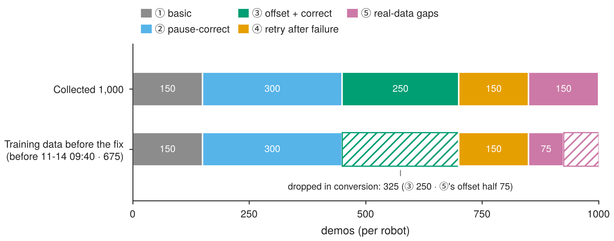
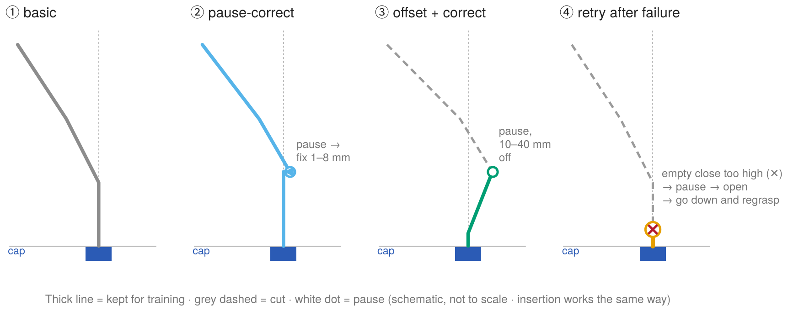
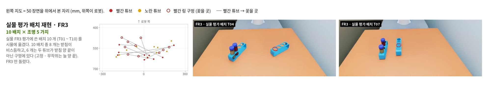
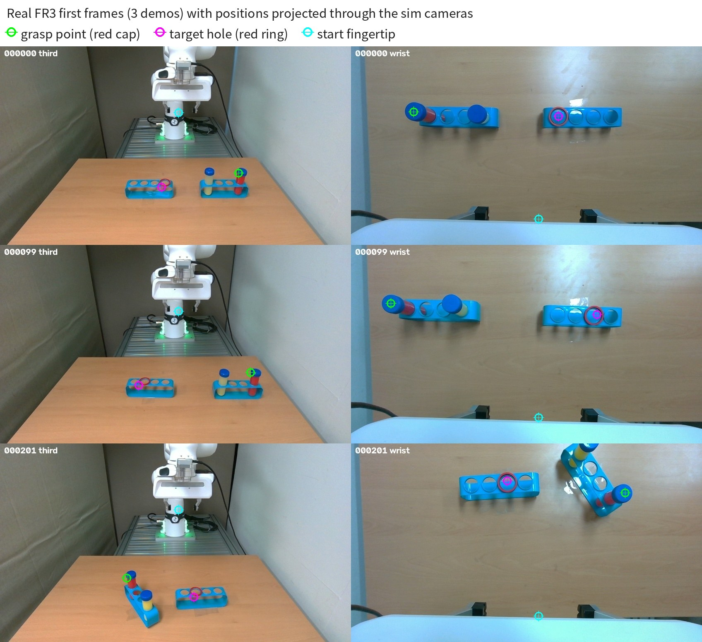

# Report 7 — Progress log 11-13 afternoon – 11-14 morning: Switching to sim-to-real and the 1,000-demo dataset

2026-11-13 (Fri) 15:50 – 11-14 (Sat) 10:50 · Sim-to-Real Post-Training (simulation part) · Isaac Sim 6.0.1 · Isaac Lab 3.0 · GR00T N1.7 · [한국어](README.md)

In the middle of the improvement experiments of [Report 6](../report06_improve_1112_1113/README_EN.md), we changed direction on the judgement that "settings that only work inside the sim are of little use when moving to the real robot". This log records how we re-matched the sim to the real settings (cameras · base height · start pose · color), chose a data composition based on published research, and collected 1,000 new demos per robot.

## Summary

- **First we sorted out what data is good for VLA training (11-13 15:50).** The strongest kind is correction that starts from the policy's own mistakes (the DAgger family), followed by attaching "the correcting action" as the label for off-target states (DART). Adding more demos had a smaller effect.
- **We switched to sim-to-real (16:27).** No more data in our own settings estimated from photos; FR5 is collected only in the settings the real team matched, and FR3 only in settings newly matched from the robot-PC records.
- **We built the FR3 real setting.** Solving the third-person camera from the real camera calibration matched the real model to 0.52 px on average, and lowering the base by 23.5 mm matched the grasp height to the real measurement within 0.3 mm.
- **We matched color to the real robots.** We converted the first frames of real and sim to the training-data format, measured table and wall color, and corrected the scene color and the per-camera white balance.
- **Each robot got 1,000 demos under the same rules:** basic 150 · pause-correct 300 · offset + correction 250 · retry after failure 150 · real-data gaps 150. Only 150 are clean straight-line demos.
- **We caught one mistake (11-14 09:40).** The conversion had dropped all offset + correction demos, so "850 demos" were really 525. We fixed the converter and retrained.
- **The color in the training videos the model sees was washed out (11-14 10:23).** Input and action handling on the server and bench matched training, but the compression of the FR5 training videos erased about 80 % of the red of the small red cap. This led to the "color preservation" experiment in [Report 8](../report08_dagger_1114_1116/README_EN.md).

## 0. Terms used in this log

| Term | Meaning |
|---|---|
| Our settings | The first sim settings, with base height · start pose · third-person camera estimated from photos |
| Real-matched sim | Sim settings re-matched to the real robot-PC records and the real team's values |
| ①–⑤ | The five branches of the 1,000-demo dataset (table in Section 3) |
| Fixed-family layouts (CJ) | Like the bench fixed layout, the two racks in one line with the same orientation — for training, the whole set is rotated by ±20° and shifted by ±40 mm |
| Real-eval layouts (T) | Bench scenes that place in sim the 10 layouts (T01–T10) used for the real FR3 evaluation. Excluded from training scenes |
| White balance | The R · G · B gains that describe how a camera renders color |
| Open-loop test | A test that feeds fixed images and states to the policy without moving the robot and only looks at the actions it outputs |

## 1. 11-13 (Fri) 15:50 — What data is good for VLA training?

**User's question.** Could the distribution and shape of the data we are collecting lead to low success again? What kind of data helps VLA training?

| Research | Main point |
|---|---|
| Correction that starts from the policy's own mistakes (DAgger family — HG-DAgger, RaC, IntervenGen) | When the trained policy starts to go wrong, an expert takes over and corrects it, and only that segment is added to training. Strongest, because it starts from the offsets the policy actually makes rather than randomly injected ones |
| The label for an off-target state is "the correcting action" (DART · chopstick grasping) | Small noise during the demo creates off-target states, and the label is the correcting action. 1 cm object grasping went from 37 % to 72 % |
| Same state, same action (Data Quality in Imitation Learning) | Inconsistent actions in the same state hurt performance. Adding diversity at the cost of consistency is a loss |
| Scene diversity over demo count (Data Scaling Laws in Imitation Learning) | Environment and object diversity matter more than the number of demos; past a threshold, more demos add little |

**Against our current data.** The current, pause-correct and offset demos all lacked "the policy's own mistakes". Also, the offset demos were teaching the path that goes off target as a label too (FR5 actions are "the next state", so the drifting motion is learned as is). So we decided not to conclude that "correction data does not help" even if these datasets scored low.

**Direction chosen (proposed → executed later).**

1. In offset demos, cut out the path that goes off target and train only on the part that starts from the offset position (③ in Section 3).
2. For correcting the policy's own mistakes, the sim VLA + formula execution itself becomes the data generator — widen the handover range only for data collection, and train only on the formula segments (DAgger in [Report 8](../report08_dagger_1114_1116/README_EN.md)).
3. Put diversity in the start state (offset size · direction, layout · lighting), and keep the final approach · pause · descent under the same rules without randomness.

## 2. 11-13 (Fri) 16:27 — Switching to sim-to-real

**Decision (user, 16:27 · 16:31 · 16:36).**

- The main goal is sim-to-real. If the sim settings differ from the real robot, results that hold inside the sim are less useful when moved to the real robot.
- No more collection in our settings. The pending FR5 pause-correct 600 collection and the physics tests were stopped (nothing collected). The FR3 pause-correct 600 collection, almost done, was finished and used only for sim analysis.
- FR5 is re-collected in the settings the real team matched to the real FR5. FR3 is collected once the robot-PC records read out by the real team (camera · heights · control) arrive and a real setting is built.

**FR5 real-team settings.** We made a new folder with the 11 values the real team changed applied to our code and settings — base height (23 mm below the table) · start pose (fingertip 437, −19, 292 mm — 0.0 mm difference when computed with the new folder's code) · third-person camera height · object area · rack orientation · gripper value table · wrist image not rotated. Here we first collected 300 pause-correct and offset + correction demos (done 18:03). The offset size was widened to 10–40 mm to match the policy's actual offsets.

- Corrected: "FR3 got worse when sim data was mixed in" is not right — the two real FR3 evaluations were on different dates and layouts, so it cannot be judged (real FR3 owner's answer). FR5 was mixed without matching coordinates and heights, and real success was close to 0 %.
- The FR3 real records came as a bundle read-only from the robot PC (`sim_facts_1113_1754`).

## 3. 11-13 (Fri) 17:53 – 22:04 — Data composition and amount

**Decision (user).** The same amount for both robots (17:53), 1,000 demos per robot (18:06 → 18:38), and FR5 also newly collected under the same rules instead of using the real team's 750 demos (18:10; the real team's 750 are kept for comparison).

| Branch | Demos | Motion | Part used for training |
|---|---|---|---|
| ① Basic | 150 | Same motion as the real scripted collector, without mistakes | All |
| ② Pause-correct | 300 | Stop 0.3–0.8 s above a guessed position (1–8 mm beside the truth) → correct sideways → descend (insertion the same) | All |
| ③ Offset + correction | 250 | Stop above a position 10–40 mm off → correct while descending | From the offset position (the drifting path is cut) |
| ④ Retry after failure | 150 | Empty grasp → grasp again; insertion jams → insert again | From the failed state |
| ⑤ Real-data gaps | 150 | Half ② and half ③ motions, in far areas missing from the real data and in widely varied fixed-family layouts | Same as ② · ③ |

**Figure 1.** Composition of the 1,000 demos collected per robot. The lower bar is the training data before the fix at 11-14 09:40 — the offset + correction demos were dropped entirely in conversion, leaving 675 demos (Section 7).

**Figure 2.** Fingertip paths of ①–④ (schematic). The thick line is the part used for training. ③ cuts the drifting path and is used from the pause at the offset position; ④ is used from the pause after the failed state (an empty close too high). ⑤ performs the ② · ③ motions in areas missing from the real data.

- Only the 150 demos of ① are clean straight-line demos. Almost all current failures are "not correcting the last 1–3 cm", and ② · ③ show exactly that motion.
- Layouts are random 38 % · random tube holes too 43 % · fixed family 19 %. 15 % of the random layouts place the two racks side by side as in the real evaluation.
- The real FR3 evaluation layouts T01–T10 are excluded from training scenes (re-drawn if both racks are within 40 mm · 20°). No training scene is identical to the bench fixed layout either.

**Figure 3.** Real-eval layouts (T, labels in Korean). Bench scenes that place in sim the 10 layouts used for the real FR3 evaluation. Training scenes where both racks are within 40 mm · 20° of these layouts were excluded.

- We also decided to train a 200-demo model drawn proportionally from the same 1,000 (amount vs. composition), and a model fine-tuned from the sim model on 200 real demos (22:02 · 21:55). The yellow-ring task was postponed.
- When the data is complete, it is converted to the real format, sent to the training server, and benched each time a training run finishes.

## 4. FR3 real setting — re-matched from the robot-PC records

| Item | New value | Basis |
|---|---|---|
| Third-person camera | (1.060, −0.028, 0.527) m from the base · pitch −30.6° · field of view 88.7° | Solved the real calibration (image → table mapping) with the real camera intrinsics — 0.52 px mean · 2.39 px max against the real model. Previously (1.26, −0.017, 0.471) m · −21.4° · 69.7° |
| Wrist camera | (62.3, −16.3, −46.2) mm from the hand · field of view 88.9° | PnP from 8 real calibration points (reprojection 4.6 px), 0.93 px mean against the real model |
| Home joints | real home.json as is | Start fingertip (434.3, 17.3, 297.2) mm, within 0.1 mm |
| Base · robot height | lowered 23.5 mm | Planned grasp height 109.9 mm ↔ real measurement 109.6 mm (200 demos, at the moment of grasping) |
| Workspace · rack orientation | 0.37–0.74 m in front of the robot · ±0.30 m sideways · ±90° | Real grasp positions x 480–625 · y −207–224 mm |
| Wrist rule | No rotation → perpendicular to the rack row if a finger would hit a neighbouring cap → skip the scene above 30° | Real scripted collector rule |
| Speed · pauses | speed scale 0.4–0.6, insertion 30 mm/s, 0.8–1.2 s pause above the slot | Real records |

Projecting the red cap and ring positions through the sim cameras onto the first frames of three real demos put them in the right place for both cameras.

**Figure 4.** Sim cameras matched to the real FR3 first frames. On the first frames of three real demos (left third-person · right wrist), the grasp point · target hole · start fingertip are projected through the newly matched sim cameras. Both cameras land on the right spots.

## 5. 11-13 (Fri) 19:15 – 23:40 — Matching color to the real robots

**What we saw (user, 19:14).** Putting the first frame of a test collection in the real setting next to the real first frame, the table color was very different. We paused collection, fixed the color, then continued.

**How we measured.** We converted the sim first frames exactly like the training data (brightness matching · white balance · size) and measured the median RGB of table · wall · gripper. The real side was the training-data first frames as they are (FR3 3 demos · FR5 20 demos).

- The sim showed only about half of the color change we applied to the table on screen. The wall showed the full change.
- The real FR3 wrist camera rendered colder than the third-person camera (the white gripper looks light blue). In sim both cameras see the same color → per-camera white balance was added when converting to training data.
- The real FR5 third-person camera rendered bluish (camera white balance fixed). Multiplying the real FR3 table by the FR5 camera's blueness gave almost exactly the real FR5 table, so we treated the two tables as the same wood.

**Final values (11-13 23:40).** For FR5 we measured 48 demos and matched the color ratios of the third-person table (red ÷ green · blue ÷ green) to 1.037 · 0.824 against real 1.036 · 0.824; the FR3 wrist table was matched to 1.037 · 0.864 against real 1.048 · 0.872. The FR3 table was short of red by 8 %, but that is within the training color-jitter range, so we left it. White balance is applied only when converting to training data; the color of the collected scenes is unchanged.

- FR3 data collected while this was being fixed mixes three table colors (old 207 demos · first fix 183 demos · final for the rest). We treated it as table-color jitter and used it as is.

- One wrong call: at 21:40, from a 16-demo measurement (only one or two lighting draws), we concluded that "changing the painted table value barely changes the image" and changed the FR3 wrist white balance, then reverted at 21:45 with values from 36 demos. Lighting is drawn once per 8-scene batch, so a small number of demos is biased.
- The FR5 color test collection failed to start both times — two FR3 collectors were using 28.8 / 32.6 GB of GPU memory, so PhysX could not get memory. The collection queue was left to start the sim only when more than 10 GB is free.
- The FR3 pause-correct batches were slower than the basic batches: about 160 demos per hour for the two collectors combined (a little over half of the estimated 280).

## 6. 11-13 (Fri) 23:00 — ④ Retry after failure, and the automatic overnight order

| Side | Failure | Pause (training starts here) | Retry |
|---|---|---|---|
| Pick · too high | Fingertips close empty 4–14 mm above the cap top | 0.4–0.9 s pause to confirm the empty grasp | Open again → descend straight and grasp |
| Pick · sideways | Empty grasp at a position beside the cap | Same | Open → up 8 mm → sideways → descend and grasp |
| Insert | Descends 3–6 mm beside the hole and the tube bottom stops 2–3.5 mm above the top | 0.4–0.9 s pause to confirm the jam | Lift 10–20 mm → normal insertion |

- The path that deliberately goes to fail is not used for training; only the pause to the end is. Only demos judged successful are saved.
- Overnight without hands: FR5 collection → add ④ and test 8 demos → check → ④ 150 demos (FR3 → FR5) → 1,000- and 200-demo real-format conversion → training server → training → server → bench. No benches ran during collection.
- **We fixed 58 benches before any results.** All models × FR3 (fixed · real-eval · random) · FR5 (fixed · random · random tube holes too) × policy only · VLA + formula. The pre-registered comparisons were the effect of ④ · amount vs. composition (1,000 vs. 200 demos) · how much sim performance remains after real fine-tuning · sim success of the real-only model.

## 7. 11-14 (Sat) 09:40 — The offset + correction demos were missing (fixed)

**What went wrong (my mistake).** The overnight conversion log said "325 offset demos → 0 segments". For each robot, all 250 demos of ③ and the 75 offset demos in ⑤ were dropped, so **"850 demos" were really 525 and "1,000 demos" were really 675.**

Figure 1's lower bar is the data that went into training at that time.

**Why.** Demos with both offset and correction turned on use a different name for the "stop above the hole" stage ("stop and look above the guessed hole"), and the converter looked for only one name and dropped whole demos when it was missing. Earlier tests used offset demos with the correction off, so they did not catch it.

**What we changed.**

- The converter looks for both names and reports the reasons for demos it could not cut into segments.
- **A gate before sending** — among offset demos, at most 5 % without segments · number of segments ≥ number of offset demos · 0 check problems.
- Rebuilt the data (the earlier data was not deleted) and rescheduled training. The 525-demo model without ③ was kept as a control for "the effect of ③".

**Decided at the same time — FR5 image size (user, 09:40).** If the FR5 data were kept at 848×480 like FR3, the model input would be 452×256 with the aspect ratio kept, and the cap colors would fade less. Still, to keep the schedule, this training used 256×256 (aspect ignored), the same as the real FR5 training and real robot input. Instead, the FR5 bench would count color choice separately, and if that turned out to be the blocker we would run an 848×480 comparison. (This decision changed on 11-17 — [Report 9](../report09_final_1116_1119/README_EN.md).)

## 8. 11-14 (Sat) 10:00 – 10:23 — "Root cause" check: does the bench feed what training saw?

**User's question (10:08 – 10:14).** Adding data gives similar or lower success — it should reach at least 40 %. Is something wrong in the GR00T server settings (perception · actions)? It is strange that success rises with the real team's data and stays low with ours alone. (At the same time: since the fixed layout is "half and half", is this overfitting?)

We wrote the criteria first and ran checks that do not move the robot (FR5, basic + pause-correct model).

| Check | Measured | Verdict |
|---|---|---|
| Perception — difference in predicted end point when the same state is asked with the training video · bench image · bench image without compression | 8.4 · 9.7 mm (spread of asking the same image 3 times: 10.8 mm) | No problem — the bench input does not change the prediction |
| Perception — orientation · color order | 180° rotation · swapping R↔B land much farther away | Normal |
| State conversion | 0.000 mm difference | No problem |
| Action decoding (round trip) | 0 differences in 504 steps · 0 inverse-kinematics failures | No problem |
| Tracking (sent target → actual 0.1 s later) | bench median 1.9 mm · training source 0.9 mm | Above the 2× criterion but small — not the main cause |
| Open loop — share of first moves toward red | training scenes 80 % (fixed family 84 %) · bench fixed 76 %, no one-sided bias | Neither overfitting nor a color-signal problem — the first move is mostly toward red |
| Training config (config file) | Ours · the real team's mix · the real-only model are all the same (color jitter · crop · frozen vision encoder · dropout 0.2) | The training recipe matches the real team's |

**What we found (observation outside the criteria).** Counting red cap pixels in the training video and the bench image gave 4 vs. 24 for the third-person camera and 18 vs. 102 for the wrist. **The compression of the FR5 training video (256×256 · H.264 · 4:2:0) was erasing about 80 % of the red of the small red cap.** The model still chose the right first direction about 80 % of the time, but it was learning from data with a weak color cue.

**Three experiments decided (user, 10:28 · 10:38, criteria set before results).**

1. Bench the real team's mix model **in our scenes** — its earlier high numbers were measured in the real team's scenes and could not be compared directly with our models.
2. Re-save the same 1,000 FR5 demos as **color-preserving** video (4:4:4 — no reduction of color resolution) and train.
3. The FR5 physics-jump fix test (decided on 11-13 but not run).

Results are in [Report 8](../report08_dagger_1114_1116/README_EN.md).

## Appendix. Development notes for this period

Development notes 34 (data shapes that are good for VLA training) · 35 (switch to sim-to-real · FR5 real-setting collection) · 36 (data composition · amount · FR3 real values — Sections 0–16) · real team answers (FR3 request 3 · answer 3). Research sources: DART (Laskey et al., CoRL 2017) · Grasping with Chopsticks (Ke et al., 2020) · Data Quality in Imitation Learning (Belkhale et al., NeurIPS 2023) · Data Scaling Laws in Imitation Learning (Lin et al., ICLR 2025) · HG-DAgger (Kelly et al., ICRA 2019) · IntervenGen (Hoque et al., IROS 2024) · RaC (Hu et al., 2025).
