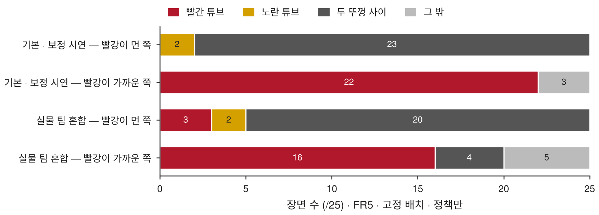
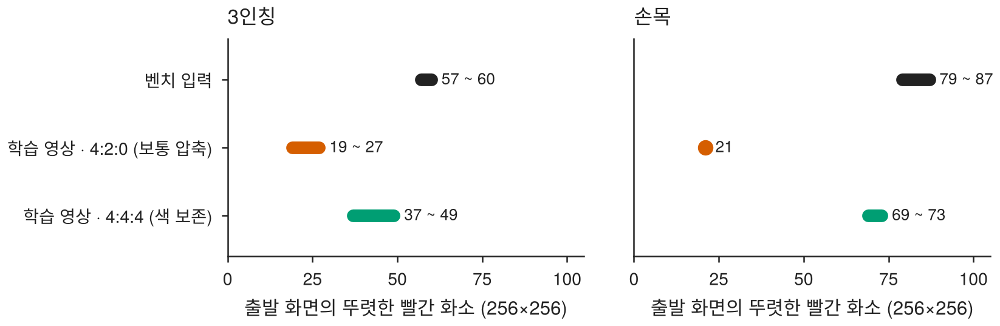
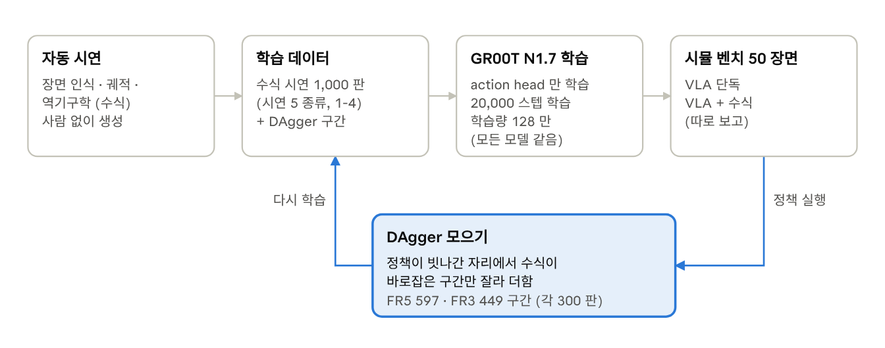
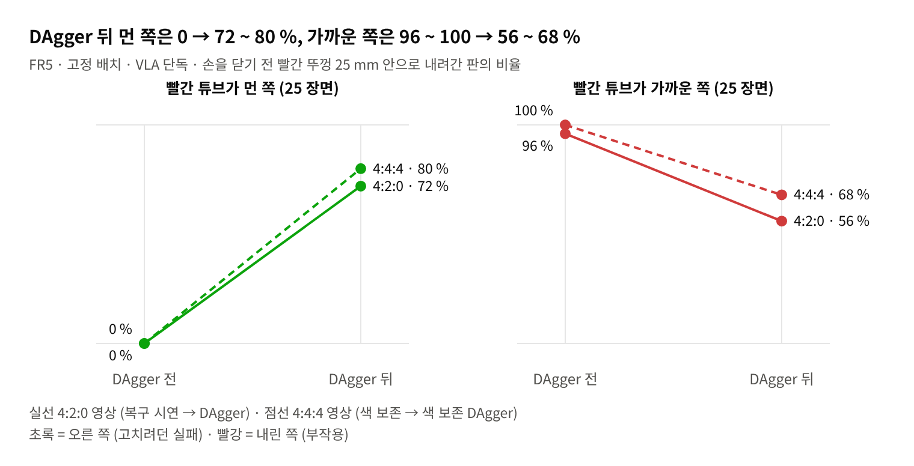
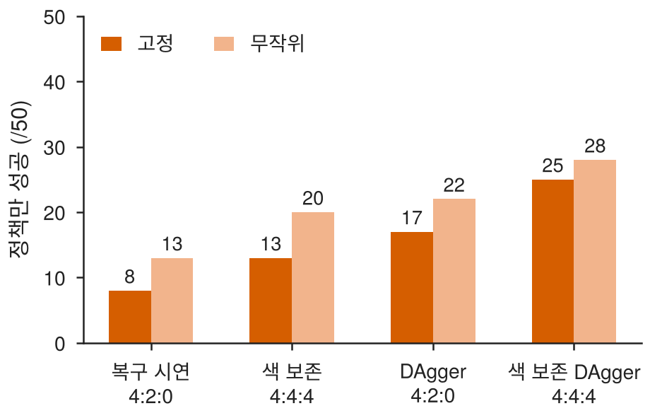
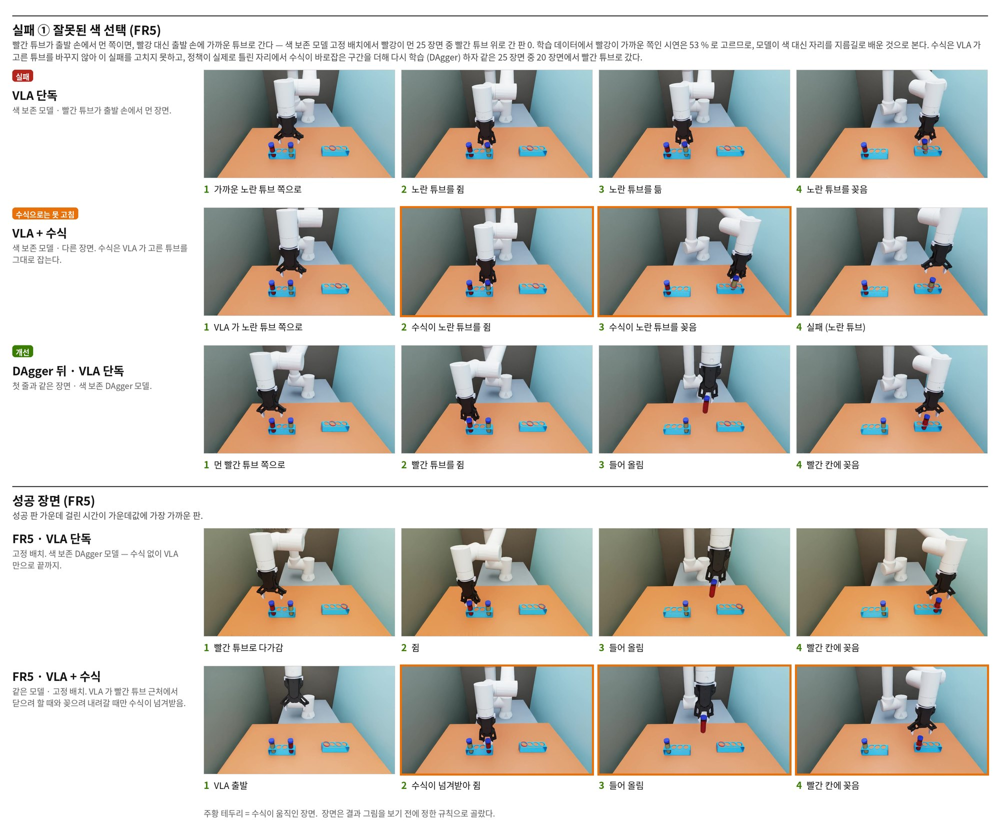
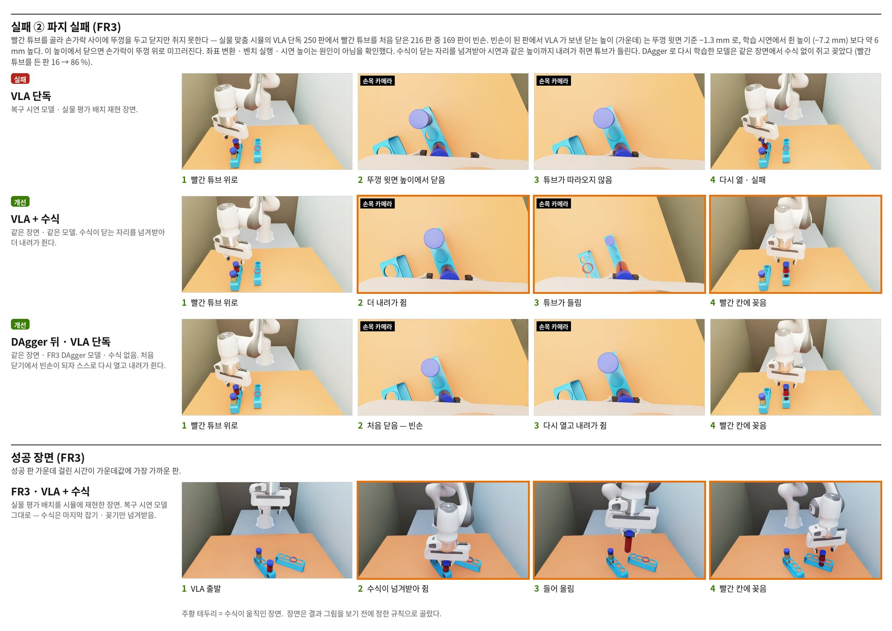
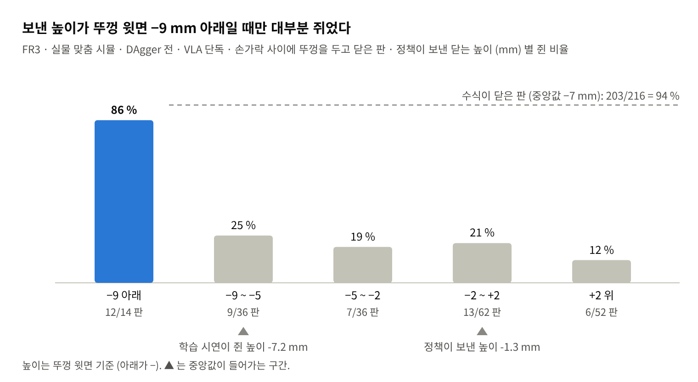
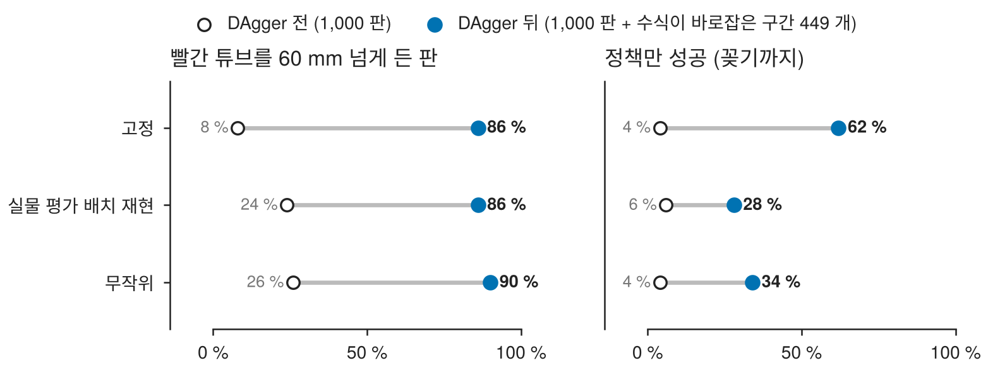

# 보고서 8 — 진행 기록 11-14 \~ 11-16: FR5 가 먼 튜브로 못 가는 까닭, DAgger 를 앞당김, FR3 가 쥐지 못하는 까닭

2026-11-14 (토) \~ 11-16 (월) · Sim-to-Real Post-Training (시뮬레이션 파트) · Isaac Sim 6.0.1 · Isaac Lab 3.0 · GR00T N1.7 · [English](README_EN.md)

[보고서 7](../report07_sim2real_1000/README.md) 에서 실물에 맞춘 시뮬 설정과 1,000 판 데이터를 만든 뒤, 그 모델들을 재며 [보고서 4](../report04_sim_bench/README.md) 의 결과에 이르기까지 사흘 동안의 기록입니다. 이 기간에는 **질문 하나마다 판정 기준을 결과를 보기 전에 적고**, 기준대로 원인 후보를 하나씩 지우거나 남겼습니다.

## 요약

- **11-14 오전 — 지금까지 돈 벤치 53 개를 같은 단계표 (S0 \~ S9) 로 다시 채점했다.** 어느 설정에서나 VLA + 수식이 정책만의 2 \~ 5 배였고, FR3 는 같은 200 판에서 학습량만 4 배로 늘리자 고정 배치 0/50 → 13/50 이 되었다.
- **11-14 낮 — FR5 원인 후보를 하나씩 지웠다.** 물리 튐 고치기 · 다시 묻는 간격 · 손가락 충돌체 · 손목 회전 거르기 · 쥐기 허용폭 · 움직임 빠르기는 원인이 아니거나 고치지 못했다. 남은 것은 **「빨간 튜브가 출발 손에서 먼 쪽이면 두 튜브 가운데로 간다」** 였다. 같은 화면을 20 번 물어도 20 번 모두 가운데를 겨눴다.
- **11-14 오후 — DAgger 를 앞당겼다.** 정책을 직접 돌려 정책이 실제로 가는 자리에서 수식이 바로잡은 구간 597 개를 모아 더했다. 그 사이 「출발 손에서 가까운 튜브로 가는 버릇」 이 데이터가 아니라 모델의 지름길 (shortcut) 이라는 것을 확인했다.
- **11-15 — FR5 DAgger 가 그 버릇을 고쳤다.** 고정 배치에서 빨강이 먼 쪽인 25 장면 가운데 빨간 튜브 위로 간 판이 0 → 18 (색 보존 영상은 0 → 20) 이 되었다. 색 보존 DAgger 는 정책만 25/50, VLA + 수식 46/50 이었다.
- **11-15 — FR3 가 쥐지 못하는 까닭은 「약 6 mm 높게 닫음」 이었다.** 변환 · 벤치 실행 · 학습 데이터는 원인이 아니었고, 정책이 시연보다 높은 자리에서 닫으라고 보냈다. 같은 방식의 FR3 DAgger 를 모았다 (넘김 시간을 FR5 값 그대로 써서 한 번 다시 모음).
- **11-16 — FR3 DAgger 결과를 받고 보고서 4 를 냈다.** FR3 는 정책만 고정 배치 31/50, 수식을 더하면 50/50 이었다.

## 0. 이 기록에서 쓰는 말

| 말 | 뜻 |
|---|---|
| 실물 맞춤 시뮬 | 장면 · 카메라 · 받침 높이 · 시작 자세를 실물에 맞춘 새 시뮬 설정 ([보고서 7](../report07_sim2real_1000/README.md)). 이 기록의 벤치는 따로 적지 않으면 모두 이 설정 |
| 기본 · 보정 시연 모델 | 기본 시연 + 위에서 멈춰 1 \~ 8 mm 를 고치는 「보정」 시연 525 판으로 학습 |
| 복구 시연 모델 (1,000 판) | 위에 「빗나감 + 바로잡기」 250 판, 「실패에서 다시 하기」 150 판을 더한 1,000 판으로 학습 |
| 색 보존 모델 | 복구 시연 모델과 같은 데이터를 색 정보를 줄이지 않는 영상 (4:4:4) 으로 저장해 학습 |
| 실물 팀 혼합 · 실물 팀 시뮬 | 실물 팀 설정으로 모은 시뮬 데이터에 실물을 섞은 모델 · 시뮬만으로 학습한 모델 |
| DAgger | 정책을 직접 돌려 정책이 실제로 가는 상태를 모으고, 그 상태에서 전문가 (여기서는 시연을 만든 수식) 의 행동을 붙여 데이터에 더해 다시 학습하는 방법 (Ross 외, 2011) |
| VLA + 수식 | 정책이 목표를 고르고, 마지막 잡기 · 꽂기만 수식이 넘겨받는 실행 (실물 FR3 스테이션과 같은 구조) |
| 빨강이 먼 쪽 · 가까운 쪽 | 고정 배치에서 빨간 튜브가 출발 손에서 먼 끝 · 가까운 끝에 있는 각 25 장면 |
| 다름 · 다르다고 못 함 | 두 모델의 차이가 운만으로 생길 가능성이 5 % 아래 (Fisher 정확 검정) 면 「다름」 |

## 1. 11-14 (토) 오전 — 지금까지 돈 벤치를 같은 기준으로 다시 채점

워크스테이션의 벤치 폴더 53 개를 실물과 같은 S0 \~ S9 단계표로 다시 채점했다. 벤치 설정이 셋 (처음 설정 · 실물 팀 설정 · 실물 맞춤 시뮬) 이라 설정이 다른 줄끼리는 바로 견주지 않았다.

| 본 것 | 숫자 |
|---|---|
| VLA + 수식은 어디서나 정책만의 2 \~ 5 배 | FR3 52 · 60 %, FR5 실물 팀 설정 56 \~ 66 %, 실물 맞춤 시뮬 48 %. 닫는 자리가 정책만 12 \~ 28 mm 빗나감 → 수식 0 \~ 2 mm |
| FR3 는 학습량이 크게 효과 | 같은 200 판에서 학습 샘플을 4 배 (32 만 → 128 만) 로: 고정 배치 0/50 → 13/50, 닫기 28 → 12 mm |
| 실물 팀 데이터의 효과는 실물 영상이 아니라 설정 쪽 | 실물 팀 설정으로 모은 시뮬만 600 판 모델이 시뮬 + 실물 혼합 모델과 다르지 않음 |
| 실물만 학습한 모델 | 어느 설정에서나 0 \~ 2/50, 닫는 자리 43 \~ 64 mm |

**바로잡은 것 (같은 날).** 「학습 데이터가 처음부터 정확히 가는 완벽한 시연뿐이라 빗나간 상태에서 고치는 장면을 본 적이 없다」 고 했는데 틀렸다. 그 말은 처음 설정의 100 \~ 600 판 모델에만 맞고, 실물 맞춤 시뮬 데이터에는 보정 · 바로잡기 · 다시 하기 시연이 있다. 다만 바로잡기 · 다시 하기가 든 모델은 이때까지 한 번도 벤치하지 않았다.

- 도구: `tools/common_bench_report.py` 1.0 (읽기만, S0 \~ S9 채점 `common_bench_stage.py` 1.1 은 11-12 에 고정). 원본 `logs/_bench_report_1114.txt` · `.json`.
- 바로잡은 제 실수 둘: ① 「FR5 물리 튐은 11-11 부터 생김」 — 튐 판정은 11-10 저녁부터라 그 앞은 「0」 이 아니라 「안 잼」. ② 「손목 URDF 벤치의 손목 힘이 150」 — 보고서 도구가 칸을 14 글자로 잘라 앞 셋만 보였고, 실제로는 손목 28 N·m 가 들어감.

## 2. 11-14 (토) 낮 — FR5 원인 후보를 하나씩 지움

모든 시험은 같은 모델 (기본 · 보정 시연 모델, FR5), 같은 고정 배치 50 장면에서 한 가지만 바꿨고, 판정 기준은 결과 전에 적었다.

| 물음 | 기준 (미리 적음) | 결과 | 판단 |
|---|---|---|---|
| 물리 튐을 고칠 수 있나 — 관절 반복 계산을 늘림 (solv) · 그리퍼 관절 힘을 낮춤 (fsoft) | 튐 5/50 이하 | solv 튐 8 · fsoft 7 (기준 벤치 10) | 둘 다 못 고침 |
| 다시 묻는 간격을 0.8 → 0.4 초로 줄이면 | 성공이 「다름」 으로 오르나 | 2/50 대 5/50 | 다르다고 못 함 — 나아지지 않음 |
| FR5 손가락 흰색 끝에 충돌체가 없나 | 충돌체가 2 mm 넘게 뒤 · 3 mm 넘게 짧으면 | 양쪽 모두 0.0 mm 차 (95.2 mm 같음) | 충돌체가 덮음 — 원인 아님 |
| 손목을 많이 돌리는 시연 (70° 넘음) 이 문제인가 | 우리 데이터 15 % 넘으면 | 4 \~ 6 % (실물 팀은 70° 넘는 판을 거름) | 원인 아님 |
| 시뮬 쥐기가 실물보다 가혹한가 | 벌림 방향 10 \~ 20 mm 빗나간 닫기의 쥠 70 % 넘으면 가혹하지 않음 | 91 \~ 100 % (25 mm 넘으면 52 \~ 69 %) | 가혹하지 않음 — 시뮬 쥐기 보조 (25 mm) 때문에 오히려 너그러움 |
| 정책이 시연보다 빨리 움직이나 | 평균 빠르기 1.5 배 넘으면 | 38 mm/s 대 시연 45 \~ 75 mm/s, 뚜껑 위 하강도 68 대 72 \~ 115 mm/s | 빠르지 않음 |

- **결과를 본 뒤 정한 설정 하나.** 물리 시험은 미리 정한 기준을 넘지 못했지만, 사용자가 solv 의 성공 (11/50 대 5/50, 다르다고 못 함) 을 보고 이후 FR5 벤치를 모두 solv 로 돌리기로 했다. 그래서 이 기간 FR5 숫자는 「결과를 본 뒤 고른 물리」 로 따로 적고, 비교는 같은 물리끼리만 한다.
- 같은 모델 · 같은 장면에서 물리 묶음만 조금 바꿔도 성공이 5 \~ 11/50 으로 움직였다. 50 장면 결과가 이 정도로 흔들린다는 뜻이라, 비교는 「다름」 일 때만 다르다고 쓴다.

**어디서 실패하나.** 처음 막힌 단계를 보면 고정 배치의 실패는 두 덩어리였다 — 쥐러 가기 전 (S1 · S2) 22/50, 꽂기 (S9) 16/50. VLA + 수식은 꽂기 실패를 1 로 줄이지만 쥐러 가기 전 실패는 그대로였다 (23). 수식은 정책이 빨강 가까이에서 닫으려 할 때만 넘겨받기 때문이다.

닫기 전 가장 낮게 내려간 자리를 나눠 보니 원인이 보였다.

| 고정 배치 · 정책만 | 빨강이 먼 쪽 (25) | 빨강이 가까운 쪽 (25) |
|---|---|---|
| 기본 · 보정 시연 모델 | 두 뚜껑 사이 23 · 노랑 2 · **빨강 0** | **빨강 22** · 그 밖 3 |
| 실물 팀 혼합 모델 | 두 뚜껑 사이 20 · 빨강 3 · 노랑 2 | 빨강 16 · 사이 4 · 그 밖 5 |

**그림 1.** 닫기 전 가장 낮게 내려간 자리 (FR5 · 고정 배치 · 정책만). 빨강이 먼 쪽이면 거의 언제나 두 뚜껑 사이로, 가까운 쪽이면 빨강으로 갔다.

**빨강이 먼 쪽이면 거의 언제나 두 튜브 가운데로 내려가고, 가까운 쪽이면 빨강으로 갔다.** 두 튜브는 랙 양 끝 (111 mm 간격) 이라, 가운데로 내려가면 벌린 손가락 (95 mm) 이 양쪽 뚜껑 위에 얹혀 움직이지 못한다. 사용자가 벤치 영상에서 본 「빠르게 내려가다 두 뚜껑에 걸림」 이 이것이었다.

**모델이 실제로 받는 화면.** 벤치가 정책에 넘기는 화면과 학습 영상을 같은 방식으로 256×256 으로 만들어 뚜렷한 빨간 화소를 셌다.

| 출발 화면의 뚜렷한 빨간 화소 | 3인칭 | 손목 |
|---|---|---|
| 벤치 입력 | 57 \~ 60 | 79 \~ 87 |
| 학습 영상 (4:2:0 압축) | 19 \~ 27 | 21 |
| 학습 영상 (4:4:4 — 색 보존) | 37 \~ 49 | 69 \~ 73 |

**그림 2.** 모델이 받는 출발 화면의 뚜렷한 빨간 화소. 같은 장면을 256×256 으로 만들어 셌다. 보통 압축 (4:2:0) 학습 영상은 벤치 입력의 1/3 \~ 1/4 이고, 색 보존 (4:4:4) 은 벤치 입력에 가깝다.

- 학습 영상의 빨강이 벤치 입력의 1/3 \~ 1/4 로 흐렸다. 보통의 영상 압축 (4:2:0) 은 색을 가로 · 세로 절반 해상도로만 남기기 때문이다. 이것이 **색 보존 모델** 을 만든 까닭이다.
- 확인된 사실 하나: **고정 배치는 튜브 자리가 완전히 고정**이다. 50 장면은 사실상 배치 둘 (빨강 왼쪽 · 오른쪽) 을 링 구멍 · 조명만 바꿔 25 번씩 본 것이다. 그래서 일반화는 무작위 배치로 읽는다.

**같은 화면을 20 번 묻기.** GR00T 는 물을 때마다 다른 잡음에서 시작하므로, 같은 화면 · 상태를 20 번 물으면 정책이 고르는 갈래가 하나인지 둘인지 보인다. 「빨강 쪽 · 노랑 쪽이 둘 다 30 % 넘으면 갈팡질팡, 가운데가 60 % 넘으면 가운데를 겨눔」 으로 미리 정했다.

- 빨강이 먼 쪽 장면: 내려가기 직전 20 번 모두 두 튜브 가운데 (빨강 → 노랑 선의 0.52 \~ 0.64 자리) 를 겨눴다 → **「가운데를 겨눔」**. 갈팡질팡이 아니라 매번 같은 가운데를 확신하듯 골랐다.
- 빨강이 가까운 쪽 장면: 20 번 모두 빨강.
- 같은 화면을 학습 영상처럼 압축해 물어도 똑같았다 → 화면이 또렷한지 흐린지는 이 선택을 바꾸지 않았다.
- 그래서 다시 묻는 간격 · 잡음 · 화면 다듬기로는 고쳐지지 않는다. 지금 데이터의 보정 (1 \~ 8 mm) · 바로잡기 (10 \~ 40 mm) 는 「빨강 근처에서 조금 빗나감」 을 고치는 시연이라, 「두 튜브 가운데 (빨강에서 약 60 mm) → 빨강」 장면이 없다. **정책이 실제로 가는 그 자리에서 시작하는 DAgger 가 이것을 직접 채운다.**

- 같은 날 확인한 실물 팀과의 차이: Isaac Lab 판이 같고 (v3.0.0-beta2.patch1) Isaac Sim 판 번호도 같음, 벤치는 모두 우리 워크스테이션 한 설치에서 돎 → 설치 차이는 원인에서 뺌. 실물 팀은 시뮬 데이터를 합칠 때 손목 회전 70° 이하 판만 걸렀음.
- 처음 잰 「첫 화면 빨간 화소 35 만 · 12 만」 은 책상 색까지 빨강으로 센 틀린 측정이라 버림 (제 실수). 뚜렷한 빨강 (R ≥ 100, G · B 가 R 의 0.55 배 아래) 만 다시 셈.
- 「학습에 그 자리 시연이 모자라서인가」 도 미리 기준을 정해 봤는데, 빨강 왼쪽 · 오른쪽 모두 같은 자리 시연이 있는 장면 25/25 로 다르지 않음 → 원인으로 보기 어려움.
- 사용자 결정 (15:32): 「이대로 우선 해 보고, DAgger 는 마지막에」 → 15:36 「앞당겨서 진행」.

## 3. 11-14 (토) 오후 \~ 밤 — DAgger 앞당김

**설계 (결과 전에 정함).**

| 항목 | 값 |
|---|---|
| 돌리는 정책 | FR5 복구 시연 모델 (1,000 판) |
| 장면 | 학습 규칙의 새 시드 300 판 (고정 계열 150 · 무작위 150) — 벤치 장면이 아님 |
| 전문가 (수식) | 늘 빨간 튜브 · 빨간 칸으로 간다 (정책이 고른 쪽이 아님). 손이 낮으면 먼저 곧게 위로 → 자동 시연과 같은 잡기 · 들기 / 칸 위로 → 맞춤 → 꽂기 |
| 넘겨받는 때 (데이터용) | 손이 빨간 뚜껑 위 40 mm 아래인데 빨강에서 20 mm 넘게 떨어짐 · 정책이 닫으려 함 · 9 초가 지남 — 가운데로 내려가는 실패를 잡으려고 평가용 규칙보다 넓게 |
| 학습에 넣는 구간 | 수식이 움직인 구간만 (잡기: 넘겨받음 → 들기 끝, 꽂기: 넘겨받음 → 놓고 빼기). 정책이 움직인 구간은 틀린 행동이라 넣지 않고, 수식 구간이 실패한 조각도 뺌 |
| 주 판정 | 고정 배치 · 정책만 · 빨강이 먼 쪽 25 장면에서 빨간 튜브 위 (25 mm 안) 로 간 판 — DAgger 대 복구 시연 모델 |

**그림 3.** DAgger 의 흐름. 정책을 직접 돌려, 정책이 빗나간 자리에서 수식이 바로잡은 구간만 잘라 학습 데이터에 더하고 다시 학습한다. 그림의 FR3 449 구간은 11-15 의 FR3 DAgger 다 (5 절).

평가용 VLA + 수식의 넘김 규칙 (25 mm · 6 mm · 25 mm) 은 바꾸지 않았다. 수식이 넘겨받는 범위를 넓히는 것은 데이터를 모을 때만이다.

**모은 결과.** 300 판 모두 수식이 잡기를 넘겨받았고, 까닭은 「빨강에서 먼 채 내려가려 함」 220 · 「닫으려 함」 80 이었다. 수식 헛잡음 0, 물리 튐 0, 끝까지 성공 297 판. 조각은 잡기 300 · 꽂기 297 개, 48,716 프레임 (전체 학습 프레임의 약 20 %) 이었다.

**같이 나온 미리 정한 비교 — 색 보존은 이 실패를 고치지 못했다.** 빨강이 먼 쪽 25 장면에서 빨간 튜브 위로 간 판이 색 보존 모델 0/25, 복구 시연 모델 0/25 였다 (다르다고 못 함).

**「출발 손에서 가까운 튜브」 버릇.** 바로잡기 · 다시 하기 시연이 든 두 모델 (복구 시연 · 색 보존) 은 가운데 대신 가까운 노랑으로 갔다. 다섯 모델 모두 같은 모양이었다 (표는 무작위 배치까지 끝난 넷).

| 정책만 · 빨간 튜브 위로 간 비율 | 고정 · 가까운 쪽 | 고정 · 먼 쪽 | 무작위 · 가까운 쪽 | 무작위 · 먼 쪽 |
|---|---|---|---|---|
| 기본 · 보정 시연 | 19/25 | 1/25 | 17/23 | 8/27 |
| 복구 시연 | 24/25 | 0/25 | 18/23 | 7/27 |
| 실물 팀 혼합 | 16/25 | 3/25 | 19/23 | 15/27 |
| 실물 팀 시뮬 | 23/25 | 0/25 | 17/23 | 11/27 |

- 학습 데이터에서 빨강이 출발 손에 더 가까운 판은 53 % (배치별 48 \~ 55 %) 로 고르다. 미리 정한 기준 (35 \~ 65 % 면 데이터는 고름) 에 따라 **데이터 치우침이 아니라, 모델이 색 대신 자리를 지름길로 배운 버릇**으로 판단했다.
- 시뮬 데이터만 쓴 모델일수록 심하고, 실물 영상이 섞인 모델은 무작위 배치에서 덜했다.

- 학습이 두 번 막힘 (제 실수 포함):
  - 학습 서버 GPU 가 비었는데 「빈 메모리 60 GB」 기준을 다른 줄에서 그대로 옮겨 써 2 시간 넘게 놀았음 → 48 GB 로 고침 (배치 64 가 모자라면 32 × 2 로 저절로).
  - 5,154 / 20,000 번째에 `CUDA error: the launch timeout` 으로 꺼짐 (11-03 FR5 학습과 같은 오류, 메모리 부족 아님). 서버의 드라이버 판 어긋남과 관계있는지는 모름 (재부팅은 서버 관리자 몫이라 하지 않음) → 10,000 번째에 옵티마이저까지 저장하고 꺼지면 그곳부터 이어 학습하게 고침.
- 색 보존 학습이 한 번 건너뛰어짐 (제 실수): 학습 전 「깔린 해독기가 모두 yuv444 를 읽어야 함」 으로 기준을 잘못 정함 (실제 학습은 torchcodec 만 씀). 「학습이 실제로 쓰는 해독기가 읽음」 으로 고쳐 다시 켬.
- 사용자 결정 (11-15 00:07): DAgger 도 색 보존 영상으로 한 번 더 (조각은 4:2:0 모델로 모은 그대로 — 엄밀한 DAgger 는 아님, 보고서 4 에 그렇게 적음).

## 4. 11-15 (일) — FR5 DAgger 결과

| 고정 배치 · 정책만 · 빨강이 먼 쪽 25 장면 | 빨간 튜브 위로 간 판 | 판정 (미리 정함) |
|---|---|---|
| 복구 시연 모델 → DAgger | 0 → 18 | 다름 |
| 색 보존 모델 → 색 보존 DAgger | 0 → 20 | 다름 |

**그림 4.** DAgger 앞뒤로 빨간 튜브 위로 간 비율 (FR5 · 고정 배치 · 정책만). 왼쪽 = 빨강이 먼 25 장면, 오른쪽 = 가까운 25 장면. 실선 = 보통 압축 영상 (복구 시연 → DAgger), 점선 = 색 보존 영상 (색 보존 → 색 보존 DAgger).

**FR5 의 「가까운 튜브」 버릇을 DAgger 가 고쳤다.** 무작위 배치의 먼 쪽 장면도 7/27 → 20/27, 6/27 → 21/27 로 올랐다.

| 정책만 성공 (/50) | 고정 | 무작위 |
|---|---|---|
| 복구 시연 (4:2:0) | 8 | 13 |
| 색 보존 (4:4:4) | 13 | 20 |
| DAgger (4:2:0) | 17 | 22 |
| 색 보존 DAgger (4:4:4) | **25** | **28** |

**그림 5.** FR5 정책만 성공 (/50). 같은 50 장면 · 같은 물리 (solv).

- 색 보존 DAgger 대 색 보존: 고정 「다름」, 무작위 「다르다고 못 함」.
- 색 보존은 DAgger 앞에서도 뒤에서도 같은 방향 (4 \~ 8 판 높음) 으로 나왔지만, 하나하나는 「다르다고 못 함」 이다.
- VLA + 수식: 색 보존 DAgger 고정 46/50 · 무작위 44/50 — 이 기간 FR5 에서 가장 높았다.
- **부작용 하나.** 빨강이 가까운 쪽 장면에서 빨간 튜브 위로 간 판이 24/25 → 14/25 (색 보존은 25/25 → 17/25) 로 줄었다. 먼 쪽 버릇을 고치는 대신 가까운 쪽 정확도가 조금 떨어지는 일이 두 번 모두 나왔다.

**그림 6.** FR5 주요 장면. 위 = DAgger 전 정책은 가까운 노란 튜브로 가고, VLA + 수식도 그 노란 튜브를 꽂는다. DAgger 뒤 정책은 먼 빨간 튜브로 간다. 아래 = 성공 장면.

## 5. 11-15 (일) — FR3 는 왜 쥐지 못하나

**물음 (사용자).** FR3 정책은 빨강을 잘 찾아가는데 집어 들지 못한다. 들기 명령을 냈는데 끼인 것인지, 그리퍼가 좁아서인지, 정책 문제인지 시뮬 물리 · 설정 문제인지.

처음 닫은 순간부터 5 초를 나눠 셌다 (실물 맞춤 시뮬, FR3 정책만 250 판).

| 처음 닫은 뒤 | 정책만 | VLA + 수식 |
|---|---|---|
| 빨강 40 mm 안에서 닫지 않음 | 34 | 34 |
| 빈손 · 손가락이 쥘 수 있는 범위 밖에서 닫음 | 16 | 9 |
| **빈손 · 범위 안 · 높이도 맞음** | **140** | 4 |
| 쥠 → 들기 명령 없음 | 30 | 0 |
| 들기 명령 → 손이 못 올라감 (끼임) | **0** | 0 |
| 튜브 60 mm 넘게 들림 | 10 | 195 |

주요 줄만 옮겼다 (뺀 줄: 빈손 · 범위 안 · 높게 닫음 13 · 0, 손은 올라가는데 튜브가 안 따라옴 4 · 7, 들렸다가 빠짐 3 · 1).

- 끼임은 0 판이었다. 대부분 (216 판 중 169) 은 쥐지 못했다.
- 「범위 안인데 빈손」 140 판 가운데 123 판은 손가락이 뚜껑을 지나 끝까지 닫혔다. **쥔 판은 모두 손끝이 뚜껑 윗면 아래 7 mm 까지 내려가 있었고, 정책은 가운데 뚜껑 윗면 높이 (약 7 mm 높게) 에서 닫았다.** 시뮬에서는 그 높이에서 손가락이 뚜껑 윗모서리를 타고 미끄러진다.
- 손가락 넓이는 주된 차이가 아니었다. FR3 가 닫은 자리 216 판 가운데 FR3 손가락 범위 안이 200, FR5 손가락이라면 212 로, 기하 차이는 12 판뿐이다. 차이는 시뮬의 쥐기 처리 (FR5 에만 쥐기 보조) 쪽이다.

**그림 7.** FR3 주요 장면 (실물 평가 배치 재현 장면). 위 = DAgger 전 정책은 뚜껑 윗면 높이에서 닫아 튜브가 따라오지 않는다. 가운데 = 같은 장면에서 수식이 넘겨받아 더 내려가 쥔다. 아래 = DAgger 뒤 정책은 처음 닫음이 빈손이어도 스스로 다시 열고 내려가 쥔다 (7 절).

**왜 높게 닫나 — 네 후보를 미리 기준을 정해 갈랐다.**

| 후보 | 확인 | 결과 |
|---|---|---|
| ① 실물 형식 변환 (시뮬 손끝 97.0 mm 와 실물 103.4 mm 의 차) | 학습 시연 3,572 칸을 벤치와 같은 방식으로 바꿔 학습 상태와 견줌 | 위치 0.000 mm 차 — 원인 아님 |
| ② 벤치 실행 (팔이 닿기 전에 닫음) | 닫는 순간 실제 − 보낸 높이 | +0.1 mm — 원인 아님 |
| ③ 정책 행동 (높은 자리를 보냄) | 보낸 닫는 높이 대 시연 | **−1.3 mm 대 시연 −7.2 mm** — 그렇다 |
| ④ 시연에 높은 잡기가 섞임 | 시연 쥔 판 중 윗면 −3 mm 위 | 0 % — 원인 아님 |

**그림 8.** 정책이 보낸 닫는 높이별 쥔 비율 (FR3 · DAgger 전 · 정책만). 뚜껑 윗면보다 9 mm 넘게 아래로 보냈을 때만 대부분 쥐었다. 시연이 쥔 높이의 가운데값은 −7.2 mm, 정책이 보낸 높이는 −1.3 mm 다.

정책은 시연보다 약 6 mm 높은 곳에서 멈추고 닫았다. 시연은 늘 정확한 높이까지 내려가므로 「높게 멈췄으면 더 내려간 뒤 닫는다」 는 장면이 학습에 없다. FR5 에서 DAgger 가 고친 것과 같은 종류 (정책 자신의 잘못된 자리 + 수식의 바로잡기) 라, **미리 정한 다음 걸음대로 FR3 DAgger** 를 했다.

**FR3 DAgger.** FR5 와 같은 방식에, 잡기를 넘겨받을 때 손이 이미 빨간 뚜껑을 끼고 있으면 **그 자리에서 마저 내려가 쥐는** 수식을 더했다 (사용자 결정). 주 판정은 「고정 + 실물 평가 배치 재현 100 장면에서 빨간 튜브를 60 mm 넘게 든 판」 으로 미리 정했다.

- 한 번 다시 모음 (제 실수): 넘김 시간 9 초를 FR5 DAgger 에서 그대로 가져왔더니, 느린 FR3 시연에서는 정책이 뚜껑에 닿기 전 (다가가는 중) 에 넘겨받아 「그 자리에서 마저 내려가 쥐기」 가 6 % 만 쓰였다. FR3 정책이 빨강을 처음 닫은 시각의 90 % 값 (20.3 초 → 21 초) 으로 다시 정해 다시 모았다. 9 초로 모은 300 판은 지우지 않고 남기되 학습에 쓰지 않았다.
- 벤치 FR3 그리퍼 처리가 실물 실행기와 다름을 같이 찾음: 벤치는 칸마다 0.5 기준으로 열고 닫고 팔을 세우지 않음, 실물은 0.4 / 0.6 두 칸 연속에서 팔을 세운 뒤 쥘 때까지 기다림. 이번 원인은 아니었지만 시뮬 · 실물 차이 표에 남김.

## 6. 11-15 (일) — 시뮬 로봇이 실물과 다른 점, 실물만 모델이 시뮬에서 낮은 까닭

**사용자 물음:** FR5 USD · URDF 와 그리퍼가 실물과 달라 계속 문제가 생기는 것 아닌가.

| 로봇 | 항목 | 시뮬 | 실물 |
|---|---|---|---|
| FR5 | 팔 기구 (DH · 관절 한계) | URDF / USD | 일치 (제어기 자세와 0.007°) |
| FR5 | 그리퍼 | AG-95 모델: 바깥 너클을 위치 구동, 나머지는 소프트웨어로 따라가게 함 | 모터 하나 · 링크로 묶인 기구 — **기구가 다름** |
| FR5 | 쥔 동안 붙이기 | 손에서 25 mm 안이면 튜브를 손에 붙임 | 없음 — **실물에 없는 보조** |
| FR5 | 물리 튐 | 판의 16 \~ 20 % | 없음 |
| FR3 | 로봇 모델 | Isaac 기본 Franka **Panda** | FR3 — 전용 모델이 아님 |
| FR3 | 팔 구동 | PD 강성 400 · 중력 끔 | 관절 임피던스 · 중력 보상 — **시뮬이 3 \~ 40 배 단단** |
| FR3 | 쥔 동안 붙이기 | 없음 | 없음 — 그래서 시뮬 FR3 가 시뮬 FR5 보다 엄격 |
| 둘 다 | 받침 구멍 | 31 mm (튜브 30 mm) | 잰 적 없음 |

그래서 **시뮬 정책만의 성공률은 두 로봇 모두 실물 성공률을 그대로 대신하지 못한다.** FR5 시뮬은 쥐기가 너그럽고 물리 튐이 많고, FR3 시뮬은 엄격하다. 같은 물리에서 모델끼리 견준 것 (DAgger 대 복구 시연, VLA + 수식 대 정책만) 은 그대로 쓴다.

**실물만 학습한 모델이 시뮬에서 0 \~ 4 % 인 까닭 (미리 정한 판정).**

- 화면: 처음 빨강을 고른 비율이 76/150 (51 %) 로 50 % 와 다르지 않았다 → 시뮬 화면에서 빨강을 못 가림.
- 자리: 고정 배치에서 손이 뚜껑보다 로봇 앞쪽으로 약 2.5 \~ 5 cm 일정하게 치우침 → 장면 · 카메라 시점 쪽 후보.
- 외운 자리 · 시작 상태: 아니다 (손은 장면 따라 움직이고, 첫 상태는 실물 데이터와 같음).
- 물리 (제어기 · 그리퍼) 는 손이 쥐는 자리에 거의 닿지 못해 이 벤치로는 판정하지 못했다.

## 7. 11-16 (월) — FR3 DAgger 결과와 보고서 4

| FR3 · 정책만 (/50) | 고정 | 무작위 | 실물 평가 배치 재현 |
|---|---|---|---|
| 복구 시연 모델 | 2 | 2 | 3 |
| DAgger | **31** | **17** | **14** |

**그림 9.** FR3 DAgger 앞뒤 (정책만, 같은 50 장면씩). 왼쪽 = 빨간 튜브를 60 mm 넘게 든 판, 오른쪽 = 성공 (꽂기까지).

- 주 판정 (미리 정함): 고정 + 재현 100 장면에서 빨간 튜브를 60 mm 넘게 든 판 16 → 86 → **다름**.
- VLA + 수식은 50 · 45 · 43 /50.
- DAgger 학습에서는 학습량도 함께 늘어, 올라간 몫을 DAgger 하나로 나누지는 못한다.

이 결과까지를 모아 [보고서 4 — 시뮬 벤치 결과](../report04_sim_bench/README.md) 를 냈다. 보고서 4 의 FR5 숫자는 이 기간의 모델 (실물 FR5 형식대로 256×256 으로 줄인 영상) 이고, 다음 기간에 영상 형식을 FR3 와 같게 바꿔 다시 쟀다 ([보고서 9](../report09_final_1116_1119/README.md)).

## 부록. 이 기간의 기록 문서

개발 문서 37 (벤치 결과 정리 — 1 \~ 22 절). 모든 숫자는 실물 맞춤 시뮬 · 학습에 없던 같은 50 장면 (장면마다 첫 판 · 물리 튐 = 실패) 이다. FR5 숫자는 반복 계산을 늘린 물리 (solv, 결과를 본 뒤 고른 설정) 이고, FR3 는 시뮬 기본 물리다.
