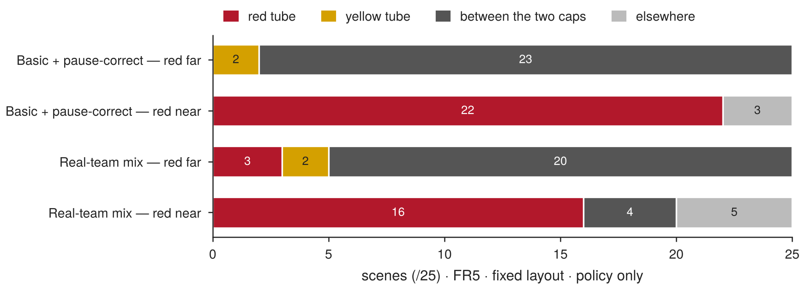
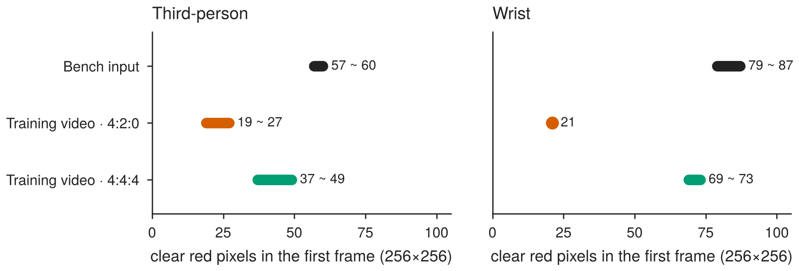
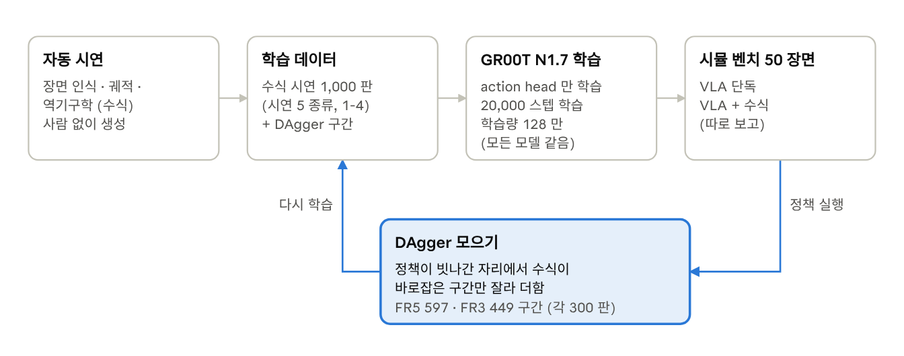
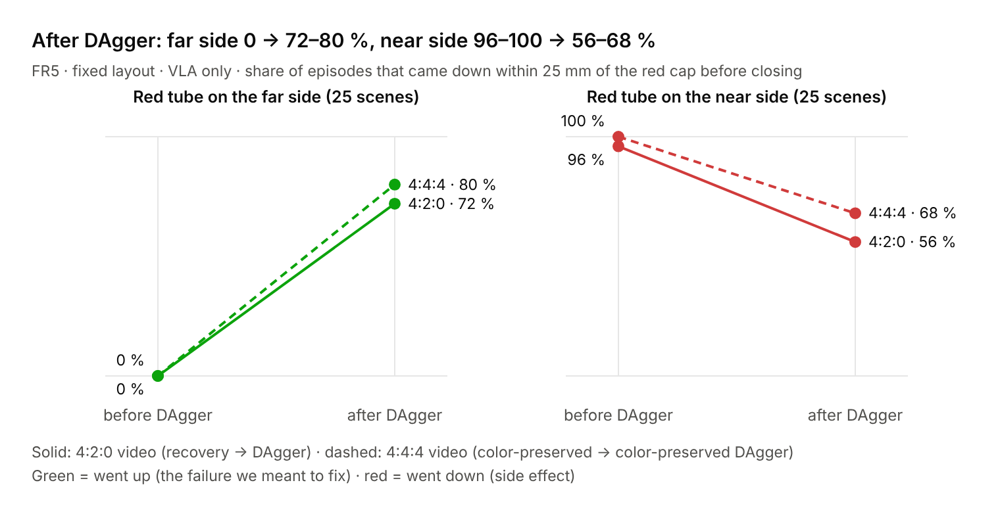
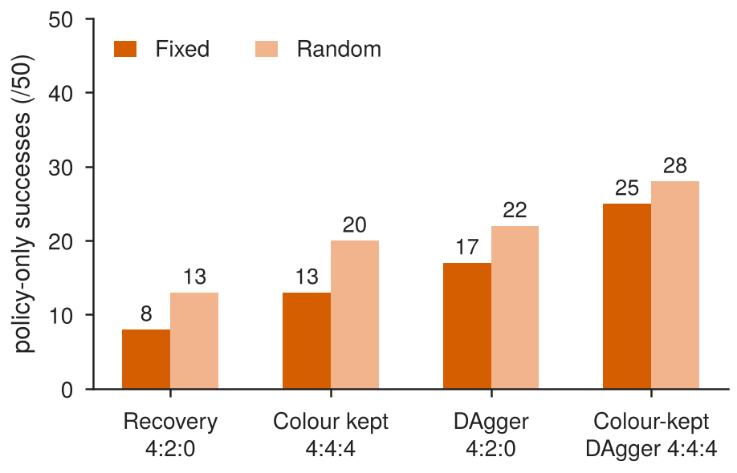
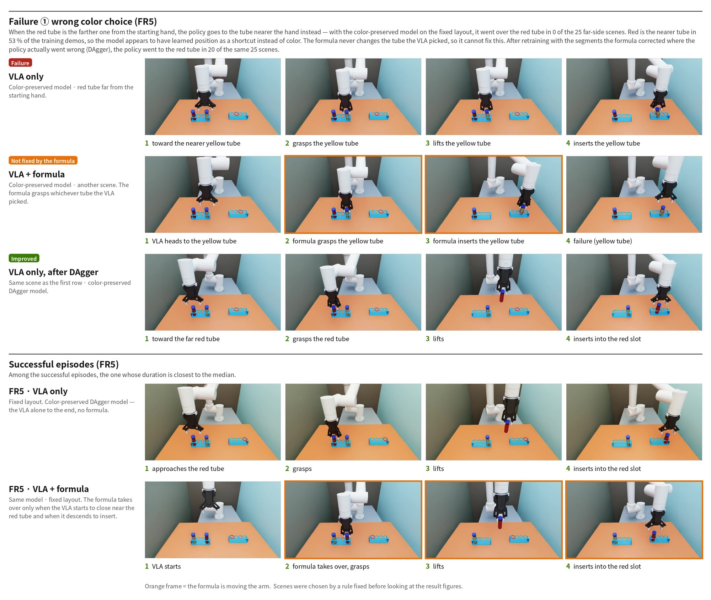
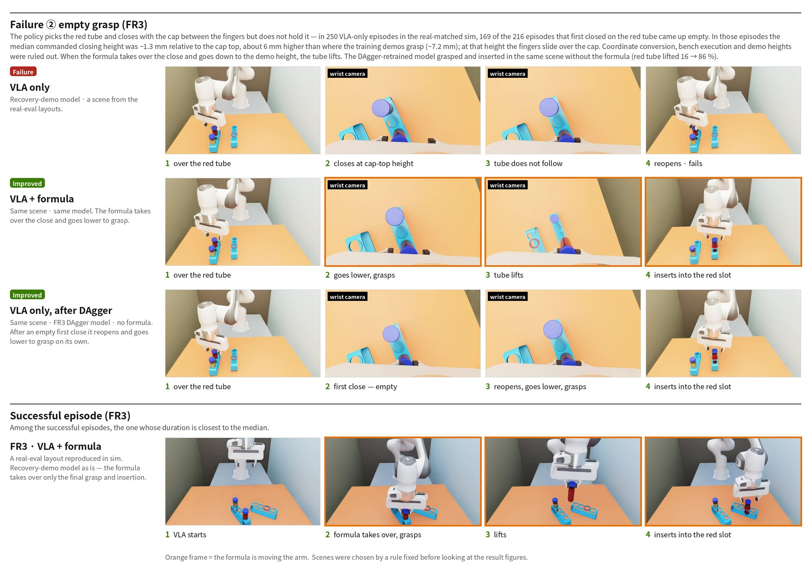
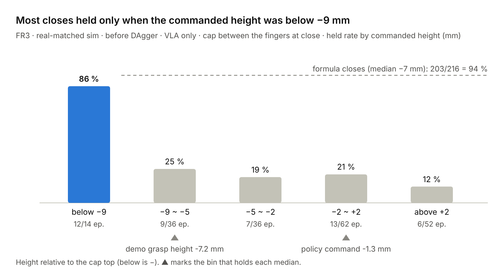
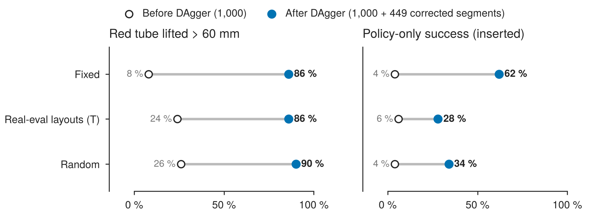

# Report 8 — Progress log 11-14 – 11-16: Why FR5 does not go to the far tube, bringing DAgger forward, why FR3 cannot hold the tube

2026-11-14 (Sat) – 11-16 (Mon) · Sim-to-Real Post-Training (simulation part) · Isaac Sim 6.0.1 · Isaac Lab 3.0 · GR00T N1.7 · [한국어](README.md)

Three days of measuring the models built on the real-matched sim settings and the 1,000-demo dataset of [Report 7](../report07_sim2real_1000/README_EN.md), up to the results of [Report 4](../report04_sim_bench/README_EN.md). In this period **we wrote down the criterion for every question before seeing the results**, and ruled candidate causes out or kept them according to those criteria.

## Summary

- **11-14 morning — We rescored the 53 benches run so far with the same stage table (S0–S9).** In every setting VLA + formula was 2–5× policy only, and on FR3, 4× more training on the same 200 demos took the fixed layout from 0/50 to 13/50.
- **11-14 daytime — We ruled out the FR5 candidates one by one.** The physics-jump fixes · re-query interval · finger colliders · filtering wrist rotation · grasp tolerance · motion speed were not the cause or could not fix it. What remained was **"when the red tube is far from the start hand, the policy goes between the two tubes"**. Asking the same image 20 times aimed between them all 20 times.
- **11-14 afternoon — We brought DAgger forward.** We ran the policy and added 597 segments where the formula corrected it from where the policy actually went. Along the way we confirmed that "the habit of going to the tube nearer the start hand" is a shortcut learned by the model, not a bias in the data.
- **11-15 — FR5 DAgger fixed that habit.** On the fixed layout, of the 25 scenes with red on the far side, trials that went above the red tube rose from 0 to 18 (color-preserving video: 0 to 20). The color-preserving DAgger model scored 25/50 with the policy alone and 46/50 with VLA + formula.
- **11-15 — FR3 cannot hold the tube because it "closes about 6 mm too high".** Conversion, bench execution and training data were not the cause; the policy itself sent the close at a higher point than the demos. We collected an FR3 DAgger set the same way (once again, because the handover time was first copied from FR5).
- **11-16 — FR3 DAgger results arrived and Report 4 was published.** FR3 policy only reached 31/50 on the fixed layout, and 50/50 with the formula.

## 0. Terms used in this log

| Term | Meaning |
|---|---|
| Real-matched sim | The new sim settings with scene · cameras · base height · start pose matched to the real robots ([Report 7](../report07_sim2real_1000/README_EN.md)). Every bench in this log uses it unless stated otherwise |
| Basic + pause-correct model | Trained on 525 basic demos plus "pause-correct" demos that stop above and fix 1–8 mm |
| Recovery-demo model (1,000) | Trained on the 1,000 demos that add 250 "offset + correction" and 150 "retry after failure" demos |
| Color-preserving model | Same data as the recovery-demo model, saved as video that keeps full color resolution (4:4:4) |
| Real-team mix · real-team sim | Models trained on sim data collected in the real team's settings mixed with real data · on that sim data alone |
| DAgger | Run the policy, collect the states it actually reaches, attach the expert's action in those states (here, the formula that made the demos), add them to the data and retrain (Ross et al., 2011) |
| VLA + formula | Execution where the policy chooses the target and only the final grasp and insertion are handed to the formula (same structure as the real FR3 station) |
| Red far · red near | On the fixed layout, the 25 scenes each where the red tube is at the end far from · near the start hand |
| Different · cannot say different | "Different" if the chance that the gap between two models arises by luck alone is below 5 % (Fisher's exact test) |

## 1. 11-14 (Sat) morning — Rescoring all benches so far with the same criteria

We rescored the 53 bench folders on the workstation with the same S0–S9 stage table as the real robots. There were three bench settings (first settings · real-team settings · real-matched sim), so rows with different settings were not compared directly.

| Observation | Numbers |
|---|---|
| VLA + formula is 2–5× policy only everywhere | FR3 52 · 60 %, FR5 real-team settings 56–66 %, real-matched sim 48 %. Closing position off by 12–28 mm with the policy alone → 0–2 mm with the formula |
| Training amount has a large effect on FR3 | 4× the training samples on the same 200 demos (0.32 M → 1.28 M): fixed layout 0/50 → 13/50, closing offset 28 → 12 mm |
| The benefit of the real team's data comes from its settings, not the real videos | The 600-demo model trained only on sim data collected in the real team's settings was not different from the sim + real mix model |
| Model trained on real data only | 0–2/50 in every setting, closing offset 43–64 mm |

**Corrected (same day).** We had said that "the training data contains only perfect demos that go exactly to the target from the start, so the policy has never seen corrections from an off-target state". That was wrong. It holds only for the 100–600-demo models in the first settings; the real-matched sim data contains pause-correct, offset-correction and retry demos. However, the models containing offset-correction and retry demos had not been benched at all by then.

- Tool: `tools/common_bench_report.py` 1.0 (read-only; S0–S9 scoring `common_bench_stage.py` 1.1 was fixed on 11-12). Source `logs/_bench_report_1114.txt` · `.json`.
- Two of my mistakes corrected: ① "FR5 physics jumps started on 11-11" — the jump rule only exists from the evening of 11-10, so before that it is "not measured", not "0". ② "The wrist torque on the URDF-wrist bench was 150" — the report tool cut the column at 14 characters so only the first three joints showed; the wrist was in fact 28 N·m.

## 2. 11-14 (Sat) daytime — Ruling out the FR5 candidates one by one

Every test used the same model (basic + pause-correct model, FR5) and the same 50 fixed-layout scenes, changed one thing only, and had its criterion written before the result.

| Question | Criterion (written first) | Result | Verdict |
|---|---|---|---|
| Can the physics jumps be fixed — more joint solver iterations (solv) · lower gripper joint force (fsoft) | jumps ≤ 5/50 | solv 8 jumps · fsoft 7 (baseline bench 10) | Neither fixes it |
| Re-query interval 0.8 → 0.4 s | Does success rise as "different"? | 2/50 vs. 5/50 | Cannot say different — no improvement |
| Is there no collider on the white FR5 fingertips? | collider more than 2 mm behind or 3 mm short | 0.0 mm difference on both sides (both 95.2 mm) | The collider covers it — not the cause |
| Are demos with large wrist rotation (over 70°) the problem? | over 15 % of our data | 4–6 % (the real team filtered out demos over 70°) | Not the cause |
| Is the sim grasp harsher than the real one? | not harsh if closes 10–20 mm off along the opening direction still hold > 70 % | 91–100 % (52–69 % beyond 25 mm) | Not harsh — if anything lenient because of the sim grasp assist (25 mm) |
| Does the policy move faster than the demos? | mean speed over 1.5× | 38 mm/s vs. demos 45–75 mm/s; descent above the cap 68 vs. 72–115 mm/s | Not faster |

- **One setting chosen after seeing results.** The physics tests did not meet their pre-registered criterion, but after seeing solv's success (11/50 vs. 5/50, cannot say different) the user decided to run all later FR5 benches with solv. So FR5 numbers in this period are marked as "physics chosen after seeing results", and comparisons are made only within the same physics.
- With the same model and the same scenes, small changes to the physics set moved success between 5 and 11/50. That is how much a 50-scene result can wobble, so we call two results different only when they are "different".

**Where does it fail?** Looking at the first failing stage, fixed-layout failures came in two lumps — before going to grasp (S1 · S2) 22/50 and insertion (S9) 16/50. VLA + formula cut the insertion failures to 1 but left the failures before grasping unchanged (23), because the formula only takes over when the policy tries to close near the red tube.

Splitting the lowest point reached before closing showed the cause.

| Fixed layout · policy only | Red far (25) | Red near (25) |
|---|---|---|
| Basic + pause-correct model | between the two caps 23 · yellow 2 · **red 0** | **red 22** · elsewhere 3 |
| Real-team mix model | between the two caps 20 · red 3 · yellow 2 | red 16 · between 4 · elsewhere 5 |

**Figure 1.** Lowest point reached before closing (FR5 · fixed layout · policy only). With red on the far side it almost always went between the two caps; with red on the near side it went to red.

**With red far, it almost always descends between the two tubes; with red near, it goes to red.** The two tubes are at the two ends of the rack (111 mm apart), so descending in the middle puts the open fingers (95 mm) on top of both caps and the hand cannot move. This was the "descends fast and gets caught on both caps" the user had seen in the bench videos.

**The image the model actually receives.** We made the image the bench sends to the policy and the training video into 256×256 the same way and counted clearly red pixels.

| Clearly red pixels in the first frame | Third-person | Wrist |
|---|---|---|
| Bench input | 57–60 | 79–87 |
| Training video (4:2:0 compression) | 19–27 | 21 |
| Training video (4:4:4 — color preserved) | 37–49 | 69–73 |

**Figure 2.** Clearly red pixels in the first frame the model receives. Counted after making the same scene into 256×256. Ordinary compressed (4:2:0) training video has 1/3 – 1/4 of the bench input, and color-preserving (4:4:4) video is close to the bench input.

- The red in the training video was 1/3 – 1/4 of the bench input, because ordinary video compression (4:2:0) keeps color only at half resolution horizontally and vertically. This is why we built the **color-preserving model**.
- One confirmed fact: **on the fixed layout the tube positions are completely fixed.** The 50 scenes are in effect two layouts (red left · red right), each seen 25 times with a different ring hole and lighting. So generalization is read from the random layout.

**Asking the same image 20 times.** GR00T starts from different noise each time it is asked, so asking the same image and state 20 times shows whether the policy has one branch or two. We set in advance: "if both red side and yellow side exceed 30 %, it is torn; if the middle exceeds 60 %, it aims at the middle".

- Red-far scene: all 20 times, just before descending, it aimed between the two tubes (at 0.52–0.64 along the red → yellow line) → **"aims at the middle"**. Not torn — it picked the same middle every time, as if sure.
- Red-near scene: red all 20 times.
- Asking the same image compressed like the training video gave the same result → whether the image is sharp or blurred did not change this choice.
- So re-query intervals, noise or image clean-up will not fix it. The current pause-correct (1–8 mm) and offset-correction (10–40 mm) demos correct "a small miss near red"; there is no scene of "between the two tubes (about 60 mm from red) → red". **DAgger, starting from exactly where the policy actually goes, fills this directly.**

- Differences from the real team checked the same day: same Isaac Lab version (v3.0.0-beta2.patch1) and Isaac Sim build, and all benches run on one install on our workstation → installation differences ruled out. The real team filtered sim demos to wrist rotation ≤ 70° when merging.
- The first measurement "350k · 120k red pixels in the first frame" counted the table color as red and was discarded (my mistake). Recounted with clear red only (R ≥ 100, G · B below 0.55 × R).
- We also tested "are there too few demos at that position?" with a pre-set criterion: scenes with demos at the same position for both red-left and red-right were 25/25, not different → hard to call it the cause.
- User decision (15:32): "try as is first, DAgger at the end" → 15:36 "bring it forward".

## 3. 11-14 (Sat) afternoon – night — Bringing DAgger forward

**Design (set before results).**

| Item | Value |
|---|---|
| Policy that runs | FR5 recovery-demo model (1,000) |
| Scenes | 300 new seeds under the training rules (fixed family 150 · random 150) — not bench scenes |
| Expert (formula) | Always goes to the red tube and red slot (not the side the policy chose). If the hand is low, first straight up → the same grasp · lift as the scripted demos / above the slot → align → insert |
| When it takes over (for data) | The hand is below 40 mm above the red cap but more than 20 mm from red · the policy tries to close · 9 s have passed — wider than the evaluation rule, to catch the descend-in-the-middle failure |
| Part used for training | Only the formula segments (grasp: takeover → end of lift; insert: takeover → release and withdraw). The policy's segments are wrong actions and are not used; failed formula segments are also dropped |
| Main criterion | Fixed layout · policy only · 25 red-far scenes: trials that went above the red tube (within 25 mm) — DAgger vs. the recovery-demo model |

**Figure 3.** How DAgger works (labels in Korean). Run the policy, cut only the segments where the formula corrected it from where it went off target, add them to the training data and retrain. The FR3 449 segments in the figure are the FR3 DAgger of 11-15 (Section 5).

The handover rules of the evaluation VLA + formula (25 mm · 6 mm · 25 mm) were not changed. Widening the formula's takeover range is only for collecting data.

**What we collected.** The formula took over the grasp in all 300 runs, because "trying to descend while far from red" 220 · "trying to close" 80. Formula empty grasps 0, physics jumps 0, 297 complete successes. Segments: 300 grasp · 297 insert, 48,716 frames (about 20 % of all training frames).

**A pre-registered comparison that came out at the same time — color preservation did not fix this failure.** In the 25 red-far scenes, trials that went above the red tube were 0/25 for the color-preserving model and 0/25 for the recovery-demo model (cannot say different).

**The habit of "the tube nearer the start hand".** The two models containing offset-correction and retry demos (recovery-demo · color-preserving) went to the nearer yellow tube instead of the middle. All five models showed the same shape (the table shows the four that also finished the random layout).

| Policy only · share that went above the red tube | Fixed · near | Fixed · far | Random · near | Random · far |
|---|---|---|---|---|
| Basic + pause-correct | 19/25 | 1/25 | 17/23 | 8/27 |
| Recovery demos | 24/25 | 0/25 | 18/23 | 7/27 |
| Real-team mix | 16/25 | 3/25 | 19/23 | 15/27 |
| Real-team sim | 23/25 | 0/25 | 17/23 | 11/27 |

- In the training data, red was nearer the start hand in 53 % of demos (48–55 % per layout), i.e. balanced. Under the pre-set criterion (35–65 % means the data is balanced), we judged this **not a data bias but a habit the model learned: using position as a shortcut instead of color**.
- The more a model relied on sim data alone, the stronger the habit; models with real videos mixed in showed less of it on the random layout.

- Training got stuck twice (including my mistakes):
  - The training-server GPU was free, but a "60 GB free memory" criterion copied over from another queue left it idle for over 2 hours → changed to 48 GB (falls back to 32 × 2 automatically if 64 does not fit).
  - Crashed at step 5,154 / 20,000 with `CUDA error: the launch timeout` (the same error as the 11-03 FR5 training; not out of memory). Whether it relates to the driver version mismatch on the server is unknown (rebooting is up to the server admin, so we did not) → now saves the optimizer too at step 10,000 and resumes from there after a crash.
- The color-preserving training was skipped once (my mistake): the pre-training criterion was wrongly "all installed decoders must read yuv444" (training actually uses torchcodec only). Fixed to "the decoder training actually uses can read it" and restarted.
- User decision (11-15 00:07): DAgger once more with color-preserving video (the segments are the ones collected with the 4:2:0 model — not strict DAgger; Report 4 says so).

## 4. 11-15 (Sun) — FR5 DAgger results

| Fixed layout · policy only · 25 red-far scenes | Trials that went above the red tube | Verdict (pre-registered) |
|---|---|---|
| Recovery-demo model → DAgger | 0 → 18 | Different |
| Color-preserving model → color-preserving DAgger | 0 → 20 | Different |

**Figure 4.** Share that went above the red tube before and after DAgger (FR5 · fixed layout · policy only). Left = 25 red-far scenes, right = 25 red-near scenes. Solid = ordinary compressed video (recovery demos → DAgger), dashed = color-preserving video (color-preserving → color-preserving DAgger).

**DAgger fixed the FR5 "nearer tube" habit.** The far-side scenes of the random layout also rose, 7/27 → 20/27 and 6/27 → 21/27.

| Policy-only successes (/50) | Fixed | Random |
|---|---|---|
| Recovery demos (4:2:0) | 8 | 13 |
| Color-preserving (4:4:4) | 13 | 20 |
| DAgger (4:2:0) | 17 | 22 |
| Color-preserving DAgger (4:4:4) | **25** | **28** |

**Figure 5.** FR5 policy-only successes (/50). Same 50 scenes · same physics (solv).

- Color-preserving DAgger vs. color-preserving: fixed "different", random "cannot say different".
- Color preservation came out in the same direction (4–8 trials higher) both before and after DAgger, but each comparison alone is "cannot say different".
- VLA + formula: color-preserving DAgger fixed 46/50 · random 44/50 — the highest FR5 result of this period.
- **One side effect.** In the red-near scenes, trials that went above the red tube dropped from 24/25 to 14/25 (color-preserving: 25/25 → 17/25). Both times, fixing the far-side habit cost some accuracy on the near side.

**Figure 6.** FR5 key scenes. Top = before DAgger the policy goes to the nearer yellow tube, and VLA + formula also inserts that yellow tube. After DAgger the policy goes to the far red tube. Bottom = success scenes.

## 5. 11-15 (Sun) — Why can't FR3 hold the tube?

**Question (user).** The FR3 policy finds red well but cannot pick it up. Did it issue a lift command and get stuck, is the gripper too narrow, or is it a policy problem or a sim physics or setup problem?

We split the 5 s after the first close (real-matched sim, FR3 policy only, 250 trials).

| After the first close | Policy only | VLA + formula |
|---|---|---|
| Did not close within 40 mm of red | 34 | 34 |
| Empty · closed outside the range the fingers can hold | 16 | 9 |
| **Empty · within range · height also right** | **140** | 4 |
| Held → no lift command | 30 | 0 |
| Lift command → hand could not rise (stuck) | **0** | 0 |
| Tube lifted more than 60 mm | 10 | 195 |

Only the main rows are shown (left out: empty · within range · closed too high 13 · 0; hand rises but the tube does not follow 4 · 7; lifted then slipped out 3 · 1).

- Stuck: 0 trials. Most (169 of 216) did not hold the tube.
- Of the 140 "within range but empty" trials, in 123 the fingers passed over the cap and closed fully. **Every trial that held had the fingertips down to 7 mm below the cap top, while the policy closed at about the cap top height (about 7 mm higher) in the median.** In sim, at that height the fingers slide over the top edge of the cap.
- Finger width was not the main difference. Of the 216 positions where FR3 closed, 200 were within FR3's finger range, and 212 would be for FR5's fingers — a geometric difference of only 12 trials. The difference is in the sim grasp handling (grasp assist only on FR5).

**Figure 7.** FR3 key scenes (a real-eval layout scene). Top = before DAgger the policy closes at cap-top height and the tube does not follow. Middle = in the same scene the formula takes over and goes lower to grasp. Bottom = after DAgger the policy, even when its first close comes up empty, opens again by itself and goes down to grasp (Section 7).

**Why does it close high — four candidates split with pre-set criteria.**

| Candidate | Check | Result |
|---|---|---|
| ① Real-format conversion (sim fingertip 97.0 mm vs. real 103.4 mm) | Converted 3,572 demo steps the same way as the bench and compared with the training states | 0.000 mm position difference — not the cause |
| ② Bench execution (closes before the arm arrives) | actual − sent height at the moment of closing | +0.1 mm — not the cause |
| ③ Policy actions (sends a high position) | sent closing height vs. demos | **−1.3 mm vs. demos −7.2 mm** — yes |
| ④ High grasps mixed into the demos | demo grasps above cap top −3 mm | 0 % — not the cause |

**Figure 8.** Held rate by the closing height the policy sent (FR3 · before DAgger · policy only). Most trials held only when the close was sent more than 9 mm below the cap top. The median height at which the demos held is −7.2 mm; the height the policy sent is −1.3 mm.

The policy stopped and closed about 6 mm higher than the demos. The demos always go down to exactly the right height, so "if you stopped too high, go further down and then close" is not in the training data. This is the same kind of failure that DAgger fixed on FR5 (the policy's own wrong position + the formula's correction), so **following the pre-set next step we ran FR3 DAgger**.

**FR3 DAgger.** Same method as FR5, plus a formula that, if the hand already straddles the red cap when the grasp is taken over, **continues down from there and grasps** (user decision). The main criterion was set in advance as "trials that lifted the red tube more than 60 mm over 100 scenes of fixed + real-eval layouts".

- Collected once more (my mistake): the 9 s handover time was copied from FR5 DAgger, so in the slower FR3 demos the formula took over before the policy reached the cap (still approaching), and "continue down from there and grasp" was used in only 6 % of runs. We reset it to the 90th percentile of the time when the FR3 policy first closed on red (20.3 s → 21 s) and collected again. The 300 runs collected with 9 s were kept but not used for training.
- Found at the same time that the bench's FR3 gripper handling differs from the real executor: the bench opens and closes each step at a 0.5 threshold and does not stop the arm, while the real executor stops the arm on two consecutive 0.4 / 0.6 steps and waits until it has grasped. Not the cause this time, but recorded in the sim · real difference table.

## 6. 11-15 (Sun) — How the sim robots differ from the real ones, and why the real-only model is low in sim

**User's question:** Isn't the FR5 USD · URDF and gripper being different from the real one causing repeated problems?

| Robot | Item | Sim | Real |
|---|---|---|---|
| FR5 | Arm kinematics (DH · joint limits) | URDF / USD | Match (0.007° from the controller pose) |
| FR5 | Gripper | AG-95 model: the outer knuckle is position-driven, the rest follow in software | One motor · a linked mechanism — **different mechanism** |
| FR5 | Attach while held | The tube is attached to the hand if within 25 mm | None — **an assist the real robot does not have** |
| FR5 | Physics jumps | 16–20 % of trials | None |
| FR3 | Robot model | Isaac's default Franka **Panda** | FR3 — not a dedicated model |
| FR3 | Arm drive | PD stiffness 400 · gravity off | Joint impedance · gravity compensation — **the sim is 3–40× stiffer** |
| FR3 | Attach while held | None | None — so sim FR3 is stricter than sim FR5 |
| Both | Rack hole | 31 mm (tube 30 mm) | Never measured |

So **for both robots, sim policy-only success cannot stand in for real success.** FR5 sim grasping is lenient and has many physics jumps; FR3 sim is strict. Comparisons between models under the same physics (DAgger vs. recovery demos, VLA + formula vs. policy only) are used as they are.

**Why the model trained only on real data scores 0–4 % in sim (pre-registered verdicts).**

- Images: it chose red first in 76/150 (51 %), not different from 50 % → it cannot tell red apart in the sim images.
- Position: on the fixed layout the hand was consistently about 2.5–5 cm toward the front of the robot relative to the cap → scene / camera viewpoint is the candidate.
- Memorized positions · start state: no (the hand follows the scene, and the first state matches the real data).
- Physics (controller · gripper) could not be judged with this bench, since the hand rarely reached a grasping position.

## 7. 11-16 (Mon) — FR3 DAgger results and Report 4

| FR3 · policy only (/50) | Fixed | Random | Real-eval layouts |
|---|---|---|---|
| Recovery-demo model | 2 | 2 | 3 |
| DAgger | **31** | **17** | **14** |

**Figure 9.** FR3 before and after DAgger (policy only, same 50 scenes each). Left = trials that lifted the red tube more than 60 mm, right = success (inserted).

- Main criterion (pre-registered): trials that lifted the red tube more than 60 mm over 100 scenes of fixed + real-eval layouts, 16 → 86 → **different**.
- VLA + formula: 50 · 45 · 43 /50.
- Training amount also grew with DAgger, so the gain cannot be attributed to DAgger alone.

These results were collected into [Report 4 — sim bench results](../report04_sim_bench/README_EN.md). Report 4's FR5 numbers are from the models of this period (videos squashed to 256×256 as in the real FR5 format); in the next period we changed the video format to match FR3 and measured again ([Report 9](../report09_final_1116_1119/README_EN.md)).

## Appendix. Development notes for this period

Development note 37 (bench result summary — Sections 1–22). All numbers are real-matched sim · the same 50 scenes not in training (first try per scene · physics jump = failure). FR5 numbers use the physics with more solver iterations (solv, chosen after seeing results); FR3 uses the default sim physics.
