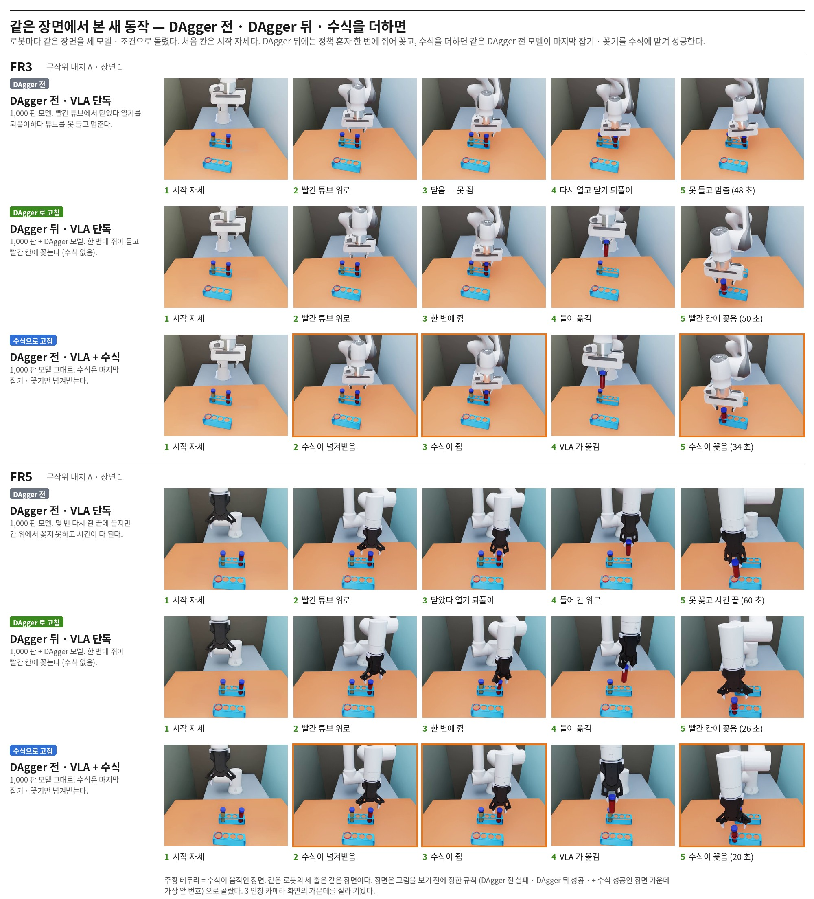
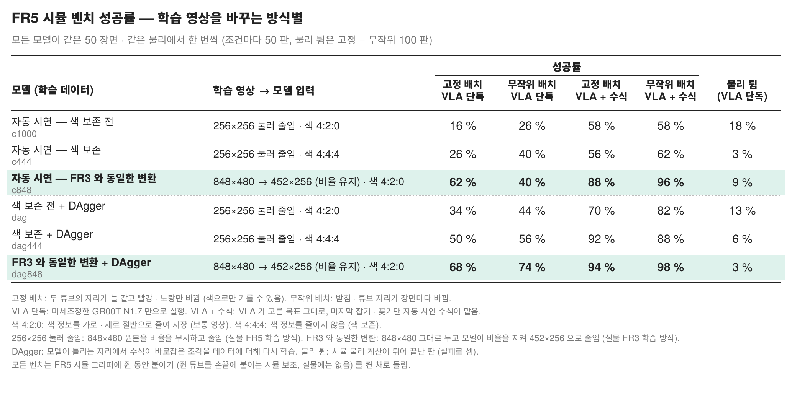
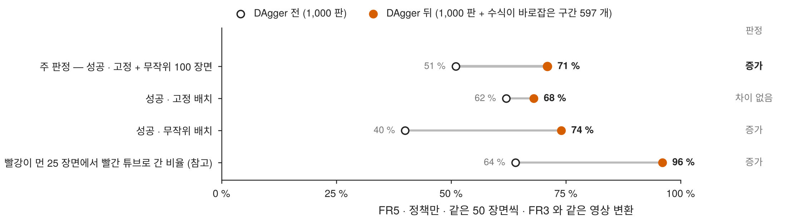
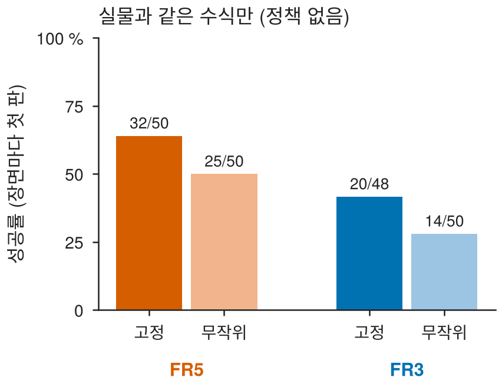
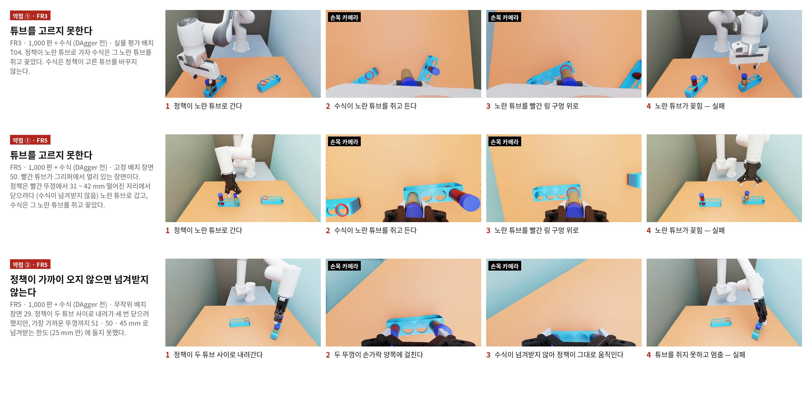
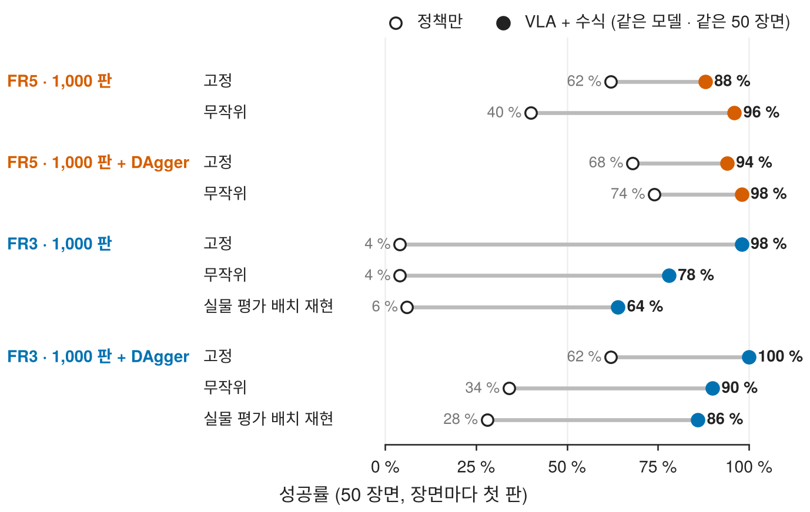

# 보고서 9 — 진행 기록 11-16 \~ 11-19: FR5 영상 형식을 FR3 와 같게, DAgger 다시, 실물과 같은 수식 점검, VLA + 수식의 약점

2026-11-16 (월) \~ 11-19 (목) · Sim-to-Real Post-Training (시뮬레이션 파트) · Isaac Sim 6.0.1 · Isaac Lab 3.0 · GR00T N1.7 · [English](README_EN.md)

[보고서 4](../report04_sim_bench/README.md) 를 낸 뒤 나흘 동안의 기록입니다. FR5 학습 영상을 FR3 와 같은 방식으로 바꾸자 FR5 정책이 크게 올랐고, 그 새 모델로 DAgger 를 다시 했습니다. 마지막 이틀은 VLA + 수식의 수식을 실물과 같은 조건으로 점검하고, VLA + 수식이 어디서 실패하는지 (약점) 를 정리해 최종 보고서를 썼습니다. **이 기간의 FR5 숫자가 보고서 4 의 FR5 숫자를 대신합니다.**

**요약 그림.** 같은 장면 (무작위 배치 · 장면 1) 을 DAgger 전 정책만 · DAgger 뒤 정책만 · DAgger 전 VLA + 수식으로 돌렸다. 위는 FR3, 아래는 FR5 다.

## 요약

- **11-16 — 다음 방향을 「차이가 어디서 생기나」 로 정했다.** 시뮬 ↔ 실물 차이 (FR5 물리 · FR3 로봇 모델) 를 찾고, 실물 정보는 실물 팀 컴퓨터에서 읽기만 해서 가져온다.
- **11-17 — FR5 학습 영상을 FR3 와 같게 바꿨다.** 848×480 을 256×256 으로 눌러 줄이던 것을, 848×480 그대로 두고 모델이 비율을 지켜 줄이게 했다. 같은 1,000 판 · 같은 50 장면 · 같은 물리에서 정책만의 성공이 고정 배치 16 → 62 %, 무작위 배치 26 → 40 % 가 되었다.
- **11-17 \~ 18 — 새 FR5 모델로 DAgger 를 다시 했다.** 실패 모양이 바뀌었기 때문이다 (색 선택 실패가 거의 사라지고 「튜브 사이 하강」 · 「칸 위 꽂기 실패」 가 남음). 미리 정한 주 판정 (고정 + 무작위 100 장면 성공) 이 51 → 71 % 로 증가했다.
- **11-18 — FR3 시뮬 데이터는 다시 모으지 않기로 했다.** 남은 차이 (쥔 폭 · 팔 처짐) 를 먼저 고치고, 다시 모을 일이 생기면 한 번에 반영한다.
- **11-19 — 실물과 같은 조건의 수식을 따로 점검했다.** 정답 자리를 모르는 수식 (카메라로 찾음) 만으로 고정 배치 FR5 32/50 · FR3 20/48 이었다. 들어 올린 튜브는 모두 꽂혔고, 실패는 튜브를 찾고 고르는 단계에서 났다. 보고서의 VLA + 수식 숫자는 정답 자리 수식 그대로 내고, 이 점검은 보조 실험으로 이어 가기로 했다.
- **11-19 — VLA + 수식의 약점을 정리했다.** 수식은 정책이 고른 튜브를 바꾸지 않고, 정책이 가까이 오지 않으면 넘겨받지 않는다. FR5 VLA + 수식 200 판의 실패 12 판을 모두 나눠 보았다.

## 0. 이 기록에서 쓰는 말

| 말 | 뜻 |
|---|---|
| 1,000 판 모델 · 1,000 판 + DAgger 모델 | 이 기간의 최종 두 모델 (로봇마다). FR5 는 FR3 와 같은 영상 형식으로 학습 |
| 정답 자리 수식 | VLA + 수식에서 수식이 시뮬이 아는 정답 자리 (뚜껑 · 칸) 를 쓰는 방식 — 보고서 숫자 |
| 실물과 같은 수식 | 실물처럼 카메라 화면 · 좌표로 튜브와 칸을 찾는 수식 (시뮬 정답 자리를 쓰지 않음) |
| 튜브 사이 하강 | 고정 배치에서 빨간 튜브가 멀 때 두 튜브 사이로 내려가 양쪽 뚜껑에 손가락이 얹히는 실패 |
| 칸 위 꽂기 실패 | 무작위 배치에서 튜브를 빨간 칸 위까지 옮겼지만 꽂지 못한 실패 (S9 에서 처음 막힘) |
| 4:2:0 · 4:4:4 | 영상의 색 저장 방식. 4:2:0 은 색을 가로 · 세로 절반 해상도로만 남김 (보통 영상), 4:4:4 는 줄이지 않음 |

## 1. 11-16 (월) — 보고서 4 와 다음 방향

[보고서 4](../report04_sim_bench/README.md) 를 내고 다음 방향을 정했다 (사용자).

- 최종 목표는 **real-to-sim · sim-to-real 차이가 어디서 생기는지** 찾는 것이다. 가장 중요한 것은 실물과의 비교다.
- FR5 는 시뮬 로봇 물리를 실물과 같게 맞추고 싶다. FR3 는 지금 쓰는 Isaac 기본 Panda 자산 대신 FR3 자산이 실물 (임피던스 등) 에 더 맞는지 확인한다.
- 실물 정보는 연구실 내부망으로 실물 팀 컴퓨터 (FR3 로봇 PC · FR5 제어 PC) 에 접속해 **읽기만** 해서 가져온다.

## 2. 11-17 (화) — FR5 학습 영상을 FR3 와 같게

**왜.** FR5 학습 영상은 실물 FR5 팀의 방식대로 848×480 을 비율을 무시하고 256×256 으로 눌러 줄였고, FR3 는 848×480 그대로 두어 모델이 비율을 지켜 452×256 으로 줄였다. 두 로봇이 학습 설정 · 데이터 변환에서 다르면 로봇끼리 견줄 수 없다 (사용자 — 256×256 으로 눌러 줄이는 것은 맞지 않다고 봄). 보고서 7 · 8 에서 본 「FR5 학습 영상에서 빨간 뚜껑이 흐려짐」 도 이 줄이기 · 압축과 관련이 있었다.

**바꾼 것.** 같은 FR5 1,000 판을 FR3 와 같은 변환으로 다시 만들고, 같은 조건 (batch size 64 × 20,000 · 같은 학습 설정 파일) 으로 다시 학습했다.

**그림 1.** FR5 시뮬 벤치 성공률 — 학습 영상을 바꾸는 방식별. 같은 1,000 판 · 같은 50 장면 · 같은 물리. 아래 세 줄은 DAgger 를 더한 모델이다.

| FR5 · 같은 50 장면 · 같은 물리 | 정책만 고정 | 정책만 무작위 | VLA + 수식 고정 | VLA + 수식 무작위 |
|---|---|---|---|---|
| 256×256 · 4:2:0 (보고서 4 의 복구 시연 모델) | 16 % | 26 % | 58 % | 58 % |
| 256×256 · 4:4:4 (색 보존) | 26 % | 40 % | 56 % | 62 % |
| **848×480 → 452×256 · 4:2:0 (FR3 와 같은 변환)** | **62 %** | **40 %** | **88 %** | **96 %** |

- FR3 와 같은 변환이 정책만 고정 배치에서 가장 크게 달랐다 (16 → 62 %). 색만 보존한 것 (26 %) 보다도 높았다.
- 새 모델은 실패 모양이 달랐다. 노란 튜브로 간 판이 거의 없었고, 남은 실패는 **고정 배치의 「튜브 사이 하강」 (빨강이 먼 25 장면 가운데 9 판)** 과 **무작위 배치의 「칸 위 꽂기 실패」 (20 판)** 였다.
- 실패 모양이 바뀌었으므로, DAgger 도 이 모델로 다시 하기로 했다 (사용자).

## 3. 11-17 \~ 18 — 새 FR5 모델로 DAgger

방법은 [보고서 8](../report08_dagger_1114_1116/README.md) 과 같다 — 1,000 판 모델을 벤치와 다른 300 장면에서 돌리고, 정책이 빗나가면 수식이 넘겨받아 빨간 튜브 · 빨간 칸으로 바로잡은 구간만 1,000 판에 더해 같은 조건으로 처음부터 다시 학습한다.

| 로봇 | 모은 판 | 더한 구간 | 「정한 시간」 (결과 전에 규칙으로) |
|---|---|---|---|
| FR5 | 300 (물리 튐 0) | 597 개 (잡기 300 · 꽂기 297) · 47,857 프레임 | 9 초 — 1,000 판 모델이 빨강을 처음 닫은 시각의 90 % 값 (6.86 초) 을 초 단위로 올림 |
| FR3 (11-15, [보고서 8](../report08_dagger_1114_1116/README.md)) | 300 | 449 개 | 21 초 (같은 규칙) |

**주 판정 단계도 결과 전에 규칙으로 골랐다.** 「1,000 판 모델의 정책만 고정 + 무작위 100 판에서 처음 막힌 판이 가장 많은 단계」 가 S9 (칸 위 맞춤 · 꽂기, 26 판) 였고, S9 통과는 곧 성공이다.

| FR5 · 정책만 | DAgger 전 | DAgger 뒤 | 판정 |
|---|---|---|---|
| **주 판정 — 성공, 고정 + 무작위 100 장면** | **51 %** | **71 %** | **증가** |
| 성공, 고정 배치 | 62 % | 68 % | 차이 없음 |
| 성공, 무작위 배치 | 40 % | 74 % | 증가 |
| 빨강이 먼 25 장면에서 빨간 튜브로 간 비율 (참고) | 64 % | 96 % | 증가 |
| 그 25 장면의 튜브 사이 하강 (참고) | 9 판 | 1 판 | 감소 |
| 무작위 배치 · S9 에서 처음 막힌 판 (참고) | 20 판 | 8 판 | 감소 |

**그림 2.** 새 FR5 모델의 DAgger 앞뒤 (정책만). 주 판정과 판정 문구는 결과 전에 정한 규칙을 따른다.

- 무작위 배치는 꽂기 실패가 줄어 크게 올랐다. 더한 구간의 절반 (꽂기 297 개) 이 정책이 실제로 칸 위에서 빗나간 자리에서 꽂는 구간이라, 그 몫으로 본다.
- 고정 배치는 튜브 사이 하강 · 들기 실패가 줄어 더 많은 판이 꽂기까지 왔지만, 꽂기에서 처음 막힌 판이 6 → 12 판으로 늘어 성공은 차이 없음이었다.
- VLA + 수식은 고정 94 % · 무작위 98 % 였다.

- FR5 두 모델은 FR3 의 짝 모델과 같은 학습 설정 파일로 학습했다 (학습을 시작할 때 설정을 칸마다 견줘 확인).

## 4. 11-18 (수) — FR3 시뮬 데이터는 다시 모으지 않음

- 튜브 실험의 FR3 시뮬 데이터 (Isaac 기본 Panda 모델) 는 지금 다시 모으지 않는다. 남은 차이 (쥔 폭 · 팔 처짐) 를 먼저 고치고, 다시 모을 일이 생기면 고친 값을 모두 넣어 한 번만 모은다.
- 보고서에서는 Panda 모델을 써서 FR3 결과와 차이가 없거나 작으면 「sim-to-real 의 한계」 로 쓰고, 로봇의 한계라고 하지 않는다.
- DAgger 로 성공률이 확실히 오른 것을 확인했고, 다음은 수식 보조 없이 **정책만의 성공률**을 올리는 길을 찾는 것이다.

## 5. 11-19 (목) — 실물과 같은 조건의 수식을 따로 점검

**물음 (사용자).** 시뮬 벤치의 VLA + 수식에서 수식은 실물과 같은 조건이어야 하지 않나 — 실물 수식은 카메라 · 좌표로 튜브와 칸을 찾고, 시뮬에서만 아는 정답 자리는 모른다. (데이터를 모으는 수식 · DAgger 전문가는 정답 자리를 써도 괜찮다.)

**방법.** 정책 없이 수식만 실물 조건으로 처음부터 끝까지 돌렸다 — 시작 장면을 손목 카메라로 검출하고 (시뮬 정답 자리는 쓰지 않음), 실물 수식과 같은 규칙 (손목을 30° 넘게 돌려야 하면 하지 않음 등) 을 따른다. 시뮬은 물리 한계가 있어 수식의 값 (잡는 깊이 · 닫는 속도 등) 은 시뮬에 맞게 정해도 되지만, 파이프라인 구조는 실물과 같게 둔다.

| 실물과 같은 수식만 (정책 없음) | 고정 배치 | 무작위 배치 |
|---|---|---|
| FR5 | 32/50 | 25/50 |
| FR3 | 20/48 | 14/50 |

**그림 3.** 실물과 같은 수식만으로 돌린 결과 (정책 없음, 장면마다 첫 판).

- **들어 올린 튜브는 모두 꽂혔다.** 실패는 튜브를 찾고 고르고 쥐는 단계에서 났다.
- FR5 실패: 손목을 30° 넘게 돌려야 하는 장면 (실물 규칙대로 하지 않음 — 무작위 배치 18 판), 손목 화면만으로 노란 튜브를 빨강으로 고름 (실물은 3인칭으로 한 번 더 확인 — 시뮬에는 아직 없음), 빨간 튜브를 못 찾음.
- FR3 실패: 헛잡음. 손끝은 계획한 자리로 정확히 가고 닫기 전 튜브도 그대로인데, 뚜껑 자리 어림 오차 2 \~ 3.5 mm 에서 시뮬 FR3 그리퍼가 놓쳤다. FR5 에는 시뮬 쥐기 보조 (25 mm) 가 있어 이 오차를 덮는다.

**결정 (사용자 11-19 20:30).** 보고서의 VLA + 수식 숫자는 지금 숫자 (정답 자리 수식) 그대로 낸다. 수식 파이프라인은 집기 · 꽂기 정확도를 높이는 보조 도구라 시뮬 성공률이 높은 것은 정상 범위로 보고, 실물과 같은 수식 점검은 보조 실험으로 이어 간다.

**이어 할 일 (미리 정한 순서).** ① 시뮬 수식 값 (잡는 깊이 · 닫는 속도) 의 후보를 정하고, 벤치와 다른 장면에서 미리 정한 규칙으로 골라 고정한 뒤 다시 점검 ② FR5 에 실물처럼 3인칭으로 빨강을 확인하는 단계를 넣기 ③ 넘김 규칙은 바꾸지 않음 ④ 실물과 같은 수식의 VLA + 수식 벤치는 보조 실험으로.

## 6. 11-19 (목) — VLA + 수식의 약점

VLA + 수식은 견준 10 쌍 모두에서 정책만보다 성공이 올랐다. 그래도 만능은 아니다. FR5 VLA + 수식 4 벤치 200 판의 실패 12 판을 모두 나눠 보았다.

| 실패 갈래 | 판 |
|---|---|
| 수식이 넘겨받지 못함 (정책이 뚜껑 가까이 오지 않음) | 2 |
| 수식이 잡다 헛잡음 | 4 |
| 쥔 튜브가 8.2° 기울어 (기준 8°) 꽂기를 멈춤 | 1 |
| 덜 꽂힘 — 칸 위 0.5 \~ 1.2 mm 로 맞췄지만 튜브가 10 \~ 17 mm 위에서 끝남 (두 판은 놓고 2 초 뒤에도 내려가는 중) | 3 |
| 정책이 노란 튜브를 골라 수식이 노란 튜브를 꽂음 | 2 |

- 넘겨받은 뒤 실패한 10 판 가운데 8 판은 **정책이 처음에 뚜껑에서 25 mm 넘게 떨어진 곳에서 닫으려 한 뒤** 였다.

**그림 4.** VLA + 수식의 약점. 위 둘 = 약점 ① 수식은 정책이 고른 튜브를 바꾸지 않는다 (FR3 · FR5), 아래 = 약점 ② 정책이 가까이 오지 않으면 넘겨받지 않는다 (FR5).

**약점 ① 수식은 정책이 고른 튜브를 바꾸지 않는다.** FR3 (실물 평가 배치 재현 T04) 와 FR5 (고정 배치 장면 50) 에서 정책이 노란 튜브로 가자, 수식은 그 노란 튜브를 쥐고 빨간 링 구멍에 꽂았다. 이것은 설계대로다 — 수식이 다른 튜브를 고르면 정책의 결과라고 할 수 없다.

**약점 ② 정책이 가까이 오지 않으면 넘겨받지 않는다.** FR5 (무작위 배치 장면 29) 에서 정책이 닫으려는 자리가 넘김 범위 (25 mm) 밖이라 수식이 끝까지 넘겨받지 않았다.

사진의 장면은 결과를 보기 전에 정한 규칙 (벤치 순서대로 · 그 갈래가 처음 나오는 벤치의 가장 작은 장면 번호) 으로 골랐다.

## 7. 11-19 (목) — 최종 보고서

이 기간까지의 결과를 「바이오튜브 보고서 — FR3 · FR5 시뮬 벤치 · DAgger · 수식 마무리」 로 정리했다. 처음 읽는 사람도 알 수 있게 내부 줄임말을 풀어 쓴 이름으로 바꿨다 (예: 「배치 망설임」 → 「튜브 사이 하강」, 「무작위 배치 꽂기」 → 「칸 위 꽂기 실패」). 최종 숫자는 아래와 같다.

| 로봇 · 모델 | 정책만 고정 | 정책만 무작위 | VLA + 수식 고정 | VLA + 수식 무작위 |
|---|---|---|---|---|
| FR5 · 1,000 판 | 62 % | 40 % | 88 % | 96 % |
| FR5 · 1,000 판 + DAgger | 68 % | 74 % | 94 % | 98 % |
| FR3 · 1,000 판 | 4 % | 4 % | 98 % | 78 % |
| FR3 · 1,000 판 + DAgger | 62 % | 34 % | 100 % | 90 % |

**그림 5.** 최종 숫자 — 정책만 (흰 점) 과 VLA + 수식 (찬 점), 같은 모델 · 같은 50 장면.

학습에 쓰지 않은 같은 50 장면, 장면마다 첫 판이다. FR3 의 실물 평가 배치 재현은 1,000 판 6 % → DAgger 28 % (VLA + 수식 64 → 86 %) 였다.

**읽을 때 주의할 점.** 시뮬 수치는 실물 성공률의 예측이 아니다 — 같은 시뮬 · 같은 물리 안에서 모델끼리 견주는 도구로 쓴다. FR5 시뮬 성공률은 실물에 없는 쥐기 보조에 기대고 있고, FR3 시뮬에는 이 보조가 없다. 고정 배치는 사실상 배치 둘 × 25 장면이라, 처음 보는 자리에서의 성능은 무작위 배치로 읽는다.

## 8. 다음 (시험 기간 뒤)

- 실물과 같은 수식: 수식 값 고르기 → 다시 점검, FR5 3인칭 빨강 확인, VLA + 수식 보조 벤치.
- 실물 팀의 FR5 두 모델 실물 평가 결과를 시뮬과 같은 S0 \~ S9 로 비교.
- 다음 실험 하나: DAgger 2 회차 · FR5 그리퍼 모델 단순화 · 노란 링 과제 · 강화학습 미세조정 · GR00T N2 (12 월 공개 예정).

## 부록. 이 기간의 기록

최종 보고서 (11-19) · 개발 문서 38 \~ 40 (워크스테이션) · 벤치 기록 (`progress/bench_results.jsonl`). 모든 숫자는 실물 맞춤 시뮬 · 학습에 쓰지 않은 같은 50 장면 (장면마다 첫 판 · 물리 튐 = 실패) 이다. FR5 벤치는 시뮬 쥐기 보조를 켠 채 돌렸다.
