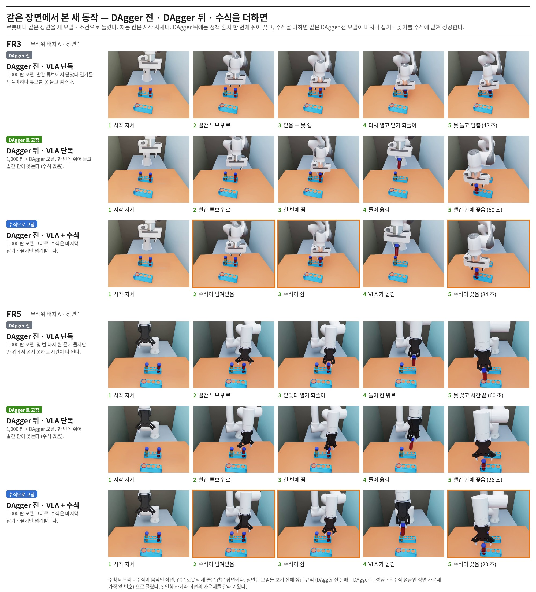
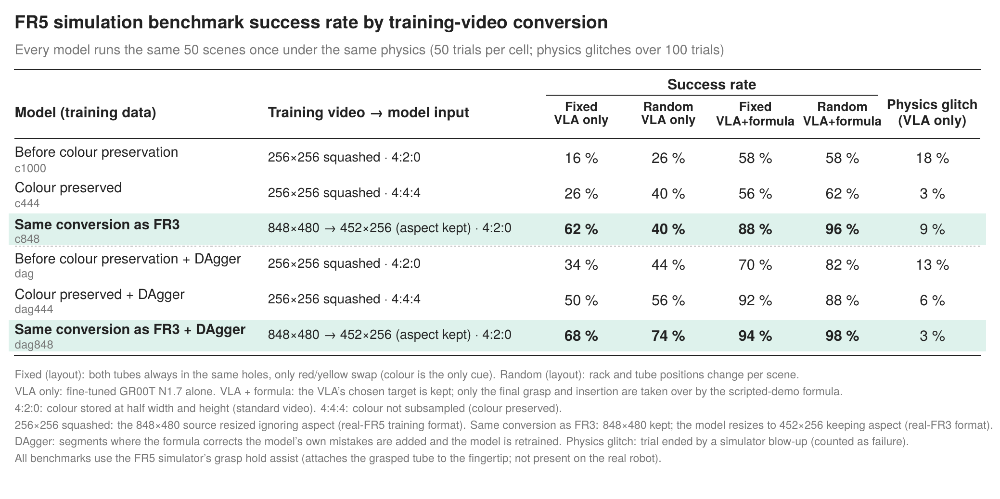
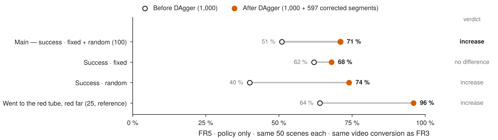
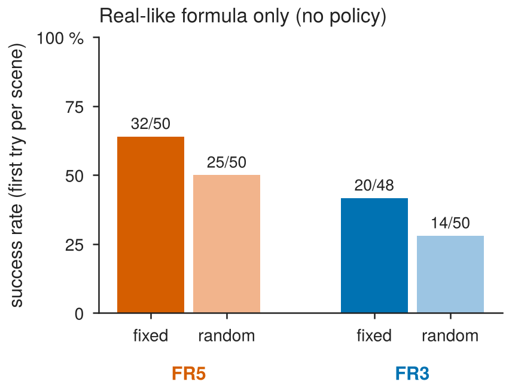
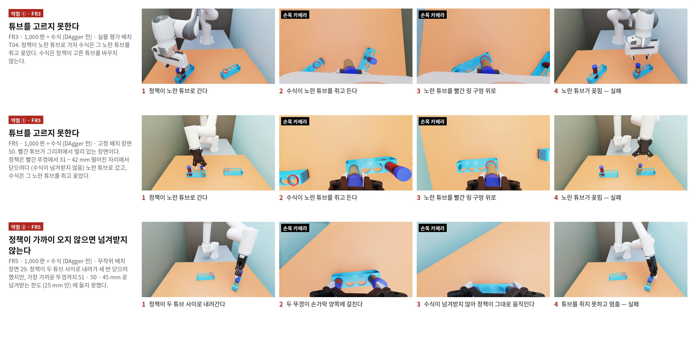
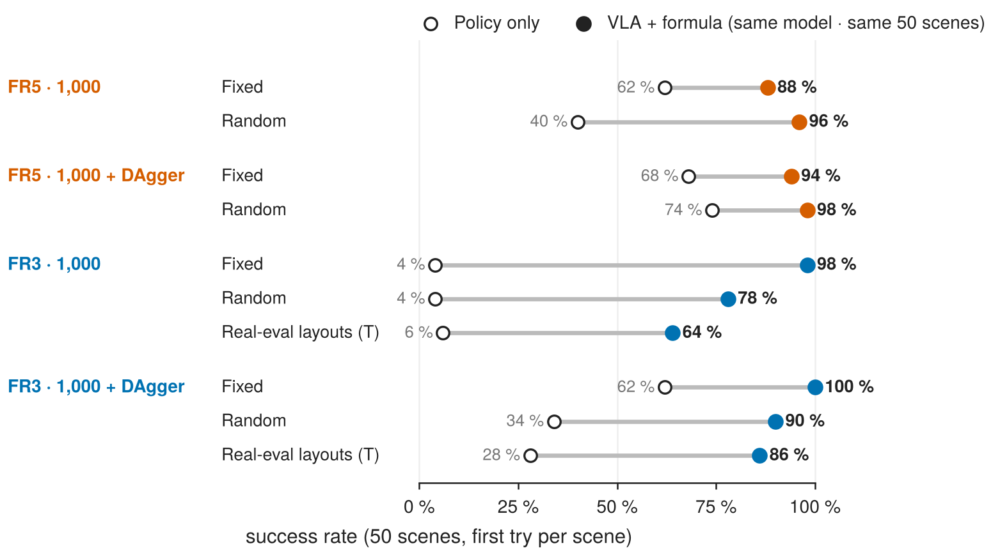

# Report 9 — Progress log 11-16 – 11-19: FR5 video format made the same as FR3, DAgger again, a check of the real-like formula, weaknesses of VLA + formula

2026-11-16 (Mon) – 11-19 (Thu) · Sim-to-Real Post-Training (simulation part) · Isaac Sim 6.0.1 · Isaac Lab 3.0 · GR00T N1.7 · [한국어](README.md)

The four days after publishing [Report 4](../report04_sim_bench/README_EN.md). Converting the FR5 training videos the same way as FR3 lifted the FR5 policy a lot, and we redid DAgger with that new model. In the last two days we checked the formula of VLA + formula under real-robot conditions, sorted out where VLA + formula fails (its weaknesses), and wrote the final report. **The FR5 numbers of this period replace the FR5 numbers of Report 4.**

**Summary figure** (labels in Korean). The same scene (random layout · scene 1) run with the policy alone before DAgger · the policy alone after DAgger · VLA + formula before DAgger. Top FR3, bottom FR5.

## Summary

- **11-16 — Next direction set to "where do the differences come from".** Find the sim ↔ real differences (FR5 physics · FR3 robot model), and take real-side information by reading only on the real team's computers.
- **11-17 — FR5 training videos made the same as FR3.** Instead of squashing 848×480 into 256×256, we keep 848×480 and let the model shrink it with the aspect ratio kept. With the same 1,000 demos, the same 50 scenes and the same physics, policy-only success went from 16 to 62 % on the fixed layout and from 26 to 40 % on the random layout.
- **11-17 – 18 — DAgger again with the new FR5 model,** because the failure shape changed (color-choice failures almost disappeared; "descending between the tubes" and "insertion failure above the slot" remained). The pre-registered main criterion (success over 100 fixed + random scenes) went from 51 to 71 %: increase.
- **11-18 — FR3 sim data will not be re-collected.** The remaining differences (grip width · arm sag) are fixed first, and if a re-collection becomes necessary it will include everything at once.
- **11-19 — The real-like formula was checked separately.** A formula that does not know the ground-truth positions (finds them with the camera) scored, on its own, FR5 32/50 · FR3 20/48 on the fixed layout. Every tube that was lifted was inserted; the failures were in finding and choosing the tube. The VLA + formula numbers in the report stay with the ground-truth formula, and this check continues as a side experiment.
- **11-19 — Weaknesses of VLA + formula sorted out.** The formula does not change the tube the policy chose, and it does not take over unless the policy comes close. All 12 failures of 200 FR5 VLA + formula trials were classified.

## 0. Terms used in this log

| Term | Meaning |
|---|---|
| 1,000 model · 1,000 + DAgger model | The two final models of this period (per robot). FR5 is trained with the same video format as FR3 |
| Ground-truth formula | VLA + formula where the formula uses the ground-truth positions known to the sim (caps · slot) — the report numbers |
| Real-like formula | A formula that, like the real one, finds the tubes and slot from camera images and coordinates (without the sim's ground truth) |
| Descending between the tubes | On the fixed layout with the red tube far away, the hand descends between the two tubes and the fingers rest on both caps |
| Insertion failure above the slot | On the random layout, the tube is carried above the red slot but not inserted (first failing stage S9) |
| 4:2:0 · 4:4:4 | How video stores color. 4:2:0 keeps color only at half resolution horizontally and vertically (ordinary video); 4:4:4 does not reduce it |

## 1. 11-16 (Mon) — Report 4 and the next direction

After publishing [Report 4](../report04_sim_bench/README_EN.md), we set the next direction (user).

- The final goal is to find **where the real-to-sim and sim-to-real differences come from**. The most important thing is the comparison with the real robots.
- For FR5, we want to match the sim robot physics to the real one. For FR3, we check whether an FR3 asset fits the real robot (impedance etc.) better than the Isaac default Panda asset we use now.
- Real-side information is taken by connecting over the lab network to the real team's computers (FR3 robot PC · FR5 control PC) **read-only**.

## 2. 11-17 (Tue) — FR5 training videos made the same as FR3

**Why.** FR5 training videos followed the real FR5 team's method and squashed 848×480 into 256×256 ignoring the aspect ratio, while FR3 kept 848×480 and let the model shrink it to 452×256 with the aspect ratio kept. If the two robots differ in training setup and data conversion, they cannot be compared (user — squashing to 256×256 is not right). The "red cap washed out in FR5 training videos" seen in Reports 7 · 8 was also related to this shrinking and compression.

**What we changed.** We rebuilt the same 1,000 FR5 demos with the same conversion as FR3 and retrained under the same conditions (batch size 64 × 20,000 · the same training config file).

**Figure 1.** FR5 sim bench success by training-video conversion. Same 1,000 demos · same 50 scenes · same physics. The bottom three rows are the models with DAgger added.

| FR5 · same 50 scenes · same physics | Policy only, fixed | Policy only, random | VLA + formula, fixed | VLA + formula, random |
|---|---|---|---|---|
| 256×256 · 4:2:0 (Report 4's recovery-demo model) | 16 % | 26 % | 58 % | 58 % |
| 256×256 · 4:4:4 (color preserved) | 26 % | 40 % | 56 % | 62 % |
| **848×480 → 452×256 · 4:2:0 (same conversion as FR3)** | **62 %** | **40 %** | **88 %** | **96 %** |

- The FR3 conversion made the largest difference in policy-only fixed-layout success (16 → 62 %), higher than preserving color alone (26 %).
- The new model failed differently. It almost never went to the yellow tube; the remaining failures were **"descending between the tubes" on the fixed layout (9 of the 25 red-far scenes)** and **"insertion failure above the slot" on the random layout (20 trials)**.
- Because the failure shape changed, we decided to redo DAgger with this model (user).

## 3. 11-17 – 18 — DAgger with the new FR5 model

The method is the same as in [Report 8](../report08_dagger_1114_1116/README_EN.md) — run the 1,000 model in 300 scenes different from the bench, let the formula take over when the policy goes off and correct it to the red tube and red slot, add only those segments to the 1,000 demos and retrain from scratch under the same conditions.

| Robot | Runs collected | Segments added | "Set time" (by rule, before results) |
|---|---|---|---|
| FR5 | 300 (physics jumps 0) | 597 (grasp 300 · insert 297) · 47,857 frames | 9 s — the 90th percentile of the time the 1,000 model first closed on red (6.86 s), rounded up to whole seconds |
| FR3 (11-15, [Report 8](../report08_dagger_1114_1116/README_EN.md)) | 300 | 449 | 21 s (same rule) |

**The main criterion stage was also chosen by rule before results.** "The stage where the most trials first failed among the 1,000 model's policy-only 100 fixed + random trials" was S9 (alignment above the slot · insertion, 26 trials), and passing S9 is the same as success.

| FR5 · policy only | Before DAgger | After DAgger | Verdict |
|---|---|---|---|
| **Main — success, 100 fixed + random scenes** | **51 %** | **71 %** | **Increase** |
| Success, fixed layout | 62 % | 68 % | No difference |
| Success, random layout | 40 % | 74 % | Increase |
| Went to the red tube in the 25 red-far scenes (reference) | 64 % | 96 % | Increase |
| Descending between the tubes in those 25 scenes (reference) | 9 trials | 1 trial | Decrease |
| Random layout · first failure at S9 (reference) | 20 trials | 8 trials | Decrease |

**Figure 2.** DAgger before and after with the new FR5 model (policy only). The main criterion and the verdict words follow rules set before the results.

- The random layout rose a lot because insertion failures dropped. Half of the added segments (297 insert segments) are insertions from where the policy actually missed above the slot, and we attribute the gain to them.
- On the fixed layout, fewer trials descended between the tubes or failed to lift, so more reached insertion, but trials that first failed at insertion rose from 6 to 12, and success showed no difference.
- VLA + formula was 94 % fixed · 98 % random.

- Both FR5 models were trained with the same training config file as their FR3 counterparts (checked field by field at the start of training).

## 4. 11-18 (Wed) — FR3 sim data will not be re-collected

- The FR3 sim data of the tube experiment (Isaac default Panda model) is not re-collected now. The remaining differences (grip width · arm sag) are fixed first, and if a re-collection becomes necessary, everything fixed so far goes in and it is collected only once.
- In the report, where using the Panda model shows no or little difference from the FR3 results, we write it as "a limit of sim-to-real", not a limit of the robot.
- DAgger clearly raised success; the next step is finding a way to raise **policy-only success** without the formula's help.

## 5. 11-19 (Thu) — Checking the real-like formula separately

**Question (user).** Shouldn't the formula in the sim bench's VLA + formula be under the same conditions as on the real robot? The real formula finds the tubes and slot from the camera and coordinates and does not know the ground-truth positions that only the sim knows. (The formula that collects data and the DAgger expert may use ground truth.)

**Method.** We ran the formula alone under real-robot conditions from start to finish, without the policy — the start scene is detected from the wrist camera (no sim ground truth), and it follows the same rules as the real formula (e.g. skip if the wrist must turn more than 30°). The sim has physical limits, so the formula's values (grasp depth · closing speed, etc.) may be tuned for the sim, but the pipeline structure stays the same as on the real robot.

| Real-like formula only (no policy) | Fixed layout | Random layout |
|---|---|---|
| FR5 | 32/50 | 25/50 |
| FR3 | 20/48 | 14/50 |

**Figure 3.** Results of running the real-like formula alone (no policy, first try per scene).

- **Every tube that was lifted was inserted.** Failures happened when finding, choosing and grasping the tube.
- FR5 failures: scenes that needed more than 30° of wrist rotation (skipped as by the real rule — 18 trials on the random layout), picking the yellow tube as red from the wrist image alone (the real robot double-checks with the third-person camera — not yet in the sim), and not finding the red tube.
- FR3 failures: empty grasps. The fingertips went exactly to the planned position and the tube had not moved before closing, but with a 2–3.5 mm error in the estimated cap position the sim FR3 gripper missed. FR5 has the sim grasp assist (25 mm), which covers this error.

**Decision (user, 11-19 20:30).** The VLA + formula numbers in the report stay as they are (ground-truth formula). The formula pipeline is a helper that raises grasp and insertion accuracy, so high sim success is considered within the normal range, and the real-like formula check continues as a side experiment.

**Next steps (order set in advance).** ① Choose candidates for the sim formula values (grasp depth · closing speed), pick them by a pre-set rule in scenes different from the bench, fix them, then check again ② add a third-person check of red on FR5 as on the real robot ③ do not change the handover rules ④ run a VLA + formula bench with the real-like formula as a side experiment.

## 6. 11-19 (Thu) — Weaknesses of VLA + formula

VLA + formula raised success over policy only in all 10 pairs compared. Still, it is not a cure-all. We classified all 12 failures of 200 trials across the four FR5 VLA + formula benches.

| Failure type | Trials |
|---|---|
| The formula did not take over (the policy did not come near the cap) | 2 |
| The formula's grasp came up empty | 4 |
| The held tube tilted 8.2° (limit 8°) and insertion stopped | 1 |
| Not fully inserted — aligned within 0.5–1.2 mm above the slot, but the tube ended 10–17 mm high (two were still sinking 2 s after release) | 3 |
| The policy chose the yellow tube and the formula inserted the yellow tube | 2 |

- Of the 10 failures after a takeover, 8 came **after the policy had first tried to close more than 25 mm away from the cap**.

**Figure 4.** Weaknesses of VLA + formula (labels in Korean). Top two = weakness ① the formula does not change the tube the policy chose (FR3 · FR5); bottom = weakness ② it does not take over unless the policy comes close (FR5).

**Weakness ① the formula does not change the tube the policy chose.** On FR3 (real-eval layout T04) and FR5 (fixed layout scene 50) the policy went to the yellow tube, and the formula grasped that yellow tube and inserted it into the red-ring hole. This is by design — if the formula picked a different tube, the result could not be called the policy's.

**Weakness ② it does not take over unless the policy comes close.** On FR5 (random layout scene 29), the point where the policy tried to close was outside the handover range (25 mm), so the formula never took over.

The scenes in the photos were chosen by a rule fixed before looking at results (in bench order · the smallest scene number in the first bench where that failure type appears).

## 7. 11-19 (Thu) — The final report

The results up to this period were written up as "Biotube report — FR3 · FR5 sim bench · DAgger · formula finish". So that first-time readers can follow, internal shorthand was replaced with descriptive names (e.g. "layout hesitation" → "descending between the tubes", "random-layout insertion" → "insertion failure above the slot"). The final numbers:

| Robot · model | Policy only, fixed | Policy only, random | VLA + formula, fixed | VLA + formula, random |
|---|---|---|---|---|
| FR5 · 1,000 | 62 % | 40 % | 88 % | 96 % |
| FR5 · 1,000 + DAgger | 68 % | 74 % | 94 % | 98 % |
| FR3 · 1,000 | 4 % | 4 % | 98 % | 78 % |
| FR3 · 1,000 + DAgger | 62 % | 34 % | 100 % | 90 % |

**Figure 5.** Final numbers — policy only (open dot) and VLA + formula (filled dot), same model · same 50 scenes.

The same 50 scenes not used in training, first try per scene. On the FR3 real-eval layouts, the 1,000 model scored 6 % → DAgger 28 % (VLA + formula 64 → 86 %).

**Read with care.** Sim numbers are not predictions of real success — they are a tool for comparing models within the same sim and the same physics. FR5 sim success relies on a grasp assist the real robot does not have, and FR3 sim has no such assist. The fixed layout is in effect two layouts × 25 scenes, so performance at unseen positions is read from the random layout.

## 8. Next (after the exam period)

- Real-like formula: choose the formula values → check again, FR5 third-person red check, VLA + formula side bench.
- Compare the real team's real evaluations of the two FR5 models with the sim using the same S0–S9.
- One next experiment: DAgger round 2 · simplifying the FR5 gripper model · the yellow-ring task · reinforcement-learning fine-tuning · GR00T N2 (expected in December).

## Appendix. Records for this period

Final report (11-19) · development notes 38–40 (workstation) · bench records (`progress/bench_results.jsonl`). All numbers are real-matched sim · the same 50 scenes not used in training (first try per scene · physics jump = failure). FR5 benches ran with the sim grasp assist on.
